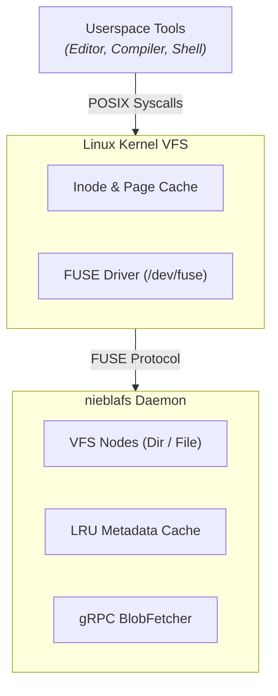
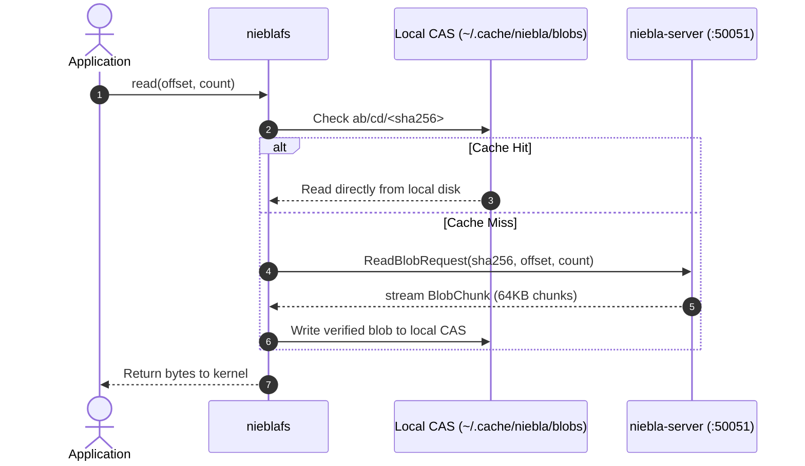

**NieblaFS** (`nieblafs`) is the userspace [FUSE](https://en.wikipedia.org/wiki/Filesystem_in_Userspace) daemon that mounts Niebla workspaces on Linux workstations. It exposes multi-gigabyte [monorepos](https://en.wikipedia.org/wiki/Monorepo) as local directories in under 100 milliseconds without downloading the full repository tree upfront.

---

## 1. Kernel-to-Userspace Interface (`/dev/fuse`)

[FUSE (*Filesystem in Userspace*)](https://en.wikipedia.org/wiki/Filesystem_in_Userspace) is a Linux kernel module that routes filesystem calls (`open`, `read`, `write`, `stat`, `readdir`) from applications to an unprivileged userspace process via `/dev/fuse`.



When an application opens a file in a mounted workspace:
1. The Linux [Virtual File System (VFS)](https://en.wikipedia.org/wiki/Virtual_file_system) routes a lookup request through `/dev/fuse` to `nieblafs`.
2. `nieblafs` resolves the path against its [whiteout markers](https://en.wikipedia.org/wiki/Union_mount), local scratch folder, and in-memory [Merkle tree](https://en.wikipedia.org/wiki/Merkle_tree) metadata cache.
3. Unopened files consume **0 bytes** on disk until a process actually calls `read()`.

---

## 2. Three-Tier Workspace Storage

`nieblafs` combines three storage tiers into a single unified directory tree:

1. **Tier 1 — Base Merkle Tree (Read-Only):** The immutable snapshot of the repository at the workspace's base Changelist (CL).
2. **Tier 2 — In-Memory [LRU](https://en.wikipedia.org/wiki/Cache_replacement_policies#Least_recently_used_(LRU)) Metadata Cache:** Caches directory manifests (`NodeEntry`: name, mode, size, [SHA-256](https://en.wikipedia.org/wiki/SHA-2)) and synthetic 64-bit [inode](https://en.wikipedia.org/wiki/Inode) numbers so `ls`, `stat`, and tree walks do not make repeated [gRPC](https://en.wikipedia.org/wiki/GRPC) calls.
3. **Tier 3 — [Copy-on-Write (CoW)](https://en.wikipedia.org/wiki/Copy-on-write) Scratch Layer (Read-Write):** A local directory (`~/.niebla/workspaces/<name>/scratch/`) that stores all modified files, newly created files, and deletion markers.

---

## 3. On-Demand Blob Streaming & Singleflight Coalescing

When a process reads an unmodified file:



* **Local [CAS](https://en.wikipedia.org/wiki/Content-addressable_storage) Cache Hit:** If `~/.cache/niebla/blobs/ab/cd/<sha256>` already exists on disk (even if downloaded by a different workspace), `nieblafs` reads directly from local storage with zero network traffic.
* **Singleflight Coalescing:** If a compiler spawns 16 threads that read the same uncached file simultaneously, `nieblafs` coalesces them with `singleflight.Group` so only a single gRPC stream is requested from `niebla-server`.

---

## 4. Writes & Whiteout Deletions

### Copy-on-Write (CoW) Promotion
When a process opens a base file for writing or truncation:
1. `nieblafs` creates the parent directory path inside `~/.niebla/workspaces/<name>/scratch/`.
2. It copies the base file into scratch before applying the modification.
3. Subsequent reads and writes on that file route directly to the local scratch file.

### OverlayFS-Style Whiteout Markers
Because the base Merkle tree is immutable, deleting a file (`rm path/to/file.go`) cannot remove the base blob. Instead, `nieblafs`:
1. Removes any copy in the scratch directory.
2. Creates an empty [whiteout marker](https://en.wikipedia.org/wiki/Union_mount) file:
   ```text
   ~/.niebla/workspaces/<name>/scratch/path/to/.wh.file.go
   ```
3. Suppresses `file.go` from directory listings (`ReadDirAll`) and returns `ENOENT` on `Lookup` calls.

---

## 5. `nieblafs` Daemon CLI Reference

`nieblafs` is normally spawned and supervised automatically by `niebla workspace create` and `niebla workspace mount`, but it can also be invoked directly:

```bash
nieblafs --mount <dir> --scratch <dir> --server <host:port> [flags]
```

| Flag | Default | Description |
| :--- | :--- | :--- |
| `--mount <path>` | *(Required)* | Directory where the virtual FUSE filesystem is mounted. |
| `--scratch <path>` | *(Required)* | Local directory for modified, added, and `.wh.*` whiteout files. |
| `--server <addr>` | `127.0.0.1:50051` | Address of the `niebla-server` gRPC instance. |
| `--cache <path>` | `~/.cache/niebla/blobs` | Shared local CAS cache directory for downloaded blobs. |
| `--socket <path>` | *(Optional)* | [UNIX domain socket](https://en.wikipedia.org/wiki/Unix_domain_socket) (`nieblafs.sock`) used by `niebla` for health checks and `niebla sync` re-anchoring. |
| `--debug` | `false` | Enables verbose FUSE operation logging to stderr. |

### Unmounting & Recovery
To detach a workspace cleanly without deleting scratch edits, run `niebla workspace unmount <name>` (or `fusermount3 -u <mount-path>`). If a daemon process crashes and leaves a stale mount point, see the [Troubleshooting Guide](/niebla/workflows/troubleshooting/#1-fuse-virtual-filesystem-failures).

For environments without `/dev/fuse` (such as macOS or unprivileged CI containers), see [Direct Materialization Mode (`--no-fuse`)](/niebla/workflows/direct-materialization/).
