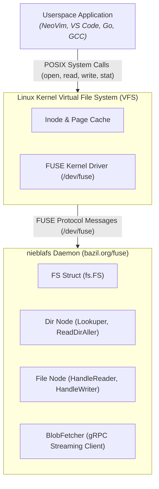
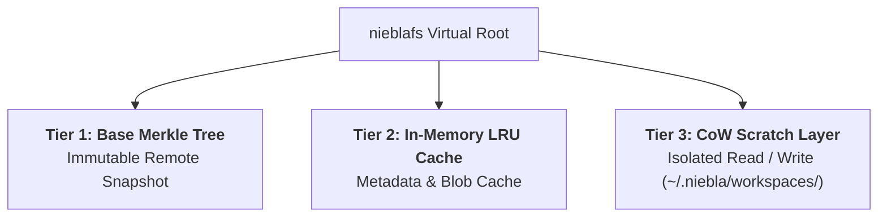
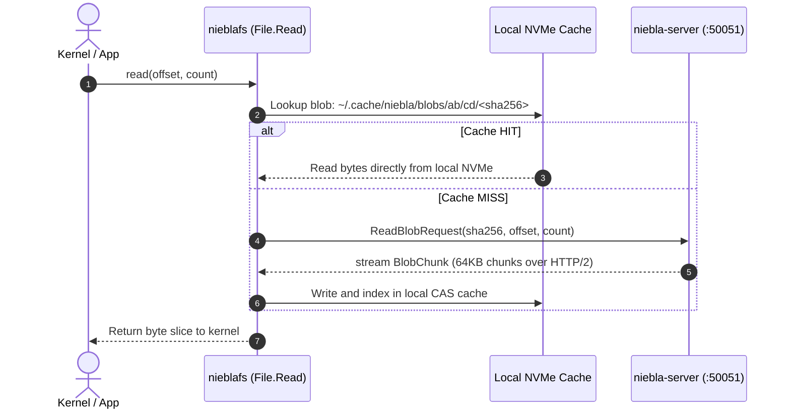

**NieblaFS** is the virtual filesystem daemon powering Niebla workspaces. It enables developers to interact with multi-gigabyte or terabyte monorepos as if they were present on local disk, without requiring full downloads or disk-space exhaustion.

This document explains what FUSE is, how `nieblafs` interacts with the Linux kernel VFS, how on-demand blob streaming functions, and how Copy-on-Write (CoW) scratch overlays and whiteout deletions are implemented in pure Go.

---

## 1. Why a FUSE Virtual Monorepo?

In conventional Git workflows, accessing a repository requires:
1. Cloning gigabytes of packed commit history (`.git/objects/pack/`).
2. Materializing thousands or millions of physical inodes onto local NVMe/SSD storage.
3. Running background fetchers or Git-LFS sidecars for binary assets.

As monorepos scale to millions of files, this model breaks down: `git status`, `git checkout`, and branch switches become painfully slow due to filesystem I/O saturation.

Inspired by Google's **Clients in the Cloud (CitC)**, Niebla inverts this model:
* **Instant Workspace Mounts:** Creating a workspace (`niebla workspace create`) takes **less than 100 milliseconds**, regardless of repository size.
* **Zero Initial Blob Downloads:** Only directory names and metadata inodes are materialized. File contents are streamed lazily over gRPC only when an application (editor, linter, compiler) actually requests bytes.
* **Isolated Copy-on-Write (CoW) Scratch:** Edits never touch the base tree. Modifications live in an isolated local scratch overlay, making workspace state clean, throwaway, and easy to diff.

---

## 2. Kernel-to-Userspace Interface (`/dev/fuse`)

FUSE (**Filesystem in Userspace**) is a Linux kernel subsystem that delegates filesystem system calls to an unprivileged userspace daemon.



When an application invokes `open("/path/to/workspace/main.go")`:
1. The Linux VFS determines that the mount point is controlled by FUSE.
2. The kernel routes a `FUSE_LOOKUP` request through the `/dev/fuse` character device.
3. The `nieblafs` daemon reads the request, checks its local metadata cache, and returns a synthetic inode attribute struct.
4. The kernel validates permissions and returns a valid file descriptor to the calling application.

---

## 3. The Three-Tier Storage Topology

NieblaFS organizes workspace data into three distinct tiers:



### Tier 1: Immutable Base Merkle Tree
* Represents a snapshot of the monorepo at a specific Changelist (CL) or trunk revision.
* Stored on the central `niebla-server`. Directory structures are serialized as recursive Merkle trees containing SHA-256 hashes of subdirectories and leaf files.
* Completely read-only.

### Tier 2: In-Memory LRU Cache (`hashicorp/golang-lru/v2`)
* Maintained by `metadata.MetadataCache` inside the `nieblafs` daemon process.
* Caches directory listings and node entries (`NodeEntry`: name, size, mode, SHA-256).
* Ensures repeated `ls`, `stat`, or tree traversals do not make redundant gRPC round-trips to `niebla-server`.

### Tier 3: Copy-on-Write (CoW) Scratch Layer

A private directory on local disk (or `/scratch/niebla/workspaces/<workspace-name>/` in multi-tenant environments):

```bash
~/.niebla/workspaces/<workspace-name>/scratch/
```

Whenever a developer creates, writes, or modifies a file, the modified bytes are stored exclusively in this directory.

---

## 4. On-Demand Blob Streaming & Fetching

When an application calls `read(fd, buf, count)` on an unmodified file:



### Execution Lifecycle:
1. **`nieblafs File.Read()` Invocation**: The kernel invokes `File.Read()` with the requested byte `offset` and buffer `size`.
2. **Local CAS Verification**: `nieblafs` checks if the blob exists in `~/.cache/niebla/blobs/ab/cd/<sha256>`.
   * **Cache HIT**: Reads bytes directly from local NVMe storage at the requested offset with zero network latency.
   * **Cache MISS**: Calls the remote gRPC `BlobFetcher`:
     1. Issues `ReadBlobRequest(sha256, offset, length)` to `niebla-server`.
     2. `niebla-server` streams 64KB chunks (`stream BlobChunk`) over HTTP/2.
     3. `nieblafs` buffers incoming chunks, persists the object into local CAS storage, and returns the requested slice to the kernel.

### Singleflight Request Coalescing
If a build tool (e.g. Bazel, Go compiler) spawns 16 parallel threads that all read `go.mod` at the exact same millisecond:
* `nieblafs` employs in-flight request coalescing (using Go `singleflight.Group`).
* Only **one** gRPC network request is sent to `niebla-server`. The remaining 15 concurrent callers wait for the single stream to complete and read from the freshly populated cache.

---

## 5. Mutation Handling & Whiteout Deletions

NieblaFS handles mutations without altering the base tree.

### File Modifications (Copy-on-Write Promotion)
When `write()` or `truncate()` is called on a virtual base file:
1. `nieblafs` detects that `isScratch == false`.
2. It creates the parent directory hierarchy inside the scratch directory.
3. If the write is partial (e.g. appending bytes or modifying a few lines), `nieblafs` lazily copies the base file contents into the scratch file before applying the edit.
4. The inode handle is updated: all subsequent reads and writes target the scratch file directly.

### File Deletions & Unlinks (Whiteouts)
POSIX filesystems require that deleting a file immediately hides it from subsequent `lookup()` and `readdir()` calls. Since `nieblafs` cannot delete files from the immutable remote base tree, it implements **OverlayFS-style whiteout markers**:

1. When a user runs `rm path/to/file.go`:
   * The kernel issues `FUSE_UNLINK`.
   * `nieblafs` removes any modified version in the scratch directory.
   * `nieblafs` creates an empty marker file:

```bash
~/.niebla/workspaces/<name>/scratch/path/to/.wh.file.go
```

2. During `ReadDirAll()` and `Lookup()`:
   * `nieblafs` inspects the scratch directory for `.wh.*` prefix files.
   * If `.wh.file.go` exists, `nieblafs` suppresses `file.go` from the virtual directory listing and returns `ENOENT` on direct lookups.
   * Compilers, IDEs, and `ls` see the file as completely deleted.

---

## 6. The Go VFS Node & Handle Implementation

The implementation in [`cmd/nieblafs/internal/fs/`](https://github.com/mrtnzjsh/niebla/tree/main/niebla/cmd/nieblafs/internal/fs) maps FUSE interfaces to Go types:

```go
// Directory node: handles path component resolution
type Dir struct {
    fs    *FS
    path  string
    inode uint64
}

// Inode lookup: resolves name across whiteouts, scratch, and base tree
func (d *Dir) Lookup(ctx context.Context, name string) (fs.Node, error) {
    // 1. Check if name is hidden by a whiteout file (.wh.<name>)
    if d.fs.isWhiteout(d.path, name) {
        return nil, syscall.ENOENT
    }
    // 2. Check scratch overlay on local disk
    if scratchNode, ok := d.fs.lookupScratch(d.path, name); ok {
        return scratchNode, nil
    }
    // 3. Fallback to base Merkle tree metadata
    return d.fs.lookupBase(ctx, d.path, name)
}

// File node: supports Copy-on-Write promotion and on-demand streaming
type File struct {
    fs          *FS
    path        string
    scratchPath string
    blobHash    string
    size        int64
    mode        uint32
}

func (f *File) Read(ctx context.Context, req *fuse.ReadRequest, resp *fuse.ReadResponse) error {
    if f.scratchPath != "" {
        return readFromFileAt(f.scratchPath, req.Offset, req.Size, resp)
    }
    return f.fs.Fetcher.FetchBlobChunk(ctx, f.blobHash, req.Offset, req.Size, resp)
}
```

---

## 7. macOS & Container Fallback: Direct Materialization (`--no-fuse`)

While FUSE is standard on Linux workstations, some environments cannot load kernel extensions:
* **macOS without macFUSE / FUSE-T**: Apple requires kernel extension approvals and system reboots for third-party kexts.
* **Restricted Containers (Docker / Podman / Kubernetes)**: CI runners running without `--privileged` or `/dev/fuse` access.

For these environments, Niebla provides a transparent fallback:

```bash
niebla workspace create my-feature --no-fuse --server <server-host>:50051
```

### How `--no-fuse` Works:
1. The `niebla` CLI calls `GetTree` over gRPC and streams blob contents into a standard physical directory on disk (`~/.niebla/workspaces/<name>/work/`).
2. Standard OS file system calls operate directly on disk without `/dev/fuse`.
3. When running `niebla status` or `niebla shelve`, the CLI traverses the physical tree, computes cryptographic SHA-256 digests, and generates the exact same patchset Merkle tree as the FUSE version.

---

## 8. Daemon Lifecycle & Supervision

When running under full FUSE mode, `nieblafs` runs as a supervised background daemon.

### Mount Daemon

```bash
nieblafs --mount /path/to/mount --scratch /path/to/scratch --server <server-host>:50051 --socket /path/to/nieblafs.sock
```

The daemon exposes a UNIX domain socket (`nieblafs.sock`) allowing the `niebla` CLI to poll mount health, query cache statistics, or trigger cache flushes.

### Graceful Unmounting

```bash
fusermount -u /path/to/mount
```

`nieblafs` intercepts `SIGINT` / `SIGTERM`, flushes dirty write buffers, closes open file handles, and cleanly detaches from `/dev/fuse`.
