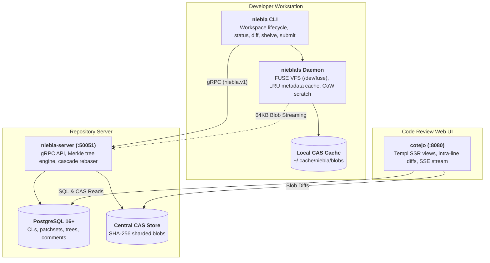

Niebla separates local workspace operations from canonical repository storage. Workstations never download full repository histories; instead, they mount lightweight workspaces and communicate with a central server over [gRPC](https://en.wikipedia.org/wiki/GRPC).

---

## 1. Component Overview

Niebla consists of four statically compiled Go binaries:

| Binary | Role | Key Responsibilities |
| :--- | :--- | :--- |
| `niebla` | Developer CLI | Creates workspaces, calculates `O(changed)` status and diffs against base [Merkle trees](https://en.wikipedia.org/wiki/Merkle_tree), shelves patchsets, and submits CLs to trunk. See [CLI Command Reference](/niebla/reference/cli/). |
| `nieblafs` | Virtual Filesystem Daemon | Mounts workspaces via Linux `/dev/fuse` ([FUSE](https://en.wikipedia.org/wiki/Filesystem_in_Userspace)), serves directory trees from memory, streams file blobs on demand, and redirects writes to a [Copy-on-Write (CoW)](https://en.wikipedia.org/wiki/Copy-on-write) scratch folder. See [NieblaFS Internals](/niebla/architecture/fuse-internals/). |
| `niebla-server` | Central Repository Daemon | Authoritative gRPC service (`:50051`) managing [Content-Addressable Storage (CAS)](https://en.wikipedia.org/wiki/Content-addressable_storage), PostgreSQL metadata, linear trunk revisions, and automated cascade rebases. See [Repository Server](/niebla/components/server/). |
| `cotejo` | Web Code Review Server | Web interface (`:8080`) for reviewing patchsets, intra-line word diffs, threaded comments, attention sets, and one-click code suggestions. See [Cotejo Overview](/niebla/cotejo/overview/). |

---

## 2. Technology Stack

* **Language & Packaging:** Written in Go 1.26 (`CGO_ENABLED=0`) and packaged declaratively with [Nix](https://en.wikipedia.org/wiki/Nix_(package_manager)) (`flake.nix`).
* **Virtual Filesystem:** `bazil.org/fuse` for `/dev/fuse` communication and `hashicorp/golang-lru/v2` for in-memory [LRU](https://en.wikipedia.org/wiki/Cache_replacement_policies#Least_recently_used_(LRU)) directory and [inode](https://en.wikipedia.org/wiki/Inode) caching.
* **RPC & Streaming:** HTTP/2 [gRPC](https://en.wikipedia.org/wiki/GRPC) with [Protocol Buffers](https://en.wikipedia.org/wiki/Protocol_Buffers) v3 (`niebla.v1`). File transfers stream in fixed 64 KB chunks (`stream BlobChunk`) without buffering entire files in RAM.
* **Database:** PostgreSQL 16+ accessed via `jackc/pgx/v5` and compile-time type-safe SQL generated by `sqlc`. Trunk commits serialize using transaction-scoped advisory locks (`pg_advisory_xact_lock`).
* **Content-Addressable Storage (CAS):** Blobs are stored by [SHA-256](https://en.wikipedia.org/wiki/SHA-2) hash using a two-level directory fanout (`ab/cd/<sha256>`) and compressed with [Zstandard (`zstd`)](https://en.wikipedia.org/wiki/Zstandard).
* **Web Review UI:** Server-side HTML templates compiled ahead of time with `a-h/templ`, syntax-highlighted intra-line diffs via `alecthomas/chroma/v2` and `sergi/go-diff`, and real-time browser updates over [Server-Sent Events (SSE)](https://en.wikipedia.org/wiki/Server-sent_events).
* **Configuration:** Validated [TOML](https://en.wikipedia.org/wiki/TOML) files (`pelletier/go-toml/v2`) under `~/.config/niebla/` for host settings and `.niebla/` for in-tree governance.

---

## 3. End-to-End Request Flow

1. **Edit (`nieblafs`):** When you edit a file inside a mounted workspace, `nieblafs` intercepts the write call and copies the file into your local scratch directory (`~/.niebla/workspaces/<ws>/scratch/`).
2. **Inspect (`niebla status` / `diff`):** The CLI scans only the local scratch directory, comparing modified files and `.wh.*` deletion markers against the base changelist's Merkle tree.
3. **Shelve (`niebla shelve`):** The CLI streams modified scratch files to `niebla-server` via `UploadBlob`, builds a new Merkle root hash, and calls `ShelveCL` to record a new changelist or patchset in PostgreSQL.
4. **Review (`cotejo`):** Reviewers open the changelist URL in Cotejo, inspect side-by-side or inter-patchset diffs, leave inline comments, and approve (`LGTM`).
5. **Submit (`niebla submit`):** `niebla-server` acquires `pg_advisory_xact_lock`, verifies `OWNERS.toml` approvals, resolved comments, and green CI runs, advances the trunk revision counter, and automatically rebases any child changelists stacked on top.

---

## 4. Network & Privacy Boundaries

Niebla is self-hosted open-source software (MIT License) with **zero telemetry**:
* None of the four binaries phone home, collect usage analytics, or contact external servers on their own.
* All workspace traffic flows strictly between your workstation (`niebla` / `nieblafs`) and your own `niebla-server`.
* Outbound network connections from `niebla-server` or `cotejo` occur only if you explicitly configure webhooks (`[events]`), external CI runners (`[ci]`), remote backup targets (`[resilience]`), or an LLM API (`[critique.ai]`).

---

## Component Deep Dives

* **[NieblaFS (Virtual Filesystem)](/niebla/architecture/fuse-internals/):** Kernel VFS integration, lazy blob streaming, CoW scratch overlays, and `nieblafs` flags.
* **[CAS & Merkle Trees](/niebla/components/cas-storage/):** SHA-256 blob sharding, atomic writes, and 3-way Merkle tree merges.
* **[Repository Server (`niebla-server`)](/niebla/components/server/):** Database schema, trunk serialization locks, and cascade rebasing.
* **[Security & Authentication](/niebla/reference/security-auth/):** Bearer tokens, TLS 1.3, proxy headers, and webhook signatures.
