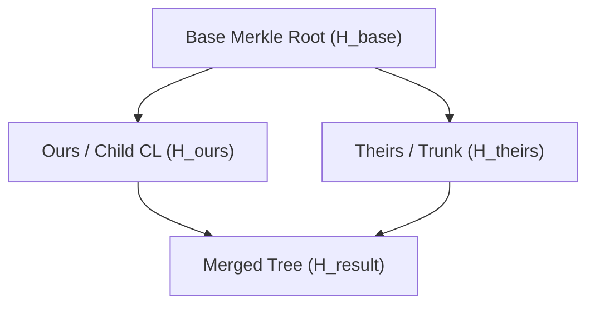

Niebla stores all file contents and directory manifests in **[Content-Addressable Storage (CAS)](https://en.wikipedia.org/wiki/Content-addressable_storage)** (`pkg/cas/`) and **[Merkle Trees](https://en.wikipedia.org/wiki/Merkle_tree)** (`pkg/tree/`). Every object—whether a 10-line source file or a multi-gigabyte binary—is addressed by its [SHA-256](https://en.wikipedia.org/wiki/SHA-2) hash.

---

## 1. Two-Level Directory Sharding

Storing millions of blobs in a single flat directory degrades filesystem lookup performance. Niebla partitions blobs using a two-level hex prefix (`cas.RelativeBlobPath`):

```text
${CAS_BASE_DIR}/
├── .tmp/                          # Staging directory for in-flight uploads
│   └── upload_9b2d8f1e.tmp
├── 2d/                            # First 2 hex characters
│   └── d4/                        # Next 2 hex characters
│       └── 2dd4bf38a1c9e8f0...    # Full 64-character SHA-256 filename
└── f4/
    └── 3f/
        └── f43f5e921b7a0d4c...
```

* **Global Deduplication:** Identical files across any number of workspaces or changelists share the exact same SHA-256 digest and are stored once on disk.
* **Portable Relative Paths:** PostgreSQL records only the relative path (`ab/cd/<sha256>`), allowing the CAS directory to be moved across disks or [ZFS](https://en.wikipedia.org/wiki/ZFS) datasets without updating database rows.

---

## 2. Atomic Write Protocol

To guarantee readers never observe partial or corrupted files during concurrent uploads:

1. **Stage:** `UploadBlob` streams incoming 64 KB chunks to a temporary file in `${CAS_BASE_DIR}/.tmp/`.
2. **Verify:** An incremental `crypto/sha256` hasher computes the digest while streaming.
3. **Commit:** Once the stream finishes and the SHA-256 hash is verified, the server atomically renames (`os.Rename`) the file into `ab/cd/<sha256>`.

---

## 3. Merkle Tree Serialization (`pkg/tree`)

Each directory in the repository is represented as a sorted manifest of `NodeEntry` records:

```go
type NodeEntry struct {
    Name        string // File or directory name
    Mode        uint32 // POSIX permissions (0644, 0755, etc.)
    Size        uint64 // Uncompressed byte size
    BlobSHA256  []byte // SHA-256 of file content (nil for directories)
    SubTreeHash []byte // Merkle hash of child directory (nil for files)
}
```

1. Entries are sorted [lexicographically](https://en.wikipedia.org/wiki/Lexicographic_order) by `Name`.
2. The SHA-256 hash of the serialized manifest becomes that directory's `TreeHash`.
3. When a single file changes, only that file and its ancestor directories recompute their hashes up to the root. Unmodified subtrees keep their existing hashes and are shared across revisions.

---

## 4. Three-Way Merkle Tree Merges

When a parent changelist lands on trunk or you run `niebla sync`, Niebla executes a [three-way tree merge](https://en.wikipedia.org/wiki/Merge_(version_control)#Three-way_merge) (`pkg/tree/merge.go`) between **Base**, **Ours** (child workspace/CL), and **Theirs** (updated parent/trunk):



Because every directory has a deterministic Merkle hash, the merge engine skips unchanged subtrees in $O(1)$ time:
* If `H_ours == H_theirs`: Both sides are identical; keep `H_ours`.
* If `H_base == H_ours`: Only upstream modified this directory; fast-forward the entire subtree to `H_theirs` without inspecting individual files.
* If `H_base == H_theirs`: Only the child modified this directory; keep `H_ours`.
* If all three hashes differ: Recurse into the directory. Line-level 3-way diffing (`pkg/tree/diff3.go`) runs only when both sides modified the exact same leaf file.
