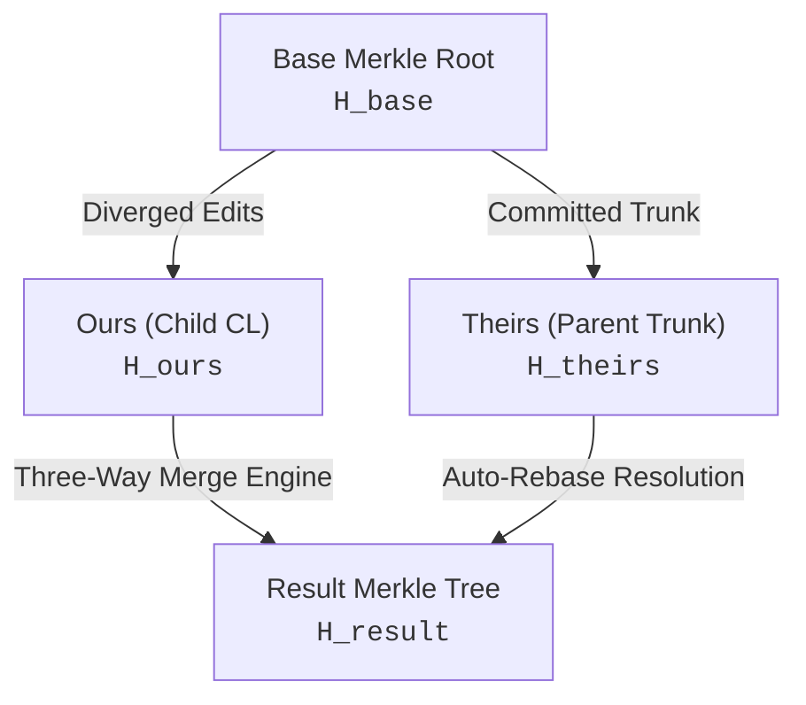

At the heart of Niebla's scale and performance is its **Content-Addressable Storage (CAS)** and **Merkle Tree Serialization** subsystem ([`pkg/cas/`](https://github.com/mrtnzjsh/niebla/tree/main/niebla/pkg/cas) and [`pkg/tree/`](https://github.com/mrtnzjsh/niebla/tree/main/niebla/pkg/tree)).

This subsystem eliminates Git's packfile bloat, makes Git-LFS obsolete by design, and enables automated, three-way Merkle tree rebases in constant time.

---

## 1. Why CAS Over Git Packfiles?

In Git, files are stored as objects inside packfiles (`.git/objects/pack/*.pack`) with delta compression chains:
* **The Scale Wall:** When large binaries, models, or datasets are committed, packfiles swell to gigabytes. Unpacking, repacking, or checking out branches requires traversing long delta chains, saturating memory and CPU.
* **The Git-LFS Compromise:** Git-LFS was retrofitted onto Git by replacing files with pointer stubs that talk to an external S3 server. This splits version control into two disconnected systems, complicating branch operations and offline development.

### Niebla's Unified Design:
* **Everything is a CAS Blob:** Source code, compiler artifacts, and 10GB dataset binaries are stored using the exact same unified CAS engine.
* **Deduplication by Default:** Because blobs are identified solely by their cryptographic SHA-256 digest, identical files committed across thousands of workspaces or changelists occupy physical disk space **exactly once**.
* **Zero Packfile Repacking:** Objects are written once as immutable, atomic files. There are no packfiles to corrupt, unpack, or re-index.

---

## 2. Directory Sharding & Storage Layout

Writing millions of files into a single flat directory causes severe filesystem performance degradation due to directory lock contention and B-tree leaf fragmentation.

Niebla avoids this using a **two-level prefix fanout scheme** implemented in `cas.RelativeBlobPath`:

```
${CAS_BASE_DIR}/
├── .tmp/                          # Staging area for atomic writes
│   └── 9b2d8f1e-...
│
├── 2d/                            # Level 1: First 2 hex characters
│   └── d4/                        # Level 2: Next 2 hex characters
│       └── 2dd4bf38a1c9e8f0...    # Full 64-character SHA-256 file
│
└── f4/
    └── 3f/
        └── f43f5e921b7a0d4c...
```

### Path Resolution Logic
```go
// RelativeBlobPath returns the portable relative key: ab/cd/<sha256Hex>
func RelativeBlobPath(sha256Hex string) (string, error) {
    if len(sha256Hex) < 4 {
        return "", fmt.Errorf("invalid sha256 hex string: too short")
    }
    part1 := sha256Hex[0:2]
    part2 := sha256Hex[2:4]
    return filepath.ToSlash(filepath.Join(part1, part2, sha256Hex)), nil
}
```

By storing relative keys (`ab/cd/<hash>`) in PostgreSQL, storage volumes can be migrated, mounted over NFS/Ceph, or backed up to cloud object storage without needing path updates in the database.

---

## 3. Atomic Write Protocol

To prevent partial, corrupted, or aborted uploads from being read by other clients:

1. **Streaming to Staging:** When `UploadBlob` gRPC is called, `niebla-server` streams incoming chunks into a random temporary file in `${CAS_BASE_DIR}/.tmp/upload_<uuid>.tmp`.
2. **Streaming SHA-256 Verification:** As chunks pass through the server's streaming pipeline, an incremental `crypto/sha256` hasher computes the digest on-the-fly.
3. **Atomic POSIX Rename:** Once the stream closes:
   * The server compares the computed hash against the client's assertion.
   * If valid, the parent directories (`ab/cd/`) are created if missing.
   * The temporary file is moved to its permanent path using `os.Rename`. On POSIX filesystems, `rename()` is an atomic kernel operation: readers either see the complete, verified blob or nothing.

---

## 4. Merkle Tree Serialization (`pkg/tree`)

Directory hierarchies are stored as **Merkle Trees**. A directory tree consists of an ordered manifest of `NodeEntry` structs:

```go
type NodeEntry struct {
    Name        string // Entry filename or directory name
    Mode        uint32 // POSIX permissions (e.g. 0644, 0755)
    Size        uint64 // Uncompressed byte length
    BlobSHA256  []byte // SHA-256 digest of file content (nil for dirs)
    SubTreeHash []byte // Merkle hash of sub-tree (nil for files)
}
```

### Deterministic Tree Hashing
1. Directory entries are strictly sorted lexicographically by name (`sort.Slice(entries, ...)`).
2. Each entry is serialized using a fixed-width binary format.
3. The SHA-256 digest of the serialized manifest becomes the directory's `TreeHash`.
4. If a file changes deep within the monorepo, only the changed file and its parent directories update their hashes up to the root. Unmodified subtrees retain their existing hashes and are shared globally across all revisions.

---

## 5. Three-Way Merkle Merge Engine (`pkg/tree/merge.go`)

When a parent changelist lands on trunk or a developer runs `niebla sync`, Niebla performs automated **Three-Way Tree Merges** ([`pkg/tree/merge.go`](https://github.com/mrtnzjsh/niebla/blob/main/niebla/pkg/tree/merge.go)):

$$\text{Result Tree} = \text{Merge3}(\text{Base Tree}, \text{Ours (Child CL)}, \text{Theirs (Parent Committed)})$$



### Fast-Path Optimization
Because directories are Merkle trees, the merge engine compares hashes at the directory level:
* **Case 1:** If `H_ours == H_theirs`, no changes were made $\to$ retain `H_ours`.
* **Case 2:** If `H_base == H_ours`, only the parent modified this subtree $\to$ fast-forward to `H_theirs` without inspecting children!
* **Case 3:** If `H_base == H_theirs`, only the child modified this subtree $\to$ retain `H_ours`.
* **Case 4:** If all three hashes differ, the engine recurses into the subdirectory. Only when two independent edits collide on the exact same leaf file does the engine fall back to line-by-line diffing ([`pkg/tree/diff3.go`](https://github.com/mrtnzjsh/niebla/blob/main/niebla/pkg/tree/diff3.go)).

This design allows stacked changelists spanning millions of files to rebase in **a few milliseconds**.
