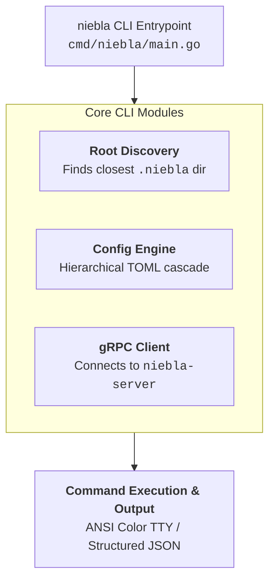

The `niebla` executable is the primary command-line interface for engineers and automated AI coding agents. It provides workspace virtualization management, fast change inspection against base Merkle trees, changelist shelving, and trunk submissions.

---

## 1. Architecture & Execution Model

The CLI is structured into modular Cobra commands ([`internal/cli/`](https://github.com/mrtnzjsh/niebla/tree/main/niebla/internal/cli)):



### Workspace Root Discovery
When `niebla` is executed from any subdirectory:
1. It traverses upwards from `$PWD` searching for a `.niebla/` control directory.
2. If found, it reads `.niebla/workspace.toml` to identify the active workspace ID, base changelist number, and remote server endpoint.
3. If not inside a virtual workspace, it resolves global settings from `~/.config/niebla/config.toml`.

---

## 2. Core Command Subsystems

### 1. Workspace Lifecycle (`niebla workspace`)
Manages virtual directories on local workstations:
* `niebla workspace create <name> [--base-cl <id>] [--no-fuse] [--server <host:port>]`
  * Calls `CreateWorkspace` on `niebla-server`.
  * Creates scratch directory (`~/.niebla/workspaces/<name>/scratch`).
  * In FUSE mode: Launches background `nieblafs` daemon and mounts virtual VFS.
  * In `--no-fuse` mode: Materializes tree inodes directly to disk.
* `niebla workspace list`: Displays all active local workspaces, mount status, and associated base CL revisions.
* `niebla workspace destroy <name>`: Gracefully unmounts `nieblafs` and cleans up scratch storage.
* `niebla workspace sync`: Pulls the latest trunk revision or rebased parent patchsets, updating the virtual base tree.

### 2. Change Detection Algorithm (`niebla status`)
Unlike `git status`, which must stat millions of clean repository files across disk, Niebla's change detection is instantaneous:
1. The CLI queries the local scratch directory (`~/.niebla/workspaces/<name>/scratch/`).
2. Only files that were modified or newly created exist in scratch.
3. For modified files: Compares scratch SHA-256 against the base Merkle tree entry.
4. For deleted files: Scans for `.wh.<filename>` whiteout markers.
5. Ignores matches against `.nieblaignore` rules.
6. Execution time is proportional **only to the number of changed files** ($O(\text{changed})$), not the size of the repository.

### 3. Changelist Shelving (`niebla shelve`)
Prepares a new patchset for peer and AI review in Cotejo:
1. Scans modified files in the scratch layer.
2. Streams all new and modified blob chunks to `niebla-server` via `UploadBlob` gRPC.
3. Synthesizes a new Merkle root tree combining unmodified base nodes and updated scratch hashes.
4. Calls `ShelveCL` over gRPC.
5. Server records the new patchset, generates a CL number (e.g. `CL 104`), and prints the Cotejo review URL:
   ```text
   http://<server-host>:8080/cl/104
   ```

### 4. Monotonic Trunk Submit (`niebla submit`)
Lands an approved changelist onto trunk:
1. Executes local pre-submit hooks defined in `.niebla/hooks.toml` (linters, formatters, unit tests).
2. Sends `SubmitCL` RPC to `niebla-server`.
3. Server validates review approvals (per `.niebla/OWNERS.toml`) and passing CI check runs.
4. Atomically acquires `pg_advisory_xact_lock`, increments `trunk_revision_seq`, and marks the changelist as submitted.
5. Automatically triggers cascading rebases for all dependent child CLs.

---

## 3. Machine-Readable Agent Output (`--json`)

Every query and inspection command supports the `--json` flag, producing structured JSON outputs for AI coding agents:

```bash
niebla status --json
```

```json
{
  "workspace": "feature-auth",
  "base_cl": 42,
  "trunk_revision": 105,
  "changes": [
    {
      "path": "pkg/auth/handler.go",
      "status": "modified",
      "scratch_size": 4120,
      "base_sha256": "3a7b...8c1f",
      "new_sha256": "9f2d...5e4a"
    },
    {
      "path": "pkg/auth/token_test.go",
      "status": "added",
      "scratch_size": 1845,
      "base_sha256": null,
      "new_sha256": "4b1c...2a8d"
    },
    {
      "path": "pkg/auth/deprecated.go",
      "status": "deleted",
      "scratch_size": 0,
      "base_sha256": "1e2f...9c0b",
      "new_sha256": null
    }
  ]
}
```
