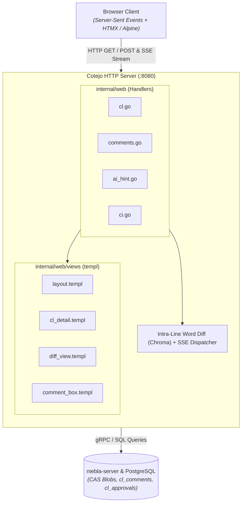

**Cotejo** is the web-based code review interface for the Niebla ecosystem, inspired by Google's internal **Critique** code review tool. It is optimized for reviewing patchset revisions, intra-line word diffs, threaded discussions, and AI-assisted patch generation.

---

## 1. Architectural Overview

Cotejo is implemented as a high-performance Go web service ([`internal/web/`](file:///home/matatan/Developer/niebla/niebla/internal/web)):



---

## 2. Key Subsystems & Design Choices

### Type-Safe Compiled Templates (`a-h/templ`)
Cotejo uses [`a-h/templ`](https://github.com/a-h/templ) to compile HTML components into pure Go code ahead-of-time:
* **Zero Runtime Overhead:** No dynamic string parsing or reflection.
* **Compile-Time Type Safety:** Go compiler guarantees that all view parameters (changelists, diff chunks, user profiles) match expected models.
* **Component Modularity:** Reusable components like `comment_box.templ` and `diff_view.templ` compose cleanly without global template namespace collisions.

### High-Fidelity Intra-Line Word Diffing
Diffs are calculated by comparing blob pairs streamed from `niebla-server`:
1. **LCS Diffing (`sergi/go-diff` / `pmezard/go-difflib`)**: Computes line-by-line additions and deletions.
2. **Intra-Line Character/Word Slicing**: When a line is modified, Cotejo performs a second pass within the line to isolate the exact changed words or characters.
3. **Syntax Highlighting (`alecthomas/chroma/v2`)**: Tokenizes the code using language-specific lexers, applying distinct syntax colors inside both base and modified diff panes.

### Real-Time Updates via Server-Sent Events (SSE)
Instead of polling the server every few seconds or managing heavyweight WebSockets:
* Browsers connect to `/events`.
* When an author publishes a new patchset, a reviewer posts a comment, or a CI check run finishes, the server pushes an SSE event frame (`event: comment_added`, `event: approval_updated`).
* The UI seamlessly updates the affected DOM container using lightweight target swaps.

---

## 3. Reviewer Workflow & Features

### 1. Multi-Draft Commenting
Reviewers can write notes across dozens of files without immediately notifying the author:
* Comments start in an `is_draft = true` state.
* Drafts are visible only to the authoring reviewer.
* Clicking **"Publish Comments"** atomically sets `is_draft = false` and sends a batch notification.

### 2. Multi-Line Range Comments
Reviewers can click and drag across line numbers to anchor comments to an entire block (storing `line_number` and `end_line_number` in `cl_comments`).

### 3. Thread Resolution Policy
Discussions require explicit resolution:
* Comments track `resolved = true/false`.
* If a repository's `config.toml` sets `allow_submit_with_unresolved_comments = false`, `niebla submit` will abort if any thread remains open.

### 4. Attention Set State Machine
Inspired by Critique, the attention set highlights who needs to take action:
* When an author shelves a CL $\to$ Reviewers are in the attention set.
* When a reviewer posts comments and requests changes $\to$ Author is in the attention set.
* When the author publishes an updated patchset $\to$ Attention flips back to reviewers.

---

## 4. AI Code Hints & One-Click Suggestions

Cotejo integrates directly with the `pkg/agents` subsystem:
1. **Generating AI Hints**: Reviewers or authors can click **"Request AI Hint"** on any file or line range (`POST /cl/{id}/ai-hint/generate`).
2. **Structured Suggestions**: AI agents return structured diff suggestions (`suggestion_start_line`, `suggestion_end_line`, `suggestion_code`).
3. **One-Click Application**: The author clicks **"Apply Suggestion"**:
   * Cotejo rewrites the modified file in the latest Merkle tree.
   * Synthesizes and records a new patchset in `cl_patchsets`.
   * Flags `suggestion_applied_ps` on the comment to record that the suggestion was incorporated.

---

## 5. Authentication & Reverse-Proxy Deployment

Cotejo supports three authentication profiles in `config.toml`:

```toml
[critique.auth]
# 1. Local single-developer development
mode = "developer"
default_user = "matatan"

# 2. Reverse proxy with trusted header (e.g. Tailscale Auth, Cloudflare Access, Traefik)
# mode = "proxy_header"
# header_name = "X-Forwarded-User"

# 3. OIDC / OAuth2 Federation (Keycloak, GitHub, Google)
# mode = "oidc"
# issuer = "https://auth.example.com/realms/monorepo"
# client_id = "niebla-cotejo"
```

To run Cotejo as a service:
```bash
cotejo --config /etc/niebla/config.toml --port 8080 --server <server-host>:50051
```
