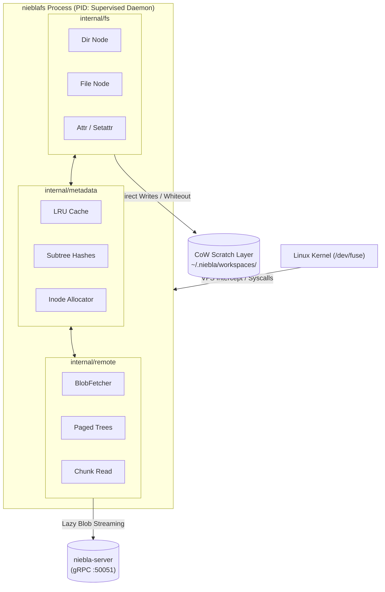

`nieblafs` is the virtual filesystem daemon responsible for mounting monorepo checkouts onto local developer workstations. It communicates with the Linux kernel `/dev/fuse` driver to intercept filesystem calls, redirect writes to Copy-on-Write (CoW) scratch storage, and stream missing blobs lazily over gRPC.

---

## 1. Overview & Architecture

When a developer runs `niebla workspace create <name>`, the CLI spawns a `nieblafs` daemon in the background:



---

## 2. CLI Flags & Configuration Options

```bash
nieblafs [flags]
```

| Flag | Type | Default | Description |
|---|---|---|---|
| `--mount` | string | *(Required)* | Target directory where the virtual filesystem is mounted (e.g. `~/.niebla/workspaces/my-ws/mount`). |
| `--scratch` | string | *(Required)* | Local directory storing modified, newly created, and whiteout files (e.g. `~/.niebla/workspaces/my-ws/scratch`). |
| `--server` | string | `127.0.0.1:50051` | Address of the remote `niebla-server` gRPC instance. |
| `--cache` | string | `~/.cache/niebla/blobs` | Local CAS cache directory for downloaded blob chunks. |
| `--socket` | string | *(Optional)* | Path to UNIX domain socket for daemon health polling and IPC control (`nieblafs.sock`). |
| `--debug` | bool | `false` | Enables verbose FUSE request logging to standard error. |

---

## 3. Subsystem Breakdown

### 1. `internal/fs` (VFS Node Implementation)
* **`Dir` (`root.go`)**: Implements `bazil.org/fuse/fs.Node`, `NodeStringLookuper`, and `HandleReadDirAller`.
  * Evaluates whiteout files (`.wh.<name>`) to suppress deleted items.
  * Checks scratch directory first; falls back to the base tree.
  * Lazily fetches remote directory pages in batches of 5,000 entries via `FetchTreePaged`.
* **`File` (`file.go`)**: Implements `Node`, `HandleReader`, `HandleWriter`, and `NodeSetattrer`.
  * If the file is modified (`isScratch == true`), reads and writes route directly to the local scratch NVMe file.
  * If unmodified, reads trigger the `BlobFetcher`.

### 2. `internal/metadata` (LRU Metadata Cache)
* Maintained by `MetadataCache` using thread-safe LRU maps (`golang-lru/v2`).
* Maps directory paths to slice manifests (`[]tree.Entry`).
* Allocates synthetic monotonic 64-bit inode numbers (`d.inode`), ensuring file descriptors persist across kernel cache revalidations.

### 3. `internal/remote` (gRPC Streaming Client & Fetcher)
* Wraps the `niebla.v1.NieblaService` client.
* **`BlobFetcher`**: Manages on-demand chunk streaming. Implements singleflight request coalescing to deduplicate parallel reads of identical hashes.
* Caches completed blobs into the local CAS cache (`~/.cache/niebla/blobs/ab/cd/<sha256>`).

### 4. `internal/control` (IPC Socket Channel)
* Binds to `nieblafs.sock`.
* Responds to status ping requests from `niebla status` to confirm daemon health without triggering FUSE kernel timeouts.

---

## 4. Lifecycle & Process Supervision

### Background Spawning
When created via the CLI:
1. `niebla workspace create` verifies mount targets.
2. Spawns `nieblafs` detached with standard streams redirected to `~/.niebla/workspaces/<ws>/nieblafs.log`.
3. Polls the IPC socket until the mount is confirmed ready before returning control to the terminal.

### Graceful Unmounting
To unmount a virtual workspace safely:
```bash
# Standard user-level unmount
fusermount -u /path/to/workspace/mount

# macOS (if using FUSE-T / macFUSE)
umount /path/to/workspace/mount
```

Upon receiving `SIGINT` or `SIGTERM`, `nieblafs`:
1. Completes any in-flight blob writes to scratch.
2. Closes open file descriptors.
3. Notifies the kernel driver to release the mount point.
4. Removes the control socket.
