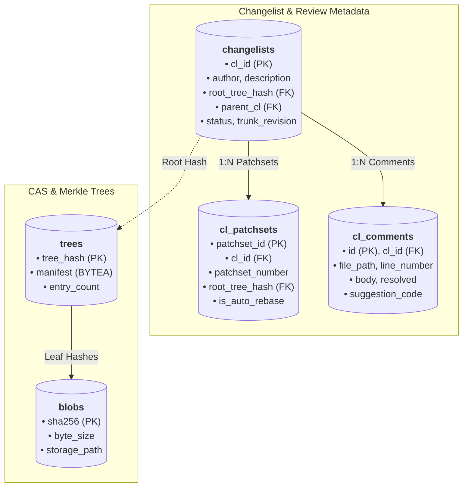

`niebla-server` is the central [gRPC](https://en.wikipedia.org/wiki/GRPC) daemon (`:50051`) that manages repository metadata in PostgreSQL, coordinates [Content-Addressable Storage (CAS)](https://en.wikipedia.org/wiki/Content-addressable_storage), enforces `OWNERS.toml` submission rules, and rebases stacked changelists.

For the full [Protobuf](https://en.wikipedia.org/wiki/Protocol_Buffers) service definition and RPC payloads, see the [gRPC Wire Protocol Reference](/niebla/reference/grpc-api/).

---

## 1. PostgreSQL Schema Overview

`niebla-server` uses **PostgreSQL 16+** (`pgx/v5` and `sqlc`) as its relational metadata store:



* **`changelists`:** Tracks each CL (`pending` → `shelved` → `submitted`), its author, parent CL (for stacked changes), and committed `trunk_revision`.
* **`cl_patchsets`:** Records the immutable `root_tree_hash` for each `niebla shelve` iteration (`Patchset 1, 2, ...`).
* **`cl_comments`:** Stores inline review threads, line ranges, resolution status, and structured code suggestions.
* **`trees` & `blobs`:** Maps [Merkle](https://en.wikipedia.org/wiki/Merkle_tree) directory hashes to binary manifests and [SHA-256](https://en.wikipedia.org/wiki/SHA-2) blob hashes to their relative CAS paths (`ab/cd/<sha256>`).

---

## 2. Monotonic Trunk Serialization

Trunk commits in Niebla form a strict linear sequence (`1, 2, 3, ...`) backed by `trunk_revision_seq`:

1. When a client calls `SubmitCL`, `niebla-server` opens a database transaction and acquires a transaction-scoped advisory lock:
   ```sql
   SELECT pg_advisory_xact_lock(7955998246305947649);
   ```
2. The server verifies `OWNERS.toml` approvals, resolved discussion threads, and required CI check runs.
3. If another CL landed on trunk while the current CL was in review, the server runs an in-transaction [3-way Merkle tree merge](https://en.wikipedia.org/wiki/Merge_(version_control)#Three-way_merge) against the latest trunk head.
4. If the merge is clean, the server assigns the next `trunk_revision` integer and commits the transaction.

---

## 3. Automated Cascade Rebasing

When developers stack changelists (`Trunk` → `CL 101` → `CL 102` → `CL 103`) and `CL 101` is submitted or updated:

1. `niebla-server` finds all active child changelists where `parent_cl = 101`.
2. For each child (`CL 102`), it runs the [Three-Way Merkle Merge Engine](/niebla/components/cas-storage/#4-three-way-merkle-tree-merges).
3. **Clean Merge:** Creates a new patchset on `CL 102` (`is_auto_rebase = true`), updates its base to the new trunk revision, and continues recursively down the stack to `CL 103`.
4. **Conflict:** Sets `needs_rebase = true` and records the conflicting file paths so the author can resolve them locally with `niebla sync`.

---

## 4. Running `niebla-server`

```bash
niebla-server --config /etc/niebla/config.toml [flags]
```

| Flag | Default | Description |
| :--- | :--- | :--- |
| `--config <path>` | `~/.config/niebla/config.toml` | Path to configuration file or directory. |
| `--grpc-port <port>` | `50051` | TCP port for the gRPC listener. |
| `--db-url <uri>` | `postgres:///niebla?host=/run/postgresql` | PostgreSQL connection string. |
| `--cas-dir <path>` | `~/.cache/niebla/blobs` | Root directory for CAS blob storage. |

For full `[server]` configuration options (including TLS, [mTLS](https://en.wikipedia.org/wiki/Mutual_authentication#mTLS), and bearer tokens), see the [Configuration Schema](/niebla/reference/configuration/#server--repository-daemon--storage) and [Security & Authentication](/niebla/reference/security-auth/).
