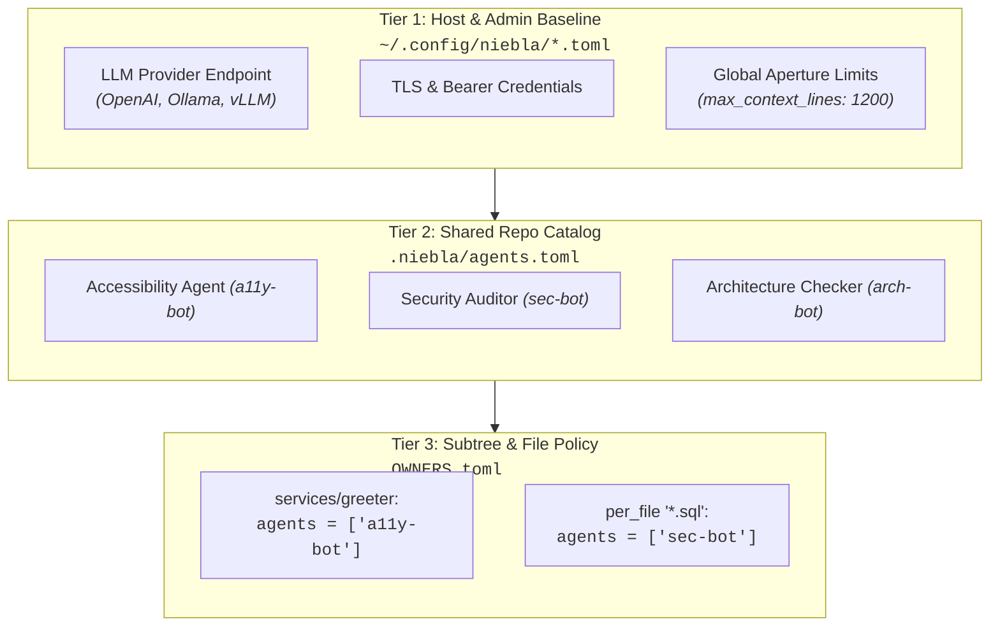
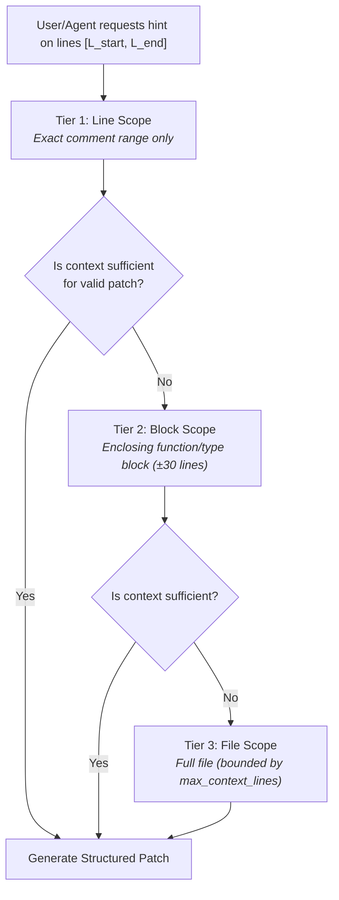

Cotejo integrates first-class **AI Review Personas** and **Automated Code Hints** directly into the review experience. 

Unlike external chatbot integrations that post noisy, ungrounded comments, Cotejo's AI subsystem generates **type-aware, syntax-checked code replacement suggestions** that authors can review and apply with a single click.

---

## The 3-Tier Enterprise Governance Model

AI capabilities in Cotejo follow a strict **3-Tier Governance Hierarchy** to ensure security, compliance, and developer autonomy:



1. **Tier 1 (Host Baseline — `~/.config/niebla/ai.toml` or `config.toml`):**
   Defines the upstream LLM provider (OpenAI API, vLLM, Ollama, LiteLLM), TLS certificates, API keys, and global token limits.
2. **Tier 2 (Shared Repository Catalog — `.niebla/agents.toml`):**
   Declares reusable review agents (`type = "ai"`, `type = "cas_binary"`, `type = "in_tree"`), their system prompts, and execution timeouts.
3. **Tier 3 (Subtree Policy — `OWNERS.toml`):**
   Subtree maintainers explicitly opt into or require specific agents for their directories or file patterns (e.g., `agents = ["a11y-bot"]`).

---

## Adaptive Context Aperture

A frequent flaw with AI code assistance is either sending too little context (causing hallucinations) or sending entire monorepo files (wasting tokens and incurring latency).

Cotejo implements **Adaptive Context Aperture** (`pkg/ai.GenerateWithAperture`):



* **Tier 1 (`lines`):** Analyzes only the selected line range $[L_{\text{start}}, L_{\text{end}}]$. If the request is a simple syntax or style fix, generation succeeds immediately with minimal token overhead.
* **Tier 2 (`block`):** If the snippet references local variables or function parameters declared outside the selection, the engine automatically widens the window to the enclosing function or class block ($\pm 30$ lines).
* **Tier 3 (`file`):** If package imports or top-level struct declarations are necessary, the engine escalates to the complete file, bounded by `critique.ai.max_context_lines` (default: 1200 lines).

---

## Dual Suggestion Storage & One-Click Application

Every AI or human code suggestion in Cotejo is persisted in **two complementary formats**:

1. **Human-Readable Markdown:** A standard ```` ```suggestion ```` fenced block inside the comment body for web readability.
2. **Database Columns:** Structured columns on `cl_comments`:
   * `has_suggestion` (`boolean`)
   * `suggestion_start_line` / `suggestion_end_line` (`integer`)
   * `suggestion_code` (`text`)
   * `suggestion_applied_ps` (`integer`)

### The One-Click Patch Lifecycle

When an author clicks the **`✓ Apply Suggestion`** button on any comment:

```mermaid
sequenceDiagram
    autonumber
    actor Author as CL Author
    participant Cotejo as Cotejo Web Service
    participant CAS as Central CAS Storage
    participant Server as niebla-server
    participant DB as PostgreSQL

    Author->>Cotejo: Click "Apply Suggestion" (POST /apply-suggestion)
    Cotejo->>CAS: Retrieve current file blob
    Cotejo->>Cotejo: Splice suggestion_code into [start_line, end_line]
    Cotejo->>CAS: Write modified blob to CAS (~/.cache/niebla/blobs)
    Cotejo->>Server: Compute new Merkle root tree
    Server->>DB: Record Patchset N+1 in cl_patchsets
    Server->>DB: Mark comment resolved (suggestion_applied_ps = N+1)
    Cotejo-->>Author: Push SSE update; UI refreshes with Patchset N+1
```

1. **Splice:** Cotejo replaces lines `[suggestion_start_line, suggestion_end_line]` with `suggestion_code`.
2. **CAS Ingestion:** The new file blob is written to local CAS storage.
3. **Merkle Update:** The server creates **Patchset $N+1$** referencing the updated tree.
4. **Auto-Resolution:** The original comment thread is automatically marked as **Resolved**, with `suggestion_applied_ps` recording which patchset incorporated the fix.

---

## Authoring Custom Review Personas

Review bots in Niebla are defined declaratively in `.niebla/agents.toml`. You can configure three distinct execution types:

### 1. Declarative AI Personas (`type = "ai"`)
Zero Go code required. The agent uses `niebla-server`'s built-in LLM client and a system prompt in `.niebla/prompts/`:

```toml
# .niebla/agents.toml
[[agent]]
name = "a11y-bot"
display_name = "Accessibility (WCAG 2.1 AA) Auditor"
type = "ai"
prompt_file = ".niebla/prompts/accessibility.md"
trigger_paths = ["**/*.templ", "**/*.html", "**/*.tsx"]
blocking = false
auto_approve = true
capture_logs = true
timeout_seconds = 60
```

The system prompt (`.niebla/prompts/accessibility.md`) instructs the model to return structured JSON matching `AgentReviewReport`:

```json
{
  "verdict": "changes_requested",
  "summary": "Found 1 missing ARIA label in navigation component.",
  "comments": [
    {
      "file_path": "services/web/nav.templ",
      "line_start": 34,
      "line_end": 36,
      "body": "Buttons without text must provide an aria-label attribute for screen readers.",
      "suggestion_code": "<button aria-label=\"Close Menu\" class=\"btn-icon\">\n    <svg>...</svg>\n</button>"
    }
  ]
}
```

### 2. Hermetic CAS Binary Agents (`type = "cas_binary"`)
For deterministic static analyzers, linters, or custom Go/Rust binaries that should run hermetically:

```bash
# Compile review binary and upload to CAS
go build -o /tmp/sec-scanner ./tools/agents/sec-scanner
niebla cas put /tmp/sec-scanner
# Output: e3b0c44298fc1c149afbf4c8996fb92427ae41e4649b934ca495991b7852b855
```

Register in `.niebla/agents.toml`:

```toml
[[agent]]
name = "sec-cas-bot"
display_name = "Hermetic Security Scanner"
type = "cas_binary"
cas_sha256 = "e3b0c44298fc1c149afbf4c8996fb92427ae41e4649b934ca495991b7852b855"
args = ["--strict"]
trigger_paths = ["pkg/auth/**", "services/api/**"]
blocking = true
auto_approve = true
```

### 3. In-Tree Script Reviewers (`type = "in_tree"`)
Executes an in-tree shell script or linter inside the workspace:

```toml
[[agent]]
name = "license-checker"
display_name = "SPDX License Header Verifier"
type = "in_tree"
entrypoint = "tools/ci/check-licenses.sh"
trigger_paths = ["**/*.go", "**/*.rs"]
auto_approve = true
```

---

## Configuring the LLM Provider

Enable AI hints in `~/.config/niebla/config.toml` (or `~/.config/niebla/ai.toml`):

```toml
[critique.ai]
enabled = true
# Compatible with OpenAI, vLLM, Ollama, LiteLLM, or self-hosted proxies
endpoint = "https://api.openai.com/v1"
api_key_env = "OPENAI_API_KEY"
model = "gpt-4o"
temperature = 0.2
timeout_seconds = 30
max_context_lines = 1200

# Optional private CA or internal mutual TLS:
[critique.ai.tls]
enabled = false
# ca_file = "/etc/niebla/tls/ca.crt"
# server_name = "llm.internal.corp"
```

Verify your configuration:

```bash
niebla config validate
```

---

## Next Steps

* **[Deployment, Auth & Theming](/niebla/cotejo/deployment-auth/):** Learn how to run Cotejo behind Tailscale or NGINX with custom color themes.
* **[The Code Review Lifecycle](/niebla/cotejo/review-workflows/):** Master intra-line diffing, inter-diff patchset views, and keyboard shortcuts.

