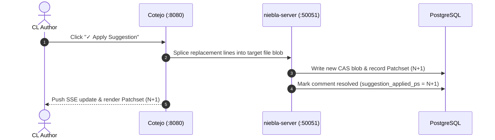

Cotejo supports inline code replacement suggestions from both human reviewers and automated review agents, allowing changelist authors to apply fixes with a single click.

:::note[100% Opt-In & Local-LLM Friendly]
Niebla never sends your code to external AI services behind the scenes. AI hints are disabled unless you explicitly enable `[critique.ai]` in your configuration, and you can point `[critique.ai]` to a self-hosted local model server (such as **Ollama**, **vLLM**, or **LiteLLM**) so code never leaves your network.
:::

---

## 1. One-Click Code Suggestions

Any review comment—written by a teammate or generated by an agent—can include a ```` ```suggestion ```` block proposing replacement code for the commented line range:

````markdown
Use `strings.TrimSpace` so whitespace-only tokens are rejected:

```suggestion
if strings.TrimSpace(token) == "" {
    return nil, ErrEmptyToken
}
```
````

When the changelist author clicks **`✓ Apply Suggestion`** in Cotejo:



1. Cotejo replaces `[suggestion_start_line, suggestion_end_line]` in the target file with the suggested code.
2. The modified file is written to [CAS](https://en.wikipedia.org/wiki/Content-addressable_storage) and a new **Patchset ($N+1$)** is created on the changelist.
3. The comment thread is automatically marked **Resolved** and tagged with the patchset number where it was applied (`suggestion_applied_ps`).

---

## 2. How On-Demand AI Hints Scale Context

When a reviewer selects a line range in Cotejo and clicks **Request AI Hint** (`POST /cl/{id}/ai-hint/generate`), Cotejo sends the minimum necessary code context (`pkg/ai.GenerateWithAperture`) rather than always uploading the entire file:

1. **Line Scope (`lines`):** Sends only the selected line range $[L_{\text{start}}, L_{\text{end}}]$ for localized syntax or style fixes.
2. **Block Scope (`block`):** Widens to the enclosing function or struct block ($\pm 30$ lines) when local variables or parameters are referenced.
3. **File Scope (`file`):** Escalates to the full file (up to `max_context_lines`, default `1200`) only when top-level types or imports are needed.

---

## 3. Configuring the LLM Provider (`[critique.ai]`)

To enable on-demand AI hints and `[agent]` personas of `type = "ai"`, configure `[critique.ai]` in `~/.config/niebla/config.toml` (or `~/.config/niebla/ai.toml`):

```toml
[critique.ai]
enabled = true
# Works with local Ollama ("http://127.0.0.1:11434/v1"), vLLM, LiteLLM, or OpenAI
endpoint = "http://127.0.0.1:11434/v1"
api_key_env = "LLM_API_KEY"
model = "qwen2.5-coder:32b"
temperature = 0.2
timeout_seconds = 30
max_context_lines = 1200
```

Validate your settings with:

```bash
niebla config validate
```

---

## 4. Registering Automated Review Agents

To run automated review bots, hermetic CAS binaries, or in-tree linter scripts automatically whenever files in a directory are shelved, see [In-Tree Governance: Automated Review Agents (`.niebla/agents.toml`)](/niebla/workflows/in-tree-governance/#3-automated-review-agents-nieblaagentstoml).
