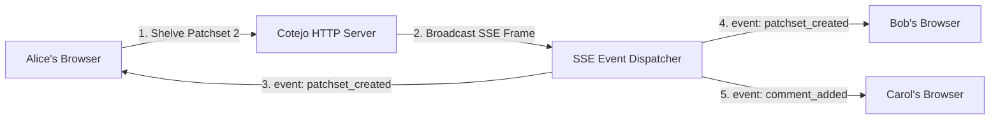

Cotejo is engineered to run seamlessly across single-developer laptops, air-gapped internal subnets, and large enterprise infrastructure behind identity-aware reverse proxies.

This guide details daemon execution, production authentication modes, real-time event streaming, and custom UI theming.

---

## 1. Running the Cotejo Service

Cotejo can be started directly via the CLI or supervised via systemd.

### Direct Execution

```bash
# Start Cotejo connected to a local or remote niebla-server
cotejo --config ~/.config/niebla/config.toml --port 8080 --server 127.0.0.1:50051
```

### Production Systemd Service (`/etc/systemd/system/cotejo.service`)

```ini
[Unit]
Description=Cotejo Code Review Web Service
After=network.target niebla-server.service
Requires=niebla-server.service

[Service]
Type=simple
User=niebla
Group=niebla
ExecStart=/usr/local/bin/cotejo --config /etc/niebla/config.toml
Restart=always
RestartSec=5s
LimitNOFILE=65536

# Sandboxing & Security Hardening
ProtectSystem=strict
ProtectHome=read-only
ReadWritePaths=/var/cache/niebla /var/log/niebla
PrivateTmp=true

[Install]
WantedBy=multi-user.target
```

---

## 2. Authentication Models & Identity Resolution

Identity in Cotejo is configured under the `[critique.auth]` section in `~/.config/niebla/config.toml`:

```toml
[critique.auth]
mode = "headers" # "developer", "headers", or "oidc"
```

### Mode 1: Developer Mode (`mode = "developer"` or `mode = "local"`)
Designed for local workstations and single-tenant setups:
* Identity defaults dynamically to the active operating system user (`$USER`).
* You can configure an explicit fallback user:
  ```toml
  [critique.auth]
  mode = "developer"
  default_user = "alice"
  # Enable ?reviewer=bob query parameter testing in local development
  allow_query_override = true
  ```

### Mode 2: Reverse Proxy Header Auth (`mode = "headers"`)
The recommended deployment model for enterprise infrastructure using **Tailscale**, **Cloudflare Access**, **Traefik**, **Caddy**, or **NGINX**.

The reverse proxy handles TLS termination and user authentication (SAML, Okta, Google Workspace), passing the verified username to Cotejo in an HTTP header:

```toml
[critique.auth]
mode = "headers"
header_name = "X-Forwarded-User" # or "Tailscale-User-Login"
default_user = "nobody"

# Strictly restrict header trust to trusted reverse proxy IPs / CIDRs
trusted_proxies = ["127.0.0.1/32", "10.0.0.0/8"]
allow_query_override = false
```

#### Example NGINX Reverse Proxy Configuration

```nginx
server {
    listen 443 ssl http2;
    server_name cotejo.internal.mycompany.com;

    ssl_certificate     /etc/ssl/certs/cotejo.crt;
    ssl_certificate_key /etc/ssl/private/cotejo.key;

    location / {
        proxy_pass http://127.0.0.1:8080;
        proxy_set_header Host $host;
        proxy_set_header X-Real-IP $remote_addr;
        proxy_set_header X-Forwarded-For $proxy_add_x_forwarded_for;
        proxy_set_header X-Forwarded-Proto $scheme;

        # Forward authenticated user from internal SSO / mTLS
        proxy_set_header X-Forwarded-User $remote_user;

        # Server-Sent Events (SSE) streaming requirements
        proxy_set_header Connection '';
        proxy_http_version 1.1;
        chunked_transfer_encoding off;
        proxy_buffering off;
        proxy_cache off;
        proxy_read_timeout 86400s;
    }
}
```

---

## 3. Real-Time Reactivity via Server-Sent Events (SSE)

Unlike legacy code review tools that poll endpoints or require complex WebSocket handshakes, Cotejo uses **Server-Sent Events (SSE)** at `/events`.



### Event Stream Architecture
* When a reviewer posts a draft, publishes comments, or applies an AI suggestion, Cotejo emits lightweight event frames:
  ```text
  event: comment_published
  data: {"cl_id": 101, "patchset": 2, "author": "alice"}
  ```
* Connected browsers catch the event and use HTMX target swaps to update the review UI **instantly without a full page refresh**.

---

## 4. Visual Themes & Syntax Highlighting

Cotejo includes built-in themes and customizable palettes configured in `~/.config/niebla/config.toml` (or `~/.config/niebla/theme.toml`):

### Built-in Presets

```toml
[critique.theme]
# Supported presets: "catppuccin-mocha", "catppuccin-latte", "catppuccin-frappe",
#                    "catppuccin-macchiato", "tokyo-night", "dracula", "nord", "github-dark", "custom"
preset = "catppuccin-mocha"

# Chroma syntax highlighting style matching your preset
syntax_style = "catppuccin-mocha"
```

### Custom Palette Overrides (Paleta Quisqueyana)

To customize UI colors or match your team's design system, specify custom color tokens:

```toml
[critique.theme]
preset = "custom"
syntax_style = "tokyonight-night"

[critique.theme.colors]
bg_canvas       = "#0f172a"                 # Slate 900
bg_surface      = "#1e293b"                 # Slate 800
bg_card         = "#334155"                 # Slate 700
border          = "#475569"                 # Slate 600
text_primary    = "#f8fafc"                 # Slate 50
text_muted      = "#94a3b8"                 # Slate 400
accent          = "#2dd4bf"                 # Larimar Blue (#2DD4BF)
diff_add_bg     = "rgba(45, 212, 191, 0.18)" # Larimar Green
diff_add_border = "#2dd4bf"
diff_del_bg     = "rgba(244, 63, 94, 0.18)"  # Rose Red
diff_del_border = "#f43f5e"
```

### Fast-Fail Validation

After modifying your configuration, run the validation tool:

```bash
niebla config validate
```

**Output:**
```text
✓ Validating ~/.config/niebla/config.toml:
  - Port allocations: OK (Server: 50051, Web: 8080, Proxy: 7331)
  - Theme preset: 'catppuccin-mocha' (Valid Chroma syntax style)
  - Reverse proxy header auth: OK (Trusted proxies configured)
Configuration is valid!
```

---

## Next Steps

* **[Security & Authentication Architecture](/niebla/reference/security-auth/):** Complete guide to the 5 trust zones, gRPC bearer tokens, TLS 1.3, and Tailscale zero-trust runbooks.
* **[Cotejo Overview & Philosophy](/niebla/cotejo/overview/):** Review the Google Critique model, attention sets, and segregated inboxes.
* **[The Code Review Lifecycle](/niebla/cotejo/review-workflows/):** Explore intra-line diffing, inter-diff comparisons, and review voting.
* **[AI Hints & Review Personas](/niebla/cotejo/ai-assistance/):** Author automated review agents and one-click code suggestions.

