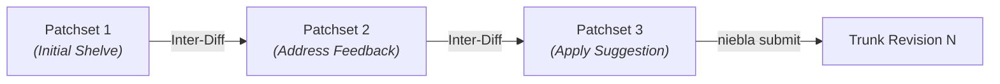
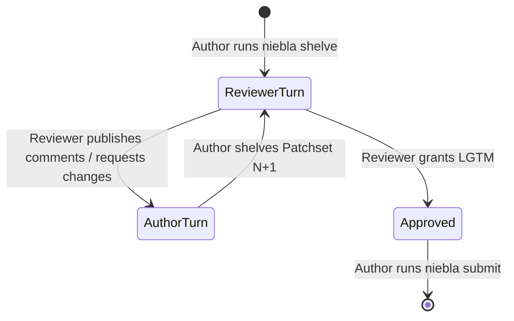

**Cotejo** (*pronounced* **koh-TEH-hoh**, [IPA](https://en.wikipedia.org/wiki/Help:IPA/Spanish): `[koˈte.xo]`, port `8080`) is Niebla's web code review interface. Instead of reviewing Git branches full of fixup and merge commits, Cotejo organizes code review around immutable **Patchsets** and an explicit **Attention Set**.

:::tip[What does "Cotejo" mean?]
***Cotejo*** (from the Spanish verb *cotejar*) means a **"side-by-side comparison," "collation,"** or **"critical examination of two documents against each other."** In archival and legal Spanish, a *cotejo* is the act of comparing a revised draft against an original record to verify every change—matching how reviewers inspect side-by-side intra-line and inter-patchset diffs in Cotejo.
:::

---

## 1. Patchsets vs. Pull Requests

| Pull Request Friction | Cotejo Patchset Model |
| :--- | :--- |
| **Commit soup:** Fixup commits, merges, and force-pushes obscure what changed during review. | **Linear patchsets:** Each `niebla shelve` creates an immutable snapshot (**Patchset 1, Patchset 2, ...**). |
| **Re-reading whole PRs:** Reviewers must scan the entire diff again after minor updates. | **Inter-patchset diffs:** Compare **Patchset 1 vs. Patchset 2** to inspect *only* the lines changed since your last review. |
| **Ambiguous ownership:** Unclear who is authorized to approve specific directories. | **In-tree `OWNERS.toml` gates:** Subtree owners and approval quotas are evaluated automatically before submit. |
| **Noisy inboxes:** Bot notifications bury human reviews. | **Attention sets & separate queues:** Automated bot CLs are separated into their own tab; attention sets show whose turn it is to act. |

---

## 2. The Attention Set

Code reviews often stall when it isn't obvious who needs to act next. Cotejo tracks an **Attention Set** on every changelist:

1. **Shelve:** Assigned reviewers enter the Attention Set.
2. **Comment / Request Changes:** When a reviewer publishes comments, the reviewer leaves the Attention Set and the author enters it.
3. **New Patchset:** When the author shelves an updated patchset, attention returns to the reviewers.
4. **Approval (`LGTM`):** Attention returns to the author to run `niebla submit`.

---

## 3. Inbox Queues

The Cotejo dashboard (`/cls`) separates changelists into focused queues so automated tooling never buries human reviews:

* **My Review Queue (`/cls?tab=my-reviews`):** Changelists where you (or one of your `@group` aliases) are currently in the Attention Set.
* **Out for Review (`/cls?tab=outgoing`):** Your open changelists, showing approval progress, unresolved comment counts, and CI status.
* **Agent / Automated (`/cls?tab=agents`):** Changelists created by automated bots or CI jobs (matching `agent_author_patterns` such as `agent/*`, `bot/*`, `*[bot]`, `ci/*`).
* **Submitted (`/cls?tab=submitted`):** Recently committed [trunk](https://en.wikipedia.org/wiki/Trunk-based_development) revisions.
* **All (`/cls?tab=all`):** Complete changelist stream.

---

## 4. Per-Reviewer File Tracking

On multi-file changelists, Cotejo tracks which files each reviewer has inspected:

* **Isolated per user:** Review status is keyed by `(cl_id, file_path, reviewer)`. When Alice marks a file `reviewed`, it remains `not reviewed` for Bob.
* **Header progress bar:** Displays live progress (`Review Progress: 14 of 18 files reviewed by alice`).
* **Quick toggle:** Click the `reviewed` badge next to any file (or press `m`) to toggle its state via [HTMX](https://en.wikipedia.org/wiki/Htmx) without reloading the page.

---

## Next Steps

* **[Review Lifecycle & Diffs](/niebla/cotejo/review-workflows/):** Intra-line word diffs, inter-patchset comparisons, draft comments, and keyboard shortcuts.
* **[AI Hints & Suggestions](/niebla/cotejo/ai-assistance/):** One-click code suggestions and opt-in LLM configuration.
* **[Authentication & Theming](/niebla/cotejo/deployment-auth/):** Identity modes, [Server-Sent Events (SSE)](https://en.wikipedia.org/wiki/Server-sent_events), and color themes.
