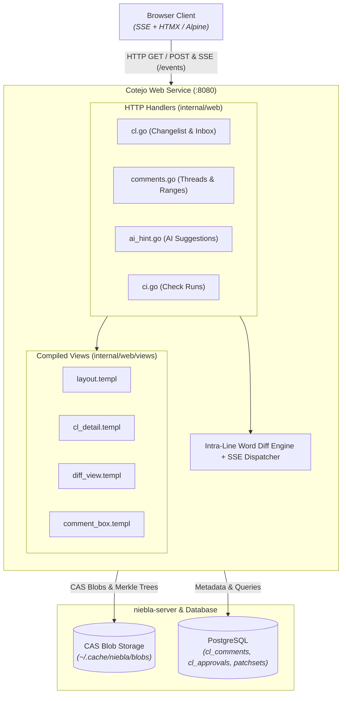
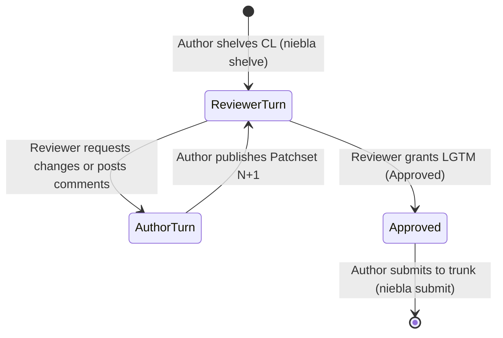

**Cotejo** is Niebla's native, web-based code review interface, inspired by Google's internal **Critique** review platform. It is engineered from the ground up to solve the friction, ambiguity, and merge-skew inherent in distributed Git pull-request workflows at monorepo scale.

Operating on port `8080` (with live-reload proxy on port `7331` for development), Cotejo integrates directly with `niebla-server`, Content-Addressable Storage (CAS), and PostgreSQL.

---

## The Paradigm Shift: Patchsets vs. Pull Requests

Most modern developer platforms treat code review as a series of Git branches and pull requests. In enterprise monorepos, this creates fundamental issues:

| Git Pull Request Dilemma | The Cotejo / Critique Solution |
| :--- | :--- |
| **Commit Soup:** Fixup commits, merges, and rebases clutter history during review. | **Linear Patchset Stack:** Each review round is an immutable Merkle tree snapshot (**Patchset 1, Patchset 2, ...**). |
| **Branch Clones & Merge Conflicts:** Merging a stale branch into trunk can break silently. | **Server-Side Rebase & Inter-Diffs:** Reviewers can diff any patchset against any other patchset to see *only* what changed since their last review. |
| **Ambiguous Ownership:** Anyone can approve or merge if branch rules aren't granular. | **Declarative `OWNERS.toml` Gates:** Subtree owners retain explicit sign-off authority; submissions are blocked until required approvers sign off. |
| **Unfocused Inboxes:** Human reviewers get flooded with automated bot alerts. | **Attention Sets & Inbox Segregation:** Automated bots are partitioned into a dedicated queue; attention sets clarify exactly who must act next. |

```mermaid
flowchart TD
    subgraph GitModel["Traditional Git Pull Request"]
        C1["Initial Commit"] --> C2["WIP Fixup 1"]
        C2 --> C3["Rebase / Merge trunk"]
        C3 --> C4["Address review comments"]
        C4 --> C5["Squash and merge"]
    end

    subgraph CotejoModel["Niebla / Cotejo Patchset Model"]
        P1["Patchset 1<br/><i>(Initial Shelf)</i>"]
        P2["Patchset 2<br/><i>(Address Feedback)</i>"]
        P3["Patchset 3<br/><i>(One-Click AI Fix)</i>"]
        P1 -->|"Inter-Diff"| P2
        P2 -->|"Inter-Diff"| P3
        P3 -->|"Atomic Linear Merge"| Trunk["Committed Trunk Head"]
    end
```



---

## Core Architectural Foundations

Cotejo is implemented as a compiled, high-performance Go web service using [`a-h/templ`](https://github.com/a-h/templ) for type-safe server-side rendering, [`alecthomas/chroma/v2`](https://github.com/alecthomas/chroma) for syntax highlighting, and Server-Sent Events (SSE) for real-time reactivity without WebSocket overhead.



---

## The Attention Set: Eliminating Review Deadlocks

In typical code review systems, reviews stall because it is unclear whose court the ball is in. Cotejo adopts the **Attention Set state machine**:



1. **Author Shelves CL:** The author's turn is done; assigned reviewers and directory approvers enter the Attention Set.
2. **Reviewer Posts Comments:** Once comments are published, the reviewer leaves the Attention Set and the author enters it.
3. **Author Pushes Update:** When the author runs `niebla shelve` to upload Patchset 2, the Attention Set flips back to the reviewers.
4. **Approval:** Once approved, the author regains attention to perform `niebla submit`.

At any time, developers can look at their inbox and see only changelists where **their action is required**.

---

## Review Inbox Segregation & Bot Protection

In large monorepos, automated tools (security scanners, accessibility checkers, linters, dependency bots) can quickly cause review fatigue. Cotejo solves this by partitioning the inbox into distinct queues:

* **My Review Queue (`/cls?tab=my-reviews`):**
  High-priority queue containing changelists where the authenticated user (or one of their group aliases like `@auth-team`) is explicitly listed in the Attention Set.
* **Out for Review (`/cls?tab=outgoing`):**
  Pending changelists authored by you, showing current reviewer status, unresolved comment counts, and CI results.
* **Agent / Automated (`/cls?tab=agents`):**
  Automated background changes produced by review bots, dependency updaters, and scheduled CI workflows (matching `agent/*`, `bot/*`, `*[bot]`, `*@agent*`, `ci/*`). These changelists are badged with a distinct `🤖 Agent` tag and isolated from human notifications.
* **Submitted / Trunk (`/cls?tab=submitted`):**
  Recently merged changelists for audit and history tracking.
* **All (`/cls?tab=all`):**
  Global monorepo changelist stream with real-time status pills.

---

## Per-Reviewer File Review Tracking

In changelists spanning 20 or 50 files, reviewers often lose track of which files they have already inspected. Cotejo tracks review progress on a **per-reviewer basis**:

1. **Automatic Status on View:**
   Selecting and reading a file in the diff viewer automatically marks it as `reviewed` for your user account.
2. **Strict Reviewer Isolation:**
   File review records are keyed by `(cl_id, file_path, reviewer)`. When Alice marks a file reviewed, it remains `not reviewed` for Bob.
3. **Visual Header Progress:**
   The changelist header renders a live progress indicator:
   ```text
   Review Progress: 14 of 18 files reviewed by alice (77%)
   ```
4. **Instant HTMX Toggling:**
   In the file list, clicking the status pill (`reviewed` with an emerald checkmark vs. `not reviewed` in muted slate) toggles status immediately via HTMX without reloading the page.

---

## Next Steps

* **[The Code Review Lifecycle](/niebla/cotejo/review-workflows/):** In-depth guide to intra-line diffs, patchset comparisons, multi-draft commenting, and keyboard shortcuts.
* **[AI Hints & Review Personas](/niebla/cotejo/ai-assistance/):** Configure AI code suggestion cards, automated review bots, and one-click patch application.
* **[Deployment, Auth & Theming](/niebla/cotejo/deployment-auth/):** Production setup, Reverse-Proxy authentication with Tailscale, and Catppuccin themes.
