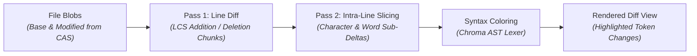
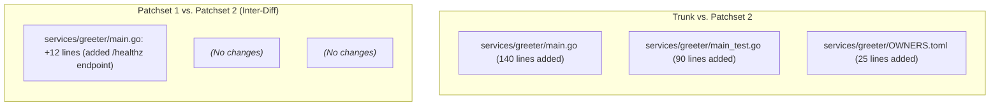

Reviewing code in Cotejo is centered around fast, distraction-free reading, fine-grained discussions, and rapid iteration between patchsets. 

This guide details how to navigate diffs, compare patchset revisions, draft inline comments, and satisfy repository governance gates.

---

## 1. Navigating Diffs & Intra-Line Word Highlighting

When viewing a changelist in Cotejo (`/cl/{id}`), you can toggle between **Side-by-Side** (two-pane split) and **Unified** (single-pane inline) diff modes.

### The Two-Pass Diff Engine

Standard `diff -u` tools only report that an entire 80-character line was replaced. When reviewing complex expressions or multi-variable refactors, locating the modified variable takes unnecessary effort.

Cotejo uses a **two-pass diff engine**:



1. **Pass 1 (Line-Level LCS):** Cotejo calculates line-level additions, deletions, and unchanged context using the Longest Common Subsequence algorithm.
2. **Pass 2 (Intra-Line Token Slicing):** For lines identified as modified, Cotejo performs a second pass within the line boundaries. Unchanged words are displayed normally, while the specific modified tokens receive prominent color highlights (`diff_add_bg` and `diff_del_bg`).
3. **AST Syntax Coloring:** Tokens retain their semantic syntax colors (keywords, strings, type signatures) inside the diff highlight, ensuring syntax readability is never compromised.

---

## 2. Comparing Patchsets (Inter-Diffs)

A primary advantage of Niebla's server-authoritative architecture is that every shelf operation creates an immutable, content-addressed **Patchset**.

In the Cotejo review header, you can use the **Diff Comparison Selector** to compare any two revisions:

```text
Comparing: [ Patchset 1 ▼ ]  to  [ Patchset 2 ▼ ]
```

### Common Comparison Modes:

* **Trunk vs. Latest Patchset (Cumulative Diff):**
  Shows the entire changelist as it currently stands against upstream trunk. Ideal for initial reviews and final pre-submit verification.
* **Patchset $N-1$ vs. Patchset $N$ (Inter-Diff):**
  Shows **only the delta introduced in the latest update**.
  * If an author changes 2 lines in response to your comment across a 40-file changelist, the Inter-Diff highlights **only those 2 lines**.
  * You do not need to re-review the 39 untouched files.



---

## 3. Commenting & Thread Resolution

### Multi-Draft Commenting
To prevent flooding authors with fragmented notification emails or chat pings while a review is in progress:
* All comments you post initially save in an **unsubmitted draft state** (`is_draft = true`).
* Drafts are highlighted with a distinctive dashed amber border and are visible **only to you**.
* You can edit, reword, or delete drafts freely as you read through other files.
* When you finish reviewing, click **"Publish Comments"** in the top navigation bar. This atomically publishes all drafts, updates the changelist Attention Set, and notifies the author in a single batch.

### Multi-Line Range Drag Selection
Rather than leaving a comment on a single line that refers vaguely to "lines 45 through 52":
1. Hover your cursor over the line numbers on either pane.
2. **Click and drag** from the start line to the end line.
3. The selected range ($L_{\text{start}} \dots L_{\text{end}}$) highlights, and a draft comment box expands directly underneath.
4. The line range is stored directly in the database (`line_number` and `end_line_number`), allowing reviewers and AI agents to anchor comments to complete functions or code blocks.

### Thread Resolution & Submit Gates
Cotejo treats review discussions as tasks that must be resolved:
* Every thread tracks an explicit status: **Open** or **Resolved**.
* Authors or reviewers can click **"Mark as Resolved"** once an item has been addressed or answered.
* **Submit Gating:** If a subtree's `OWNERS.toml` specifies `allow_unresolved_comments = false`, running `niebla submit` will **strictly fail** until every thread is marked resolved.

---

## 4. Voting & Sign-Off Mechanics

When publishing comments or completing a review, reviewers select a verdict:

| Verdict | Meaning | Impact on Changelist |
| :--- | :--- | :--- |
| **`LGTM` (Looks Good To Me)** | Full approval | Satisfies `required_approvals` threshold for touched paths in `OWNERS.toml`. |
| **`Changes Requested`** | Blocking feedback | Blocks `niebla submit`; flips Attention Set to the author. |
| **`Commented`** | Questions / Suggestions | Posts comments without approving or blocking. |

### The Dynamic Governance Panel
The sidebar of every changelist displays the **Governance Panel**, which evaluates the change in real-time against `OWNERS.toml`:

```text
Governance & Submit Gates:
  ✓ Required Approvals: 1 / 1 (alice signed off)
  ✓ Discussion Threads: 3 / 3 resolved
  ✓ CI Check Runs: 2 / 2 passed (unit-tests, linter)
  ✓ Trunk Rebase: Up to date (Clean fast-forward)

Status: READY TO SUBMIT
```

If any condition is unmet (e.g. `bob` has not approved `services/greeter/*.go`, or a thread remains open), Cotejo clearly highlights the blocking requirement and disables the submit button.

---

## 5. Keyboard Navigation Quick Reference

Cotejo includes built-in vim-style keyboard shortcuts for rapid review without touching the mouse:

| Shortcut | Action | Description |
| :--- | :--- | :--- |
| `j` / `k` | Next / Previous File | Scrolls smoothly to the next or previous file in the changelist. |
| `n` / `p` | Next / Previous Comment | Jumps directly to the next or previous discussion thread. |
| `m` | Toggle Reviewed | Toggles the active file between `reviewed` and `not reviewed`. |
| `r` | Reply | Opens a reply box on the currently focused comment thread. |
| `e` | Expand All / Collapse All | Toggles all diff accordions on the page. |
| `?` | Keyboard Help | Opens the keyboard shortcut cheat-sheet modal. |
| `Esc` | Close | Closes open comment boxes, menus, or modals. |

---

## Next Steps

* **[AI Hints & Review Personas](/niebla/cotejo/ai-assistance/):** Learn how Cotejo's integrated AI agents generate structured code suggestions and apply one-click patches.
* **[Deployment, Auth & Theming](/niebla/cotejo/deployment-auth/):** Configure production reverse-proxies, user groups, and custom themes.
