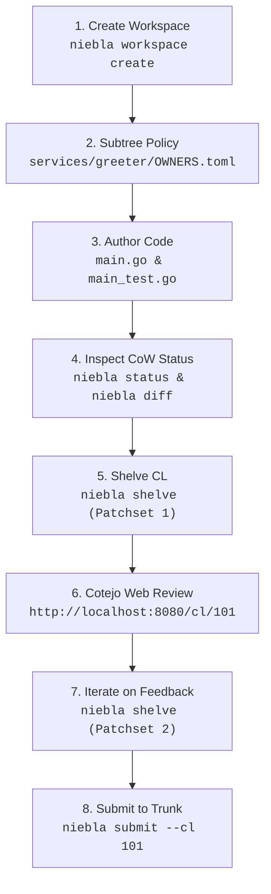

Now that you have installed Niebla and verified your connection to `niebla-server`, let's walk through an end-to-end development cycle. 

In this tutorial, you will:
1. **Create a virtual workspace** backed by `nieblafs`.
2. **Define directory-level governance** using `OWNERS.toml`.
3. **Build a simple Go HTTP microservice** with unit tests.
4. **Inspect scratch changes** and verify local Copy-on-Write (CoW) state.
5. **Shelve your changelist (CL)** into central Content-Addressable Storage (CAS).
6. **Conduct a code review in Cotejo**, iterate with a second patchset, and resolve review comments.
7. **Submit the changelist to trunk** through server-enforced governance gates.

---

## Complete Tutorial Workflow



---

## Step 1: Create a Fresh Virtual Workspace

Unlike Git, where you clone historical packfiles onto your local drive, Niebla workspaces mount directly from `niebla-server` via `nieblafs`.

Run the following command to create a new workspace called `greeter-service`:

```bash
niebla workspace create greeter-service --mount-dir ~/niebla/workspaces/greeter-service
```

Navigate into your new workspace:

```bash
cd ~/niebla/workspaces/greeter-service
```

Verify that the workspace is active and anchored to current trunk:

```bash
niebla status
```

**Expected Output:**
```text
Workspace: greeter-service
Mounted at: /home/user/niebla/workspaces/greeter-service
Base Trunk CL: 100 (clean)
Scratch layer: 0 modified, 0 added, 0 deleted (0 B)
```

> [!NOTE]
> Workspace creation takes **under 50 milliseconds**. The entire monorepo is instantly browseable, but unopened files consume **0 bytes of physical disk space**.

---

## Step 2: Define Subtree Governance (`OWNERS.toml`)

In Niebla, code ownership and review gates are not configured via external repository webhooks or branch protection rules. Instead, they are defined **hierarchically directly in the tree** using `OWNERS.toml`.

Let's create a directory for our new microservice:

```bash
mkdir -p services/greeter
```

Now create `services/greeter/OWNERS.toml`:

```toml
# services/greeter/OWNERS.toml
# Subtree Governance & Review Policy for the Greeter Service

# Approvers who hold sign-off authority for this subtree
approvers = ["alice", "bob"]

# Suggested reviewers to be automatically assigned
reviewers = ["carol"]

# Minimum number of approvals required before submission
required_approvals = 1

# Gate trunk submission on green CI check runs
require_green_ci = true

# Require all discussion threads in Cotejo to be marked resolved
allow_unresolved_comments = false

# Pattern-specific ownership rules
[per_file]
"*.go" = ["alice"]
```

### Why This Matters
* **Autonomous Subtree Ownership:** The team maintaining `services/greeter` decides who can approve code, whether green CI is mandatory, and who gets automatically notified.
* **Server-Enforced:** During `niebla submit`, the server evaluates all touched files against this file. If `alice` hasn't signed off on `*.go`, the submission is rejected.

---

## Step 3: Author the Hello World Service

Now let's write our microservice in Go. Create `services/greeter/main.go`:

```go
package main

import (
	"fmt"
	"log"
	"net/http"
	"os"
)

// GreeterHandler returns a greeting message.
func GreeterHandler(w http.ResponseWriter, r *http.Request) {
	name := r.URL.Query().Get("name")
	if name == "" {
		name = "World"
	}
	fmt.Fprintf(w, "Hello, %s! Welcome to Niebla.\n", name)
}

func main() {
	port := os.Getenv("PORT")
	if port == "" {
		port = "8080"
	}

	http.HandleFunc("/greet", GreeterHandler)

	log.Printf("Starting greeter service on :%s...", port)
	if err := http.ListenAndServe(":"+port, nil); err != nil {
		log.Fatalf("Server failed to start: %v", err)
	}
}
```

Next, add a unit test in `services/greeter/main_test.go`:

```go
package main

import (
	"net/http"
	"net/http/httptest"
	"testing"
)

func TestGreeterHandler(t *testing.T) {
	tests := []struct {
		name           string
		query          string
		expectedBody   string
		expectedStatus int
	}{
		{
			name:           "default greeting",
			query:          "",
			expectedBody:   "Hello, World! Welcome to Niebla.\n",
			expectedStatus: http.StatusOK,
		},
		{
			name:           "personalized greeting",
			query:          "?name=Developer",
			expectedBody:   "Hello, Developer! Welcome to Niebla.\n",
			expectedStatus: http.StatusOK,
		},
	}

	for _, tt := range tests {
		t.Run(tt.name, func(t *testing.T) {
			req := httptest.NewRequest("GET", "/greet"+tt.query, nil)
			w := httptest.NewRecorder()

			GreeterHandler(w, req)

			if w.Code != tt.expectedStatus {
				t.Errorf("expected status %d, got %d", tt.expectedStatus, w.Code)
			}
			if w.Body.String() != tt.expectedBody {
				t.Errorf("expected body %q, got %q", tt.expectedBody, w.Body.String())
			}
		})
	}
}
```

### Run the Tests Locally

Execute standard Go tooling within your workspace mount:

```bash
go test -v ./services/greeter/...
```

**Output:**
```text
=== RUN   TestGreeterHandler
=== RUN   TestGreeterHandler/default_greeting
=== RUN   TestGreeterHandler/personalized_greeting
--- PASS: TestGreeterHandler (0.00s)
    --- PASS: TestGreeterHandler/default_greeting (0.00s)
    --- PASS: TestGreeterHandler/personalized_greeting (0.00s)
PASS
ok      services/greeter    0.012s
```

---

## Step 4: Inspect Workspace State & Diffs

In Niebla, new or modified files are automatically captured in your workspace's local **Copy-on-Write (CoW) scratch layer**.

Inspect your workspace status:

```bash
niebla status
```

**Output:**
```text
Workspace: greeter-service
Base Trunk CL: 100
Scratch Layer:
  + Added: services/greeter/OWNERS.toml
  + Added: services/greeter/main.go
  + Added: services/greeter/main_test.go

Total scratch footprint: 3 files (2.4 KB on disk)
```

Now inspect the diff against base trunk:

```bash
niebla diff
```

Niebla displays terminal diffs with intra-line color highlighting, showing exactly what will be packaged into your changelist.

---

## Step 5: Shelve Your Changelist (CL)

When you are ready to send your code for review, run `niebla shelve`:

```bash
niebla shelve -m "feat(greeter): introduce greeting HTTP service with OWNERS policy"
```

### What Happens Behind the Scenes:
1. **Blob Hashing:** The Niebla CLI hashes your 3 new files using SHA-256.
2. **CAS Upload:** Only these 3 new blobs (2.4 KB) are streamed over gRPC to the central Content-Addressable Storage (CAS).
3. **Merkle Tree Computation:** The server constructs a new Merkle root tree representing the monorepo with your additions applied.
4. **CL & Patchset Creation:** The server registers **CL 101**, initializes **Patchset 1**, and assigns reviewers based on `services/greeter/OWNERS.toml`.

**Expected Output:**
```text
✓ Computed 3 new blobs (2.4 KB)
✓ Streamed to CAS server (127.0.0.1:50051)
✓ Computed Merkle root: 7c89f...21b0
✓ Shelved Changelist 101 (Patchset 1)
  Review URL: http://localhost:8080/cl/101
```

---

## Step 6: Code Review in Cotejo

Open the review link in your web browser:

```
http://localhost:8080/cl/101
```

### What You See in Cotejo:
* **Side-by-Side Diffs:** Review syntax-highlighted code diffs for `OWNERS.toml`, `main.go`, and `main_test.go`.
* **Governance Panel:** The sidebar dynamically parses `services/greeter/OWNERS.toml`:
  * *Approvers:* `alice` or `bob` required.
  * *CI Status:* Waiting for green CI run.
  * *Unresolved Comments:* 0 / 0.
* **AI Hint Agent:** Automated review suggestions appear inline to identify potential edge cases or missing endpoints.

---

## Step 7: Address Feedback with a Second Patchset

Suppose your reviewer (`alice`) leaves an inline comment on `main.go`:
> *"Could we please add a `/healthz` endpoint for Kubernetes liveness probes?"*

In Niebla, you don't create "fixup commits" or rebase Git branches. You simply edit the code in your workspace and shelve again to publish **Patchset 2**.

### 1. Update `services/greeter/main.go`

Add the `/healthz` endpoint to `main.go`:

```go
// HealthzHandler returns HTTP 200 OK for health monitoring.
func HealthzHandler(w http.ResponseWriter, r *http.Request) {
	w.WriteHeader(http.StatusOK)
	fmt.Fprintln(w, "OK")
}
```

Register it in `main()`:

```go
http.HandleFunc("/greet", GreeterHandler)
http.HandleFunc("/healthz", HealthzHandler)
```

### 2. Shelve Patchset 2

From your workspace directory, run:

```bash
niebla shelve -m "feat(greeter): add /healthz liveness probe per review feedback"
```

**Output:**
```text
✓ Computed 1 modified blob (main.go)
✓ Uploaded to CAS
✓ Created Patchset 2 for CL 101
  Review URL: http://localhost:8080/cl/101?patchset=2
```

### 3. Review the Inter-Diff in Cotejo
In the Cotejo web UI, you can now toggle between:
* **Trunk vs. Patchset 2:** The full cumulative change.
* **Patchset 1 vs. Patchset 2 (Inter-diff):** Shows *only* the new `/healthz` handler added in response to Alice's comment!

Mark the comment as **Resolved**.

---

## Step 8: Approval & Submitting to Trunk

Once the reviewer is satisfied:
1. `alice` signs off on the CL by clicking **Approve** in Cotejo (or running `niebla review approve --cl 101`).
2. The CI runner reports green for your tests (`passed`).

Now submit the changelist to trunk:

```bash
niebla submit --cl 101
```

### Server-Enforced Pre-Submit Checks:
1. **OWNERS Check:** Confirms `alice` (authorized in `services/greeter/OWNERS.toml`) approved the change.
2. **Discussion Check:** Verifies all review comments are resolved (`allow_unresolved_comments = false`).
3. **CI Gate:** Confirms CI test runs succeeded (`require_green_ci = true`).
4. **Trunk Rebase Check:** Validates that no conflicting commits landed on trunk while you were in review.

**Output:**
```text
✓ Evaluating OWNERS policy: 1/1 required approvals met (alice)
✓ Checking discussion threads: 1/1 threads resolved
✓ Checking CI check runs: 1/1 runs passed
✓ Fast-forwarding trunk Merkle root tree
✓ CL 101 submitted to trunk as Change 101!
```

---

## Step 9: Workspace Lifecycle & Cleanup

Now that your feature has landed on trunk, you have two options for your local workspace:

### Option A: Synchronize to Latest Trunk (Recommended for Ongoing Work)
Keep the workspace and update its base Merkle root to include the new trunk changes:

```bash
niebla sync
```
Because the files already exist in your local CAS cache, `niebla sync` updates your in-memory metadata in **less than 2 milliseconds with zero file copying**.

### Option B: Delete the Workspace
If you are done with this feature, delete the virtual workspace:

```bash
niebla workspace delete greeter-service
```
This cleanly unmounts `nieblafs` and purges the scratch directory.

---

## Next Steps

Congratulations! You have completed a full Niebla development cycle. Continue exploring Niebla's advanced features:

* **[Virtual Workspaces & Storage Economics](file:///home/matatan/Developer/niebla/docs-site/src/content/docs/workflows/workspaces.md):** Deep dive into FUSE mounts, CAS deduplication, and local disk footprints.
* **[Stacking Dependent Workspaces](file:///home/matatan/Developer/niebla/docs-site/src/content/docs/workflows/development-lifecycle.md#stacking-dependent-workspaces):** Build features on top of pending, unsubmitted changelists.
* **[IDE Setup & Configuration](file:///home/matatan/Developer/niebla/docs-site/src/content/docs/workflows/ide-setup.md):** Configure VS Code, JetBrains IDEs, Neovim, and Emacs for virtual monorepos.
