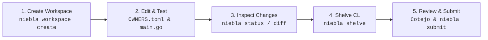

This walkthrough covers a complete development cycle in Niebla:
1. Creating a virtual workspace
2. Defining directory ownership with `OWNERS.toml`
3. Writing and testing code in the [Copy-on-Write (CoW)](https://en.wikipedia.org/wiki/Copy-on-write) scratch layer
4. Shelving a Changelist (CL) for review in **Cotejo**
5. Publishing a second patchset and submitting to [trunk](https://en.wikipedia.org/wiki/Trunk-based_development)



---

## 1. Create a Virtual Workspace

Ensure `niebla-server` and `cotejo` are running (see [Installation & Setup](/niebla/getting-started/installation/) or [Local & Workstation Setup](/niebla/recipes/local-setup/)).

Create a new workspace named `greeter-service`:

```bash
niebla workspace create greeter-service --mount-dir ~/niebla/workspaces/greeter-service
cd ~/niebla/workspaces/greeter-service
```

:::tip[macOS & Containers]
If your environment does not have `/dev/fuse`, add `--no-fuse` to materialize files directly on disk. See [Direct Materialization (`--no-fuse`)](/niebla/workflows/direct-materialization/).
:::

Check the workspace status:

```bash
niebla status
```

```text
Workspace: greeter-service
Mounted at: /home/user/niebla/workspaces/greeter-service
Base Trunk CL: 1 (clean)
Scratch layer: 0 modified, 0 added, 0 deleted (0 B)
```

---

## 2. Add Subtree Governance (`OWNERS.toml`)

In Niebla, review requirements and code ownership live directly in the repository tree via `OWNERS.toml` files rather than external web settings.

Create a directory for the new service and add an `OWNERS.toml` policy:

```bash
mkdir -p services/greeter
cat <<'EOF' > services/greeter/OWNERS.toml
approvers = ["alice", "bob"]
reviewers = ["carol"]
required_approvals = 1
require_green_ci = false
allow_unresolved_comments = false
EOF
```

See [In-Tree Governance (`OWNERS.toml`)](/niebla/workflows/in-tree-governance/) for the full schema, per-file rules, and automated review agents.

---

## 3. Write & Test the Service

Create `services/greeter/main.go`:

```go
package main

import (
	"fmt"
	"log"
	"net/http"
)

func GreeterHandler(w http.ResponseWriter, r *http.Request) {
	name := r.URL.Query().Get("name")
	if name == "" {
		name = "World"
	}
	fmt.Fprintf(w, "Hello, %s! Welcome to Niebla.\n", name)
}

func main() {
	http.HandleFunc("/greet", GreeterHandler)
	log.Fatal(http.ListenAndServe(":8080", nil))
}
```

Standard compilers and test runners work normally inside the workspace mount.

---

## 4. Inspect Scratch Status & Diffs

All new and modified files are stored in the workspace's local scratch layer (`~/.niebla/workspaces/greeter-service/scratch`).

```bash
niebla status
```

```text
Workspace: greeter-service (Base CL 1)

Changes (2 files):
  A  services/greeter/OWNERS.toml
  A  services/greeter/main.go
```

View the unified diff against the base changelist:

```bash
niebla diff
```

---

## 5. Shelve a Changelist (Patchset 1)

Package your changes into a server-authoritative Changelist (CL) for code review:

```bash
niebla shelve -m "feat(greeter): add greeting HTTP service and OWNERS policy"
```

```text
✓ Uploaded 2 blobs to CAS
✓ Shelved Changelist 2 (Patchset 1)
  Review URL: http://127.0.0.1:8080/cl/2
```

Behind the scenes, `niebla shelve` hashes your modified files with [SHA-256](https://en.wikipedia.org/wiki/SHA-2), streams only the changed blobs to [Content-Addressable Storage (CAS)](https://en.wikipedia.org/wiki/Content-addressable_storage), computes a new [Merkle root tree](https://en.wikipedia.org/wiki/Merkle_tree), and registers **Patchset 1** on the server.

---

## 6. Review in Cotejo & Iterate with Patchset 2

Open `http://127.0.0.1:8080/cl/2` in your browser to inspect your changelist in **Cotejo**.

Suppose a reviewer asks for a `/healthz` endpoint. In Niebla, you do not create fixup commits or force-push branches—you edit the file in your workspace and run `niebla shelve` again:

1. Add a health check handler to `services/greeter/main.go`.
2. Shelve the update:
   ```bash
   niebla shelve -m "feat(greeter): add /healthz endpoint"
   ```
   ```text
   ✓ Uploaded 1 modified blob (main.go)
   ✓ Updated CL 2 (Patchset 2)
     Review URL: http://127.0.0.1:8080/cl/2?patchset=2
   ```
3. In Cotejo, switch the diff selector to **Patchset 1 vs. Patchset 2** to review *only* the lines added in Patchset 2.

---

## 7. Approve & Submit to Trunk

Once all comments are resolved and the changelist is approved in Cotejo, land the change onto trunk:

```bash
niebla submit --cl 2
```

```text
✓ Verified OWNERS policy & resolved threads
✓ Submitted CL 2 to trunk as Revision 2
```

After submitting, either sync your workspace to continue working (`niebla sync`) or delete it (`niebla workspace delete greeter-service`).

---

## Next Steps

* **[Workspaces & Storage](/niebla/workflows/workspaces/):** How the 5-layer workspace layout keeps local disk usage near zero.
* **[Development Lifecycle](/niebla/workflows/development-lifecycle/):** Syncing with trunk, resolving merge conflicts, and stacking changelists.
* **[Cotejo Code Review](/niebla/cotejo/overview/):** Attention sets, intra-line diffs, and keyboard shortcuts.
