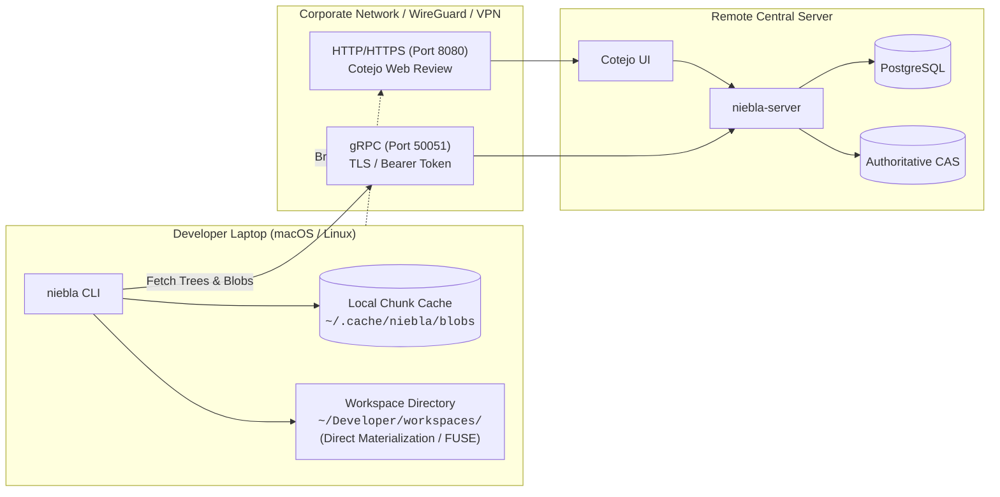

In team environments, developers do not run `niebla-server` or PostgreSQL on their laptops. Instead, a central server or cloud instance hosts the database, Content-Addressable Storage (CAS), and Cotejo review UI.

Developers install only the lightweight `niebla` CLI on their workstation (Linux or macOS). The CLI communicates over secure gRPC, maintains a fast local chunk cache in `~/.cache/niebla/blobs`, and materializes workspaces on demand.



---

## 1. Installing the CLI

### Linux (Nix / Flake)
```bash
nix profile install github:mrtnzjsh/niebla#niebla
```

### macOS (Homebrew or Standalone Binary)
Download the pre-compiled universal binary (`darwin-arm64` for Apple Silicon or `darwin-amd64` for Intel) and place it in your `$PATH`:

```bash
sudo curl -fsSL -o /usr/local/bin/niebla https://releases.internal.corp/niebla/darwin-arm64/niebla
sudo chmod +x /usr/local/bin/niebla
```

Verify the installation:

```console
$ niebla --version
niebla version 1.0.0 (darwin/arm64)
```

---

## 2. Client Configuration (`~/.config/niebla/config.toml`)

Because your laptop is acting strictly as a client, you only need to configure the `[core]` and `[fs]` tables. You **do not** need `[server]`, `[resilience]`, or PostgreSQL connection strings.

Create `~/.config/niebla/config.toml`:

```toml
# ~/.config/niebla/config.toml
version = 1

[core]
# Hostname or IP address of your central Niebla server
server_addr = "niebla.corp.internal:50051"

# Default workspace name if not specified in commands
default_workspace = "my-feature"

# Bearer token if niebla-server requires client authentication
auth_token = "sec_token_prod_eng_a8f9"

[core.tls]
# Enable TLS encryption over the corporate network or internet
enabled = true
# Optional custom corporate CA certificate bundle
ca_file = "/etc/ssl/certs/corporate-ca.pem"
# Server name override for TLS verification (SNI)
server_name = "niebla.corp.internal"

[fs]
# Where workspaces should be created on your local disk
mount_base = "$HOME/Developer/workspaces"

# Local chunk cache for downloaded CAS blobs
cache_dir = "$HOME/.cache/niebla/blobs"
```

Test your connection to the remote server:

```console
$ niebla workspace list
✓ Connected to niebla.corp.internal:50051 (TLS enabled)
Active Workspaces: (0)
```

---

## 3. Direct Materialization on macOS (`--no-fuse`)

Linux supports kernel FUSE for instant virtual mounting. However, macOS deprecated third-party kernel extensions (macFUSE).

To solve this, Niebla provides **Direct Materialization (`--no-fuse`)**. Instead of mounting a virtual filesystem, `niebla` materializes real files on disk using zero-copy file links or sparse local checkouts backed by the local CAS chunk cache (`~/.cache/niebla/blobs`).

### Creating a Workspace with `--no-fuse`

```console
$ niebla workspace create my-feature --no-fuse
✓ Materialized workspace 'my-feature' in 84ms (base CL: #452)
  Location: /Users/developer/Developer/workspaces/my-feature
```

### Making `--no-fuse` the Default on macOS

If you don't want to type `--no-fuse` on every invocation, configure your shell environment:

```bash
# Add to ~/.zshrc or ~/.bashrc:
export NIEBLA_NO_FUSE=true
```

Or pass it via alias:

```bash
alias niebla="niebla --no-fuse"
```

---

## 4. Daily Remote Development Workflow

### Step 1: Open Your Workspace in Your Local IDE
```bash
cd ~/Developer/workspaces/my-feature
code . # Open in VS Code, Cursor, or your favorite editor
```

Because files are materialized directly on your APFS/ext4 disk:
- Language servers (gopls, rust-analyzer, TypeScript language server) work at full native speed.
- File system watchers (`inotify`, `FSEvents`) trigger instantly.
- Compilers write output binaries to local target directories without remote network overhead.

### Step 2: Instant Status & Diffs
Even with thousands of files in the monorepo, `niebla status` and `niebla diff` execute instantaneously by checking the local Copy-on-Write (CoW) scratch manifest:

```console
$ niebla status
Workspace: my-feature
Server:    niebla.corp.internal:50051 (Base CL: #452)

Changes:
  M  pkg/api/handlers.go
  A  pkg/api/metrics.go
```

Inspect word-level diffs:

```console
$ niebla diff pkg/api/handlers.go
```

### Step 3: Shelving Your Changelist
When ready for code review, shelve your changes. Only the delta blobs are compressed with zstd and uploaded to the central server:

```console
$ niebla shelve -m "Add Prometheus request duration metrics" --reviewers "alice,bob"
✓ Uploaded 2 blobs (14.2 KB) to CAS
✓ Created CL #512 (Patchset 1)
  Review URL: https://cotejo.corp.internal/cl/512
```

### Step 4: Conducting Code Review
Click the generated link to open Cotejo in your local browser. Review your diff, respond to comments, or trigger AI code hints.

### Step 5: Submitting from Terminal
Once reviewers approve your CL, commit monotonically to trunk:

```console
$ niebla submit
✓ Pre-submit checks passed (2/2)
✓ Verified approval from: alice, bob
✓ CL #512 merged to trunk as Commit 41a9cb82
✓ Local workspace synced to base CL #512
```

---

## 5. Working Offline

If your network connection drops (e.g., traveling on a train or plane):
1. **Local Editing & Testing:** You can continue editing, compiling, and running local tests inside your materialized workspace.
2. **Local Diffing & Status:** `niebla status` and `niebla diff` work completely offline because they compare your working directory against locally cached base CAS chunks in `~/.cache/niebla/blobs`.
3. **Reconnection:** Once back online, simply run `niebla shelve` to sync your changes with the central repository server.

