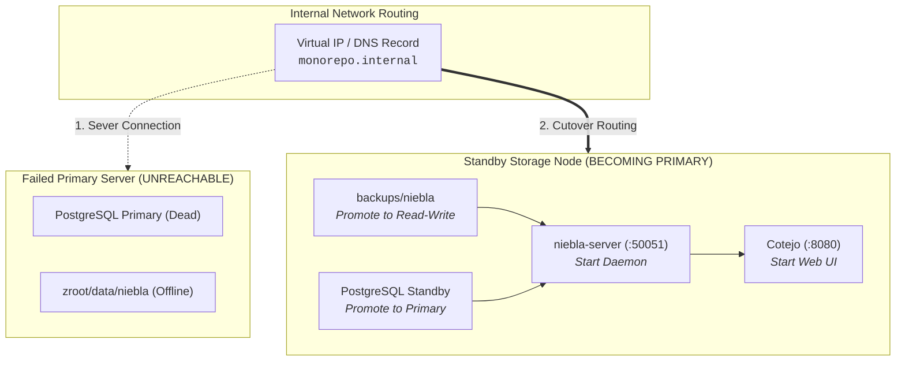

When running enterprise monorepos on dedicated hardware or cloud infrastructure, a catastrophic hardware failure (e.g. motherboard loss, unrecoverable NVMe array fault, datacenter power outage) on the Primary Monorepo Server requires promoting the **Standby Storage Node** to take over production operations.

This runbook details the end-to-end failover sequence with an **RPO (Recovery Point Objective) < 15 minutes** and an **RTO (Recovery Time Objective) < 5 minutes**.

---

## 1. Failover Architecture Overview



---

## 2. Emergency Failover Procedure

### Step 1: Verify Latest Snapshot on Standby Node
SSH into the Standby Storage Node and inspect the replication state:

```bash
# List all replicated snapshots
zfs list -t snapshot -r backups/niebla

# Or use the Niebla CLI backup inspector:
niebla backup list --target zfs
```

Ensure the latest consistent snapshot exists (e.g. `backups/niebla@niebla-auto-20261114-040000`).

---

### Step 2: Roll Back & Promote Dataset to Read-Write
By default during replication, the standby dataset is marked `readonly=on` to prevent accidental divergence.

```bash
# 1. Rollback dataset to the latest consistent snapshot
sudo zfs rollback -r backups/niebla@niebla-auto-20261114-040000

# 2. Disable read-only flag to allow write operations
sudo zfs set readonly=off backups/niebla

# 3. If native ZFS dataset encryption was used (-w), ensure the key is loaded
sudo zfs load-key backups/niebla
sudo zfs mount -a
```

---

### Step 3: Promote Standby PostgreSQL Database
Promote the PostgreSQL read replica to become the new primary writer:

```bash
# On the standby database node:
sudo -u postgres pg_ctl promote -D /var/lib/postgresql/data

# Verify PostgreSQL is accepting writes
psql -U niebla -d niebla_depot -c "SELECT pg_is_in_recovery();"
# Expected output: f (false = write mode enabled)
```

---

### Step 4: Start Niebla Server & Cotejo Daemons
Update system service environment variables on the Standby node to point to the newly promoted storage mount:

```bash
# Verify config points to the local promoted dataset
sudo cat /etc/niebla/config.toml
# Ensure:
# [core]
# blob_dir = "/backups/niebla/cas"
# server_addr = "0.0.0.0:50051"

# Start the services
sudo systemctl restart niebla-server
sudo systemctl restart cotejo

# Check service health
curl -I http://localhost:8080/healthz
```

---

### Step 5: Shift Network DNS / Virtual IP
Redirect developer traffic from the failed hardware to the Standby Node:

1. **If using Keepalived / Virtual IP**: The Standby node will have automatically assumed the VIP (`10.0.1.100`).
2. **If using Internal DNS (`monorepo.internal`)**:
   ```bash
   # Update CoreDNS or AWS Route 53 private hosted zone record:
   # monorepo.internal -> <Standby_Node_IP>
   ```

---

### Step 6: Client Workstation Verification
On developer workstations, verify that existing virtual workspaces continue operating smoothly:

```bash
# 1. Check server connection
niebla config path

# 2. Synchronize workspace base Merkle tree
niebla sync

# 3. Inspect status
niebla status
```

Because blobs are identified strictly by their cryptographic SHA-256 digests, active developer workspaces automatically re-anchor to the promoted server **with zero re-cloning or data loss**.

