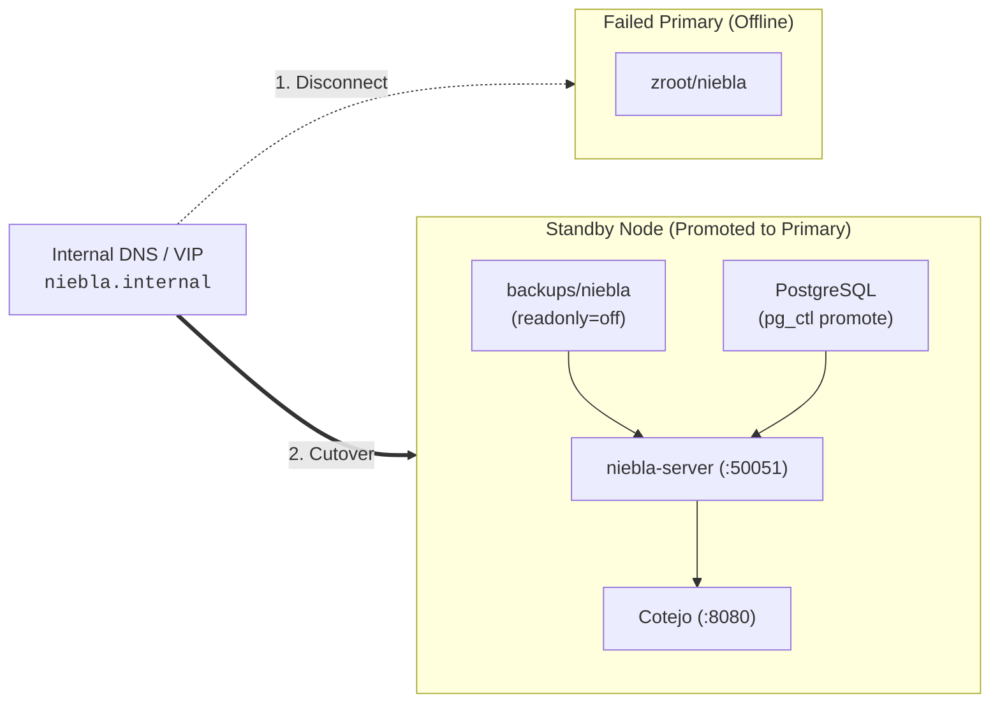

Niebla includes a built-in resilience engine (`niebla backup`) that supports two backup strategies:

1. **Incremental [ZFS](https://en.wikipedia.org/wiki/ZFS) Replication (`[resilience.zfs]`):** Uses atomic ZFS snapshots and raw encrypted `zfs send -w -I` streams to replicate [CAS](https://en.wikipedia.org/wiki/Content-addressable_storage) blobs and PostgreSQL state to a standby storage node in seconds.
2. **Portable Encrypted Bundles (`[resilience.bundle]`):** Packages a consistent PostgreSQL dump (`pg_dump`) and incremental CAS blobs into a [Zstandard](https://en.wikipedia.org/wiki/Zstandard)-compressed, [AES-256-GCM](https://en.wikipedia.org/wiki/Galois/Counter_Mode) encrypted archive (`.nbk`) and uploads it to S3, SFTP, or WebDAV.

---

## 1. Configuring ZFS Datasets & Replication

### Primary Host Dataset Setup

Create a dedicated ZFS dataset on the primary server for Niebla's CAS blobs and backups:

```bash
sudo zfs create -o mountpoint=/var/lib/niebla \
  -o compression=zstd \
  -o atime=off \
  -o recordsize=128K \
  zroot/niebla

sudo zfs create zroot/niebla/blobs
sudo chown -R niebla:niebla /var/lib/niebla
```

### Non-Root SSH & `zfs allow` Delegation

To replicate snapshots without root SSH access, create a `niebla-repl` user on the standby node and delegate ZFS receive permissions:

```bash
# On the Standby Storage Node:
sudo useradd -m -s /bin/bash niebla-repl
sudo zfs create -o readonly=on backups/niebla
sudo zfs allow -u niebla-repl receive,create,mount,rollback,destroy backups/niebla

# On the Primary Host (delegate snapshot & send to the local service user):
sudo zfs allow -u niebla snapshot,send,hold,destroy zroot/niebla
```

### `[resilience]` Configuration (`config.toml`)

```toml
[resilience]
enabled = true
default_mode = "zfs"

[resilience.zfs]
enabled = true
dataset = "zroot/niebla"
snapshot_prefix = "niebla-auto"
remote_host = "niebla-repl@standby-storage.internal"
remote_dataset = "backups/niebla"
ssh_key_path = "/etc/niebla/ssh/zfs_repl_ed25519"
raw_encrypted = true
 compressed_send = true

[resilience.schedule]
auto_backup = true
interval_hours = 1
retention_count = 48
snapshot_on_submit = true
```

---

## 2. Running & Restoring Backups via CLI

You can trigger snapshots, list recovery points, and verify archives on demand using `niebla backup`:

```bash
# Create an immediate snapshot and replicate to configured targets
niebla backup create --mode zfs

# Or create an encrypted portable bundle and upload to S3
niebla backup create --mode bundle --upload s3

# List available snapshots and bundles
niebla backup list

# Restore from a portable encrypted bundle
niebla backup restore /var/backups/niebla/backup-20261114-120000.nbk.enc
```

---

## 3. Emergency Standby Failover Runbook

If the primary server experiences a hardware outage, promote the standby ZFS and PostgreSQL node to become the new primary server.



### Step 1: Verify Latest Replicated Snapshot

SSH into the standby node and inspect the latest replicated snapshot:

```bash
zfs list -t snapshot -r backups/niebla
```

### Step 2: Roll Back & Enable Writes on the Standby Dataset

```bash
# 1. Roll back to the latest consistent snapshot
sudo zfs rollback -r backups/niebla@niebla-auto-20261114-040000

# 2. Disable read-only mode so niebla-server can write new blobs
sudo zfs set readonly=off backups/niebla

# 3. Load encryption key (if raw_encrypted = true) and mount
sudo zfs load-key backups/niebla
sudo zfs mount -a
```

### Step 3: Promote Standby PostgreSQL Replica

```bash
sudo -u postgres pg_ctl promote -D /var/lib/postgresql/data

# Verify recovery mode is false (f)
psql -U niebla -d niebla -c "SELECT pg_is_in_recovery();"
```

### Step 4: Start Services & Cut Over DNS

1. Verify `/etc/niebla/config.toml` on the standby node points `blob_path` to the mounted `backups/niebla/blobs` directory.
2. Start the daemons and verify health:
   ```bash
   sudo systemctl start niebla-server cotejo
   curl -I http://127.0.0.1:8080/healthz
   ```
3. Update your internal DNS record (`niebla.internal`) or Virtual IP to route traffic to the standby node.

### Step 5: Verify Client Workstations

Because CAS blobs are addressed strictly by [SHA-256](https://en.wikipedia.org/wiki/SHA-2) digest, developer workspaces automatically reconnect to the promoted server without re-cloning:

```bash
niebla sync
niebla status
```
