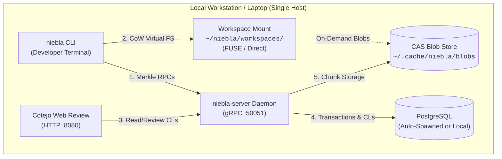

Running Niebla in a fully local, all-in-one configuration is the fastest way to evaluate the toolchain, develop features offline, or set up a self-contained single-developer workstation.

In this topology, every subsystem—the central gRPC daemon (`niebla-server`), the metadata database (PostgreSQL), the Content-Addressable Storage (CAS) directory, the Cotejo code review web interface (`cotejo`), and developer virtual workspaces—executes on a single physical host.



---

## 1. Prerequisites

Before starting, ensure your local environment satisfies:

- **Operating System:** Linux (Kernel $\ge 5.10$ for FUSE / `io_uring`) or macOS (using `--no-fuse` direct materialization).
- **PostgreSQL:** Version 14+ installed locally (or Docker if using containerized database).
- **FUSE:** `fuse3` package installed on Linux (e.g., `sudo apt install fuse3` or `pkgs.fuse3` on NixOS).

---

## 2. Minimal Local Configuration

Niebla's auto-initialization generates baseline defaults out of the box, but creating an explicit `~/.config/niebla/config.toml` gives you complete control over local paths and ports.

Run `niebla config init` or write the following skeleton:

```toml
# ~/.config/niebla/config.toml
version = 1

[core]
# Local loopback address for gRPC
server_addr = "127.0.0.1:50051"
default_workspace = "default"

[server]
host = "127.0.0.1"
port = 50051
# Connect via local PostgreSQL socket or standard TCP port
db_url = "postgres:///niebla?host=/run/postgresql"
# Automatically launch local PostgreSQL if not running
auto_db = true
# Local CAS blob root path
blob_path = "$HOME/.cache/niebla/blobs"
cache_size = 10000

[fs]
# Directory where virtual workspaces are mounted
mount_base = "$HOME/niebla/workspaces"
cache_dir = "$HOME/.cache/niebla/blobs"

[critique]
host = "127.0.0.1"
port = 8080
proxy_port = 7331
# Automatically defaults to your active OS user
default_reviewer = "$USER"
# In local mode, zero approvals are required so you can submit your own CLs
required_approvals = 0
allow_submit_with_unresolved_comments = false

[critique.auth]
mode = "local"
default_user = "$USER"

[critique.theme]
preset = "catppuccin-mocha"
syntax_style = "catppuccin-mocha"
```

Verify your configuration with the fast-fail validator:

```console
$ niebla config validate
✓ Configuration is valid (/home/developer/.config/niebla/config.toml)
```

---

## 3. Starting the Local Services

You can launch `niebla-server` and `cotejo` either as background terminal processes or as systemd user services.

### Option A: Interactive Foreground (Development Mode)

Open two terminal tabs:

**Terminal 1 — Repository Daemon:**
```bash
niebla-server --config ~/.config/niebla/config.toml
```
*Output:*
```
21:40:00 [INFO] niebla-server starting on 127.0.0.1:50051
21:40:00 [INFO] PostgreSQL connection established: niebla
21:40:00 [INFO] CAS blob storage initialized at /home/developer/.cache/niebla/blobs
21:40:00 [INFO] gRPC server listening on 127.0.0.1:50051
```

**Terminal 2 — Cotejo Web Review:**
```bash
cotejo --config ~/.config/niebla/config.toml
```
*Output:*
```
21:40:05 [INFO] cotejo listening on http://127.0.0.1:8080 (theme: catppuccin-mocha)
21:40:05 [INFO] connected to niebla-server at 127.0.0.1:50051
```

---

### Option B: Systemd User Services (Persistent Background)

For a persistent workstation setup that survives reboots, configure systemd user services:

**`~/.config/systemd/user/niebla-server.service`:**
```ini
[Unit]
Description=Niebla Repository gRPC Daemon
After=network.target postgresql.service

[Service]
ExecStart=%h/.nix-profile/bin/niebla-server --config %h/.config/niebla/config.toml
Restart=always
RestartSec=3

[Install]
WantedBy=default.target
```

**`~/.config/systemd/user/cotejo.service`:**
```ini
[Unit]
Description=Cotejo Code Review Web UI
After=niebla-server.service

[Service]
ExecStart=%h/.nix-profile/bin/cotejo --config %h/.config/niebla/config.toml
Restart=always
RestartSec=3

[Install]
WantedBy=default.target
```

Enable and start both services:

```bash
systemctl --user daemon-reload
systemctl --user enable --now niebla-server cotejo
```

Check status:

```bash
systemctl --user status niebla-server cotejo
```

---

## 4. End-to-End Developer Workflow

With services running, test the full local development lifecycle:

### Step 1: Create a Workspace
```console
$ niebla workspace create feature-search
✓ Workspace feature-search created in 12ms (base CL: #0)
  Mounted at: /home/developer/niebla/workspaces/feature-search
```

### Step 2: Make Code Edits
```bash
cd ~/niebla/workspaces/feature-search
mkdir -p internal/search
cat <<'EOF' > internal/search/search.go
package search

func Find(query string) []string {
    return []string{"result-1", "result-2"}
}
EOF
```

### Step 3: Inspect Scratch Overlay
```console
$ niebla status
Workspace: feature-search
Base CL:   #0 (Trunk)

Changes (CoW Scratch):
  A  internal/search/search.go
```

### Step 4: Shelve a Changelist
```console
$ niebla shelve -m "Add internal search package"
✓ Shelved Patchset 1 for CL #101
  Review: http://127.0.0.1:8080/cl/101
```

### Step 5: Review & Submit
1. Open [`http://127.0.0.1:8080/cl/101`](http://127.0.0.1:8080/cl/101) in your browser.
2. Inspect the syntax-highlighted diff.
3. Because `required_approvals = 0` in local mode, you can submit immediately from your terminal:

```console
$ niebla submit
✓ CL #101 committed to trunk monotonically (Commit Hash: 8f4a1c72)
  Workspace synced with trunk.
```

---

## 5. Cleaning Up Workspaces

When your feature is merged, safely unmount and remove the scratch workspace:

```console
$ cd ~
$ niebla workspace delete feature-search
✓ Workspace feature-search unmounted and deleted.
```

