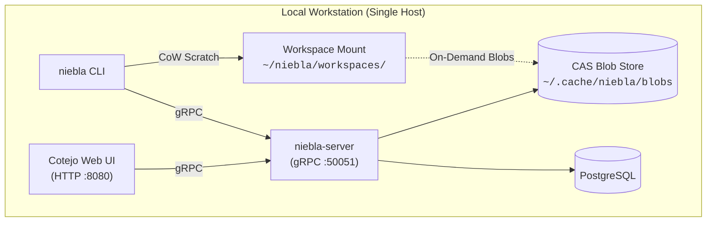

You can run the entire Niebla stack (`niebla-server`, PostgreSQL, [CAS](https://en.wikipedia.org/wiki/Content-addressable_storage) storage, Cotejo, and the `niebla` CLI) on a single workstation, or configure a laptop as a lightweight client connected to a remote `niebla-server`.

---

## 1. Local All-in-One Setup (Single Machine)

In an all-in-one setup, every component runs on `127.0.0.1` with zero external network dependencies.



### Configuration (`~/.config/niebla/config.toml`)

Run `niebla config init` or create `~/.config/niebla/config.toml`:

```toml
version = 1

[core]
server_addr = "127.0.0.1:50051"
default_workspace = "default"

[server]
host = "127.0.0.1"
port = 50051
db_url = "postgres:///niebla?host=/run/postgresql"
auto_db = true
blob_path = "$HOME/.cache/niebla/blobs"
cache_size = 10000

[fs]
mount_base = "$HOME/niebla/workspaces"
cache_dir = "$HOME/.cache/niebla/blobs"

[critique]
host = "127.0.0.1"
port = 8080
proxy_port = 7331
default_reviewer = "$USER"
required_approvals = 0
allow_submit_with_unresolved_comments = false

[critique.auth]
mode = "local"
default_user = "$USER"

[critique.theme]
preset = "catppuccin-mocha"
syntax_style = "catppuccin-mocha"
```

Validate your configuration and FUSE environment readiness:

```console
$ niebla config validate
✓ Configuration is valid: /home/developer/.config/niebla/config.toml
  • Server gRPC      : 127.0.0.1:50051
  • Workspace root   : /home/developer/niebla/workspaces
  • Critique web UI  : http://127.0.0.1:8080
  • Critique theme   : catppuccin-mocha (syntax: catppuccin-mocha)
  • Default reviewer : developer
  • FUSE readiness   : ready (/dev/fuse, fusermount3 setuid root, user_allow_other)
```

:::tip[FUSE Automation on NixOS]
On NixOS, `services.niebla` automatically enables `programs.fuse.enable = true;` and `programs.fuse.userAllowOther = true;`, ensuring `/run/wrappers/bin/fusermount3` has the setuid root bit and `/etc/fuse.conf` allows unprivileged mounts out of the box.
:::

### Running the Local Services

#### Option A: Interactive Foreground

Open two terminal tabs:

```bash
# Terminal 1: Repository daemon
niebla-server --config ~/.config/niebla/config.toml

# Terminal 2: Cotejo review UI
cotejo --config ~/.config/niebla/config.toml
```

#### Option B: Persistent `systemd` User Services

To keep `niebla-server` and `cotejo` running across reboots on Linux:

**`~/.config/systemd/user/niebla-server.service`:**
```ini
[Unit]
Description=Niebla Repository gRPC Daemon
After=network.target postgresql.service

[Service]
ExecStart=%h/.nix-profile/bin/niebla-server --config %h/.config/niebla/config.toml
Restart=always
RestartSec=3

[Install]
WantedBy=default.target
```

**`~/.config/systemd/user/cotejo.service`:**
```ini
[Unit]
Description=Cotejo Code Review Web UI
After=niebla-server.service

[Service]
ExecStart=%h/.nix-profile/bin/cotejo --config %h/.config/niebla/config.toml
Restart=always
RestartSec=3

[Install]
WantedBy=default.target
```

Enable and start both services:

```bash
systemctl --user daemon-reload
systemctl --user enable --now niebla-server cotejo
```

Once running, follow the [Quickstart Walkthrough](/niebla/getting-started/quickstart/) to create your first workspace, shelve a changelist, and submit it to trunk.

---

## 2. Remote Client Workstation Setup (Linux, macOS & Windows)

When connecting a developer laptop to a shared or remote `niebla-server`, the workstation only needs the `niebla` CLI (plus `nieblafs` if using [FUSE](https://en.wikipedia.org/wiki/Filesystem_in_Userspace) mounts on Linux). You do not need to run PostgreSQL, `niebla-server`, or `cotejo` locally.

### Client Configuration (`~/.config/niebla/config.toml`)

Point `server_addr` to the remote server and omit the `[server]` and `[critique]` blocks:

```toml
version = 1

[core]
server_addr = "niebla.internal.example.com:50051"
default_workspace = "main-dev"

# Optional: TLS and bearer token authentication for remote gRPC
tls_cert = "$HOME/.config/niebla/certs/ca.crt"
auth_token_env = "NIEBLA_AUTH_TOKEN"

[fs]
mount_base = "$HOME/Developer/workspaces"
cache_dir = "$HOME/.cache/niebla/blobs"
```

If your server requires bearer token authentication, export `NIEBLA_AUTH_TOKEN` in your shell profile (`~/.zshrc` or `~/.bashrc`):

```bash
export NIEBLA_AUTH_TOKEN="niebla_pat_9f8e7d6c5b4a3f2e1d0c"
```

### Linux, macOS & Windows Workspaces

* **Linux Workstations (FUSE or Direct):**
  * **FUSE Mount (default):** `niebla workspace create my-feature` mounts a [copy-on-write](https://en.wikipedia.org/wiki/Copy-on-write) virtual workspace in `< 50ms` and streams file blobs on demand into `~/.cache/niebla/blobs`.
  * **Direct Materialization:** Pass `--no-fuse` (`niebla workspace create my-feature --no-fuse`) if running inside an unprivileged container or if you prefer standard local files.
* **macOS Workstations (`--no-fuse`):**
  * Runs via direct materialization (`niebla workspace create my-feature --no-fuse`). Normalizes decomposed Unicode (NFD) to Unicode NFC automatically.
* **Windows Workstations (`--no-fuse`):**
  * Runs natively via `niebla.exe` (`niebla workspace create my-feature --no-fuse`). Configured in `$HOME\.config\niebla\config.toml` (or `%USERPROFILE%\.config\niebla\config.toml`). Automatically normalizes Windows backslashes (`\`) and safely intercepts NTFS case-folding collisions.
  * See [Installation & Setup](/niebla/getting-started/installation/) and [Direct Materialization (`--no-fuse`)](/niebla/workflows/direct-materialization/) for details.
