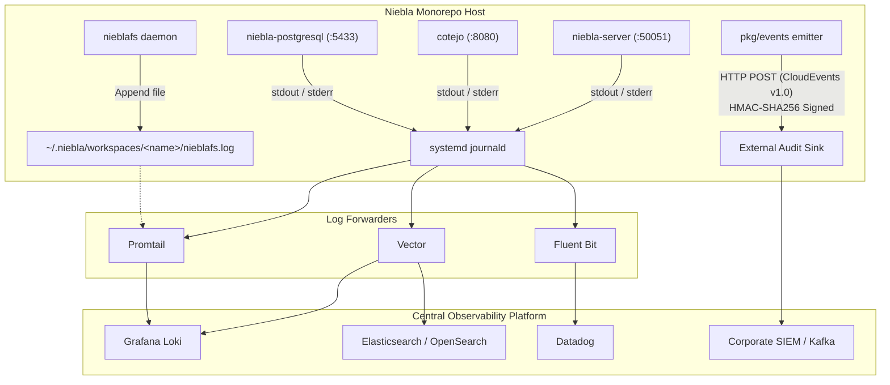

Niebla generates four distinct categories of operational data:
1. **Server Daemon Logs:** Low-level process, network, and database activity from `niebla-server`, `cotejo`, and `niebla-postgresql`.
2. **Client VFS Diagnostics:** Filesystem mounts, cache hits, and inode promotions from `nieblafs` background daemons.
3. **Structured Audit Events:** Cryptographically signed CloudEvents v1.0 records tracking repository mutations (shelving, submissions, reviews).
4. **Hermetic CI Build Logs:** Build, lint, and test logs stored as immutable content-addressed blobs in CAS.

This guide provides end-to-end recipes for shipping these logs into centralized platforms such as **Grafana Loki**, **Elasticsearch / OpenSearch**, and **Datadog**.

---

## 1. Observability Architecture Overview



---

## 2. Server Logging via systemd & Journald

When running under systemd (including via the NixOS module `services.niebla.enable = true`), `niebla-server` and `cotejo` stream timestamped logs to `stdout`/`stderr`, which are captured by `systemd-journald`.

### Operational Journald Commands

```bash
# Follow logs from all Niebla services in real-time
journalctl -u niebla-server -u cotejo -u niebla-postgresql -f

# Filter only errors and warnings from the repository server
journalctl -u niebla-server -p err..emerg

# View logs for a specific time window
journalctl -u niebla-server --since "1 hour ago"

# Export logs in structured JSON format
journalctl -u niebla-server -n 100 -o json-pretty
```

---

## 3. Shipping Logs with Vector (Recommended)

[Vector](https://vector.dev/) is an ultra-fast, memory-efficient observability pipeline. It is the recommended forwarder for Niebla because of its native journald source, sub-millisecond transforms, and multi-sink support.

### Complete `vector.toml` Configuration

```toml
# 1. Ingest journald logs for Niebla systemd units
[sources.niebla_journal]
type = "journald"
include_units = [
  "niebla-server",
  "cotejo",
  "niebla-postgresql"
]

# 2. Extract structured metadata and normalize fields
[transforms.niebla_enrich]
type = "remap"
inputs = ["niebla_journal"]
source = '''
.service = ._SYSTEMD_UNIT
.host = .host
.pid = to_int!(._PID)

# Categorize log level if emitted by Go log or PostgreSQL
if match(.message, r'error|failed|fatal|panic') {
  .level = "error"
} else if match(.message, r'warn') {
  .level = "warn"
} else {
  .level = "info"
}
'''

# 3. Sink: Ship to Grafana Loki
[sinks.loki]
type = "loki"
inputs = ["niebla_enrich"]
endpoint = "http://loki.internal.net:3100"
encoding.codec = "text"
labels.service = "{{ service }}"
labels.level = "{{ level }}"
labels.host = "{{ host }}"

# 4. Optional Sink: Ship to Elasticsearch / OpenSearch
# [sinks.opensearch]
# type = "elasticsearch"
# inputs = ["niebla_enrich"]
# endpoint = "https://opensearch.internal.net:9200"
# index = "niebla-logs-%Y.%m.%d"
# auth.strategy = "bearer"
# auth.token = "${OPENSEARCH_TOKEN}"
```

---

## 4. Shipping Logs with Promtail & Grafana Loki

If your infrastructure already standardizes on the Grafana stack (Loki + Grafana + Prometheus), you can use **Promtail** to tail both systemd units and client workspace logs.

### `promtail-config.yaml`

```yaml
server:
  http_listen_port: 9080
  grpc_listen_port: 0

positions:
  filename: /var/lib/promtail/positions.yaml

clients:
  - url: http://loki.internal.net:3100/loki/api/v1/push

scrape_configs:
  # Scrape Niebla service daemons via systemd journal
  - job_name: niebla-daemons
    journal:
      max_age: 12h
      labels:
        environment: production
        host: monorepo-primary
      matches: _SYSTEMD_UNIT=niebla-server.service + _SYSTEMD_UNIT=cotejo.service + _SYSTEMD_UNIT=niebla-postgresql.service
    relabel_configs:
      - source_labels: ['__journal__systemd_unit']
        target_label: 'service'

  # Optional: Scrape client-side FUSE daemon logs on shared dev servers
  - job_name: nieblafs-clients
    static_configs:
      - targets: [localhost]
        labels:
          job: nieblafs
          __path__: /home/*/.niebla/workspaces/*/nieblafs.log
    pipeline_stages:
      - regex:
          expression: '^(?P<timestamp>\d{4}/\d{2}/\d{2} \d{2}:\d{2}:\d{2}) (?P<message>.*)$'
      - timestamp:
          source: timestamp
          format: '2006/01/02 15:04:05'
```

### Useful Grafana LogQL Queries

* **Watch Trunk Submissions:**
  ```logql
  {service="niebla-server.service"} |= "SubmitCL"
  ```
* **Track Inter-Diff View Rates in Cotejo:**
  ```logql
  {service="cotejo.service"} |= "GET /cl/" |= "diff-content"
  ```
* **Error Rate Spike Alert:**
  ```logql
  sum(rate({service=~"niebla.*"} |= "error" [5m])) by (service)
  ```

---

## 5. Declarative NixOS Configuration

On NixOS, you can configure Promtail or Vector alongside `services.niebla` in your system flake with zero manual service files:

```nix
# /etc/nixos/configuration.nix
{ config, pkgs, ... }: {
  # 1. Enable Niebla Monorepo Suite
  services.niebla.enable = true;

  # 2. Declaratively forward systemd logs to corporate Loki instance
  services.promtail = {
    enable = true;
    configuration = {
      server.http_listen_port = 9080;
      clients = [{ url = "http://loki.internal.net:3100/loki/api/v1/push"; }];
      scrape_configs = [{
        job_name = "niebla-systemd";
        journal = {
          max_age = "12h";
          labels.host = config.networking.hostName;
          matches = "_SYSTEMD_UNIT=niebla-server.service + _SYSTEMD_UNIT=cotejo.service";
        };
        relabel_configs = [{
          source_labels = [ "__journal__systemd_unit" ];
          target_label = "service";
        }];
      }];
    };
  };
}
```

---

## 6. Shipping Structured Audit Events (CloudEvents)

While process logs capture debug information, security and compliance teams typically require **structured, tamper-evident audit trails**:
* Who shelved a changelist?
* What files were touched?
* Who granted LGTM approvals?
* When did a changelist land on trunk?

Niebla emits these events as standard [CloudEvents v1.0 JSON](https://mrtnzjsh.github.io/niebla/reference/events/) payloads with an HMAC-SHA256 signature header (`X-Niebla-Signature`).

### Forwarding CloudEvents into an Audit SIEM

In `~/.config/niebla/config.toml` (or `/etc/niebla/server.toml`):

```toml
[events]
enabled = true
sink = "https://siem-collector.internal.net/v1/niebla-audit"
secret_env = "NIEBLA_AUDIT_SECRET"
```

### Sample Audit Payload Received by Log Gateway

```json
{
  "specversion": "1.0",
  "id": "cl-sub-104-ps2",
  "source": "niebla://server/repositories/primary",
  "type": "dev.niebla.cl.submitted",
  "time": "2026-11-14T16:45:00Z",
  "datacontenttype": "application/json",
  "data": {
    "cl_id": 104,
    "trunk_revision": 315,
    "author": "alice",
    "submitter": "alice",
    "approvers": ["bob", "sec-team"],
    "root_tree_hash": "4f8b2d18c991a0293847e18928374b9281734918237498127394812739481234"
  }
}
```

Audit systems verify the payload using `crypto/subtle.ConstantTimeCompare` against `X-Niebla-Signature` (see [CloudEvents Signature Verification](https://mrtnzjsh.github.io/niebla/reference/events/#4-verifying-webhook-signatures-hmac-sha256)).

---

## 7. CI Runner Build Logs & Content-Addressable Storage

When running continuous integration check runs via `niebla ci exec` or reporting results via `niebla ci report`:

```bash
# Capture build logs and compute SHA-256 digest
niebla ci report \
  --cl 104 \
  --patchset 2 \
  --runner "nix-build" \
  --status "passed" \
  --log-file /tmp/build.log \
  --url "https://ci.internal.net/runs/4812"
```

### Accessing Logs Independent of Ephemeral CI Runners
1. The log file is uploaded directly to central Content-Addressable Storage (CAS).
2. Even after the CI runner container is destroyed, developers and review personas can fetch the raw logs at any time:
   ```bash
   niebla cas get <log_sha256> --out ./build.log
   ```
3. Cotejo renders a direct link to the log and external runner URL on the changelist review page.

---

## Related Documentation

* **[CloudEvents & Webhooks Reference](https://mrtnzjsh.github.io/niebla/reference/events/):** Complete schema specification and webhook payload definitions.
* **[Security & Authentication Architecture](https://mrtnzjsh.github.io/niebla/reference/security-auth/):** Transport security, bearer tokens, and HMAC verification.
* **[Troubleshooting Runbook](https://mrtnzjsh.github.io/niebla/workflows/troubleshooting/):** Inspecting FUSE daemon logs and diagnosing lock contention.
