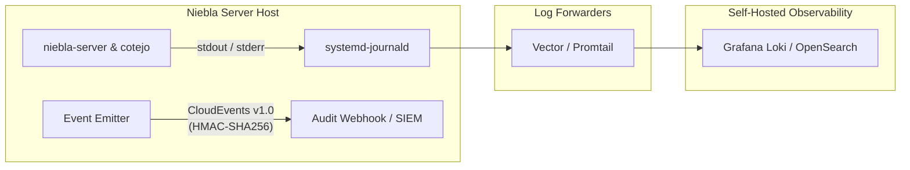

Niebla emits four categories of operational data—all generated locally and never sent to external third parties unless you explicitly configure a log forwarder or webhook sink:

1. **Server Daemon Logs:** Process, [gRPC](https://en.wikipedia.org/wiki/GRPC), and database logs written to `stdout`/`stderr` by `niebla-server` and `cotejo`.
2. **Client [VFS](https://en.wikipedia.org/wiki/Virtual_file_system) Logs:** Mount diagnostics and cache events written to `~/.niebla/workspaces/<name>/nieblafs.log`.
3. **Structured Audit Events:** [HMAC-SHA256](https://en.wikipedia.org/wiki/HMAC) signed [CloudEvents v1.0](/niebla/reference/events/) payloads emitted on repository mutations.
4. **CI Check Run Logs:** Build and test logs stored as immutable blobs in [Content-Addressable Storage (CAS)](https://en.wikipedia.org/wiki/Content-addressable_storage).



---

## 1. Inspecting Logs with `journalctl`

When running under `systemd`, inspect `niebla-server` and `cotejo` logs using `journalctl`:

```bash
# Follow live logs across all Niebla services
journalctl -u niebla-server -u cotejo -f

# Filter only errors and critical failures
journalctl -u niebla-server -p err..emerg

# Export recent logs as structured JSON
journalctl -u niebla-server -n 100 -o json-pretty
```

---

## 2. Forwarding Logs with Vector

[Vector](https://vector.dev/) can ingest `systemd-journald` units directly and forward them to Grafana Loki, Elasticsearch, or OpenSearch.

```toml
# /etc/vector/vector.toml
[sources.niebla_journal]
type = "journald"
include_units = ["niebla-server", "cotejo"]

[transforms.niebla_enrich]
type = "remap"
inputs = ["niebla_journal"]
source = '''
.service = ._SYSTEMD_UNIT
if match(string!(.message), r'(?i)error|failed|fatal|panic') {
  .level = "error"
} else if match(string!(.message), r'(?i)warn') {
  .level = "warn"
} else {
  .level = "info"
}
'''

[sinks.loki]
type = "loki"
inputs = ["niebla_enrich"]
endpoint = "http://loki.internal:3100"
encoding.codec = "text"
labels.service = "{{ service }}"
labels.level = "{{ level }}"
labels.host = "{{ host }}"
```

---

## 3. Forwarding Logs with Promtail (Grafana Loki)

If your stack uses Promtail, configure a `journal` scrape job alongside an optional static file scrape for `nieblafs.log` on shared build hosts:

```yaml
# /etc/promtail/config.yaml
server:
  http_listen_port: 9080

positions:
  filename: /var/lib/promtail/positions.yaml

clients:
  - url: http://loki.internal:3100/loki/api/v1/push

scrape_configs:
  - job_name: niebla-daemons
    journal:
      max_age: 12h
      labels:
        environment: production
      matches: _SYSTEMD_UNIT=niebla-server.service + _SYSTEMD_UNIT=cotejo.service
    relabel_configs:
      - source_labels: ['__journal__systemd_unit']
        target_label: 'service'

  - job_name: nieblafs-clients
    static_configs:
      - targets: [localhost]
        labels:
          job: nieblafs
          __path__: /home/*/.niebla/workspaces/*/nieblafs.log
```

---

## 4. Streaming Structured Audit Events (CloudEvents)

To track repository mutations (who shelved a changelist, who approved it, and when it was submitted to trunk) in a security [SIEM](https://en.wikipedia.org/wiki/Security_information_and_event_management), enable `[events]` in `config.toml`:

```toml
[events]
enabled = true
provider = "webhook"

[events.webhook]
endpoint = "https://siem-collector.internal/v1/niebla-audit"
secret_token_env = "NIEBLA_AUDIT_SECRET"
max_retries = 5
timeout_ms = 5000
```

See the [CloudEvents & Webhooks Reference](/niebla/reference/events/) for the full JSON payload schema and HMAC-SHA256 verification examples.

---

## 5. Persisting CI Build Logs in CAS

When CI pipelines report check runs with `niebla ci report --log-file`, the build log is uploaded to Content-Addressable Storage (CAS) and linked directly on the Cotejo review page:

```bash
niebla ci report \
  --cl 104 \
  --patchset 2 \
  --runner "nix-build" \
  --status "passed" \
  --log-file /tmp/build.log \
  --url "https://ci.internal/runs/4812"
```

Because the log is stored in CAS by [SHA-256](https://en.wikipedia.org/wiki/SHA-2) hash, developers can retrieve it even after ephemeral CI containers are destroyed:

```bash
niebla cas get <log_sha256> --out ./build.log
```
