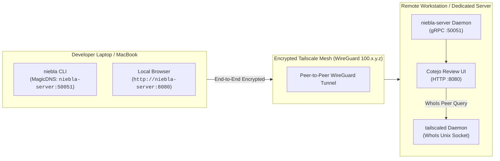

By combining Niebla with **Tailscale**, you can access your remote repository server (`niebla-server` on port 50051) and code review interface (`cotejo` on port 8080) from any developer laptop, MacBook, or mobile workstation without opening public firewall ports or managing complex VPN gateways.

Cotejo natively integrates with Tailscale's local daemon API: when configured with `[critique.auth] mode = "tailscale"`, Cotejo queries `/run/tailscale/tailscaled.sock` using Tailscale WhoIs to authenticate users automatically based on their verified WireGuard peer connection.



---

## 1. Configure the Remote Host

On the machine hosting `niebla-server` and `cotejo` (e.g., your home server, office workstation, or dedicated build machine), install and authenticate Tailscale:

```bash
sudo tailscale up --ssh
```

Note your machine's **MagicDNS name** (for example, `monorepo-box.tailnet1234.ts.net` or simply `monorepo-box`).

### Server Configuration (`~/.config/niebla/config.toml`)

Configure the services to bind to all interfaces (`0.0.0.0`) so they are accessible over the Tailscale interface (`tailscale0`):

```toml
# ~/.config/niebla/config.toml
version = 1

[core]
server_addr = "0.0.0.0:50051"
default_workspace = "default"

[server]
host = "0.0.0.0"
port = 50051
db_url = "postgres:///niebla?host=/run/postgresql"
auto_db = true
blob_path = "$HOME/.cache/niebla/blobs"

[critique]
host = "0.0.0.0"
port = 8080
proxy_port = 7331

[critique.auth]
# Native Tailscale WhoIs identity integration
mode = "tailscale"
# Fallback username if connection originates from non-tailnet loopback
default_user = "$USER"
```

### Granting Tailscale Socket Permissions

Cotejo queries `/run/tailscale/tailscaled.sock` to identify incoming peer connections. Ensure the user running `cotejo` has read/write permissions to the socket:

```bash
# Verify socket exists
ls -l /run/tailscale/tailscaled.sock

# Add your user to the tailscale group if applicable
sudo usermod -aG tailscale $USER
```

Start the services:

```bash
niebla-server &
cotejo &
```

---

## 2. Connect from Your Developer Laptop

On your laptop (macOS or Linux), join the same Tailnet:

```bash
tailscale up
```

### Client Configuration (`~/.config/niebla/config.toml`)

Create a client configuration pointing to the host's MagicDNS name:

```toml
# ~/.config/niebla/config.toml
version = 1

[core]
# Use the Tailscale MagicDNS name or 100.x.y.z IP
server_addr = "monorepo-box:50051"
default_workspace = "feature-laptop"

[fs]
mount_base = "$HOME/Developer/workspaces"
cache_dir = "$HOME/.cache/niebla/blobs"
```

Verify connectivity:

```console
$ niebla workspace list
✓ Connected to monorepo-box:50051
Active Workspaces: (0)
```

---

## 3. Developing and Reviewing over Tailnet

### Creating a Workspace
Create a local materialized workspace on your laptop:

```console
$ niebla workspace create my-feature --no-fuse
✓ Materialized workspace 'my-feature' in 92ms
  Location: /Users/developer/Developer/workspaces/my-feature
```

### Reviewing in Cotejo with Automatic Tailscale Auth
When you shelve a changelist:

```console
$ niebla shelve -m "Refactor telemetry pipeline"
✓ Shelved Patchset 1 for CL #84
  Review: http://monorepo-box:8080/cl/84
```

Open `http://monorepo-box:8080/cl/84` in your browser. 

Cotejo immediately identifies you by your verified Tailscale account name (e.g., `alice@example.com` or `alice`) via Tailscale WhoIs—without requiring any passwords, bearer tokens, or login screens!

---

## 4. HTTPS & Custom Domains via Tailscale Serve

If you want automatic Let's Encrypt TLS certificates and HTTPS on port 443 for Cotejo without managing certificates manually, use **Tailscale Serve**:

On the server host:

```bash
# Forward incoming HTTPS on port 443 of your MagicDNS name to local Cotejo on 8080
sudo tailscale serve --bg 8080
```

Now you can access Cotejo securely at:

```
https://monorepo-box.tailnet1234.ts.net/
```
