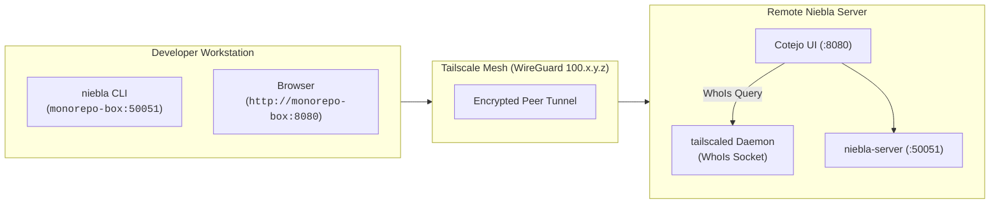

Running Niebla over **Tailscale** lets you connect to a remote `niebla-server` (port `50051`) and `cotejo` (port `8080`) from any workstation on your tailnet without opening public firewall ports.

When configured with `[critique.auth] mode = "tailscale"`, Cotejo queries the local `tailscaled` [Unix domain socket](https://en.wikipedia.org/wiki/Unix_domain_socket) (`/run/tailscale/tailscaled.sock`) using **Tailscale WhoIs** to identify users automatically from their verified [WireGuard](https://en.wikipedia.org/wiki/WireGuard) peer connection—requiring no login screens or passwords.



---

## 1. Configure the Remote Server Host

Authenticate the server host on your tailnet and note its MagicDNS hostname (for example, `monorepo-box`):

```bash
sudo tailscale up
```

### Server Configuration (`~/.config/niebla/config.toml`)

Bind `niebla-server` and `cotejo` to `0.0.0.0` (or specifically to the host's `100.x.y.z` Tailscale IP) and set Cotejo's authentication mode to `tailscale`:

```toml
version = 1

[core]
server_addr = "127.0.0.1:50051"
default_workspace = "default"

[server]
host = "0.0.0.0"
port = 50051
db_url = "postgres:///niebla?host=/run/postgresql"
auto_db = true
blob_path = "$HOME/.cache/niebla/blobs"

[critique]
host = "0.0.0.0"
port = 8080
proxy_port = 7331

[critique.auth]
mode = "tailscale"
default_user = "$USER"
```

### Grant Socket Permissions

Ensure the OS user running `cotejo` can read `/run/tailscale/tailscaled.sock`:

```bash
ls -l /run/tailscale/tailscaled.sock
sudo usermod -aG tailscale $USER
```

Start `niebla-server` and `cotejo` (see [Local & Workstation Setup](/niebla/recipes/local-setup/#running-the-local-services)).

---

## 2. Configure the Client Workstation

Join the same tailnet on your laptop or workstation and point `~/.config/niebla/config.toml` to the server's MagicDNS name:

```toml
version = 1

[core]
server_addr = "monorepo-box:50051"
default_workspace = "default"

[fs]
mount_base = "$HOME/Developer/workspaces"
cache_dir = "$HOME/.cache/niebla/blobs"
```

Verify connectivity:

```console
$ niebla workspace list
✓ Connected to monorepo-box:50051
```

When you open `http://monorepo-box:8080` in your browser, Cotejo resolves your Tailscale identity automatically via WhoIs.

---

## 3. Automatic HTTPS with Tailscale Serve

To expose Cotejo over HTTPS (port `443`) with automatic Let's Encrypt certificates on your tailnet domain, run **Tailscale Serve** on the server host:

```bash
sudo tailscale serve --bg 8080
```

Cotejo is then available at `https://monorepo-box.<tailnet-name>.ts.net/`.
