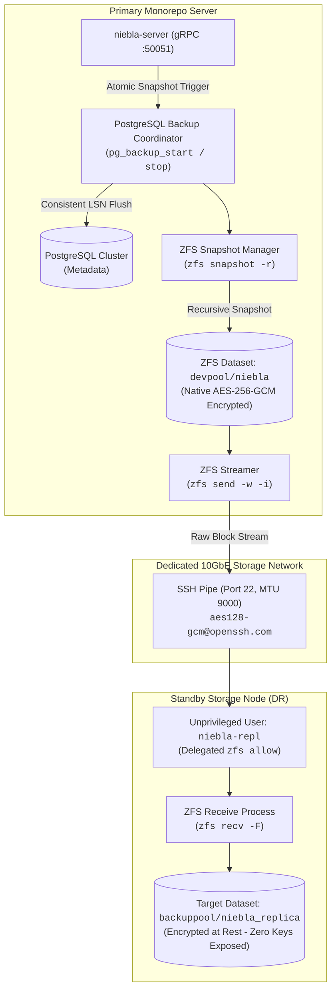

For large repositories and mission-critical monorepos, traditional file-by-file tarballs or rsync passes are too slow, non-atomic, and CPU-intensive.

Niebla features a native **ZFS Resilience Engine** that leverages OpenZFS copy-on-write primitives to provide:
1. **Sub-Second Recursive Snapshots:** Atomic point-in-time captures across Content-Addressable Storage (CAS) blobs and PostgreSQL metadata (`pg_backup_start` / `pg_backup_stop`).
2. **Raw Encrypted Streaming (`zfs send -w`):** Streams encrypted ZFS datasets directly over high-speed 10GbE/25GbE networks without exposing decryption keys or passwords to the remote backup host.
3. **Incremental Differential Transfers (`zfs send -i`):** Only changed block pointers are transmitted, reducing multi-terabyte replication windows to seconds.
4. **Non-Root Delegated Administration (`zfs allow`):** Replication uses dedicated non-privileged service users (`niebla-repl`) with least-privilege permissions.



---

## 1. Prerequisites & Storage Layout

### Storage Requirements
* **Primary Server:** OpenZFS 2.1+ running on Linux. Dedicated pool (e.g., `devpool`) storing Niebla CAS blobs and optional PostgreSQL data.
* **Remote Backup Node:** OpenZFS 2.1+ running on a separate physical machine or disaster recovery site. Dedicated backup pool (e.g., `backuppool`).
* **Network:** 10GbE or 25GbE private network interface (or encrypted Tailscale/WireGuard mesh) between primary and backup hosts.

### Recommended ZFS Dataset Properties
When creating your primary dataset, configure optimal monorepo properties:

```bash
# Create encrypted parent dataset on primary server
sudo zfs create -o encryption=aes-256-gcm \
                -o keyformat=passphrase \
                -o keylocation=file:///etc/niebla/zfs.key \
                -o compression=zstd-3 \
                -o atime=off \
                -o recordsize=1M \
                devpool/niebla
```

* **`recordsize=1M`:** Optimizes throughput and compression for Content-Addressable Storage (CAS) chunks.
* **`atime=off`:** Eliminates unnecessary metadata writes on read-heavy monorepo operations.
* **`compression=zstd-3`:** Excellent compression ratio with negligible CPU overhead at 10GbE wire speeds.

---

## 2. Dedicated Replication User & SSH Authentication

Replication should never run as `root`. We configure an unprivileged service account (`niebla-repl`) authenticated with an Ed25519 SSH key pair.

### Step 1: Create Replication User on Remote Node
Log into the remote backup node:

```bash
# On the remote backup node:
sudo useradd -r -m -s /bin/bash niebla-repl
sudo mkdir -p /home/niebla-repl/.ssh
sudo chmod 700 /home/niebla-repl/.ssh
```

### Step 2: Generate Dedicated SSH Key Pair on Primary Server
On the primary server:

```bash
# Generate dedicated non-interactive key
sudo mkdir -p /etc/niebla/ssh
sudo ssh-keygen -t ed25519 -f /etc/niebla/ssh/id_ed25519 -N "" -C "niebla-replication"
sudo chown -R niebla:niebla /etc/niebla/ssh
sudo chmod 600 /etc/niebla/ssh/id_ed25519
```

### Step 3: Install Public Key on Remote Backup Node
Copy `/etc/niebla/ssh/id_ed25519.pub` to the backup node:

```bash
# On the remote backup node, append key to authorized_keys:
echo "ssh-ed25519 AAAAC3NzaC1lZDI1NTE5AAAAI... niebla-replication" | sudo tee -a /home/niebla-repl/.ssh/authorized_keys
sudo chown -R niebla-repl:niebla-repl /home/niebla-repl/.ssh
sudo chmod 600 /home/niebla-repl/.ssh/authorized_keys
```

Verify non-root SSH access from the primary server:

```console
$ ssh -i /etc/niebla/ssh/id_ed25519 niebla-repl@backup-node.internal "echo SSH Connection Succeeded"
SSH Connection Succeeded
```

---

## 3. ZFS Delegated Administration (`zfs allow`)

OpenZFS supports granular permission delegation. Instead of granting sudo or root privileges, delegate strictly the required ZFS operations.

### On Primary Server (Send Permissions)
Grant the local user running `niebla-server` (e.g., `niebla`) permissions to snapshot and read raw streams:

```bash
sudo zfs allow -u niebla snapshot,send,hold,destroy devpool/niebla
```

### On Remote Backup Node (Receive Permissions)
Grant `niebla-repl` permissions to create datasets, mount, receive, rollback, and destroy old snapshots on the destination pool:

```bash
# Allow receiving into the target dataset subtree:
sudo zfs allow -u niebla-repl create,mount,receive,rollback,destroy,compression,mountpoint backuppool/niebla_replica
```

---

## 4. Niebla Configuration (`[resilience.zfs]`)

Configure the ZFS resilience engine in `/etc/niebla/config.toml` (or modular `/etc/niebla/resilience.toml`):

```toml
# /etc/niebla/resilience.toml
version = 1

[resilience]
# Enable automated resilience and replication subsystem
enabled = true

# Default replication mode: "zfs_stream" for block-level ZFS replication
default_mode = "zfs_stream"

[resilience.zfs]
# Master toggle for native ZFS replication
enabled = true

# Local source ZFS dataset containing Niebla CAS data
local_dataset = "devpool/niebla"

# Remote dedicated backup node hostname or IP address
remote_host = "backup-node.internal"

# Unprivileged replication user
remote_user = "niebla-repl"

# SSH port on remote node
remote_ssh_port = 22

# Private SSH key path created in Step 2
remote_key_file = "/etc/niebla/ssh/id_ed25519"

# Target dataset path on remote backup node
remote_dataset = "backuppool/niebla_replica"

# Raw encrypted send (-w): Preserves native encryption in-flight and at rest
# Remote node cannot read or decrypt repository contents!
raw_encrypted_send = true

# Prefix used when generating automated snapshot tags
snapshot_prefix = "niebla-auto"

# Number of historical snapshots retained before automatic pruning
retention_count = 30

# Maximum transfer bandwidth in MB/s (0 = unlimited wire speed, e.g. 10GbE / 1.1 GB/s)
bandwidth_limit_mb = 0

[resilience.schedule]
# Automatically trigger snapshots on background schedule
auto_backup = true

# Cadence interval in hours (every 4 hours)
interval_hours = 4

# Number of historical snapshots preserved on schedule
retention_count = 30

# Automatically take a consistent snapshot upon every successful SubmitCL
snapshot_on_submit = true
```

Validate the configuration with fast-fail verification:

```console
$ niebla config validate /etc/niebla
✓ Configuration is valid (/etc/niebla: config.toml, resilience.toml)
```

---

## 5. Running Backups via the CLI

Niebla's `backup` command family provides manual triggers, inspection, verification, and pruning.

### Creating an Initial Baseline Backup

Before incremental streaming can occur, establish the first baseline snapshot and full stream transfer:

```console
$ niebla backup create --mode zfs --label baseline
Creating ZFS recursive snapshot devpool/niebla@niebla-auto-baseline-20261113-220000...
✓ ZFS snapshot created: devpool/niebla@niebla-auto-baseline-20261113-220000
Streaming snapshot to backup-node.internal over 10GbE network...
✓ ZFS replication complete to backup-node.internal:backuppool/niebla_replica (raw encrypted: true)
```

### Listing Active Snapshots

Inspect all local and replicated snapshots with creation timestamps and space usage:

```console
$ niebla backup list --target zfs
ZFS Snapshots (devpool/niebla):
  TAG                                         CREATED               USED
  niebla-auto-baseline-20261113-220000        2026-11-13 22:00:00   0 B
  niebla-auto-submit-cl-104-20261113-221500   2026-11-13 22:15:00   14.2 MB
  niebla-auto-submit-cl-105-20261113-224500   2026-11-13 22:45:00   8.6 MB

Total Snapshots: 3 | Space Reclaimable: 22.8 MB
```

### Incremental Automated Streaming

When subsequent backups run (manually or automatically via `snapshot_on_submit = true`):
1. Niebla finds the latest common snapshot tag between source and destination.
2. It executes `zfs send -w -i <baseSnap> <targetSnap>` piped into `ssh niebla-repl@backup-node "zfs recv -F <remoteDataset>"`.
3. Only incremental diff blocks are sent over the wire, typically completing in under 2 seconds.

```console
$ niebla backup create --mode zfs
Creating ZFS recursive snapshot devpool/niebla@niebla-auto-20261113-230000...
✓ ZFS snapshot created: devpool/niebla@niebla-auto-20261113-230000
Streaming incremental delta to backup-node.internal over 10GbE network...
✓ ZFS incremental stream complete: 4.2 MB transferred in 1.4s (3.0 MB/s)
```

### Verifying Backup Parity

Verify that the remote backup dataset matches the local dataset's Merkle root:

```console
$ niebla backup verify --target zfs
Verifying ZFS dataset parity...
  • Local Dataset:  devpool/niebla@niebla-auto-20261113-230000
  • Remote Dataset: backuppool/niebla_replica@niebla-auto-20261113-230000
✓ Merkle root checksum verified: c9a4b81e7d23
✓ Backup parity confirmed across 10GbE storage link.
```

### Pruning Expired Snapshots

Prune older snapshots while preserving the specified retention count:

```console
$ niebla backup prune --target zfs --keep 14
Pruning snapshots for devpool/niebla (retention: 14)...
  Destroying snapshot: devpool/niebla@niebla-auto-20261028-120000
  Destroying snapshot: devpool/niebla@niebla-auto-20261028-160000
✓ Pruned 2 expired snapshots. 14 snapshots remaining.
```

---

## 6. Disaster Recovery & Failover

### Scenario A: Reverting Local Data to a Previous Snapshot
If local corruption or accidental deletion occurs, rollback the local dataset to a known good snapshot:

```bash
# 1. Stop niebla-server daemon
sudo systemctl stop niebla-server

# 2. Rollback dataset
sudo zfs rollback devpool/niebla@niebla-auto-20261113-220000

# 3. Restart daemon
sudo systemctl start niebla-server
```

### Scenario B: Full Site Catastrophic Failover (Promoting Replica)
If the primary server hardware experiences total failure:

1. **Promote the Replicated Dataset on the Backup Node:**
   ```bash
   # On the remote backup node:
   # Disable readonly property to allow write access
   sudo zfs set readonly=off backuppool/niebla_replica
   ```

2. **Load the Encryption Key (if raw send was used):**
   Because `raw_encrypted_send = true` was enabled, the remote node does not store the encryption key in plaintext. Supply the master key to mount the filesystem:
   ```bash
   sudo zfs load-key backuppool/niebla_replica
   sudo zfs mount backuppool/niebla_replica
   ```

3. **Start `niebla-server` on the Backup Node:**
   Update `/etc/niebla/config.toml` on the backup node to point `server.blob_path` to `/backuppool/niebla_replica` and start the service:
   ```bash
   sudo systemctl start niebla-server cotejo
   ```

4. **Update DNS / Load Balancer:**
   Point your internal corporate DNS record (`niebla.corp.internal`) to the backup node's IP address. Developer CLI clients reconnect automatically without needing to re-clone or wipe local workspaces.

---

## 7. Performance & Network Optimization

To maximize streaming throughput over 10GbE or 25GbE links:

1. **Enable Jumbo Frames (MTU 9000):**
   ```bash
   sudo ip link set dev eth1 mtu 9000
   ```
2. **Optimize OpenSSH Cipher Suite:**
   Niebla's internal streamer automatically specifies hardware-accelerated AES-GCM ciphers (`-o Ciphers=aes128-gcm@openssh.com,aes256-gcm@openssh.com`) which achieve line-rate throughput with minimal CPU overhead.
3. **Database Consistency:**
   When running PostgreSQL alongside CAS data on ZFS, Niebla's `Coordinator` automatically issues `SELECT pg_backup_start(...)` prior to snapshotting and `SELECT pg_backup_stop(...)` immediately after, guaranteeing transactional crash consistency across database records and CAS blobs.

