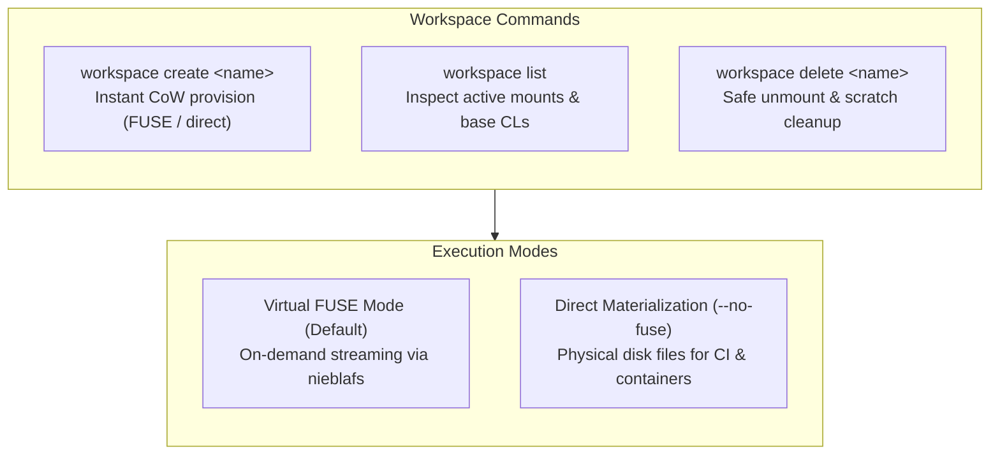
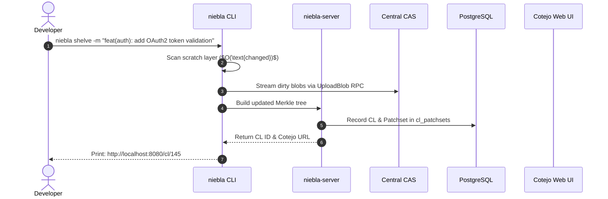
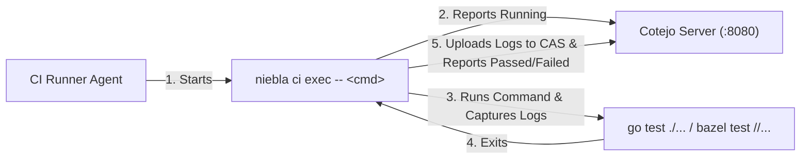

The `niebla` executable is the central developer CLI for interacting with the Niebla server-authoritative monorepo toolchain. Unlike traditional VCS tools that manipulate entire on-disk clones, `niebla` manages virtualized Copy-on-Write (CoW) workspaces, streams blobs on demand from central Content-Addressable Storage (CAS), and synchronizes Merkle tree manifests over high-throughput gRPC.

Every command is designed for dual ergonomics: clean, human-readable terminal output with ANSI styling for developers, and deterministic `--json` schemas for AI coding agents and CI runners.

---

## 1. Global Flags & Operational Model

Every `niebla` subcommand inherits global flags that configure network transport, workspace resolution, and output formatting.

| Flag | Env Variable | Default | Description |
| :--- | :--- | :--- | :--- |
| `--server <addr>` | `NIEBLA_SERVER` | `127.0.0.1:50051` | gRPC server endpoint for repository operations. |
| `--workspace <name>` | `NIEBLA_WORKSPACE` | Auto-detected | Explicit workspace name (bypasses directory-tree traversal). |
| `--config-dir <dir>` | `NIEBLA_CONFIG_DIR` | `~/.config/niebla/workspaces` | Directory storing local workspace metadata files. |
| `--json` | `NIEBLA_JSON` | `false` | Emits structured JSON output to `stdout` for scripts and AI agents. |

### Configuration Precedence
When resolving runtime parameters (such as the server address), `niebla` applies strict hierarchical precedence:
1. **Explicit CLI flags** (`--server 10.0.0.5:50051`)
2. **Environment variables** (`export NIEBLA_SERVER="10.0.0.5:50051"`)
3. **Workspace-level metadata** (`~/.config/niebla/workspaces/<name>.toml`)
4. **User configuration cascade** (`~/.config/niebla/config.toml`)
5. **Compile-time defaults** (`127.0.0.1:50051`)

### Automatic Root Discovery
When invoked from any directory without `--workspace`, `niebla` inspects `$PWD` and walks up the directory tree looking for a `.niebla/workspace.toml` control marker. This allows developers to run commands from any deeply nested subdirectory within their mounted workspace without passing positional paths.

---

## 2. Workspace Lifecycle (`niebla workspace`)

Workspaces are isolated, lightweight views of the monorepo. Creating a workspace takes under 15 milliseconds because no files are copied to disk; instead, the CLI initializes an in-memory virtual mount or sparse scratch overlay backed by `niebla-server`.



### `niebla workspace create <name>`
Provisions and mounts a new virtual workspace.

```bash
niebla workspace create <name> [flags]
```

#### Flags
* `--cl <int>`: Base Changelist ID to branch from (default: `0`, meaning current trunk head).
* `--no-fuse`: Disables the FUSE driver and materializes files directly to disk.
* `--mount-dir <path>`: Custom directory for the mount point (default: `~/niebla/workspaces/<name>`).
* `--no-hooks`: Skips client `post_create` lifecycle hooks defined in `config.toml`.

#### Use Cases

##### Use Case 1: Starting a New Feature from Trunk Head
```bash
niebla workspace create feature-oauth
cd ~/niebla/workspaces/feature-oauth
```
**Why**: Creates an instant virtual workspace pinned to the latest stable trunk revision. Developers can open the entire multi-gigabyte monorepo in their IDE immediately without waiting for a multi-hour Git clone.

##### Use Case 2: Branching from an In-Flight CL (Stacked Development)
```bash
niebla workspace create backend-api --cl 104
```
**Why**: When building a service that depends on uncommitted changes in review (`CL 104`), this branches directly from CL 104's Merkle tree. All un-submitted parent files are immediately accessible in the child workspace.

##### Use Case 3: Containerized CI or Environments Without `/dev/fuse`
```bash
niebla workspace create ci-runner-build --no-fuse --mount-dir /build/src
```
**Why**: Docker containers, Kubernetes pods, and unprivileged VMs often restrict `/dev/fuse` access. The `--no-fuse` flag instructs `niebla` to fetch tree manifests and materialize files directly into physical storage using parallel CAS streaming.

---

### `niebla workspace list`
Displays all registered local workspaces, mount paths, base revisions, and daemon health statuses.

```bash
niebla workspace list [flags]
```

#### Use Cases

##### Auditing Active Workspaces Across Multiple Projects
```bash
niebla workspace list
```
```text
NAME             BASE CL   MOUNT PATH                                STATUS
feature-oauth    142       /home/developer/niebla/workspaces/oauth   MOUNTED (PID 8412)
backend-api      104       /home/developer/niebla/workspaces/api     MOUNTED (PID 9104)
ci-test-run      150       /tmp/ci-test-run                          DIRECT (NO-FUSE)
```

##### Automated Health Check via AI Agent
```bash
niebla workspace list --json
```
AI agents inspect the structured JSON array to locate existing workspaces, verify whether the `nieblafs` background daemon is responsive, or identify stale workspaces requiring cleanup.

---

### `niebla workspace delete <name>`
Safely unmounts the virtual filesystem and purges local scratch state.

```bash
niebla workspace delete <name> [flags]
```

#### Flags
* `--force`: Forces deletion even if un-shelved modifications exist in the scratch overlay.

#### Use Cases

##### Cleaning Up Completed Features
```bash
niebla workspace delete feature-oauth
```
**Why**: Gracefully signals the background `nieblafs` daemon to flush pending writes, unmounts the FUSE mountpoint, terminates the daemon process, and removes the local workspace scratch cache (`~/.cache/niebla/workspaces/<name>`). If unsaved modifications exist, `niebla` halts with an error to prevent accidental data loss unless `--force` is specified.

---

## 3. Change Inspection (`niebla status` & `niebla diff`)

Niebla separates base repository files from local modifications through a Copy-on-Write (CoW) scratch layer. Clean files remain un-materialized in CAS; only modified, newly added, or deleted files occupy disk space in scratch storage.

### `niebla status`
Inspects pending workspace changes in the scratch overlay against the base Merkle tree.

```bash
niebla status [flags]
```

#### Output Classification
* `M` **(Modified)**: File existed in the base tree and has been edited in scratch.
* `A` **(Added)**: File was newly created in the workspace.
* `D` **(Deleted)**: File was deleted in the workspace (tracked via `.wh.<filename>` whiteout markers in scratch).

#### Use Cases

##### Instant Status on Multi-Million-File Repositories
```bash
niebla status
```
```text
Workspace: feature-oauth (Base CL 142)

Changes (3 files):
  M  services/auth/handler.go
  A  services/auth/token_test.go
  D  services/auth/legacy_auth.go
```
**Why**: Traditional tools (`git status`) must recursively run `stat()` calls across hundreds of thousands of files on disk ($O(N)$), causing multi-second delays. Niebla scans only the local scratch directory ($O(\text{changed})$), executing in single-digit milliseconds regardless of repository size.

##### Automated AI Coding Loop
Coding agents run `niebla status --json` after generating code to verify which files were modified and ensure no stray temporary files were left un-ignored:

```json
{
  "workspace": "feature-oauth",
  "base_cl": 142,
  "clean": false,
  "changes": [
    {
      "path": "services/auth/handler.go",
      "type": "M"
    },
    {
      "path": "services/auth/token_test.go",
      "type": "A"
    }
  ]
}
```

---

### `niebla diff [path]`
Displays unified diffs comparing scratch modifications against the immutable base Merkle tree.

```bash
niebla diff [path] [flags]
```

#### Features
* Intra-line, syntax-highlighted word additions and deletions.
* Scoped diffing: passing an optional `[path]` restricts diff generation to a single file or subdirectory.
* On-demand base blob fetching: base file content is fetched from CAS only when diffing that specific file.

#### Use Cases

##### Pre-Shelve Code Review
```bash
# Review all pending changes in the workspace
niebla diff

# Restrict inspection to a single file
niebla diff services/auth/handler.go
```
```diff
--- services/auth/handler.go (Base CL 142)
+++ services/auth/handler.go (Scratch)
@@ -45,7 +45,7 @@
 func ValidateToken(token string) (*Claims, error) {
-    if token == "" {
+    if strings.TrimSpace(token) == "" {
         return nil, ErrEmptyToken
     }
```

---

## 4. Changelist Shelving (`niebla shelve`)

In Niebla's Google Critique-inspired model, work is not pushed to remote Git branches. Instead, working copy changes are **shelved** into server-authoritative **Changelists (CLs)**. Shelving uploads new blobs to CAS, synthesizes an updated Merkle tree manifest, and registers a patchset for peer and AI review in Cotejo.



```bash
niebla shelve -m "<description>" [flags]
```

### Flags
* `-m, --message "<description>"` *(required)*: Summary and body of the changelist.
* `--cl <int>`: Updates an existing changelist by creating a new **Patchset ($N+1$)**. Defaults to the workspace's active CL.
* `--new-cl`: Forces creation of a brand new CL even if the workspace already tracks an active CL.
* `--on-cl <int>`: Stacks this CL on top of a specific parent changelist.
* `--reviewers "<list>"`: Comma-separated list of reviewer usernames or `@group` aliases defined in `config.toml`.

### Use Cases

#### Use Case 1: Creating a New Changelist for Initial Review
```bash
niebla shelve -m "feat(auth): implement RFC 6749 OAuth2 bearer validation" \
  --reviewers "jdoe,mrtnz,@sec-team"
```
```text
✓ Successfully shelved CL 145 (Patchset 1)
  Parent CL   : 142 (Trunk Head)
  Files       : 3 modified, 1 added, 0 deleted
  Review URL  : http://localhost:8080/cl/145
```
**Why**: Uploads only the modified blobs to CAS, generates a fresh CL number, resolves the `@sec-team` group into individual reviewers, and outputs the Cotejo review link.

#### Use Case 2: Iterating on Review Feedback (Creating Patchset 2)
When reviewers or AI review bots leave comments on `CL 145`, the developer makes edits in their workspace and runs:
```bash
niebla shelve -m "address review comments: validate token expiration claims"
```
```text
✓ Successfully updated CL 145 (Patchset 2)
  Review URL  : http://localhost:8080/cl/145
```
**Why**: Automatically detects that the workspace is already working on `CL 145` and creates **Patchset 2**. In Cotejo, reviewers can immediately perform an intra-line inter-diff between Patchset 1 and Patchset 2 to verify that feedback was addressed.

#### Use Case 3: Creating a Stacked Changelist Chain
```bash
# Branch service implementation on top of database migration in CL 145
niebla shelve -m "feat(api): expose OAuth endpoints" --on-cl 145
```
**Why**: Enables clean, modular pull requests without large, unreviewable diffs. When `CL 145` lands on trunk, child CLs automatically cascade and rebase their parent pointer.

---

## 5. Monotonic Trunk Submission (`niebla submit`)

Once a changelist receives all mandatory human sign-offs (e.g., `LGTM` and `Approved` per `OWNERS.toml`), passes AI automated persona checks, and satisfies CI check runs, it can be submitted to trunk.

Niebla enforces a **linear, monotonic trunk**. There are no merge commits or branch spaghetti; commits are serialized under database advisory locks.

```bash
niebla submit [flags]
```

### Flags
* `--cl <int>`: Explicit CL ID to submit (defaults to the workspace's active CL).
* `--no-verify`: Skips local pre-submit verification hooks.
* `--force`: Bypasses non-blocking check runs (requires administrative privileges).

### Lifecycle Workflow
1. **Local Pre-Submit Hooks**: The CLI executes linters, formatters, and test suites defined in `.niebla/hooks.toml`. If any hook fails, the submit is aborted locally before reaching the server.
2. **Server-Side Governance Gate**: The server checks that:
   - All directory owners have approved (`OWNERS.toml`).
   - Blocking AI bots (e.g. `sec-bot`) have marked threads resolved.
   - Required CI check runs have passed.
3. **Atomic Linear Commit**: The server acquires `pg_advisory_xact_lock`, increments `trunk_revision_seq`, and records the changelist as submitted.
4. **Workspace Re-anchoring**: The workspace resets its active CL and updates its base CL revision.

### Use Cases

#### Landing an Approved Feature
```bash
niebla submit
```
```text
Running pre-submit hooks...
  ✓ go-lint: passed (1.2s)
  ✓ unit-tests: passed (3.4s)
Submitting CL 145 to trunk...
✓ Successfully submitted CL 145 as Trunk Revision 308!
  Workspace base CL updated: 142 -> 308
  Active CL reset: clean working copy ready for next task.
```

---

## 6. Workspace Synchronization (`niebla sync`)

Long-running workspaces inevitably fall behind trunk as colleagues land changelists. The `niebla sync` command reconciles the workspace's base tree with the latest upstream trunk or parent patchset while preserving un-shelved scratch edits.

```bash
niebla sync [flags]
```

### Flags
* `--dry-run`: Previews incoming changes, potential rebase conflicts, and inode invalidations without touching local state.
* `--no-hooks`: Skips client `post_sync` lifecycle hooks.
* `-f`, `--force`: Forces synchronization even if uncommitted modifications exist in direct materialization (`--no-fuse`) mode.

### Use Cases

#### Use Case 1: Re-anchoring to Upstream Trunk
```bash
niebla sync
```
```text
✓ Successfully synced workspace "feature-oauth" with Trunk Revision 315.
  Base tree updated: 7a8f... -> b2c4...
  Virtual filesystem re-anchored (14 cached inodes invalidated).
```
**Why**: In FUSE mode, `niebla sync` connects to `nieblafs.sock` and invalidates cached in-memory inodes. Upstream additions and modifications appear in the file tree immediately without restarting IDEs or unmounting the filesystem.

#### Use Case 2: Detecting and Resolving Rebase Conflicts
```bash
niebla sync --dry-run
```
If an upstream commit modified a file that also has dirty scratch edits:
```text
⚠️  Rebase conflict detected with Parent CL 315!
   Conflicts: services/auth/handler.go
   Please resolve the conflicting files in your workspace, then run 'niebla shelve' to commit the resolution.
```

---

## 7. Stateless Tree Materialization (`niebla export`)

The `niebla export` command provides hermetic, FUSE-free tree materialization for CI runners, build agents, and deployment packagers.

```bash
niebla export --dest <dir> [flags]
```

### Flags
* `--dest <dir>` *(required)*: Target directory where files will be written.
* `--cl <int>`: Specific CL ID to materialize (default: `0`, meaning trunk head).
* `--patchset <int>`: Specific patchset iteration of the CL (defaults to latest).
* `--concurrency <N>`: Parallel download worker threads (default: `8`).
* `--cas-dir <dir>`: Path to local CAS blob store. When present, `niebla export` creates **zero-copy hardlinks** instead of copying bytes.

### Use Cases

#### Use Case 1: Blazing-Fast Hermetic CI Checkout
```bash
niebla export --cl 145 --dest /ci/workspace --cas-dir ~/.cache/niebla/blobs
```
```text
✓ Materialized CL 145 (Patchset 2) into /ci/workspace
  Files       : 14,820
  Directories : 1,240
  Bytes       : 482 MB (100% hardlinked from local CAS cache)
  Duration    : 180ms
```
**Why**: Because build runners retain a shared local CAS cache, `niebla export` creates hardlinks into `/ci/workspace`. A 500 MB codebase materializes in under 200 milliseconds, completely eliminating git checkout overhead in CI pipelines.

#### Use Case 2: Packaging Production Deployment Artifacts
```bash
# Export exact trunk head for release packaging
niebla export --dest /tmp/release-build
```

---

## 8. CI Pipeline Orchestration (`niebla ci`)

The `niebla ci` subsystem bridges automated build runners with Cotejo's live review UI.



### `niebla ci exec`
Wraps any build or test command, reporting `running` at launch, streaming console logs, uploading output logs to CAS, and reporting `passed` or `failed` based on process exit code.

```bash
niebla ci exec --cl <id> --runner <name> [flags] -- <command> [args...]
```

#### Flags
* `--cl <int>` *(required)*: Target changelist ID.
* `--runner <name>` *(required)*: Unique runner identifier (e.g. `unit-tests`, `linter`, `bazel-build`).
* `--patchset <int>`: Specific patchset iteration (default: latest).
* `--external-url <url>`: Direct hyperlink to external CI job dashboard (e.g. GitHub Actions or Forgejo run).

#### Use Case: Running Automated Unit Tests in CI
```bash
niebla ci exec --cl 145 --runner "go-unit-tests" \
  --external-url "https://ci.internal.net/builds/9821" \
  -- go test -v ./services/auth/...
```
**Why**: 
1. Immediately posts a `running` check run status to Cotejo.
2. Reviewers watching the review page see a live spinner.
3. Upon test completion, `niebla` streams the full console output into CAS and marks the check run as `passed` (exit code 0) or `failed` (non-zero).
4. Reviewers in Cotejo can click the runner badge to view the full log without leaving the review interface.

---

### `niebla ci report`
Directly updates check run status for custom CI integrations and webhook handlers.

```bash
niebla ci report --cl <id> --runner <name> --status <status> [flags]
```

#### Valid Statuses
`queued` | `running` | `passed` | `failed` | `canceled` | `skipped`

#### Use Case: Custom Webhook Reporting
```bash
niebla ci report --cl 145 --runner "sonarqube" \
  --status "passed" \
  --log-file /tmp/sonar-report.txt \
  --external-url "https://sonar.internal.net/project/auth"
```

---

## 9. Toolchain Configuration (`niebla config`)

The `niebla config` subsystem inspects, initializes, and validates the multi-file configuration cascade (`~/.config/niebla/*.toml`).

| Subcommand | Description |
| :--- | :--- |
| `niebla config path` | Displays absolute paths to all discovered configuration files in load priority. |
| `niebla config show` | Prints the fully resolved in-memory configuration with environment expansions. |
| `niebla config validate [file]` | Fast-fail syntax, semantic, port collision, and theme preset validation. |
| `niebla config init [--force]` | Generates a clean default `~/.config/niebla/config.toml` skeleton. |

### Use Cases

#### Validating Configuration Before Service Restart
```bash
niebla config validate
```
```text
Validating /home/developer/.config/niebla/config.toml...
  ✓ Syntax: valid TOML
  ✓ Server Bindings: 127.0.0.1:50051 (available)
  ✓ Web Bindings: 127.0.0.1:8080 (available)
  ✓ Cotejo Theme: "caribbean-dark" (recognized preset)
  ✓ AI Providers: OpenAI endpoint TLS verified
Configuration is valid!
```

---

## 10. Low-Level CAS Storage (`niebla cas`)

Content-Addressable Storage (CAS) is the foundational blob layer of Niebla. Every file and Merkle tree manifest is stored indexed by its SHA-256 hash.

### `niebla cas put <file>`
Uploads an arbitrary local file or binary into central CAS, returning its SHA-256 hash and size.

```bash
niebla cas put bin/service-arm64
```
```text
SHA256: 4f8b2d18c991a0293847e18928374b9281734918237498127394812739481234
Size  : 18,491,200 bytes
```
**Why**: Useful for caching build artifacts, test fixtures, and large compiler toolchains in central CAS without checking them into source code trees. Also used to upload hermetic review binaries referenced by `type = "cas_binary"` in `.niebla/agents.toml` (see [In-Tree Governance: CAS Binaries](/niebla/workflows/in-tree-governance/#3-type--cas_binary-hermetic-content-addressed-review-binaries)).

### `niebla cas get <sha256>`
Downloads a raw blob from CAS to local disk or `stdout`.

```bash
niebla cas get 4f8b2d18c... --dest /tmp/service-arm64
```

### `niebla cas gc`
Executes mark-and-sweep garbage collection across local or server CAS storage, comparing blobs against active trunk heads and workspaces and removing unreferenced blobs older than a grace period.

```bash
niebla cas gc [--grace-period <duration>] [--dry-run] [--dir <path>]
```
```text
✓ CAS Garbage Collection Completed:
  • Total Scanned Blobs : 14,892
  • Live Blobs Preserved: 13,204
  • Unreferenced Blobs  : 1,688
  • In-Grace Blobs Kept : 240
  • Deleted Blobs       : 1,448
  • Disk Space Reclaimed: 2,491,208,412 bytes
```

---

## 11. Resilience & Disaster Recovery (`niebla backup`)

Enterprise disaster resilience for repositories operating at multi-terabyte scales.

| Subcommand | Purpose |
| :--- | :--- |
| `niebla backup create` | Generates an envelope-encrypted standalone bundle (`.nieblabak`) or triggers 10GbE ZFS snapshot replication. |
| `niebla backup list` | Lists all local and remote replication snapshots across S3, WebDAV, and ZFS targets. |
| `niebla backup verify <file>` | Verifies cryptographic integrity, signatures, and blob checksums. |
| `niebla backup restore <file>` | Recovers database records and CAS blobs after catastrophic storage loss. |
| `niebla backup prune` | Evaluates retention schedules (daily, weekly, monthly) and prunes expired snapshots. |

### Use Case: Creating an Envelope-Encrypted Offline Archive
```bash
niebla backup create --encrypt --dest /mnt/secure-backup/
```
```text
Creating resilience snapshot...
  ✓ Dumped PostgreSQL metadata (142 MB)
  ✓ Scanned CAS blob references (48,120 blobs)
  ✓ Envelope encrypted via AES-256-GCM (Master Key: ENV_SECURE)
  ✓ Generated standalone bundle: /mnt/secure-backup/niebla-20261113-2048.nieblabak
Resilience backup completed in 4.2s.
```

---

## 12. AI Agent Harness Integration (`niebla skills`)

Niebla ships with first-class skill adapters for AI coding harnesses (Google Antigravity, Claude Code, Cursor, and universal `.agents`).

### `niebla skills sync`
Ensures the central Hub skill catalog is populated and synchronizes symlinks across all installed developer harnesses on the workstation.

```bash
niebla skills sync [flags]
```

```text
Hub populated at: /home/developer/.local/share/niebla/skills/niebla

HARNESS         STATUS      PATH
Antigravity     SYNCED      ~/.gemini/antigravity/skills/niebla
Claude Code     SYNCED      ~/.claude/skills/niebla
Cursor          SYNCED      ~/.cursor/skills/niebla
Universal       SYNCED      ~/.agents/skills/niebla
```

**Why**: With a single command, every AI coding assistant installed on the engineer's machine receives the complete Niebla skill set—enabling AI agents to natively create virtual workspaces, inspect diffs, shelve changelists, and apply review suggestions.
