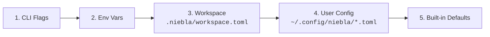

Niebla uses a unified [TOML](https://en.wikipedia.org/wiki/TOML) configuration directory (`~/.config/niebla/` or `$NIEBLA_CONFIG`) across all four components: `niebla`, `niebla-server`, `cotejo`, and `nieblafs`.

---

## 1. Discovery & Precedence



When starting up, Niebla locates its configuration in the following order:

1. **`NIEBLA_CONFIG` environment variable:** Points to a directory of modular `*.toml` files (e.g., `/etc/niebla`) or a single `.toml` file.
2. **`$XDG_CONFIG_HOME/niebla/`** (if `$XDG_CONFIG_HOME` is set per the [XDG Base Directory specification](https://en.wikipedia.org/wiki/Freedesktop.org#Base_Directory_Specification)).
3. **`~/.config/niebla/`** (automatically initialized with baseline defaults on first run if missing).

---

## 2. Multi-File Modularity (`~/.config/niebla/*.toml`)

You can keep all configuration in a single `~/.config/niebla/config.toml` file or split sections across multiple `.toml` files in the directory:

```text
~/.config/niebla/
├── config.toml         # [core], [server], [fs], [critique]
├── ai.toml             # [critique.ai]
├── ci.toml             # [ci]
├── events.toml         # [events]
├── resilience.toml     # [resilience]
└── theme.toml          # [critique.theme]
```

### Section Uniqueness Rule

Niebla loads `config.toml` first, followed by all other non-hidden `*.toml` files in alphabetical order. To prevent silent override bugs:

> [!IMPORTANT]
> Every TOML table header or sub-table (such as `[server]`, `[critique.ai]`, or `[critique.theme]`) may only be declared in **one** `.toml` file within the configuration directory. Declaring the same section in two files causes `niebla config validate` to fail immediately with file and line numbers.

---

## 3. Environment Variable Expansion

All string fields in `~/.config/niebla/*.toml` expand `$VAR` and `${VAR}` references at load time:

* `$USER` / `${USER}`: Active OS username (used by `critique.default_reviewer = "$USER"`).
* `$HOME` / `${HOME}`: User home directory (used by `fs.mount_base = "$HOME/niebla/workspaces"`).
* Note: Secret fields ending in `_env` (such as `api_key_env = "OPENAI_API_KEY"`) take the **name** of the environment variable to read at runtime so secrets never appear in `niebla config show`.

---

## 4. Complete TOML Schema Reference

### `[core]` — Client & gRPC Connection

```toml
[core]
# Target niebla-server gRPC address (host:port)
server_addr = "127.0.0.1:50051"

# Default workspace name when not inside a workspace directory
default_workspace = "default"

# Optional static bearer token (prefer NIEBLA_TOKEN env var in production)
auth_token = ""

[core.tls]
enabled = false
ca_file = "/etc/niebla/tls/ca.crt"
server_name = "niebla.internal"
```

---

### `[server]` — Repository Daemon & Storage

```toml
[server]
host = "127.0.0.1"
port = 50051

# PostgreSQL connection URI (Unix socket or TCP)
db_url = "postgres:///niebla?host=/run/postgresql"

# Automatically spawn a local PostgreSQL instance if not running
auto_db = true

# Root directory for Content-Addressable Storage (CAS) blobs
blob_path = "$HOME/.cache/niebla/blobs"

# Maximum number of Merkle tree nodes cached in server LRU memory
cache_size = 10000

# Authorized client bearer tokens (empty = unauthenticated local mode)
auth_tokens = []

[server.tls]
enabled = false
cert_file = "/etc/niebla/tls/server.crt"
key_file = "/etc/niebla/tls/server.key"
client_ca_file = "/etc/niebla/tls/client-ca.crt"
```

---

### `[fs]` — Virtual Filesystem & Client Cache

```toml
[fs]
# Base directory where virtual FUSE workspaces are mounted
mount_base = "$HOME/niebla/workspaces"

# Local Content-Addressable Storage (CAS) read cache directory
cache_dir = "$HOME/.cache/niebla/blobs"
```

---

### `[critique]` — Cotejo Web Review & Governance

```toml
[critique]
host = "127.0.0.1"
port = 8080
proxy_port = 7331
default_reviewer = "$USER"

# Minimum human LGTM approvals required before submission (0 in local mode)
required_approvals = 1

# Block submission when open/unresolved review comments remain
allow_submit_with_unresolved_comments = false

# Block submission until all required CI check runs report "passed"
require_green_check_runs = false

# Author globs badged as automated bots and excluded from human approval counts
agent_author_patterns = ["agent/*", "bot/*", "*[bot]", "*@agent*", "ci/*", "system"]

[critique.auth]
# Authentication mode: "local", "tailscale", or "headers"
mode = "local"
default_user = "$USER"
header_name = "X-Forwarded-User"
trusted_proxies = ["127.0.0.1/32", "10.0.0.0/8"]
allow_query_override = false

[critique.groups]
# Reviewer group expansion: "static", "api", or "disabled"
mode = "static"

[critique.groups.static]
core-infra = ["alice", "bob"]
security = ["carol", "dave"]
```

#### `[critique.theme]` — UI Presets & Custom Colors

```toml
[critique.theme]
# Built-in presets:
#   "catppuccin-mocha", "catppuccin-macchiato", "catppuccin-frappe", "catppuccin-latte",
#   "tokyo-night", "dracula", "nord", "github-dark", or "custom"
preset = "catppuccin-mocha"

# Chroma syntax highlighting style
syntax_style = "catppuccin-mocha"

# Optional hex/rgba overrides (required when preset = "custom")
[critique.theme.colors]
bg_canvas       = "#1e1e2e"
bg_surface      = "#181825"
bg_card         = "#11111b"
border          = "#313244"
text_primary    = "#cdd6f4"
text_muted      = "#a6adc8"
accent          = "#89b4fa"
diff_add_bg     = "rgba(166, 227, 161, 0.20)"
diff_add_border = "#a6e3a1"
diff_del_bg     = "rgba(243, 139, 168, 0.20)"
diff_del_border = "#f38ba8"
```

#### `[critique.ai]` — Opt-In AI Review Endpoint

```toml
[critique.ai]
# Disabled by default; only connects to the endpoint you configure
enabled = false
endpoint = "http://127.0.0.1:11434/v1" # Ollama, vLLM, or OpenAI-compatible URL
api_key_env = "OPENAI_API_KEY"
model = "qwen2.5-coder:32b"
timeout_seconds = 30
temperature = 0.2
system_prompt_path = ".niebla/prompts/comment_hint.md"
max_context_lines = 1200
agent_name = "ai-hint-agent"

[critique.ai.tls]
enabled = false
ca_file = "/etc/niebla/tls/ca.crt"
server_name = "llm.internal"
```

---

### `[events]` — CloudEvents Bus & Webhooks

```toml
[events]
enabled = false
# Event sink: "webhook", "exec", "log", or "noop"
sink = "webhook"
filter = ["niebla.cl.*", "niebla.workspace.*"]
buffer_size = 256

[events.webhook]
endpoint = "https://events.internal/niebla"
secret_token_env = "NIEBLA_EVENT_SECRET"
timeout_ms = 3000
max_retries = 3

[events.exec]
command = "/usr/local/bin/niebla-event-router.sh"
timeout_ms = 5000
```

---

### `[resilience]` — Backups & Replication

```toml
[resilience]
enabled = false
# Primary mode: "zfs_stream" (or "zfs") or "bundle"
default_mode = "zfs_stream"

[resilience.zfs]
enabled = false
local_dataset = "zroot/niebla"
remote_host = "backup-node.internal"
remote_user = "niebla-repl"
remote_ssh_port = 22
remote_key_file = "$HOME/.ssh/id_ed25519"
remote_dataset = "backups/niebla"
raw_encrypted_send = true
snapshot_prefix = "niebla-auto"
retention_count = 30
bandwidth_limit_mb = 0

[resilience.bundle]
enabled = false
target_dir = "/var/backups/niebla"
compression = "zstd"
compression_level = 3

[resilience.encryption]
algorithm = "aes-256-gcm" # "aes-256-gcm" or "chacha20-poly1305"
key_source = "env"        # "env", "file", or "passphrase"
key_env = "NIEBLA_MASTER_KEY"

[resilience.s3]
enabled = false
endpoint = "s3.us-east-1.amazonaws.com"
bucket = "niebla-backups"
region = "us-east-1"
prefix = "vcs/"
access_key_env = "AWS_ACCESS_KEY_ID"
secret_key_env = "AWS_SECRET_ACCESS_KEY"
force_path_style = false
use_ssl = true
storage_class = "STANDARD"

[resilience.sftp]
enabled = false
host = "sftp.internal"
user = "niebla-sftp"
remote_path = "/storage/backups"
key_file = "$HOME/.ssh/id_ed25519"
timeout_seconds = 60

[resilience.nextcloud]
enabled = false
url = "https://nextcloud.internal/remote.php/dav/files/backup-user/niebla"
username = "backup-user"
password_env = "NEXTCLOUD_APP_PASSWORD"
timeout_seconds = 180

[resilience.schedule]
auto_backup = true
interval_hours = 4
retention_count = 30
snapshot_on_submit = true
```

---

### `[ci]` — CI Runner Dispatchers

```toml
[ci]
enabled = false
default_runner = "local"
require_green_to_submit = true

[ci.runners.local]
provider = "local"
work_dir = "/tmp/niebla-ci"
command = ["go", "test", "./..."]
timeout_seconds = 300
concurrency = 4

[ci.runners.forgejo-linux]
provider = "forgejo"
endpoint = "https://git.internal/api/v1/repos/org/monorepo/actions/workflows/ci.yml/dispatches"
ref = "main"

[ci.runners.forgejo-linux.auth]
mode = "token"
token_env = "FORGEJO_TOKEN"

[ci.runners.github-ci]
provider = "github"
endpoint = "https://api.github.com/repos/org/monorepo/dispatches"
event_type = "niebla_presubmit"

[ci.runners.github-ci.auth]
mode = "bearer"
token_env = "GITHUB_PAT"
```

---

## 5. Pre-Flight Validation (`niebla config validate`)

Before starting `niebla-server` or `cotejo`, run `niebla config validate` to verify:

* `version >= 1` and valid TOML syntax.
* Zero duplicate section headers across `~/.config/niebla/*.toml`.
* No port collisions between `server.port`, `critique.port`, and `critique.proxy_port`.
* Valid `server.db_url` scheme (`postgres://` or `postgresql://`) and absolute `fs.mount_base` path.
* Recognized `critique.theme.preset` names (with [Levenshtein distance](https://en.wikipedia.org/wiki/Levenshtein_distance) suggestions on typos) and valid hex/rgba color overrides.

To validate a candidate configuration change safely before overwriting your active file:

```bash
niebla config validate /tmp/candidate_config.toml && \
  cp /tmp/candidate_config.toml ~/.config/niebla/config.toml
```
