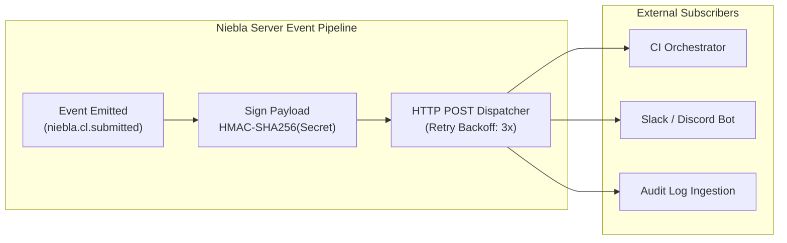

Niebla features an asynchronous enterprise event emitter ([`pkg/events`](https://github.com/mrtnzjsh/niebla/tree/main/niebla/pkg/events)) that publishes standardized events whenever changelists are created, shelved, submitted, rebased, or reviewed.

All emitted events conform to the [CNCF CloudEvents v1.0 specification](https://cloudevents.io/), ensuring seamless interoperability with Apache Kafka, AWS EventBridge, GCP Eventarc, Slack bots, and internal CI/CD dispatchers.

---

## 1. Webhook Dispatch Architecture



Webhooks are configured in `~/.config/niebla/config.toml`:

```toml
[events.webhook]
enabled = true
url = "https://ci.internal/api/v1/niebla-webhook"
secret = "$ENV{WEBHOOK_SIGNING_SECRET}"
timeout_ms = 5000
max_retries = 3
```

---

## 2. CloudEvents Envelope Structure

Every webhook POST request delivers a JSON payload with standard CloudEvents v1.0 attributes:

```json
{
  "specversion": "1.0",
  "id": "f81d4fae-7dec-11d0-a765-00a0c91e6bf6",
  "source": "niebla-server",
  "type": "niebla.cl.submitted",
  "subject": "cl/104",
  "time": "2026-11-14T03:45:00Z",
  "datacontenttype": "application/json",
  "data": { ... }
}
```

### Request Headers
- `Content-Type`: `application/json`
- `X-Niebla-Event`: The CloudEvents `type` (e.g. `niebla.cl.submitted`)
- `X-Niebla-Signature`: `sha256=<hex_hmac>` calculated over the raw request body using your configured `secret`.

---

## 3. Event Catalog & Payload Schemas

### 1. `niebla.cl.created`
Emitted when a new changelist is first shelved.

```json
{
  "specversion": "1.0",
  "type": "niebla.cl.created",
  "source": "niebla-server",
  "subject": "cl/42",
  "data": {
    "cl_id": "42",
    "author": "alice",
    "description": "feat(auth): implement passkey authentication",
    "parent_cl_id": "38",
    "patchset_number": 1,
    "root_tree_hash": "e3b0c44298fc1c149afbf4c8996fb92427ae41e4649b934ca495991b7852b855",
    "reviewers": ["bob", "@security-team"]
  }
}
```

### 2. `niebla.cl.shelved`
Emitted when a new revision/patchset ($N+1$) is uploaded to an existing changelist.

```json
{
  "specversion": "1.0",
  "type": "niebla.cl.shelved",
  "source": "niebla-server",
  "subject": "cl/42/ps/2",
  "data": {
    "cl_id": "42",
    "patchset_number": 2,
    "author": "alice",
    "root_tree_hash": "a1b2c3d4...",
    "files_changed_count": 4
  }
}
```

### 3. `niebla.cl.submitted`
Emitted when a changelist is committed to trunk with a monotonic `trunk_revision`.

```json
{
  "specversion": "1.0",
  "type": "niebla.cl.submitted",
  "source": "niebla-server",
  "subject": "cl/42",
  "data": {
    "cl_id": "42",
    "author": "alice",
    "trunk_revision": 105,
    "root_tree_hash": "a1b2c3d4..."
  }
}
```

### 4. `niebla.cl.rebased`
Emitted when an active child changelist is automatically re-parented onto an updated parent commit or trunk revision.

```json
{
  "specversion": "1.0",
  "type": "niebla.cl.rebased",
  "source": "niebla-server",
  "subject": "cl/43/ps/3",
  "data": {
    "cl_id": "43",
    "parent_cl_id": "42",
    "patchset_number": 3,
    "merged_tree_hash": "f4e3d2c1..."
  }
}
```

### 5. `niebla.check_run.completed`
Emitted when an automated test runner or review agent completes execution.

```json
{
  "specversion": "1.0",
  "type": "niebla.check_run.completed",
  "source": "niebla-server",
  "subject": "cl/42/check/192",
  "data": {
    "cl_id": 42,
    "patchset_number": 2,
    "runner_name": "security-sentinel",
    "provider": "in_tree",
    "status": "passed",
    "exit_code": 0,
    "log_blob_sha256": "4f8b2d18..."
  }
}
```

---

## 4. HMAC-SHA256 Signature Verification Samples

To ensure webhook requests genuinely originate from your `niebla-server`, verify the `X-Niebla-Signature` header:

### Python (FastAPI / Flask)
```python
import hmac
import hashlib

def verify_niebla_signature(secret: str, raw_body: bytes, header_sig: str) -> bool:
    if not header_sig.startswith("sha256="):
        return False
    expected = hmac.new(secret.encode(), raw_body, hashlib.sha256).hexdigest()
    provided = header_sig.split("=", 1)[1]
    return hmac.compare_digest(expected, provided)
```

### Go (Standard Library)
```go
package main

import (
	"crypto/hmac"
	"crypto/sha256"
	"encoding/hex"
	"strings"
)

func VerifyNieblaSignature(secret string, body []byte, signatureHeader string) bool {
	if !strings.HasPrefix(signatureHeader, "sha256=") {
		return false
	}
	expected := hmac.New(sha256.New, []byte(secret))
	expected.Write(body)
	expectedHex := hex.EncodeToString(expected.Sum(nil))

	providedHex := strings.TrimPrefix(signatureHeader, "sha256=")
	return hmac.Equal([]byte(expectedHex), []byte(providedHex))
}
```

### TypeScript (Node.js / Express)
```typescript
import * as crypto from 'crypto';

export function verifyNieblaSignature(secret: string, rawBody: Buffer, headerSig: string): boolean {
  if (!headerSig || !headerSig.startsWith('sha256=')) {
    return false;
  }
  const hmac = crypto.createHmac('sha256', secret);
  hmac.update(rawBody);
  const expected = hmac.digest('hex');
  const provided = headerSig.slice(7);

  return crypto.timingSafeEqual(Buffer.from(expected), Buffer.from(provided));
}
```

