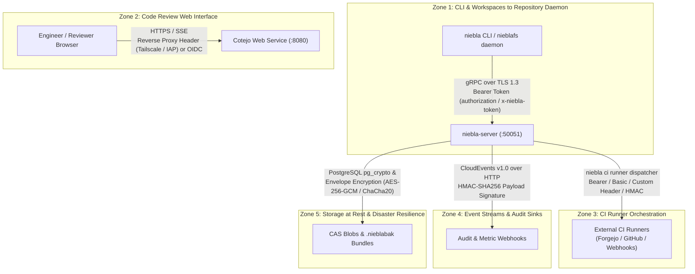
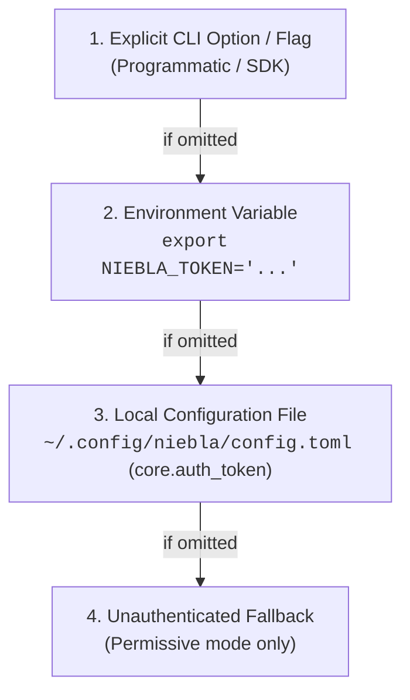
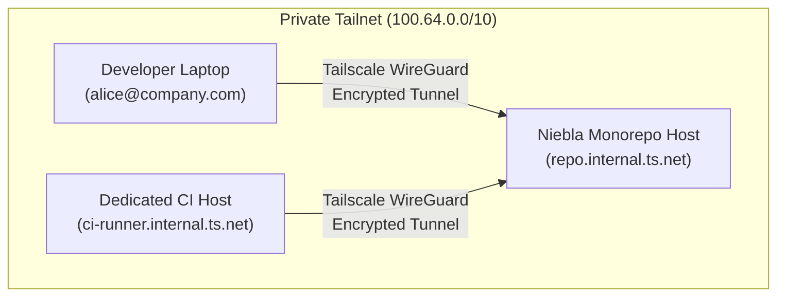

Niebla implements a defense-in-depth, zero-trust security architecture designed to operate across local developer workstations, air-gapped corporate subnets, and cloud clusters. 

Rather than relying on a single perimeter firewall or static passwords, authentication and authorization are partitioned into **five distinct trust zones**, each enforcing least-privilege access and cryptographic verification.

---

## 1. The 5 Security Trust Zones



| Zone | Protocol & Port | Identity & Auth Mechanism | Configuration Section |
| :--- | :--- | :--- | :--- |
| **Zone 1: VCS RPC** | gRPC (HTTP/2) `:50051` | Bearer Tokens (`authorization`), TLS 1.3 / mTLS | `[server]`, `[core.tls]` |
| **Zone 2: Code Review** | HTTP/1.1 & SSE `:8080` | Trusted Proxy Headers (`X-Forwarded-User`), OIDC, or OS `$USER` | `[critique.auth]` |
| **Zone 3: CI Dispatch** | REST / Webhooks | Token, Basic Auth, Custom Headers, HMAC Signatures | `[ci.runners.<name>.auth]` |
| **Zone 4: Event Sinks** | HTTP POST Webhooks | HMAC-SHA256 Signature (`X-Niebla-Signature`) | `[events]` |
| **Zone 5: At-Rest Resilience** | Filesystem / ZFS / S3 | AES-256-GCM / ChaCha20-Poly1305 with Argon2id Master Key | `[resilience.encryption]` |

---

## 2. Zone 1: gRPC Transport Security & Bearer Authentication

All command-line operations (`niebla status`, `niebla shelve`, `niebla sync`, `niebla submit`) and virtual filesystem streaming operations (`nieblafs`) communicate with `niebla-server` over gRPC.

### Server-Side Bearer Token Enforcement

In `~/.config/niebla/config.toml` (or `/etc/niebla/server.toml`):

```toml
[server]
host = "0.0.0.0"
port = 50051

# Authorized tokens for developers, agents, and CI workers
auth_tokens = [
  "nb_live_dev_8f21a09d3b44e7c1",
  "nb_live_ci_4917a2ef819c4d92",
  "nb_live_agent_33b81ef02a884c71"
]
```

#### Evaluation Semantics
* **Permissive Local Mode:** If `auth_tokens` is empty or omitted, authentication is disabled. This is standard for local single-developer prototyping on loopback (`127.0.0.1`).
* **Strict Production Mode:** If one or more tokens are specified, `niebla-server` enforces gRPC interceptors across **both Unary RPCs and Streaming RPCs** (`UploadBlob`, `GetBlob`):
  * Incoming metadata is inspected for `authorization: Bearer <token>` or `x-niebla-token: <token>`.
  * Tokens are validated using `crypto/subtle.ConstantTimeCompare` to guarantee immunity against timing side-channel attacks.
  * Missing or mismatched tokens immediately terminate the connection with gRPC status `codes.Unauthenticated (16)`.

### Client-Side Token Resolution & CLI Usage

Developers and automated CI scripts provide authentication tokens using a strict 3-tier precedence hierarchy:



#### 1. Via Environment Variable (Recommended for CI & Shells)
```bash
export NIEBLA_TOKEN="nb_live_ci_4917a2ef819c4d92"
niebla status
```

#### 2. Via Persistent Local Configuration
```toml
# ~/.config/niebla/config.toml (or ~/.config/niebla/core.toml)
[core]
auth_token = "nb_live_dev_8f21a09d3b44e7c1"
```

### Transport Layer Security (TLS 1.3)

In enterprise deployments, transport encryption ensures bearer tokens and source code blobs cannot be intercepted over untrusted networks.

#### Server TLS Configuration
```toml
[server]
tls_cert_file = "/etc/niebla/tls/server.crt"
tls_key_file  = "/etc/niebla/tls/server.key"
```

#### Client TLS Configuration
```toml
[core.tls]
enabled     = true
ca_file     = "/etc/ssl/certs/corporate-ca.crt"
server_name = "niebla.internal.net"
```

When TLS is enabled, the CLI requires a valid certificate chain and refuses to transmit bearer credentials over insecure plaintext connections.

---

## 3. Zone 2: Cotejo Web Code Review Authentication

**Cotejo** operates on port `8080`, providing human engineers and review personas with an interactive code review interface. Identity resolution is configured in the `[critique.auth]` block.

### Mode A: Reverse Proxy Header Authentication (`mode = "headers"`)

The standard architecture for enterprise monorepos. An identity-aware reverse proxy (such as **Tailscale**, **Cloudflare Access**, **Google Identity-Aware Proxy**, **Traefik**, or **NGINX**) handles multi-factor authentication (MFA) and passes the verified username in a trusted HTTP header.

```toml
[critique.auth]
mode = "headers"
header_name = "X-Forwarded-User"
default_user = "nobody"

# Strictly restrict header acceptance to trusted proxy CIDRs
trusted_proxies = ["127.0.0.1/32", "10.0.0.0/8", "100.64.0.0/10"]
allow_query_override = false
```

#### Security Guarantees
* **Spoofing Prevention:** If a request arrives with an `X-Forwarded-User` header from an IP address outside `trusted_proxies`, Cotejo strips the header and drops identity resolution to `default_user`.
* **Tailscale Zero-Trust Header:** When paired with Tailscale Serve, set `header_name = "Tailscale-User-Login"`.

### Mode B: OpenID Connect Federation (`mode = "oidc"`)

Direct integration with enterprise OAuth2 / OIDC Identity Providers (Keycloak, Okta, Dex, Google Workspace, GitHub Enterprise):

```toml
[critique.auth]
mode = "oidc"
issuer = "https://auth.internal.mycompany.com/realms/engineering"
client_id = "niebla-cotejo"
```

* Authenticates incoming requests via `Authorization: Bearer <jwt>`.
* Verifies cryptographic signatures against the provider's JSON Web Key Set (JWKS).
* Enforces token expiration (`exp`) and intended audience (`aud`).

### Mode C: Developer Mode (`mode = "developer"`)

Intended strictly for single-developer laptops and local UI development:
* Defaults to the local operating system account (`$USER`).
* Setting `allow_query_override = true` allows developers to test attention sets and multi-user reviews by appending `?reviewer=alice` in local browser tabs.

---

## 4. Zone 3: Continuous Integration (CI) Runner Credentials

Niebla's CI orchestration subsystem (`niebla ci`) dispatches build, test, and lint tasks to external runners (self-hosted Forgejo, GitHub Actions, or custom webhooks).

Authentication is configured individually for each runner in `~/.config/niebla/ci.toml`:

```toml
# 1. Bearer Token Authentication (Forgejo / Gitea API)
[ci.runners.forgejo-nix.auth]
mode = "bearer"
token_env = "FORGEJO_TOKEN" # Resolves from environment; never hardcode secrets

# 2. Key File Authentication (Vault / SOPS mounted token)
[ci.runners.github-arm64.auth]
mode = "token"
key_file = "/run/secrets/github_runner_token"

# 3. HTTP Basic Authentication
[ci.runners.internal-buildkite.auth]
mode = "basic"
username = "niebla-bot"
password_env = "BUILDKITE_API_SECRET"

# 4. Custom Header Authentication (Specialized Cloud API Gateways)
[ci.runners.cloud-sandbox.auth]
mode = "header"
header_name = "X-API-Key"
token_env = "SANDBOX_GATEWAY_KEY"

# 5. HMAC Payload Signature (Custom Internal Runner Daemons)
[ci.runners.custom-agent-cluster.auth]
mode = "hmac"
secret_env = "RUNNER_HMAC_SECRET"
```

### Secret Resolution Precedence
For all runner configurations, credentials resolve in order:
1. Direct `token` / `secret` (avoid in committed configs).
2. `token_env` / `secret_env` (standard for CI containers).
3. `key_file` (standard for Kubernetes secrets and systemd credentials).

---

## 5. Zone 4: CloudEvents & Webhook Signatures

When changelists are shelved, submitted, or updated, Niebla emits CloudEvents v1.0 payloads to external webhooks and audit systems (`[events]`):

```toml
[events]
enabled = true
sink = "https://audit.internal.net/niebla-events"
secret_env = "NIEBLA_WEBHOOK_SECRET"
```

### Signature Specification
Every outbound webhook delivery includes an HMAC-SHA256 signature in the HTTP headers:
```http
POST /niebla-events HTTP/1.1
Host: audit.internal.net
Content-Type: application/cloudevents+json; charset=utf-8
X-Niebla-Signature: sha256=a591a6d40bf420404a011733cfb7b190d62c65bf0bcda32b57b277d9ad9f146e
```

### Verification Reference Implementation (Go)

```go
package webhook

import (
	"crypto/hmac"
	"crypto/sha256"
	"crypto/subtle"
	"encoding/hex"
	"errors"
	"strings"
)

// VerifyNieblaWebhook validates an incoming webhook delivery against the shared secret.
func VerifyNieblaWebhook(secret []byte, payload []byte, signatureHeader string) error {
	if !strings.HasPrefix(signatureHeader, "sha256=") {
		return errors.New("invalid signature format: missing sha256= prefix")
	}

	providedHex := strings.TrimPrefix(signatureHeader, "sha256=")
	providedBytes, err := hex.DecodeString(providedHex)
	if err != nil {
		return errors.New("invalid signature encoding")
	}

	mac := hmac.New(sha256.New, secret)
	mac.Write(payload)
	expectedBytes := mac.Sum(nil)

	// Constant-time comparison to prevent timing attacks
	if subtle.ConstantTimeCompare(providedBytes, expectedBytes) != 1 {
		return errors.New("signature verification failed")
	}

	return nil
}
```

---

## 6. Zone 5: At-Rest Envelope Encryption for Backups

To protect against catastrophic infrastructure failure or physical drive theft, `niebla backup create --encrypt` produces standalone bundles (`.nieblabak`) using authenticated envelope encryption:

```toml
[resilience.encryption]
algorithm = "aes_256_gcm" # or "chacha20_poly1305"
key_source = "env"         # "env", "file", or "passphrase"
key_env = "NIEBLA_MASTER_KEY"
```

* **High-Throughput Ciphers:** Uses hardware-accelerated **AES-256-GCM** (with AES-NI) or **ChaCha20-Poly1305**.
* **Key Derivation:** When using passphrases, master keys are derived using **Argon2id** (with PBKDF2-SHA256 fallback), guaranteeing high resistance against GPU-accelerated brute-force attacks.
* **Per-Bundle Nonces:** Every backup envelope generates a cryptographically random 12-byte initialization vector (IV); keys are never reused with identical nonces.

---

## 7. Production Zero-Trust Runbook: Tailscale Mesh Architecture

The most secure and maintainable architecture for small-to-medium enterprise teams is running Niebla entirely across a private **Tailscale** overlay network.



### Advantages of the Tailscale Architecture
1. **Zero Open Internet Ports:** `niebla-server` and `cotejo` never bind to public IP addresses or forward NAT router ports.
2. **Built-in WireGuard Encryption:** All gRPC transfers, blobs, and web sessions are encrypted at layer 3 with ChaCha20-Poly1305.
3. **Hardware & SSO Identity:** Machine nodes are anchored to verified corporate identities (Google Workspace, Okta, Microsoft 365) with mandatory MFA.
4. **Frictionless Web Review:** Cotejo runs with `mode = "headers"` and `header_name = "Tailscale-User-Login"`. Developers navigate to `http://repo.internal.ts.net:8080` and are automatically logged into their exact workspace identity with zero credential prompts.

---

## 8. Security Checklist & Audit Runbook

Before deploying Niebla into shared team or production environments, verify the following configuration baseline:

| Check | Production Requirement | Validation Command |
| :--- | :--- | :--- |
| **1. gRPC Auth** | `server.auth_tokens` contains at least one 32-character random token | `niebla config show \| grep -A 5 "auth_tokens"` |
| **2. Zero Open Permissive Ports** | `niebla-server` is bound to private interface or Tailscale IP | `ss -tulpn \| grep 50051` |
| **3. Reverse Proxy Trusted CIDRs** | `trusted_proxies` explicitly set; loopback only if proxy is on same host | `niebla config validate` |
| **4. Secrets Isolation** | No passwords or auth tokens hardcoded in `.niebla/*.toml` | `git grep -i "token = \""` |
| **5. Webhook Validation** | Event receiver verifies `X-Niebla-Signature` before processing payloads | Unit tests on webhook receiver endpoint |
| **6. CAS Hardlink Protection** | Local cache files materialized with read-only (`0444`) permissions | `ls -l ~/.cache/niebla/blobs/` |
