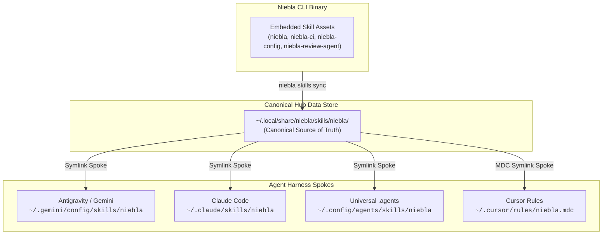

Niebla is engineered from the ground up for **dual ergonomics**: providing intuitive, color-coded ANSI terminal interfaces for human developers and deterministic, machine-readable contracts (`--json`) for autonomous AI coding agents and review personas.

To ensure AI coding agents operate effectively within Niebla monorepos without hallucinating Git commands, Niebla bundles four production-grade agent skills directly inside the `niebla` binary. These skills are automatically distributed across all installed agent harnesses via a unified **Hub-and-Spoke architecture**.



---

## 1. Hub-and-Spoke Distribution Model

Different AI coding harnesses expect instructions in disparate filesystem paths:
- Google Antigravity & Gemini CLI search `~/.gemini/config/skills/`
- Anthropic Claude Code searches `~/.claude/skills/`
- The Universal Agent specification searches `~/.config/agents/skills/`
- Cursor IDE searches `.cursor/rules/` for `.mdc` rule files

To prevent divergent, stale instruction files, Niebla implements a **Hub-and-Spoke synchronization model**:

1. **The Canonical Hub (`~/.local/share/niebla/skills/niebla`):**
   When `niebla skills sync` runs, Niebla extracts the latest embedded skill assets from the binary into the canonical XDG data directory (`$XDG_DATA_HOME/niebla/skills/niebla`).
2. **The Spokes (Symbolic Links):**
   Niebla inspects your environment for installed agent harnesses. It creates or repairs atomic symlinks pointing from each harness's skill directory back to the canonical Hub.
3. **Cursor Rule Compatibility (`.mdc`):**
   For Cursor, Niebla links the primary `SKILL.md` directly as `~/.cursor/rules/niebla.mdc`, allowing Cursor to ingest the operational rules natively.

---

## 2. Managing Skills via CLI (`niebla skills`)

The `niebla skills` command group automates skill installation, verification, and inspection.

| Command | Description |
| :--- | :--- |
| `niebla skills sync [--proactive] [--hub <dir>]` | Populates the Hub and establishes/repairs symlinks to all detected harnesses. |
| `niebla skills status [--hub <dir>]` | Audits all agent harness spokes and prints a health table (`Linked`, `Missing`, `Broken`). |
| `niebla skills export --dest <dir>` | Unpacks embedded skill assets into an arbitrary folder for inspection or packaging. |

### Synchronizing Skills Across Harnesses

To set up or update skills across all agent environments on your workstation, run:

```console
$ niebla skills sync
Hub populated at: /home/developer/.local/share/niebla/skills/niebla

HARNESS                 SPOKE PATH                                           STATUS   MESSAGE
Antigravity / Gemini    /home/developer/.gemini/config/skills/niebla         Linked   Symlink created successfully
Claude Code             /home/developer/.claude/skills/niebla                Linked   Symlink created successfully
Universal .agents       /home/developer/.config/agents/skills/niebla         Linked   Symlink created successfully
Cursor Rules            /home/developer/.cursor/rules/niebla.mdc             Linked   Symlink created successfully
```

By default, `--proactive=true` creates the parent configuration directories if an agent harness is not yet initialized.

### Inspecting Harness Spoke Health

To verify that existing symlinks remain healthy and point to valid targets:

```console
$ niebla skills status
Target Hub: /home/developer/.local/share/niebla/skills/niebla

HARNESS                 SPOKE PATH                                           STATUS   MESSAGE
Antigravity / Gemini    /home/developer/.gemini/config/skills/niebla         Linked   Valid symlink to hub
Claude Code             /home/developer/.claude/skills/niebla                Linked   Valid symlink to hub
Universal .agents       /home/developer/.config/agents/skills/niebla         Linked   Valid symlink to hub
Cursor Rules            /home/developer/.cursor/rules/niebla.mdc             Linked   Valid symlink to hub
```

---

## 3. Overview of the 4 Bundled Skills

Niebla bundles four specialized skills, each addressing a distinct operational domain:

```
~/.local/share/niebla/skills/niebla/
├── niebla/                 # Core developer VCS workflows & commands
│   └── SKILL.md
├── niebla-config/          # Toolchain configuration, theming & validation
│   └── SKILL.md
├── niebla-ci/              # CI runner execution, CloudEvents & check runs
│   └── SKILL.md
└── niebla-review-agent/    # AI review personas, Cotejo inline hints & suggestions
    └── SKILL.md
```

---

### Skill 1: `niebla` (Core Version Control & Monorepo Operations)

The foundational skill that teaches AI agents how to navigate, modify, and review code in a Niebla monorepo without attempting Git commands.

* **Primary File:** `niebla/SKILL.md`
* **Target Audience:** Coding agents (Antigravity, Claude Code, Cursor) performing feature development, bug fixes, or refactoring.
* **Core Principles Enforced:**
  1. **Strictly No Git:** Explicitly forbids agents from invoking `git commit`, `git add`, `git checkout`, or `git push`. All operations use `niebla`.
  2. **Virtual Workspace Mounts:** Teaches agents that workspaces reside in `/niebla/workspaces/<name>` or `$HOME/Developer/workspaces/<name>`. Instructs agents on when to use `--no-fuse` in containerized or non-root environments.
  3. **Copy-on-Write (CoW) Scratch Model:** Explains that changes modify the local scratch overlay without altering base CAS blobs until shelved.
  4. **Machine-Readable `--json` Contracts:** Commands agents to use `--json` flags when calling `niebla status`, `niebla shelve`, `niebla submit`, and `niebla sync` for deterministic parsing.
  5. **Changelist Lifecycle:** Guides agents through shelving Patchset $N+1$, opening review links in Cotejo, and verifying `OWNERS.toml` approvals before submitting to trunk.

#### Example Agent Workflow
```console
# Agent checks current workspace status deterministically
$ niebla status --json
{
  "workspace": "search-fix",
  "base_cl": 412,
  "changes": [
    {"status": "M", "path": "pkg/search/query.go"}
  ]
}

# Agent shelves a new patchset
$ niebla shelve -m "Fix nil pointer dereference in query tokenizer" --json
{
  "cl_id": 489,
  "patchset": 2,
  "review_url": "http://127.0.0.1:8080/cl/489"
}
```

---

### Skill 2: `niebla-config` (Toolchain Configuration & Theming)

Guides agents in reading, modifying, and validating Niebla's unified configuration files (`~/.config/niebla/*.toml`) without introducing syntax errors or service disruptions.

* **Primary File:** `niebla-config/SKILL.md`
* **Target Audience:** Configuration agents, environment setup assistants, theme customizers.
* **Core Capabilities & Rules:**
  1. **Canonical Config Resolution:** Understands `$XDG_CONFIG_HOME/niebla/` and multi-file discovery (`config.toml`, `ai.toml`, `theme.toml`, `ci.toml`).
  2. **Strict Section Uniqueness Rule:** Enforces that no TOML table header (e.g., `[server]`, `[critique.ai]`) is declared in multiple files.
  3. **Port Collision Prevention:** Validates that `server.port`, `critique.port`, and `critique.proxy_port` never collide.
  4. **Theme Customization:** Knows the 9 pre-compiled Cotejo theme presets (`catppuccin-mocha`, `catppuccin-latte`, `tokyo-night`, `dracula`, `nord`, etc.) and Chroma syntax styles.
  5. **Pre-Flight Candidate Validation Pattern:** Mandates that agents write candidate configs to `/tmp/candidate_config.toml` and run `niebla config validate` before touching production paths.

#### Example Pre-Flight Validation Pattern
```bash
# Agent prepares proposed theme change
cat <<'EOF' > /tmp/candidate_config.toml
[critique.theme]
preset = "tokyo-night"
syntax_style = "tokyonight-night"
EOF

# Agent validates candidate
niebla config validate /tmp/candidate_config.toml
# Output: ✓ Configuration is valid

# Atomically apply change
cp /tmp/candidate_config.toml ~/.config/niebla/theme.toml
rm -f /tmp/candidate_config.toml
```

---

### Skill 3: `niebla-ci` (Continuous Integration Runner Orchestration)

Teaches agents how to author CI workflows, execute builds, capture test logs into CAS, and report check run statuses back to Cotejo.

* **Primary File:** `niebla-ci/SKILL.md`
* **Target Audience:** CI/CD automation agents, build engineers, testing personas.
* **Core Capabilities & Rules:**
  1. **Provider-Agnostic Check Runs API:** Teaches agents how to interact with `POST /api/v1/ci/status` to emit `queued`, `running`, `passed`, or `failed` statuses.
  2. **Stateless Tree Materialization:** Instructs agents to use `niebla export --cl <id> --patchset <n> --dest ./src` to materialize zero-copy snapshots via local CAS hardlinks.
  3. **Execution Wrapping (`niebla ci exec`):** Shows how to wrap arbitrary build commands:
     ```bash
     niebla ci exec --runner local --cl 512 --patchset 1 -- go test -v ./...
     ```
     Captures execution logs, stores them as immutable CAS blobs, and streams status updates.
  4. **Presubmit Gating Compliance:** Guides agents in verifying that all required check runs succeed before issuing `niebla submit`.

---

### Skill 4: `niebla-review-agent` (AI Review Personas & Suggestions)

Guides the creation, registration, and operation of automated code review bots and inline AI comment hints in Cotejo.

* **Primary File:** `niebla-review-agent/SKILL.md`
* **Target Audience:** Automated review personas (security bots, accessibility checkers, linter agents) and developer-facing AI assistants.
* **Core Capabilities & Rules:**
  1. **3-Tier Governance Hierarchy:**
     - **Tier 1 (Host Baseline):** LLM endpoints and global quotas in `~/.config/niebla/ai.toml`.
     - **Tier 2 (Shared Catalog):** Registered agents and personas in `.niebla/agents.toml`.
     - **Tier 3 (Subtree Policy):** Directory-level agent bindings in `OWNERS.toml`.
  2. **Adaptive Context Aperture:**
     - Teaches agents to minimize token consumption by requesting only touched line ranges (`lines`), widening to enclosing functions (`block`), and only escalating to full file (`file`) when type definitions are missing.
  3. **Dual Code Suggestion Format:**
     - Formats code suggestions as standard Markdown ```` ```suggestion ```` blocks in review comments while ensuring line indices align with database records.
  4. **One-Click Patch Application:**
     - Explains the lifecycle where authors click "Apply Suggestion" in Cotejo, triggering `niebla-server` to splice the suggested code, write new CAS blobs, and create Patchset $N+1$ automatically.

#### Example Declarative Review Persona (`.niebla/agents.toml`)
```toml
# .niebla/agents.toml
version = 1

[agents.security-bot]
type = "ai"
display_name = "Security Sentinel"
description = "Scans diffs for OWASP vulnerabilities, hardcoded credentials, and unsafe memory operations."
system_prompt_path = ".niebla/prompts/security.md"
trigger_paths = ["pkg/auth/**", "internal/crypto/**"]
opt_in = false
max_context_lines = 1500
temperature = 0.1
```

---

## 4. Authoring In-Tree Project Skills

In addition to the global skills bundled in the `niebla` binary, individual monorepo projects can author repository-scoped skills under `.niebla/skills/` or `.agents/skills/`.

When an agent initializes in a workspace, it loads skills using standard priority:
1. Workspace-level skills (`.niebla/skills/`)
2. User-level harness skills (`~/.gemini/config/skills/`, `~/.claude/skills/`)
3. Canonical Niebla Hub (`~/.local/share/niebla/skills/niebla/`)

By maintaining strict compatibility with open agent standards, Niebla ensures that custom domain expertise (such as internal APIs, database schemas, or deployment runbooks) can be shared seamlessly across human developers and AI coding partners.

