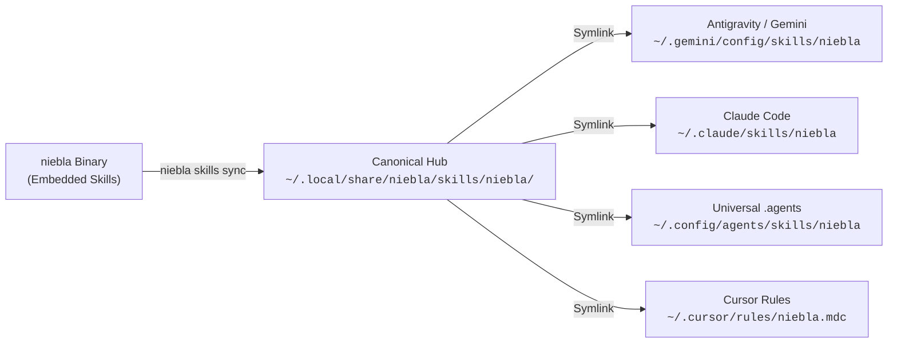

Niebla embeds four specialized AI agent skills directly inside the `niebla` binary so AI coding assistants can manage virtual workspaces, shelve changelists, configure themes, and post code review suggestions without hallucinating Git commands.



---

## 1. Synchronizing Skills (`niebla skills`)

Run `niebla skills sync` once on your workstation to extract the embedded skill definitions into `~/.local/share/niebla/skills/niebla` and create [symlinks](https://en.wikipedia.org/wiki/Symbolic_link) for every supported agent harness:

```console
$ niebla skills sync
Hub populated at: /home/developer/.local/share/niebla/skills/niebla

HARNESS                 SPOKE PATH                                           STATUS
Antigravity / Gemini    /home/developer/.gemini/config/skills/niebla         Linked
Claude Code             /home/developer/.claude/skills/niebla                Linked
Universal .agents       /home/developer/.config/agents/skills/niebla         Linked
Cursor Rules            /home/developer/.cursor/rules/niebla.mdc             Linked
```

* Use `niebla skills status` to verify that all harness symlinks resolve cleanly.
* Use `niebla skills export --dir ./skills` to unpack the raw `SKILL.md` files into a custom directory for inspection or air-gapped CI images.

---

## 2. Bundled Skills Catalog

| Skill Name | Path in Hub | Purpose & Key Rules |
| :--- | :--- | :--- |
| **`niebla`** | `niebla/SKILL.md` | Core VCS workflows (`workspace`, `status`, `diff`, `shelve`, `submit`, `sync`). Instructs agents to use `--json` output and never run `git` commands inside a Niebla workspace. |
| **`niebla-config`** | `niebla-config/SKILL.md` | Guides editing of `~/.config/niebla/*.toml`, Cotejo theme presets, section uniqueness rules, and pre-flight validation via `niebla config validate`. |
| **`niebla-ci`** | `niebla-ci/SKILL.md` | Covers stateless checkouts (`niebla export`), wrapping test runs (`niebla ci exec`), reporting check statuses (`niebla ci report`), and configuring `[ci.runners]` in `ci.toml`. |
| **`niebla-review-agent`** | `niebla-review-agent/SKILL.md` | Teaches automated review agents how to register in `.niebla/agents.toml`, use adaptive context apertures (`lines` $\to$ `block` $\to$ `file`), and format one-click ```` ```suggestion ```` blocks in Cotejo. |

---

## 3. Repository-Scoped Skills

In addition to the four global skills bundled with the CLI, teams can commit project-specific skills inside the [monorepo](https://en.wikipedia.org/wiki/Monorepo) under `.niebla/skills/` or `.agents/skills/`.

For configuring automated AI and deterministic review agents on changelists, see [In-Tree Governance](/niebla/workflows/in-tree-governance/) and [AI Review Assistance](/niebla/cotejo/ai-assistance/).
