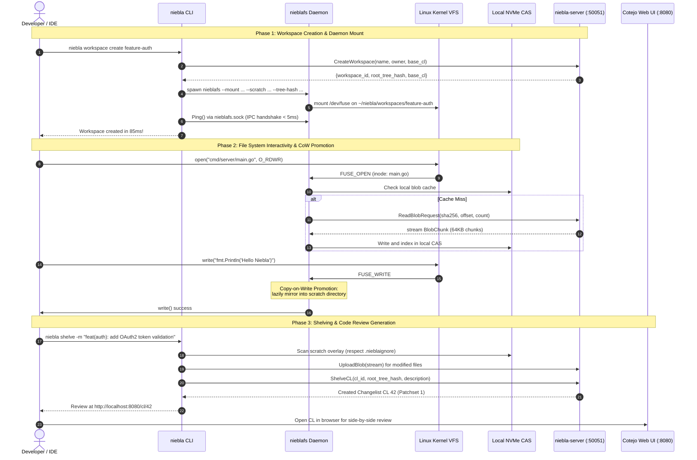

In Niebla, the lifecycle of a task moves smoothly from an instant workspace mount to modifying files in an isolated Copy-on-Write overlay, inspecting changes, and shelving a changelist for review in **Cotejo**.

This guide provides an end-to-end technical walkthrough of each phase, detailing what occurs in the Linux Virtual File System (VFS), local NVMe storage, and network RPCs.

---

## The Complete Lifecycle Overview



---

## Phase 1: Workspace Creation & Daemon Mount

When you create a workspace:

```bash
niebla workspace create feature-auth --mount-dir ~/niebla/workspaces/feature-auth
```

The CLI executes the following steps:
1. **Server Allocation:** Dials `niebla-server` and calls `CreateWorkspace(name, owner, base_cl)`. The server assigns a unique `workspace_id` and returns the cryptographic `root_tree_hash` of the base changelist.
2. **Directory Provisioning:** Ensures the mount directory, scratch directory (`~/.niebla/workspaces/feature-auth/scratch`), and shared CAS cache (`~/.cache/niebla/blobs`) exist.
3. **Daemon Fork:** Launches `nieblafs` in a detached process group (`syscall.SysProcAttr{Setpgid: true}`).
4. **FUSE VFS Mount:** `nieblafs` attaches to the Linux `/dev/fuse` character device and mounts onto the target mount directory.
5. **IPC Handshake:** The CLI polls the Unix domain socket (`nieblafs.sock`) with `control.Ping()`. As soon as the daemon acknowledges readiness (< 5ms), the CLI exits successfully.
6. **Post-Create Hooks:** If configured in `.niebla/hooks.toml`, executes post-create hooks (e.g. running language dependency setup).

---

## Phase 2: File System Interactivity Under the Hood

Once mounted, every POSIX file system call inside the workspace directory is handled by `nieblafs`:

### 1. Reading an Unmodified File
* An editor or compiler calls `open("cmd/server/main.go")`.
* The kernel issues a `FUSE_LOOKUP` request. `nieblafs` traverses its in-memory Merkle tree, finds the node entry, and returns a synthetic inode attribute struct.
* The application calls `read(fd, buf, 65536)`.
* `nieblafs` checks `~/.cache/niebla/blobs/ab/cd/<sha256>`:
  - **Cache Hit:** Bytes are read directly from local NVMe storage with native disk throughput.
  - **Cache Miss:** The daemon's `BlobFetcher` calls `ReadBlobRequest` over gRPC to `niebla-server`. Chunks are streamed in 64KB blocks, persisted into local CAS, and returned to the calling application.

### 2. Modifying a File (Copy-on-Write Promotion)
* When an application calls `open("cmd/server/main.go", O_RDWR)` and writes bytes:
* `nieblafs` detects that the file is currently pointing to the immutable base Merkle tree (`isScratch == false`).
* The daemon replicates the parent directory structure inside the local scratch directory:
  ```bash
  ~/.niebla/workspaces/feature-auth/scratch/cmd/server/
  ```
* If the write is partial (e.g. modifying lines in the middle of a file), `nieblafs` lazily copies the base file bytes into the scratch file before applying the edit.
* The file handle is upgraded: all subsequent reads and writes target the scratch file directly on disk.

### 3. Deleting a File (OverlayFS Whiteouts)
* When running `rm cmd/server/main.go`:
* The kernel issues `FUSE_UNLINK`. Because the base Merkle tree is immutable, `nieblafs` cannot delete the remote blob.
* Instead, `nieblafs` creates an empty marker file:
  ```bash
  ~/.niebla/workspaces/feature-auth/scratch/cmd/server/.wh.main.go
  ```
* During subsequent `ReadDirAll()` and `Lookup()` operations, `nieblafs` detects the `.wh.*` prefix and suppresses `main.go` from directory listings, returning `ENOENT` to any application attempting to access it.

---

## Phase 3: Change Inspection & Ignore Rules

To inspect modifications:

```bash
niebla status
```

The status command:
1. Traverses the local scratch directory.
2. Evaluates `.nieblaignore` rules. If a directory matches an ignore rule (e.g. `node_modules/`, `target/`, `build/`), `niebla` skips the entire subtree immediately using `filepath.SkipDir` to avoid scanning unneeded directories.
3. Compares the non-ignored scratch files and whiteout markers against the base Merkle tree:
   - `[M]  cmd/server/main.go` — Modified file
   - `[A]  pkg/auth/token.go` — Added file
   - `[D]  pkg/legacy/auth.go` — Deleted file (whiteout marker found)

To view unified diffs:

```bash
niebla diff
```

`niebla diff` fetches base blobs from local CAS and computes intra-line, word-level diffs against your scratch files.

---

## Phase 4: Shelving a Changelist (CL)

When you are ready to send your work for review:

```bash
niebla shelve -m "feat(auth): add OAuth2 token validation" --reviewers "alice,bob,@security-team"
```

1. **Blob Upload:** The CLI scans non-ignored dirty files in scratch and streams them to central CAS on `niebla-server` via `UploadBlob(stream)`.
2. **Merkle Manifest Generation:** The CLI constructs compact binary Merkle tree manifests (`pkg/tree`), computing recursive cryptographic hashes up to the root.
3. **ShelveCL RPC:** Dispatches `ShelveCL` to `niebla-server`. The server creates or updates the changelist record:
   - If this is the first shelve, assigns a new Changelist ID (e.g. `CL 42`).
   - If updating an existing changelist, creates **Patchset $N+1$**.
4. **Asynchronous Cascading Rebase:** If you are updating a parent changelist that has child changelists stacked on top of it, the server queues background recursive 3-way rebasing (`RebaseQueue`) across the child changelists without blocking your CLI.
5. **Cotejo URL:** The CLI outputs the direct review URL:
   ```text
   Shelved changelist CL 42 (Patchset 1)
   Review URL: http://localhost:8080/cl/42
   ```

---

## Phase 5: Upstream Synchronization (`niebla sync`)

When trunk moves forward, synchronize your workspace:

```bash
niebla sync
```

* **In FUSE Mode:** If there are no overlapping file conflicts, the server fast-forwards the base Merkle root tree and sends a `reanchor` IPC message over `nieblafs.sock`. The daemon purges its in-memory metadata cache and points to the new root tree in **sub-millisecond time with zero file copying**.
* **In Conflict Situations:** If the server detects overlapping edits between upstream trunk and your local modifications, `niebla sync` executes an in-place 3-way merge and automatically injects standard conflict markers into your workspace files:
  ```text
  ⚠️  Rebase conflict detected with Parent CL 42!
     Conflicts: pkg/auth/token.go (2 conflict hunks)
     ✓ Injected conflict markers into 1 workspace file(s):
       • pkg/auth/token.go
     Please resolve the conflicting files in your workspace, then run 'niebla shelve' to commit the resolution.
  ```

### Resolving In-Place Rebase Conflicts
1. Open the conflicted file in your IDE or text editor:
   ```go
   <<<<<<< PARENT CL 42
   func ValidateToken(token string) (*Claims, error) {
   =======
   func ValidateToken(ctx context.Context, token string) (*Claims, error) {
   >>>>>>> LOCAL WORKSPACE (feature-auth)
   ```
2. Manually edit the file to keep the desired resolution, removing the conflict markers.
3. Run `niebla diff` to verify that all conflict markers have been eliminated and clean diffs are shown.
4. Run `niebla shelve` to commit the conflict resolution and upload the new patchset to Cotejo. All orphan whiteout markers are automatically pruned upon shelving.

---

## Stacking Dependent Workspaces

When building a feature that depends on an in-progress changelist that has not yet landed on trunk:

```bash
# Create a child workspace anchored to your pending CL 42
niebla workspace create auth-ui --cl 42
```

* If you later update `CL 42` (shelving Patchset 2), running `niebla sync` inside `auth-ui` will automatically synchronize the base tree to the updated patchset.

---

## Next Steps

* **[Direct Materialization Mode (`--no-fuse`)](/niebla/workflows/direct-materialization/):** Running workspaces on macOS or containerized CI runners without `/dev/fuse`.
* **[IDE Setup & Configuration](/niebla/workflows/ide-setup/):** Optimizing VS Code, JetBrains IDEs, Neovim, and Emacs for virtual monorepos.

