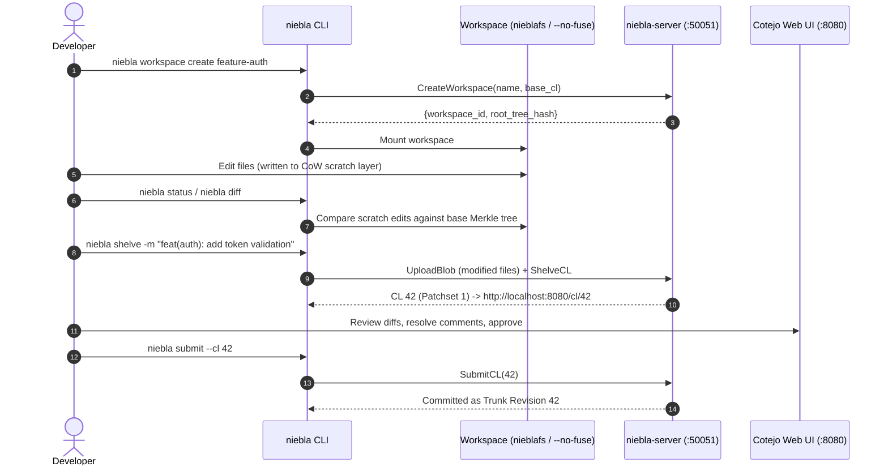

This guide covers the day-to-day developer workflow in Niebla: inspecting local edits, shelving changelists for review, syncing with upstream [trunk](https://en.wikipedia.org/wiki/Trunk-based_development), resolving conflicts, and stacking dependent changes.

For low-level details on how `nieblafs` handles kernel filesystem calls and [Copy-on-Write](https://en.wikipedia.org/wiki/Copy-on-write) scratch promotion, see [NieblaFS (Virtual Filesystem)](/niebla/architecture/fuse-internals/).

---

## 1. End-to-End Workflow Overview



---

## 2. Inspecting Changes & `.nieblaignore`

Because unmodified files stay in the read-only base tree, `niebla status` only scans your workspace's scratch layer:

```bash
niebla status
```

```text
Workspace: feature-auth (Base CL 100)

Changes:
  [M]  cmd/server/main.go
  [A]  pkg/auth/token.go
  [D]  pkg/legacy/auth.go
```

* **Ignore Rules (`.nieblaignore`):** Add build output directories (`target/`, `node_modules/`, `dist/`, `.direnv/`) to `.nieblaignore` at the repository root. When scanning scratch, `niebla` skips matching directories immediately via `filepath.SkipDir`.
* **Diffing (`niebla diff`):** Run `niebla diff` (or `niebla diff path/to/file.go`) to view syntax-highlighted unified diffs comparing your scratch files against the base changelist blobs.

---

## 3. Shelving Changelists & Patchsets (`niebla shelve`)

When your changes are ready for review, shelve them into a Changelist (CL):

```bash
niebla shelve -m "feat(auth): add OAuth2 token validation" --reviewers "alice,@security-team"
```

1. **Initial Shelve:** Streams modified scratch blobs to `niebla-server`, computes the new [Merkle root hash](https://en.wikipedia.org/wiki/Merkle_tree), creates a new CL (e.g., `CL 42`, `Patchset 1`), and prints the Cotejo review URL.
2. **Subsequent Shelves:** Running `niebla shelve -m "..."` again in the same workspace automatically publishes **Patchset $N+1$** on the existing CL so reviewers can diff `Patchset 1` vs. `Patchset 2` in Cotejo.

---

## 4. Syncing with Trunk & Resolving Conflicts (`niebla sync`)

As teammates submit changes to trunk, update your workspace's base tree with `niebla sync`:

```bash
niebla sync
```

* **Clean Fast-Forward:** If upstream changes do not touch the files you modified in scratch, `niebla-server` advances your workspace's base Merkle root hash and signals `nieblafs` over `nieblafs.sock` to refresh its metadata cache in milliseconds.
* **Overlapping Edits (Conflict Resolution):** If upstream modified a file you also edited locally, `niebla sync` runs a [3-way merge](https://en.wikipedia.org/wiki/Merge_(version_control)#Three-way_merge) and writes conflict markers into your scratch file:

```go
<<<<<<< PARENT CL 105
func ValidateToken(token string) (*Claims, error) {
=======
func ValidateToken(ctx context.Context, token string) (*Claims, error) {
>>>>>>> LOCAL WORKSPACE (feature-auth)
```

To resolve a conflict:
1. Edit the conflicted file to keep the desired code and remove the `<<<<<<<`, `=======`, and `>>>>>>>` markers.
2. Run `niebla diff` to confirm the changes look clean.
3. Run `niebla shelve -m "chore: resolve rebase conflict"` to publish the updated patchset.

---

## 5. Stacking Dependent Workspaces

To build a new feature on top of an unsubmitted changelist (`CL 42`) that is still under review:

```bash
# Create a child workspace anchored to CL 42
niebla workspace create auth-ui --cl 42
```

* All files added or modified in `CL 42` are immediately present in `auth-ui`.
* If you publish a new patchset to `CL 42` or submit `CL 42` to trunk, `niebla-server` automatically rebases child changelists stacked on top of `CL 42`. Run `niebla sync` inside `auth-ui` to pull the updated parent state.

---

## Next Steps

* **[Direct Materialization (`--no-fuse`)](/niebla/workflows/direct-materialization/):** Working on macOS or inside containers without `/dev/fuse`.
* **[In-Tree Governance (`OWNERS.toml`)](/niebla/workflows/in-tree-governance/):** Configuring approval rules, presubmit hooks, and automated review agents.
* **[CLI Command Reference](/niebla/reference/cli/):** Full flag reference for `workspace`, `shelve`, `sync`, and `submit`.
