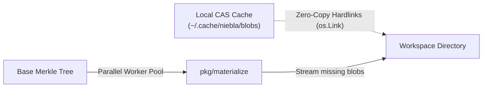

While the [FUSE](https://en.wikipedia.org/wiki/Filesystem_in_Userspace) virtual filesystem (`nieblafs`) is the default on Linux workstations, some environments do not expose `/dev/fuse`. For these environments, Niebla provides **Direct Materialization Mode (`--no-fuse`)**:

```bash
niebla workspace create my-feature --no-fuse
```

To make `--no-fuse` the default for all workspaces in your shell, set `export NIEBLA_NO_FUSE=true` in `~/.zshrc` or `~/.bashrc`.

---

## 1. When to Use `--no-fuse`

| Environment | Why `--no-fuse` Fits |
| :--- | :--- |
| **macOS Workstations** | Runs natively on macOS (`arm64` and `amd64`) without installing `macFUSE` kernel extensions or rebooting to lower system security settings. |
| **Unprivileged CI Containers** | Standard Docker, Podman, and Kubernetes pods run without `--privileged` or `--device /dev/fuse`. |
| **Heavy Full-Tree Builds** | Workloads that read nearly every file in the repository avoid userspace-to-kernel FUSE context switches. |

---

## 2. How Direct Materialization Works



1. **Parallel Tree Resolution:** `pkg/materialize.MaterializeTree` walks the base changelist's [Merkle tree](https://en.wikipedia.org/wiki/Merkle_tree) using a concurrent worker pool.
2. **Zero-Copy [Hardlinks](https://en.wikipedia.org/wiki/Hard_link) (`os.Link`):** When `~/.cache/niebla/blobs` is on the same filesystem partition as the workspace directory, Niebla hardlinks cached blobs directly into the workspace.
3. **Read-Only Cache Protection (`0444`):** Hardlinked files are marked read-only (`0444`) so editors break the hardlink on save instead of mutating the shared [CAS](https://en.wikipedia.org/wiki/Content-addressable_storage) cache in place.
4. **No Background Daemon:** The workspace is a standard directory on disk (`PID: 0`, no `nieblafs.sock` socket).

---

## 3. Syncing & Status in `--no-fuse` Mode

All standard commands (`niebla status`, `niebla diff`, `niebla shelve`, `niebla sync`, `niebla submit`) work identically in `--no-fuse` mode:

* **Fast Status Checks:** `niebla status` compares file sizes and modification timestamps (`mtime`) against the base Merkle tree, computing [SHA-256](https://en.wikipedia.org/wiki/SHA-2) hashes only for files whose metadata changed.
* **Dirty Worktree Guard on Sync:** Running `niebla sync` with unshelved local edits stops with a safety warning so your changes are never overwritten accidentally (use `niebla shelve` first, or `niebla sync --force` to discard local changes).
* **Deleted File Cleanup:** When upstream commits delete files, `niebla sync` removes those files from your local workspace directory automatically.

---

## 4. Comparison: FUSE Mode vs. Direct Materialization

| Feature | Virtual FUSE Mode (Default) | Direct Materialization (`--no-fuse`) |
| :--- | :--- | :--- |
| **Creation Time** | **< 100 ms** | ~100 ms (with warm CAS hardlinks) to seconds (cold cache) |
| **Initial Disk Space** | **< 100 KB** | 0 extra blocks when hardlinked to local CAS; full tree size otherwise |
| **Blob Fetching** | Lazy (streamed on `read()`) | Eager (materialized on `workspace create` / `sync`) |
| **Kernel Requirements** | Linux `/dev/fuse` (`fuse3`) | None (standard POSIX filesystem calls) |
| **Container Support** | Requires `--device /dev/fuse` | Runs in any unprivileged container |
| **macOS Support** | Requires third-party FUSE driver | **Native out of the box** |
| **Background Daemon** | Supervised `nieblafs` process | None (`PID: 0`) |
