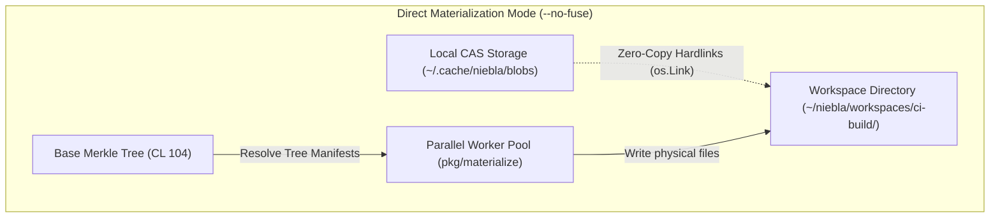

While the virtual FUSE filesystem (`nieblafs`) is the default on Linux developer workstations, certain environments cannot or should not load kernel extensions or FUSE drivers.

For these environments, Niebla provides **Direct Materialization Mode (`--no-fuse`)**:

```bash
niebla workspace create ci-build --no-fuse
```

This mode materializes repository source trees directly into standard physical directories on local disk while maintaining full cryptographic parity with the central Merkle tree.

---

## When to Use Direct Materialization Mode

| Environment | Why `--no-fuse` Is Ideal |
| :--- | :--- |
| **macOS Workstations** | Apple requires third-party kernel extension approvals and system reboots for `macFUSE`, while `FUSE-T` relies on external NFS translation bridges. Direct materialization runs natively on macOS Darwin (`aarch64` and `x86_64`) with **zero system extensions**. |
| **Unprivileged CI/CD Containers** | Standard Docker, Podman, Kubernetes, and GitHub Actions runners operate without `--privileged` or `/dev/fuse` character device passthrough. Direct materialization works out of the box in any unprivileged container. |
| **High-Throughput Batch Compilers** | Workloads with intense parallel random access where eliminating userspace-to-kernel context switching yields maximum compilation throughput. |

---

## Architecture & How It Works Under the Hood



### 1. Parallel Tree Traversal
When `workspace create --no-fuse` is executed, the CLI resolves the base changelist's root Merkle tree and invokes `pkg/materialize.MaterializeTree`. A concurrent worker pool resolves tree manifests and blob digests in parallel.

### 2. Zero-Copy Hardlink Optimization (`os.Link`)
* When the local CAS cache (`~/.cache/niebla/blobs`) resides on the **same filesystem partition** as the workspace mount directory, Niebla hardlinks the files directly into the workspace using `os.Link`.
* **Zero Storage Overhead:** Materializing a 100,000-file repository takes **milliseconds** and consumes **zero additional disk blocks**!
* Both the CAS cache and the workspace directory point to the exact same physical disk inodes.

### 3. Fallback Streaming
If CAS is located on a different disk partition or files are not yet cached locally, `MaterializeTree` streams chunks over gRPC and writes standard physical files to disk.

### 4. No Background Daemon
In `--no-fuse` mode:
* `DaemonPID` is `0`.
* `SocketPath` is empty (`""`).
* The workspace is a standard physical directory on disk, completely free from daemon lifecycles.

---

## Status, Diffing & Shelving in `--no-fuse` Mode

All standard `niebla` commands work seamlessly in `--no-fuse` mode:

### Change Inspection (`niebla status`)
In `--no-fuse` mode, `niebla status` traverses the physical workspace directory:
* Compares file modification timestamps (`mtime`) and file sizes against the base Merkle tree.
* Recomputes SHA-256 digests only for files with changed sizes or timestamps.
* Deleted files are identified by their physical absence from disk (without needing whiteout markers).
* Respects `.nieblaignore` rules, skipping ignored directories via `filepath.SkipDir`.

### Unified Diffs (`niebla diff`)
Compares modified physical files against the base CL blobs fetched from local CAS or `niebla-server`.

### Shelving (`niebla shelve`)
1. Reads modified physical files from the workspace directory.
2. Streams modified blobs to central CAS on `niebla-server`.
3. Constructs compact binary Merkle tree manifests (`pkg/tree`), computing recursive cryptographic hashes up to the root.
4. Calls `ShelveCL`, creating Patchset $N$ identically to FUSE mode.

---

## Comparison Matrix: FUSE Mode vs. Direct Materialization

| Feature / Metric | Virtual FUSE Mode (Default) | Direct Materialization Mode (`--no-fuse`) |
| :--- | :--- | :--- |
| **Creation Latency** | **< 100 ms** (instant VFS mount) | 100 ms (with CAS hardlinks) to seconds (full download) |
| **Initial Disk Usage** | **< 100 KB** (metadata & scratch only) | Full repository working tree size (or 0 extra bytes with hardlinks) |
| **Blob Fetching** | **Lazy on-demand** (streamed on `read()`) | **Eager** (materialized upon workspace creation) |
| **Kernel Requirements** | Linux kernel `/dev/fuse` support | **None** (pure userspace POSIX filesystem calls) |
| **Container Compatibility** | Requires `--device /dev/fuse --cap-add SYS_ADMIN` | **Universal** (runs in any unprivileged Docker/Podman container) |
| **macOS Support** | Requires macFUSE or FUSE-T | **Native out-of-the-box** on macOS Darwin (`aarch64` & `x86_64`) |
| **Sync Latency (`niebla sync`)** | Sub-millisecond (in-memory cache re-anchor) | Re-materializes updated blobs on disk |
| **Whiteout Deletions** | OverlayFS `.wh.<filename>` markers | Standard file deletions (`os.Remove`) |
| **Background Daemon** | Runs supervised `nieblafs` daemon | **None** (`PID: 0`) |

---

## Next Steps

* **[IDE Setup & Configuration](file:///home/matatan/Developer/niebla/docs-site/src/content/docs/workflows/ide-setup.md):** Configuring VS Code, Neovim, and Emacs for Niebla workspaces.
* **[Virtual Workspaces & Storage Economics](file:///home/matatan/Developer/niebla/docs-site/src/content/docs/workflows/workspaces.md):** Deep dive into FUSE overlays, CAS sharding, and disk economics.

