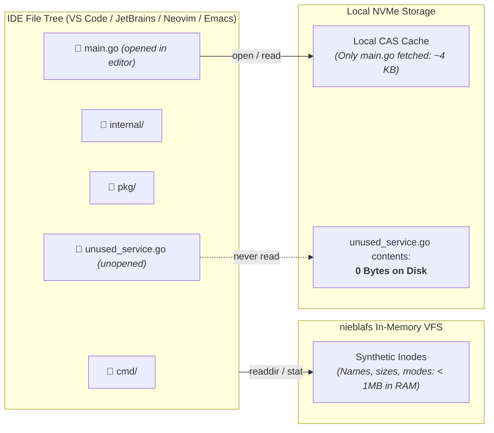

Because Niebla workspaces are mounted as standard POSIX directories, modern editors, language servers, and command-line tools function out of the box.

However, because Niebla is **server-authoritative and does not use Git**, working in an IDE involves an important conceptual shift regarding how the file tree operates.

---

## The Virtual File Tree: Accessible vs. Loaded

When you open a workspace directory (`~/niebla/workspaces/<name>`) in your editor, **the file tree will display the entire monorepo**. You can expand directories, browse shared libraries, click on files, and inspect code across the entire repository.

However, **accessible does NOT mean loaded**.



### How This Works Under the Hood

1. **Synthetic Directory Entries:**
   What your IDE sees in the file tree are lightweight **synthetic metadata inodes** held in memory by `nieblafs`. Directory listings (`readdir`) and file attributes (`stat`) resolve instantly from the in-memory Merkle tree.
2. **Zero Initial Content Downloads:**
   Seeing 500,000 files in your IDE sidebar does **not** mean 500,000 files were downloaded to your SSD. Unopened files consume **0 bytes of physical disk space**.
3. **Lazy On-Demand Fetching:**
   File contents (blobs) are streamed over HTTP/2 gRPC only at the exact moment a process (your editor, linter, or compiler) executes `read()` on that file.
4. **Important IDE Takeaway:**
   Avoid running extensions or shell scripts that recursively open or checksum every single file across the monorepo (e.g. unbounded full-disk grep or unconfigured whole-depot linters). Opening every file triggers on-demand streaming for all of them. This is why scoping file watchers and language servers is a best practice.

---

## Why Git Extensions Should Be Disabled

Most developer environments come with active Git integrations:
1. **Unnecessary Directory Searches:** Looking for `.git/HEAD` or `.git/index` can cause the editor to traverse parent directories up to the filesystem root.
2. **Inotify / File Watcher Saturation:** In multi-gigabyte monorepos, eager file watchers can exhaust system inotify limits (`fs.inotify.max_user_watches`) by indexing virtual directories that have not yet been touched.
3. **Misleading UI Indicators:** The editor might display a "Not a Git repository" warning or fail to show file status until configured.

---

## Visual Studio Code

### What to Expect
* Language servers (**gopls**, **rust-analyzer**, **tsserver**, **pyright**) resolve imports and dependencies normally through the virtual mount.
* The built-in Git extension will show a badge indicating "No source control providers registered," which is normal.

### Recommended `.vscode/settings.json`

Add the following to your workspace or user settings:

```json
{
  // Disable built-in Git extension to avoid scanning for .git
  "git.enabled": false,
  "git.autorefresh": false,

  // Prevent file watchers from recursing into scratch overlays or build caches
  "files.watcherExclude": {
    "**/.niebla/**": true,
    "**/scratch/**": true,
    "**/.git/**": true,
    "**/node_modules/**": true,
    "**/target/**": true,
    "**/dist/**": true
  },

  // Language Server Scoping (e.g. Go gopls)
  "gopls": {
    "ui.diagnostic.analyses": {
      "unusedparams": true
    },
    "formatting.gofumpt": true
  },

  // Rust Analyzer Scoping
  "rust-analyzer.check.command": "clippy"
}
```

---

## JetBrains IDEs (IntelliJ IDEA, GoLand, PyCharm, WebStorm, CLion)

### What to Expect
JetBrains IDEs provide deep static code analysis, semantic refactoring, and project-wide symbol indexing. However, unlike VS Code or Neovim (which delegate queries on demand to language servers like `gopls` or `rust-analyzer`), **JetBrains IDEs use an internal Virtual File System (VFS) and an eager background indexing engine**.

### The Indexing Pitfall: Eager Indexing vs. Lazy Streaming

> [!WARNING]
> By default, opening a project root in IntelliJ triggers a recursive scan of every directory and file to build AST symbol caches ("*Scanning files to index...*").
> 
> In a 500GB / 500,000-file Niebla monorepo, indexing the entire workspace root will force `nieblafs` to execute `read()` on **every file**, lazily streaming hundreds of gigabytes across your network and filling your local CAS NVMe storage.

### Key Differences & Solutions for IntelliJ

| Challenge in Niebla | JetBrains Behavior | Recommended Mitigation |
| :--- | :--- | :--- |
| **Unbounded Indexing** | Scans and indexes every file under the project root | Exclude untargeted monorepo directories or scope Content Roots |
| **Git Detection** | Traverses upwards searching for `.git` and polls status | Set VCS Directory Mapping to `<none>` |
| **File Watcher (`fsnotifier`)** | Attempts inotify watches across all directories | Exclude `.niebla/`, build outputs, and untargeted submodules |
| **Safe Write Renames** | Saves changes via temporary swap files (`.tmp`) | Disable "Use safe write" to ensure direct CoW file mutation |

---

### Recommended IntelliJ / JetBrains Configuration

#### 1. Scope Project Content Roots (Crucial)
Rather than letting IntelliJ index the entire monorepo, configure the project module to only index the specific services or packages you are working on:

* **Method A: Exclude Directories via UI**
  1. In the **Project** tool window (`Alt+1` / `Cmd+1`), right-click any top-level directory you don't need (e.g. `services/legacy`, `frontend/`, `build/`).
  2. Select **Mark Directory as** → **Excluded** (or press `Alt+E`).
  3. Excluded directories remain visible in your file tree for reference, but IntelliJ will **never read or index their contents**, preserving 0-byte local disk usage.

* **Method B: Configure Content Roots in Project Structure**
  1. Open **Project Structure** (`Ctrl+Alt+Shift+S` on Linux/Windows, `Cmd+;` on macOS).
  2. Under **Project Settings** → **Modules** → **Sources**:
  3. Remove the monorepo root as a monolithic Content Root.
  4. Click **+ Add Content Root** to add only your active service directories (e.g. `cmd/api` and `pkg/auth`).

* **Method C: Open Subfolders Directly**
  If your work is isolated to a single service or package, you can open the subfolder directly from your terminal:
  ```bash
  # Open only the target service directory in GoLand / IntelliJ
  goland ~/niebla/workspaces/auth-ui/services/auth-service
  ```
  IntelliJ treats the subfolder as the project root, indexing only its immediate files.

#### 2. Disable Git Version Control Mapping
Prevent IntelliJ from continuously polling for `.git` status or showing "Unregistered VCS root" warnings:

1. Open **Settings** / **Preferences** (`Ctrl+Alt+S` or `Cmd+,`).
2. Go to **Version Control** → **Directory Mappings**.
3. Select `<Project>` and change the VCS dropdown to **`<none>`** (or remove the entry).

You can also check in a project configuration file at `.idea/vcs.xml`:

```xml
<?xml version="1.0" encoding="UTF-8"?>
<project version="4">
  <component name="VcsDirectoryMappings">
    <!-- Disable Git detection inside Niebla workspaces -->
    <mapping directory="" vcs="" />
  </component>
</project>
```

#### 3. Optimize Synchronization and Safe Write
Under **Settings** → **Appearance & Behavior** → **System Settings** → **Synchronization**:

* **Uncheck "Use safe write (save changes to a temporary file first)"**:
  Safe write creates temporary files and atomically renames them over the original. In virtual FUSE filesystems, disabling safe write ensures the editor performs direct in-place writes, cleanly triggering Niebla's kernel-level Copy-on-Write (CoW) promotion into the workspace's scratch overlay.
* **Exclude Internal Niebla Paths in `.idea/<module>.iml`**:
  ```xml
  <?xml version="1.0" encoding="UTF-8"?>
  <module type="WEB_MODULE" version="4">
    <component name="NewModuleRootManager">
      <content url="file://$MODULE_DIR$">
        <!-- Exclude internal Niebla state and scratch overlay from indexing -->
        <excludeFolder url="file://$MODULE_DIR$/.niebla" />
        <excludeFolder url="file://$MODULE_DIR$/scratch" />
      </content>
    </component>
  </module>
  ```

#### 4. Tune JVM Heap Memory
When working with multiple scoped packages in a monorepo, ensure the IntelliJ process has sufficient heap space to hold syntax trees in memory without aggressive garbage collection pauses:
* Navigate to **Help** → **Change Memory Settings**.
* Set **Maximum Heap Size** to `4096 MB` or higher.

---

## Neovim

### What to Expect
* Neovim navigates FUSE workspaces with zero latency.
* Built-in LSP clients and Treesitter parse virtual files effortlessly.

### Recommended Configuration (`init.lua`)

Configure your LSP client to detect project roots using project markers (such as `go.mod`, `Cargo.toml`, or `package.json`) rather than seeking a `.git` root:

```lua
-- nvim-lspconfig root directory detection without .git dependency
local lspconfig = require('lspconfig')
local util = require('lspconfig.util')

-- Configure gopls
lspconfig.gopls.setup({
  root_dir = util.root_pattern('go.work', 'go.mod', '.nieblaignore', '.niebla'),
  settings = {
    gopls = {
      analyses = { unusedparams = true },
      staticcheck = true,
    },
  },
})

-- Configure rust-analyzer
lspconfig.rust_analyzer.setup({
  root_dir = util.root_pattern('Cargo.toml', '.nieblaignore', '.niebla'),
})

-- Telescope: Use ripgrep with .nieblaignore instead of git_files
local builtin = require('telescope.builtin')
vim.keymap.set('n', '<leader>ff', function()
  builtin.find_files({
    find_command = { 'rg', '--files', '--hidden', '--glob', '!.niebla/*' },
  })
end, { desc = 'Find files in Niebla workspace' })
```

---

## Emacs

### What to Expect
* Emacs default `vc-mode` attempts to locate `.git` or `.hg` in parent directory hierarchies. Disabling Git for Niebla workspace paths prevents startup delays.

### Recommended Emacs Configuration (`init.el` / `config.el`)

```elisp
;; Disable VC Git backend inside Niebla workspaces to prevent search overhead
(setq vc-handled-backends (delq 'Git vc-handled-backends))

;; Project.el: Define root markers for Niebla workspaces
(with-eval-after-load 'project
  (add-to-list 'project-find-functions
               (lambda (dir)
                 (when-let ((root (locate-dominating-file dir ".niebla")))
                   (cons 'transient root)))))

;; Projectile configuration (if using projectile)
(with-eval-after-load 'projectile
  (add-to-list 'projectile-project-root-files ".niebla")
  (add-to-list 'projectile-project-root-files "go.mod")
  (add-to-list 'projectile-project-root-files "Cargo.toml"))

;; Eglot / LSP-mode auto-detects project root using project.el
```

---

## Next Steps

* **[The Development Lifecycle](file:///home/matatan/Developer/niebla/docs-site/src/content/docs/workflows/development-lifecycle.md):** From editing files and CoW promotion to shelving and code review in Cotejo.
* **[Virtual Workspaces & Storage Economics](file:///home/matatan/Developer/niebla/docs-site/src/content/docs/workflows/workspaces.md):** Deep dive into FUSE overlays, CAS sharding, and disk economics.

