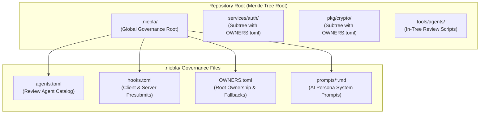
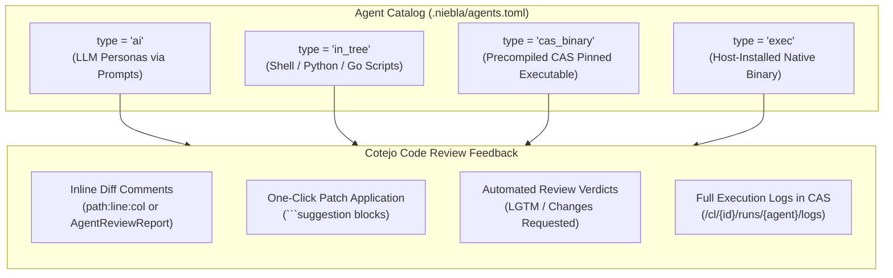

In traditional version control systems, repository governance—such as code owners, CI dispatchers, branch protection rules, and review bots—is managed outside the codebase. It resides in web dashboards, proprietary cloud SaaS settings, or external webhook configurations that cannot be branched, diffed, rolled back, or tested in isolation.

Niebla rejects external, unversioned governance in favor of **"Source Control within Source Control"**. 

All repository policies—including subtree code ownership, automated review personas, in-tree linter scripts, and presubmit hooks—are committed directly into the repository's Merkle tree under `.niebla/` and distributed `OWNERS.toml` files.



---

## 1. Principles of In-Tree Governance

1. **Self-Describing Repositories:** A freshly materialized workspace contains everything necessary to enforce security rules, review changelists, execute presubmit hooks, and dispatch automated bots—with zero dependencies on external SaaS configuration.
2. **Temporal Consistency (No In-Flight Breakages):** Because governance files are tracked in the Merkle tree, every changelist evaluates rules against its **base CL commit**. If an administrator updates a linter or hook on trunk at CL #500, older in-flight changelists branched from CL #450 continue running their original base rules until explicitly rebased.
3. **Auditable Peer Review for Policy Changes:** Changes to security scanners, ownership quotas, or AI prompts are proposed as standard Niebla Changelists (CLs). They appear in Cotejo with syntax-highlighted diffs, require sign-off from root repository owners, and produce an immutable audit trail.
4. **Hermetic In-Tree Tooling:** Linter scripts and review binaries live alongside the code they inspect. When you refactor a framework API and update its linter, both changes commit atomically in the same monotonic changelist.

---

## 2. Directory Layout of `.niebla/`

```
monorepo/
├── .niebla/
│   ├── OWNERS.toml           # Root repository owners and global fallback policies
│   ├── agents.toml           # Shared catalog of review bots, static analyzers, and AI personas
│   ├── hooks.toml            # Client-side and server-side presubmit hooks
│   └── prompts/              # In-tree LLM system prompts for AI reviewer personas
│       ├── accessibility.md
│       ├── security.md
│       └── architecture.md
├── tools/
│   └── agents/               # In-tree review scripts and linter wrappers
│       ├── sec-scanner.sh
│       └── check-licenses.sh
├── services/
│   └── auth/
│       ├── OWNERS.toml       # Subtree ownership, approver quotas, and agent bindings
│       └── handlers.go
└── pkg/
    └── crypto/
        ├── OWNERS.toml       # Isolated subtree policy with set_noparent = true
        └── cipher.go
```

---

## 3. Implementing Review Agents & Review Scripts

Review agents in Niebla are declared in `.niebla/agents.toml`. When a developer shelves a changelist (`niebla shelve`), Niebla inspects touched file paths against `.niebla/agents.toml` and relevant `OWNERS.toml` files, auto-assigns matching agents as reviewers in Cotejo, and executes them in an isolated workspace.

Niebla supports four execution modes for review agents:



---

### Type 1: In-Tree Script Reviewers (`type = "in_tree"`)

In-tree scripts execute shell, Python, or Go scripts tracked directly inside the repository.

#### Step 1: Author the Review Script (`tools/agents/sec-scanner.sh`)
The script receives an isolated workspace directory and standard environment variables:
- `NIEBLA_CL_ID`: Active changelist number
- `NIEBLA_PATCHSET`: Active patchset index
- `NIEBLA_CHANGED_FILES`: Space-separated list of modified paths
- `NIEBLA_BASE_CL`: Base trunk commit hash

The script can emit diagnostics in standard compiler format (`path:line: message` or `path:line:col: message`):

```bash
#!/usr/bin/env bash
# tools/agents/sec-scanner.sh
set -euo pipefail

echo "Running in-tree security scan across changed files..."
FAILED=0

# Scan modified Go files for hardcoded credentials or unsafe patterns
for file in $NIEBLA_CHANGED_FILES; do
    if [[ "$file" =~ \.go$ ]] && [ -f "$file" ]; then
        # Check for hardcoded secret assignments
        if grep -n -E 'const [a-zA-Z0-9_]*Secret = "[^"]+"' "$file"; then
            line_no=$(grep -n -E 'const [a-zA-Z0-9_]*Secret = "[^"]+"' "$file" | head -n1 | cut -d: -f1)
            echo "$file:$line_no: error: hardcoded secret detected; use environment variables or secret manager"
            FAILED=1
        fi
    fi
done

if [ $FAILED -ne 0 ]; then
    echo "Security scan failed."
    exit 1
fi

echo "All security checks passed."
exit 0
```

Ensure the script is executable:
```bash
chmod +x tools/agents/sec-scanner.sh
```

#### Step 2: Register in `.niebla/agents.toml`
```toml
# .niebla/agents.toml
[[agent]]
name = "sec-scanner"
display_name = "Security Pattern Scanner"
type = "in_tree"
entrypoint = "tools/agents/sec-scanner.sh"
trigger_paths = ["pkg/auth/**", "services/**/auth/**"]
auto_approve = true            # Casts 'lgtm' if script exits with 0
capture_logs = true            # Ingests stdout/stderr to CAS for Cotejo log viewer
post_inline_diagnostics = true # Automatically posts inline comments on lines flagged by compiler output
timeout_seconds = 60
```

---

### Type 2: Declarative AI Personas (`type = "ai"`)

AI personas require zero Go code. They leverage `niebla-server`'s built-in LLM inference engine (`[critique.ai]` in `~/.config/niebla/config.toml`) and evaluate diffs against an in-tree Markdown system prompt.

#### Step 1: Author the System Prompt (`.niebla/prompts/accessibility.md`)
```markdown
You are the Niebla Accessibility (WCAG 2.1 AA) Review Agent.
Review the provided changelist diffs affecting web components, templates, and UI files.

Evaluate compliance with:
1. Interactive elements must have discernible labels (aria-label, title, or visible text).
2. Form fields must have associated <label> elements.
3. Color contrast must meet WCAG 2.1 AA minimums.

You MUST respond ONLY with valid JSON matching this schema:
{
  "verdict": "approved" | "changes_requested" | "commented",
  "summary": "1-2 sentence executive summary of findings",
  "comments": [
    {
      "file_path": "path/to/file.templ",
      "line_start": 42,
      "line_end": 44,
      "body": "Detailed explanation of the accessibility defect and remediation rationale.",
      "suggestion_code": "Exact replacement code for lines [line_start, line_end]"
    }
  ]
}
```

#### Step 2: Register in `.niebla/agents.toml`
```toml
# .niebla/agents.toml
[[agent]]
name = "a11y-auditor"
display_name = "WCAG 2.1 Accessibility Auditor"
type = "ai"
prompt_file = ".niebla/prompts/accessibility.md"
trigger_paths = ["**/*.templ", "**/*.html", "**/*.tsx"]
auto_approve = true
capture_logs = true
post_inline_diagnostics = true
timeout_seconds = 45
```

When an author reviews comments posted by `a11y-auditor` in Cotejo, each comment renders with a syntax-highlighted **`✓ Apply Suggestion`** button. Clicking the button automatically splices the replacement code, writes a new CAS blob, creates **Patchset $N+1$**, and resolves the comment thread.

---

### Type 3: Hermetic Precompiled CAS Binaries (`type = "cas_binary"`)

For compute-intensive analyzers (e.g., custom AST checkers, formal verification tools, or memory profilers written in Go, Rust, or C++), committing large binary executables into Git or Niebla trees causes repository bloat.

Instead, Niebla allows uploading precompiled binaries directly to Content-Addressable Storage (CAS). The binary is referenced in `.niebla/agents.toml` strictly by its immutable cryptographic hash:

#### Step 1: Compile and Upload Binary to CAS
```bash
# Compile review analyzer for Linux x86_64
go build -ldflags="-s -w" -o /tmp/linter-bin ./cmd/linter

# Ingest binary into central CAS
niebla cas put /tmp/linter-bin
# Output: e3b0c44298fc1c149afbf4c8996fb92427ae41e4649b934ca495991b7852b855
```

#### Step 2: Register in `.niebla/agents.toml`
```toml
# .niebla/agents.toml
[[agent]]
name = "hermetic-linter"
display_name = "Hermetic Monorepo Linter"
type = "cas_binary"
cas_sha256 = "e3b0c44298fc1c149afbf4c8996fb92427ae41e4649b934ca495991b7852b855"
args = ["--strict", "--max-complexity=15"]
trigger_paths = ["pkg/**", "services/**"]
auto_approve = true
capture_logs = true
post_inline_diagnostics = true
timeout_seconds = 120
```

When `niebla-server` dispatches this agent, it fetches the executable directly from CAS by hash, verifies its integrity, marks it executable in an isolated sandbox, and passes the workspace path. This guarantees bit-for-bit identical execution across developer laptops, cloud servers, and CI runners without Docker overhead.

---

### Type 4: Native System Binaries (`type = "exec"`)

Invokes a standard tool assumed to be present on the host system `$PATH` (e.g., `shellcheck`, `clang-tidy`, `cargo-audit`):

```toml
# .niebla/agents.toml
[[agent]]
name = "shellcheck-bot"
display_name = "ShellCheck Static Analysis"
type = "exec"
command = "/usr/bin/shellcheck"
args = ["-f", "gcc"] # Emits gcc-style 'path:line:col: message'
trigger_paths = ["**/*.sh", "scripts/**"]
auto_approve = true
post_inline_diagnostics = true
```

---

## 4. Hierarchical Ownership & Agent Binding (`OWNERS.toml`)

While `.niebla/agents.toml` defines the shared catalog of available agents, individual teams decide which agents are mandatory for their subtrees using `OWNERS.toml` files.

### Subtree `OWNERS.toml` Schema

```toml
# services/auth/OWNERS.toml

# 1. Authorized Human Approvers (Any one can satisfy directory approval)
approvers = [
  "alice",
  "bob",
  "@security-leads",
]

# 2. Suggested Reviewers (Auto-assigned on shelve)
reviewers = [
  "carol",
]

# 3. Minimum Human Approvals Required Prior to Submit
required_approvals = 2

# 4. Mandatory Review Agents (Auto-assigned and executed on shelve)
agents = [
  "sec-scanner",
  "a11y-auditor",
]

# 5. Presubmit Hooks Required for this Subtree
presubmit_hooks = [
  "no-raw-sql",
]

# 6. CI Check Run Gating
require_green_ci = true
ci_runners = ["auth-service-unit-tests"]

# 7. Unresolved Comments Gate
allow_unresolved_comments = false

# 8. Boundary Isolation (Do not inherit approvers from parent/root directories)
set_noparent = true

# 9. Scoped Per-File Pattern Rules
[per_file]
"*.proto"       = { approvers = ["@proto-team"], agents = ["proto-linter"] }
"*.sql"         = { approvers = ["@dba-team"], presubmit_hooks = ["sql-migration-check"] }
"BUILD.bazel"   = { approvers = ["build-cop"] }
```

### Inheritance & Multi-Directory Aggregation Rules

When a changelist touches files across multiple directories, Niebla's submission validator walks up the directory ancestry of each touched file from leaf to root:
- **`approvers`:** Every touched directory must have at least one approval from an authorized approver.
- **`required_approvals`:** Takes the **maximum** quota across all touched `OWNERS.toml` files.
- **`agents`:** Takes the **union** of all agents bound across touched directories.
- **`require_green_ci`:** Evaluates to `true` if **any** touched `OWNERS.toml` sets `require_green_ci = true`.
- **`set_noparent`:** Halts upward inheritance at that directory boundary, ensuring sensitive components (e.g. `pkg/crypto/`) are isolated from broad parent owner overrides.

---

## 5. Lifecycle Hooks Pipeline (`.niebla/hooks.toml`)

Niebla separates presubmit checks into client-side hooks (executed locally in the workspace) and server-side hooks (executed under transaction locks on the server before monotonic commit).

```toml
# .niebla/hooks.toml
version = 1

# ------------------------------------------------------------------------------
# Client-Side Presubmit Hooks (Run locally in workspace prior to RPC dispatch)
# ------------------------------------------------------------------------------
[[client.presubmit]]
name = "gofmt"
description = "Verify Go code is canonically formatted"
command = "gofmt -l ."
fail_on_output = true

[[client.presubmit]]
name = "lint-markdown"
description = "Check documentation files for broken relative links"
command = "scripts/lint-docs.sh"
fail_on_output = false # Fails on non-zero exit code only

# ------------------------------------------------------------------------------
# Server-Side Presubmit Hooks (Run under advisory transaction locks in SubmitCL)
# ------------------------------------------------------------------------------
[[server.presubmit]]
name = "conventional-commits"
type = "metadata"
blocking = true
description = "Enforce Conventional Commits format on changelist descriptions"
[server.presubmit.metadata]
field = "description"
pattern = "^(feat|fix|docs|refactor|test|chore|perf)(\\(.+\\))?: .+"
min_length = 15

[[server.presubmit]]
name = "block-credentials"
type = "tree_scan"
blocking = true
description = "Block accidental commits of private keys, certificates, or giant files"
[server.presubmit.tree_scan]
forbidden_patterns = ["*.pem", "*.key", "id_rsa*", "*.pfx"]
max_file_size_bytes = 10485760 # 10MB limit

[[server.presubmit]]
name = "sql-migration-check"
type = "cas_binary"
opt_in = true # Only runs if specified by an OWNERS.toml presubmit_hooks list
cas_sha256 = "c8f1a23b49e01..."
args = ["--verify-reversible"]
```

### Bypassing Hooks
- **Client Hooks:** Can be skipped locally using `niebla submit --no-verify`.
- **Server Hooks:** Server-side presubmit hooks enforce monorepo security. They can only be overridden by administrators passing `niebla submit --force` or providing an override justification in the Cotejo review UI.

---

## 6. The Change Management Workflow for Governance Files

Because governance is in-tree, modifying a review bot, updating an owner, or adding a presubmit hook follows the identical, rigorously audited developer workflow as standard code changes:

### Step 1: Create a Dedicated Workspace
```console
$ niebla workspace create update-security-rules
✓ Workspace update-security-rules created in 12ms (base CL: #512)
```

### Step 2: Make Governance Edits
```bash
cd ~/niebla/workspaces/update-security-rules

# Add a new security pattern to the in-tree scanner script
cat <<'EOF' >> tools/agents/sec-scanner.sh
# Check for unsafe SQL string formatting
if grep -n -E 'fmt\.Sprintf\("SELECT.*%s' "$file"; then
    echo "$file: error: raw SQL string formatting detected; use parameterized queries"
    FAILED=1
fi
EOF

# Update trigger paths in .niebla/agents.toml
```

### Step 3: Test the Script Locally
```bash
# Verify execution directly in the workspace
NIEBLA_CHANGED_FILES="services/auth/handlers.go" tools/agents/sec-scanner.sh
```

### Step 4: Shelve the Changelist for Review
```console
$ niebla shelve -m "security: add raw SQL string formatting check to sec-scanner"
✓ Shelved Patchset 1 for CL #530
  Review: https://cotejo.corp.internal/cl/530
```

### Step 5: Review in Cotejo & Submit to Trunk
1. Open the review link in Cotejo.
2. Root repository owners (`/.niebla/OWNERS.toml`) inspect the exact line-by-line diff of the scanner script and rule definitions.
3. Once approved and all existing CI checks pass, submit monotonically:

```console
$ niebla submit
✓ Pre-submit checks passed (3/3)
✓ Verified approval from root owners: @security-leads
✓ CL #530 committed to trunk monotonically (Commit: 9b2d8e41)
```

From this commit onward, all future changelists touching database or authentication files will automatically execute the updated `sec-scanner.sh` rules!

