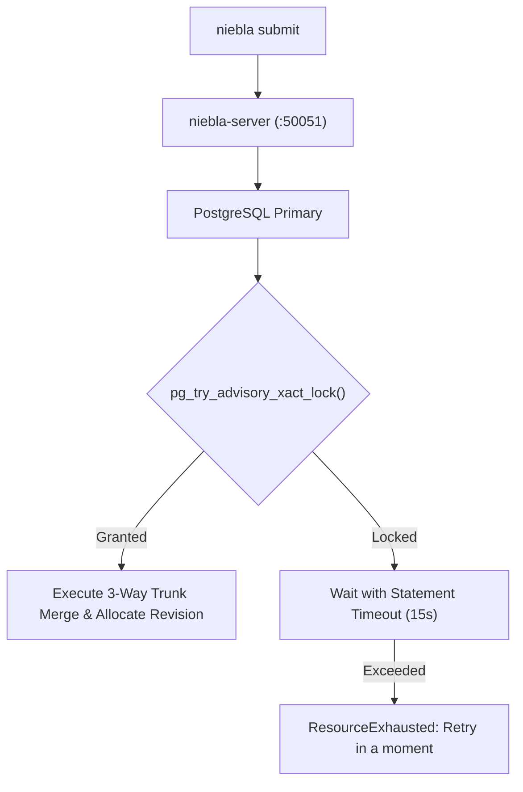

When developing or operating services in large-scale virtual monorepos, infrastructure components like FUSE daemons, UNIX domain sockets, PostgreSQL advisory locks, and Content-Addressable Storage (CAS) caches may encounter abnormal terminations, kernel driver disconnects, or network partitions.

This guide provides immediate diagnostic commands and recovery procedures for common failure scenarios.

---

## 1. FUSE Virtual Filesystem Failures

### Symptom: `Transport endpoint is not connected`
This error occurs when the `nieblafs` background daemon process terminated unexpectedly (e.g. killed via `kill -9`, Out-of-Memory killer, or host restart), leaving the Linux kernel VFS mount point dangling without a backing userspace process.

#### Diagnostics
```bash
# Check if the mount directory is in a broken state
ls ~/niebla/workspaces/my-feature
# Returns: ls: cannot access '/home/user/niebla/workspaces/my-feature': Transport endpoint is not connected

# Inspect whether the daemon process is still running
ps aux | grep "[n]ieblafs.*my-feature"
```

#### Recovery Procedure
1. **Force Lazy Unmount (`fusermount3`)**:
   Detach the dead kernel mount point immediately without waiting for open file handles to close:
   ```bash
   # On Linux:
   fusermount3 -u -z ~/niebla/workspaces/my-feature

   # On macOS (Direct Materialization or macFUSE):
   umount -f ~/niebla/workspaces/my-feature
   ```

2. **Verify Local Scratch Overlay is Intact**:
   Your modified code, newly created files, and whiteouts are safely stored in your scratch directory and **never lost** during a FUSE daemon crash:
   ```bash
   ls -la ~/.niebla/workspaces/my-feature/scratch/
   ```

3. **Re-mount the Virtual Workspace**:
   Launch a fresh `nieblafs` daemon instance bound to your existing scratch layer and base Merkle root:
   ```bash
   niebla workspace mount my-feature
   ```

---

### Symptom: `Device or resource busy` during unmount
An application (such as an editor, language server daemon, or terminal shell) has its current working directory (CWD) set inside the workspace mount path.

#### Diagnostics
```bash
# Find all processes holding open handles or CWD in the mount directory
lsof +D ~/niebla/workspaces/my-feature
# Or:
fuser -v -m ~/niebla/workspaces/my-feature
```

#### Recovery Procedure
1. Exit or change directory in any shell tabs opened inside the workspace (`cd ~`).
2. If background language servers (e.g. `gopls`, `rust-analyzer`, `tsserver`) are holding handles, terminate them:
   ```bash
   fuser -k -m ~/niebla/workspaces/my-feature
   ```
3. Retry unmounting:
   ```bash
   fusermount3 -u ~/niebla/workspaces/my-feature
   ```

---

## 2. UNIX Domain Control Socket Recovery

Niebla CLI communicates with the background `nieblafs` daemon using a local UNIX domain control socket located at:
```text
~/.niebla/workspaces/<name>/nieblafs.sock
```

### Symptom: `Warning: failed to re-anchor nieblafs daemon via control socket: connection refused`
This occurs when an orphan socket file remains on disk after a system power loss, or when permissions prevent the current user from dialing the socket.

#### Diagnostics
```bash
# Test socket responsiveness using netcat or curl
nc -U ~/.niebla/workspaces/my-feature/nieblafs.sock
# Or check socket existence and permissions
ls -l ~/.niebla/workspaces/my-feature/nieblafs.sock
```

#### Recovery Procedure
1. Verify if the daemon PID recorded in workspace metadata is alive:
   ```bash
   # Inspect workspace configuration
   cat ~/.config/niebla/workspaces/my-feature.json | grep daemon_pid
   ```
2. If the PID is dead, remove the stale socket file:
   ```bash
   rm -f ~/.niebla/workspaces/my-feature/nieblafs.sock
   ```
3. Restart the daemon:
   ```bash
   niebla workspace mount my-feature
   ```

---

## 3. Database & Distributed Advisory Lock Diagnostics

Niebla serializes trunk commits across distributed servers using PostgreSQL transaction-scoped advisory locks (`TrunkCommitAdvisoryLockID` = `7955998246305947649` / `0x6e6965626c610001`).



### Symptom: `niebla submit` hangs or returns `failed to acquire trunk serialization lock`
If a server process crashed while holding a database transaction open during a large 3-way trunk merge, PostgreSQL may retain locks until client timeout.

#### Diagnostics
Connect to PostgreSQL and inspect all active advisory locks:

```sql
SELECT 
    l.pid,
    a.usename,
    a.client_addr,
    a.application_name,
    a.state,
    now() - a.query_start AS duration,
    a.query
FROM pg_locks l
JOIN pg_stat_activity a ON l.pid = a.pid
WHERE l.locktype = 'advisory'
ORDER BY duration DESC;
```

#### Recovery Procedure
1. If an abandoned backend session from a terminated server is holding the lock:
   ```sql
   -- Politely cancel the query
   SELECT pg_cancel_backend(<pid>);

   -- If unresponsive, forcefully terminate the connection
   SELECT pg_terminate_backend(<pid>);
   ```
2. Verify that `trunk_revision_seq` is consistent:
   ```sql
   SELECT MAX(trunk_revision) FROM changelists;
   SELECT last_value FROM trunk_revision_seq;
   ```

---

## 4. Local CAS Cache Management & Pruning

The shared Content-Addressable Storage (CAS) cache on developer workstations is located by default at:
- Linux: `~/.cache/niebla/blobs/` (or `/niebla/cache/`)
- macOS: `~/Library/Caches/niebla/blobs/`

### Symptom: Workstation NVMe Disk Space Exhaustion
Over months of active development across hundreds of workspaces, unreferenced blobs from older changelists accumulate in the shared cache.

#### Safe Cache Eviction Procedure
Niebla includes a built-in mark-and-sweep garbage collector that queries active trunk heads, preserves live blobs, and purges unreferenced blobs older than a grace period:

```bash
# 1. Preview what can be cleaned up without deleting anything (Dry Run)
niebla cas gc --dry-run

# 2. Run live garbage collection with a 24-hour grace period (default)
niebla cas gc --grace-period 24h

# 3. For emergency disk recovery, purge blobs unreferenced in the last 2 hours
niebla cas gc --grace-period 2h
```

:::caution[Never Manually `rm -rf` the CAS Directory While Workspaces Are Mounted]
If you delete cached blobs while `nieblafs` daemons are running, active file reads targeting those blobs will fail with `EIO`. Always use `niebla cas gc` or unmount active workspaces before running manual disk maintenance.
:::

---

## 5. Quick Reference: Health Check Cheat Sheet

| Symptom | Diagnostic Command | Immediate Resolution |
| :--- | :--- | :--- |
| **Dangling FUSE Mount** | `ls <mount>` $\to$ `Transport endpoint is not connected` | `fusermount3 -u -z <mount>` then `niebla workspace mount <name>` |
| **Unmount Blocked** | `fuser -v -m <mount>` | Terminate blocking IDE/LSP handles: `fuser -k -m <mount>` |
| **Control Socket Error** | `nc -U <mount>/nieblafs.sock` fails | `rm -f <mount>/nieblafs.sock` and restart daemon |
| **Stuck Commit Lock** | `SELECT * FROM pg_locks WHERE locktype = 'advisory';` | `SELECT pg_terminate_backend(<pid>);` on database |
| **NVMe Disk Full** | `df -h ~/.cache/niebla/blobs` | `niebla cas gc --grace-period 24h` |
| **Stale Deleted Files** | `niebla status` reports `[D]` after shelve | Handled automatically in Niebla v0.2.0; manual fix: `rm -f scratch/**/.wh.*` |
