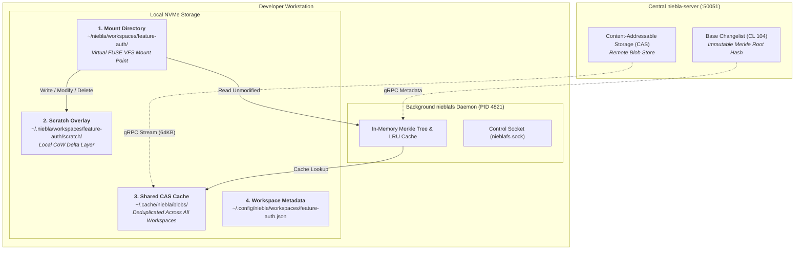
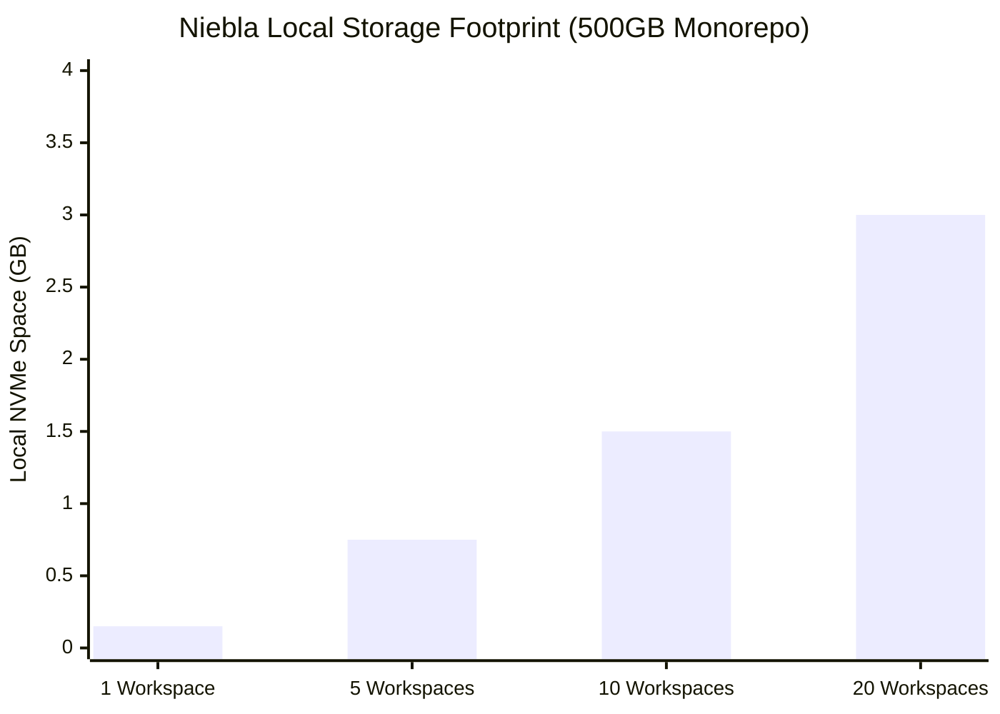

In Niebla, you never clone gigabyte-sized Git packfiles, switch branches in-place, or juggle stashes. Instead, every feature, bugfix, or experiment receives its own lightweight, isolated **virtual workspace**.

This guide covers what a workspace actually is under the hood, how its five storage layers interact, how much disk space it consumes, and how to manage workspace lifecycles.

---

## 1. What Actually Is a Workspace?

Architecturally, a Niebla workspace is **not** a Git clone. It is an isolated working directory anchored to a specific immutable point in monorepo history called the **Base Changelist** (`base_cl`), identified by its cryptographic Merkle root hash (`root_tree_hash`).



A workspace is composed of five distinct layers on your workstation:

| Component | Default Path | Purpose & Mechanics |
| :--- | :--- | :--- |
| **Mount Directory** | `~/niebla/workspaces/<name>` | The entry point presented to developers, shells, compilers, and IDEs. In FUSE mode, this is a virtual POSIX mount point backed by `nieblafs`. |
| **Scratch Overlay** | `~/.niebla/workspaces/<name>/scratch` | A private local directory holding modified files, newly created files, and OverlayFS-style whiteout deletion markers (`.wh.*`). |
| **Shared CAS Cache** | `~/.cache/niebla/blobs` (or `/niebla/cache`) | A global Content-Addressable Storage (CAS) blob cache organized with 2-level SHA-256 sharding (`ab/cd/<sha256>`). Deduplicated across **all** workspaces on the workstation. |
| **Control Socket** | `~/.niebla/workspaces/<name>/nieblafs.sock` | A UNIX domain socket providing sub-5ms IPC for health pings, cache inspection, and instant re-anchoring during `niebla sync`. |
| **Workspace Metadata** | `~/.config/niebla/workspaces/<name>.json` | Tracks workspace ID, base changelist number, root Merkle tree hash, daemon PID, and mount configuration. |

### Contrast with Git Working Trees

| Characteristic | Git Branches & Worktrees | Niebla Virtual Workspaces |
| :--- | :--- | :--- |
| **Creation Latency** | Seconds to minutes (unpacking packfiles and inodes) | **< 100 milliseconds** (instant VFS mount) |
| **Disk Storage** | Gigabytes per clone or worktree | **< 100 KB on creation** (storage only grows with edits) |
| **Branch Switching** | Mutates files in-place; risks dirty worktree conflicts | **Zero branch switching**; run 10+ workspaces concurrently side-by-side |
| **Blob Materialization** | Eager (full history or full checkout) | **Lazy on-demand streaming** over HTTP/2 gRPC |
| **Isolation** | Shared `.git` lockfile contention | Completely isolated scratch layers and daemon processes |

---

## 2. Local Storage Economics: How Much Disk Space Does a Workspace Take?

A primary design goal of Niebla is that **workspace creation must be virtually free**.

### FUSE Mode: ~0 Bytes on Creation (< 100 KB)

When you run `niebla workspace create feature-auth`, the disk consumption of the newly created workspace is **under 100 KB**, regardless of whether your monorepo contains 100 megabytes or 500 gigabytes of source code.

* **No Object Packfiles:** The workspace does not download commit histories or pack databases (`.git/objects/pack/`).
* **No Materialized Inodes:** Directory trees exist purely as synthetic in-memory data structures inside the `nieblafs` daemon process.
* **Storage Footprint:** The initial disk usage consists only of:
  - The mount directory inode: ~4 KB
  - The empty scratch directory: ~4 KB
  - The workspace configuration JSON: ~1 KB
  - The daemon log file: ~2 KB

### The Copy-on-Write (CoW) Delta Model

As you work, local disk space is consumed **only in proportion to your modifications**:

1. **Reading an Unmodified File:** Consumes space only in the shared local CAS blob cache (`~/.cache/niebla/blobs/`).
2. **Editing a 50-line File:** Consumes only that file's modified bytes in the local scratch directory (`~/.niebla/workspaces/<name>/scratch/`).
3. **Deleting a File:** Consumes **0 bytes** (creates an empty whiteout marker file).
4. **Generating Build Artifacts (`target/`, `node_modules/`):** Consumed in scratch; excluded from version control tracking via `.nieblaignore`.



### Storage Comparison: Niebla vs. Conventional Git

| Workspace Count | Niebla Virtual Workspaces | Traditional Git Full Clones | Git Worktrees |
| :--- | :--- | :--- | :--- |
| **1 Workspace** | **~0.15 GB** *(0.03% of repo)* | 500 GB *(1.0x)* | 500 GB *(shared `.git`)* |
| **5 Workspaces** | **~0.75 GB** *(shared CAS cache)* | 2,500 GB (2.5 TB) | 1,500 GB (1.5 TB) |
| **10 Workspaces** | **~1.50 GB** *(shared CAS cache)* | 5,000 GB (5.0 TB) | 2,750 GB (2.75 TB) |
| **20 Workspaces** | **~3.00 GB** *(shared CAS cache)* | 10,000 GB (10.0 TB) | 5,250 GB (5.25 TB) |

### Global Deduplication Across All Workspaces

The Content-Addressable Storage (CAS) cache on your machine is **shared globally across every workspace**:
* If Workspace A and Workspace B both reference the same 80 MB protobuf library or third-party dependency at trunk revision, that blob is downloaded **exactly once**.
* Both `nieblafs` instances read from the same cached file (`~/.cache/niebla/blobs/2d/d4/2dd4bf38...`).
* Running 10 concurrent workspaces touching common files incurs zero redundant storage overhead.

---

## 3. Workspace Management & Commands

### Creating a Workspace

```bash
niebla workspace create feature-auth
```

By default, Niebla mounts a virtual FUSE filesystem backed by `nieblafs`:
* **Mount Directory:** `~/niebla/workspaces/feature-auth` (or `/niebla/workspaces/feature-auth`)
* **Scratch Directory:** `~/.niebla/workspaces/feature-auth/scratch`
* **Base Changelist:** Inherited from latest trunk revision

To specify a custom mount point or base changelist:

```bash
niebla workspace create feature-auth --cl 42 --mount-dir ~/projects/my-auth
```

### Listing Active Workspaces

To audit active workspaces across your workstation:

```bash
niebla workspace list
```

Example output:

```text
NAME             BASE CL   STATUS            MOUNT DIR                                    PID
feature-auth     104       ACTIVE            /home/matatan/niebla/workspaces/feature-auth 4821
ci-integration   104       ACTIVE (NO-FUSE)  /home/matatan/niebla/workspaces/ci-run       0
bugfix-db        98        ACTIVE            /home/matatan/niebla/workspaces/bugfix-db    5112
```

### Deleting a Workspace

When work on a changelist is complete or an experiment is discarded:

```bash
niebla workspace delete feature-auth
```

* Gracefully unmounts `/dev/fuse` via `fusermount -u`.
* Terminates the background `nieblafs` daemon (SIGTERM with SIGKILL fallback).
* Removes the local scratch overlay directory.
* Cleans up workspace configuration.
* If uncommitted scratch edits exist, pass `--force` to confirm discarding unshelved modifications.

---

## Next Steps

* **[The Development Lifecycle](/niebla/workflows/development-lifecycle/):** Step-by-step walkthrough from editing files and CoW promotion to `niebla status`, `niebla diff`, and shelving a CL.
* **[Direct Materialization Mode (`--no-fuse`)](/niebla/workflows/direct-materialization/):** Running workspaces on macOS or containerized CI runners without `/dev/fuse`.
* **[IDE Setup & Configuration](/niebla/workflows/ide-setup/):** Optimizing VS Code, JetBrains IDEs, Neovim, and Emacs for virtual monorepos.
