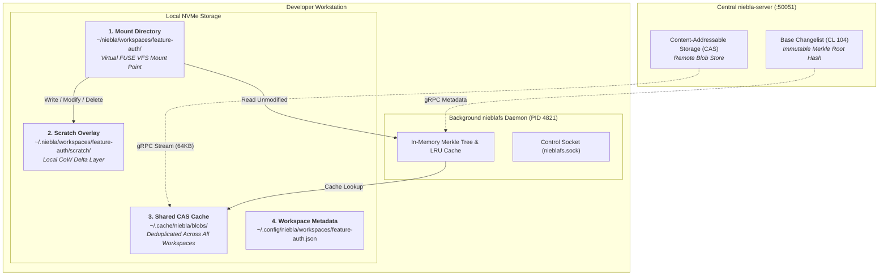
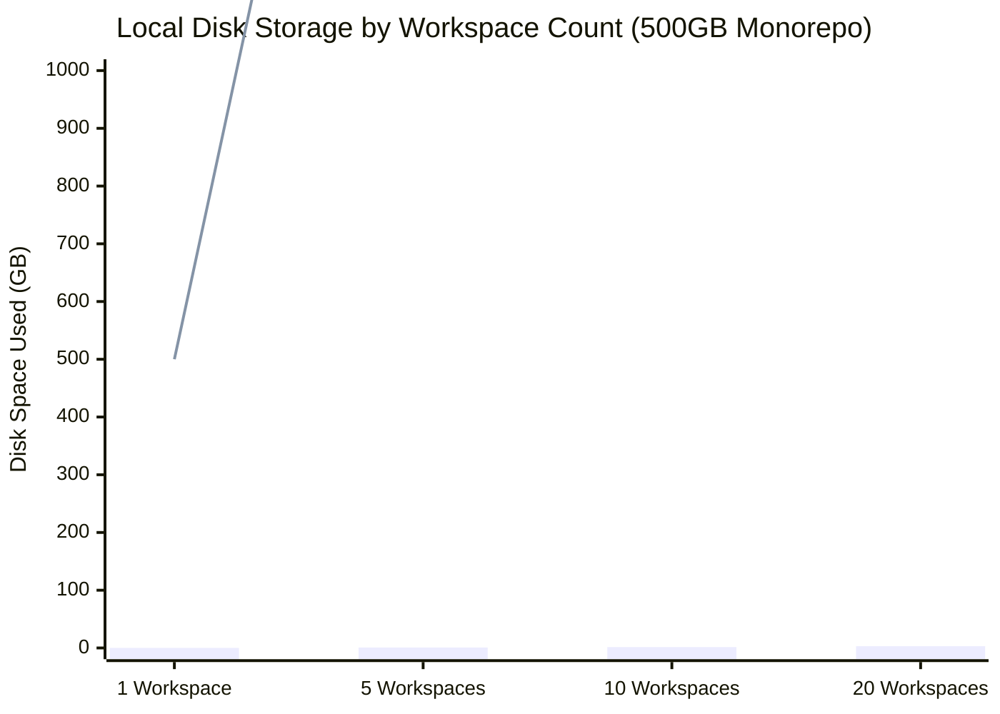
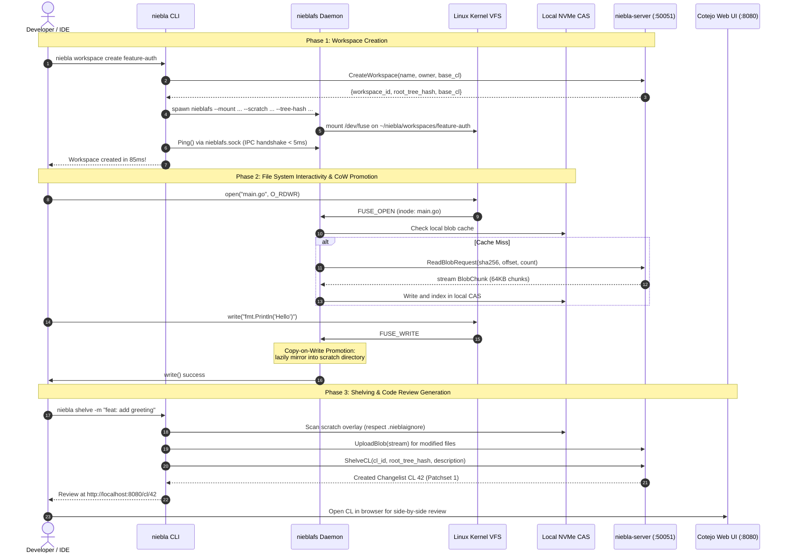
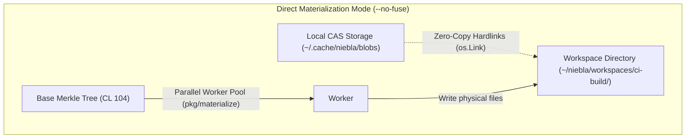

In Niebla, you never clone gigabyte-sized Git packfiles, switch branches in-place, or juggle stashes. Instead, every feature, bugfix, or experiment receives its own lightweight, isolated **virtual workspace**.

This guide covers what a workspace is under the hood, how much disk space it consumes, how file system calls traverse FUSE and Copy-on-Write (CoW) scratch overlays, how to configure your IDE (VS Code, Neovim, Emacs), how **Direct Materialization Mode (`--no-fuse`)** works, and best practices for workspace lifecycle hygiene.

---

## 1. What Actually Is a Workspace?

Architecturally, a Niebla workspace is **not** a Git clone. It is an isolated working directory anchored to a specific immutable point in monorepo history called the **Base Changelist** (`base_cl`), identified by its cryptographic Merkle root hash (`root_tree_hash`).



A workspace is composed of five distinct layers on your workstation:

| Component | Default Path | Purpose & Mechanics |
| :--- | :--- | :--- |
| **Mount Directory** | `~/niebla/workspaces/<name>` | The entry point presented to developers, shells, compilers, and IDEs. In FUSE mode, this is a virtual POSIX mount point backed by `nieblafs`. |
| **Scratch Overlay** | `~/.niebla/workspaces/<name>/scratch` | A private local directory holding modified files, newly created files, and OverlayFS-style whiteout deletion markers (`.wh.*`). |
| **Shared CAS Cache** | `~/.cache/niebla/blobs` (or `/niebla/cache`) | A global Content-Addressable Storage (CAS) blob cache organized with 2-level SHA-256 sharding (`ab/cd/<sha256>`). Deduplicated across **all** workspaces on the workstation. |
| **Control Socket** | `~/.niebla/workspaces/<name>/nieblafs.sock` | A UNIX domain socket providing sub-5ms IPC for health pings, cache inspection, and instant re-anchoring during `niebla sync`. |
| **Workspace Metadata** | `~/.config/niebla/workspaces/<name>.json` | Tracks workspace ID, base changelist number, root Merkle tree hash, daemon PID, and mount configuration. |

### Contrast with Git Working Trees

| Characteristic | Git Branches & Worktrees | Niebla Virtual Workspaces |
| :--- | :--- | :--- |
| **Creation Latency** | Seconds to minutes (unpacking packfiles and inodes) | **< 100 milliseconds** (instant VFS mount) |
| **Disk Storage** | Gigabytes per clone or worktree | **< 100 KB on creation** (storage only grows with edits) |
| **Branch Switching** | Mutates files in-place; risks dirty worktree conflicts | **Zero branch switching**; run 10+ workspaces concurrently side-by-side |
| **Blob Materialization** | Eager (full history or full checkout) | **Lazy on-demand streaming** over HTTP/2 gRPC |
| **Isolation** | Shared `.git` lockfile contention | Completely isolated scratch layers and daemon processes |

---

## 2. Local Storage Economics: How Much Disk Space Does a Workspace Take?

A primary design goal of Niebla is that **workspace creation must be virtually free**.

### FUSE Mode: ~0 Bytes on Creation (< 100 KB)

When you run `niebla workspace create feature-auth`, the disk consumption of the newly created workspace is **under 100 KB**, regardless of whether your monorepo contains 100 megabytes or 500 gigabytes of source code.

* **No Object Packfiles:** The workspace does not download commit histories or pack databases.
* **No Materialized Inodes:** Directory trees exist purely as synthetic in-memory data structures inside the `nieblafs` daemon process.
* **Storage Footprint:** The initial disk usage consists only of:
  - The mount directory inode: ~4 KB
  - The empty scratch directory: ~4 KB
  - The workspace configuration JSON: ~1 KB
  - The daemon log file: ~2 KB

### The Copy-on-Write (CoW) Delta Model

As you work, local disk space is consumed **only in proportion to your modifications**:

1. **Reading an Unmodified File:** Consumes space only in the shared local CAS blob cache (`~/.cache/niebla/blobs/`).
2. **Editing a 50-line File:** Consumes only that file's modified bytes in the local scratch directory (`~/.niebla/workspaces/<name>/scratch/`).
3. **Deleting a File:** Consumes **0 bytes** (creates an empty whiteout marker file).
4. **Generating Build Artifacts (`target/`, `node_modules/`):** Consumed in scratch; excluded from version control tracking via `.nieblaignore`.


*(Blue bars represent Niebla's shared CAS + scratch model; the red line shows conventional Git full clones).*

### Global Deduplication Across All Workspaces

The Content-Addressable Storage (CAS) cache on your machine is **shared globally across every workspace**:
* If Workspace A and Workspace B both reference the same 80 MB protobuf library or third-party dependency at trunk revision, that blob is downloaded **exactly once**.
* Both `nieblafs` instances read from the same cached file (`~/.cache/niebla/blobs/2d/d4/2dd4bf38...`).
* Running 10 concurrent workspaces touching common files incurs zero redundant storage overhead.

---

## 3. Low-Level Lifecycle: From Creation to Generating a CL

Here is the exact step-by-step technical lifecycle of what happens under the hood when a developer or agent works in Niebla.



### Phase 1: Workspace Creation & Daemon Spawn

When you execute:

```bash
niebla workspace create feature-auth --mount-dir ~/niebla/workspaces/feature-auth
```

The CLI performs the following operations:
1. **gRPC Registration:** Dials `niebla-server` and invokes `CreateWorkspace(name, owner, base_cl)`. The server assigns a unique `workspace_id` and returns the cryptographic `root_tree_hash` of the base changelist.
2. **Directory Provisioning:** Ensures the mount directory, scratch directory (`~/.niebla/workspaces/feature-auth/scratch`), and shared CAS cache (`~/.cache/niebla/blobs`) exist.
3. **Daemon Spawn (`nieblafs`):** Launches `nieblafs` with a detached process group (`syscall.SysProcAttr{Setpgid: true}`).
4. **VFS Mount:** `nieblafs` opens `/dev/fuse` and mounts itself onto the mount directory.
5. **IPC Readiness Check:** The CLI connects to `nieblafs.sock` using `control.NewClient(socketPath).Ping(ctx)`. As soon as the daemon acknowledges readiness (typically within 3–5 milliseconds), the CLI exits successfully.
6. **Post-Create Hooks:** If configured in `.niebla/hooks.toml`, executes post-create hooks (e.g. running language dependency setup).

### Phase 2: File System Operations Under the Hood

Once mounted, any POSIX system call in the workspace directory interacts with `nieblafs`:

#### 1. Reading an Unmodified File
* An application calls `open("cmd/server/main.go")`.
* The kernel issues `FUSE_LOOKUP`. `nieblafs` traverses its in-memory Merkle tree, finds the `NodeEntry`, and returns a synthetic inode attribute struct.
* The application calls `read(fd, buf, 65536)`.
* `nieblafs` checks `~/.cache/niebla/blobs/ab/cd/<sha256>`:
  - **Cache Hit:** Bytes are read directly from local NVMe storage with native filesystem speed.
  - **Cache Miss:** The daemon's `BlobFetcher` calls `ReadBlobRequest` over gRPC to `niebla-server`. Chunks are streamed in 64KB blocks, persisted into local CAS, and returned to the calling application.

#### 2. Modifying a File (Copy-on-Write Promotion)
* An application calls `open("cmd/server/main.go", O_RDWR)` and writes bytes.
* `nieblafs` detects that the file is currently pointing to the immutable base Merkle tree (`isScratch == false`).
* The daemon replicates the parent directory structure inside the scratch directory:
  ```bash
  ~/.niebla/workspaces/feature-auth/scratch/cmd/server/
  ```
* If the write is partial (e.g. modifying lines in the middle of a file), `nieblafs` lazily copies the base file bytes into the scratch file before applying the edit.
* The file handle is upgraded: all subsequent reads and writes target the scratch file directly on disk.

#### 3. Deleting a File (OverlayFS Whiteouts)
* A developer runs `rm cmd/server/main.go`.
* The kernel issues `FUSE_UNLINK`. Because the base Merkle tree is immutable, `nieblafs` cannot delete the remote blob.
* Instead, `nieblafs` creates an empty marker file:
  ```bash
  ~/.niebla/workspaces/feature-auth/scratch/cmd/server/.wh.main.go
  ```
* During subsequent `ReadDirAll()` and `Lookup()` operations, `nieblafs` detects the `.wh.*` prefix and suppresses `main.go` from directory listings, returning `ENOENT` to any application attempting to access it.

### Phase 3: Change Inspection & Ignore Rules

To inspect modifications:

```bash
niebla status
```

The status command:
1. Traverses the local scratch directory.
2. Evaluates `.nieblaignore` rules. If a directory matches an ignore rule (e.g. `node_modules/`, `target/`, `build/`), `niebla` skips the entire subtree immediately using `filepath.SkipDir` to avoid scanning unneeded directories.
3. Compares the non-ignored scratch files and whiteout markers against the base Merkle tree:
   - `[M]  cmd/server/main.go` — Modified file
   - `[A]  pkg/auth/token.go` — Added file
   - `[D]  pkg/legacy/auth.go` — Deleted file (whiteout marker found)

To view unified diffs:

```bash
niebla diff
```

`niebla diff` fetches base blobs from local CAS and computes intra-line, word-level diffs against your scratch files.

### Phase 4: Shelving a Changelist (CL)

When you are ready to send your work for review:

```bash
niebla shelve -m "feat(auth): add OAuth2 token validation" --reviewers "alice,bob,@security-team"
```

1. **Blob Upload:** The CLI scans non-ignored dirty files in scratch and streams them to central CAS on `niebla-server` via `UploadBlob(stream)`.
2. **Merkle Manifest Generation:** The CLI constructs compact binary Merkle tree manifests (`pkg/tree`), computing recursive cryptographic hashes up to the root.
3. **ShelveCL RPC:** Dispatches `ShelveCL` to `niebla-server`. The server creates or updates the changelist record:
   - If this is the first shelve, assigns a new Changelist ID (e.g. `CL 42`).
   - If updating an existing changelist, creates **Patchset $N+1$**.
4. **Asynchronous Cascading Rebase:** If you are updating a parent changelist that has child changelists stacked on top of it, the server queues background recursive 3-way rebasing (`RebaseQueue`) across the child changelists without blocking your CLI.
5. **Cotejo URL:** The CLI outputs the direct review URL:
   ```text
   Shelved changelist CL 42 (Patchset 1)
   Review URL: http://localhost:8080/cl/42
   ```

---

## 4. IDE Integration & Expectations: VS Code, Neovim, Emacs

Because Niebla workspaces are mounted as standard POSIX directories, modern editors and language servers work out of the box. However, because Niebla is **not** Git, certain IDE features that assume a local `.git` directory should be tuned to prevent unnecessary full-depot scans.

### Visual Studio Code

#### What to Expect
* Language servers (**gopls**, **rust-analyzer**, **tsserver**, **pyright**) function normally because file reads and imports resolve through the FUSE VFS mount.
* Visual Studio Code's built-in Git extension will show a badge indicating "No source control providers registered," which is normal.

#### Recommended `.vscode/settings.json`

Add the following to your workspace or user settings to optimize file watching and disable Git polling:

```json
{
  // Disable built-in Git extension to avoid scanning for .git
  "git.enabled": false,
  "git.autorefresh": false,

  // Prevent file watchers from recursing into scratch overlays or build caches
  "files.watcherExclude": {
    "**/.niebla/**": true,
    "**/scratch/**": true,
    "**/.git/**": true,
    "**/node_modules/**": true,
    "**/target/**": true
  },

  // Language Server scoping (e.g., Go gopls)
  "gopls": {
    "ui.diagnostic.analyses": {
      "unusedparams": true
    },
    "formatting.gofumpt": true
  }
}
```

### Neovim

#### What to Expect
* Neovim navigates FUSE workspaces with zero latency.
* Built-in LSP clients and Treesitter parse virtual files effortlessly.

#### Recommended Configuration (`init.lua`)

Configure your LSP client to detect project roots using project markers (such as `go.mod`, `Cargo.toml`, or `package.json`) rather than seeking a `.git` root:

```lua
-- nvim-lspconfig root directory detection without .git dependency
local lspconfig = require('lspconfig')
local util = require('lspconfig.util')

-- Configure gopls
lspconfig.gopls.setup({
  root_dir = util.root_pattern('go.work', 'go.mod', '.nieblaignore', '.niebla'),
  settings = {
    gopls = {
      analyses = { unusedparams = true },
      staticcheck = true,
    },
  },
})

-- Configure rust-analyzer
lspconfig.rust_analyzer.setup({
  root_dir = util.root_pattern('Cargo.toml', '.nieblaignore', '.niebla'),
})

-- Telescope: Use ripgrep with .nieblaignore instead of git_files
local builtin = require('telescope.builtin')
vim.keymap.set('n', '<leader>ff', function()
  builtin.find_files({
    find_command = { 'rg', '--files', '--hidden', '--glob', '!.niebla/*' },
  })
end, { desc = 'Find files in Niebla workspace' })
```

### Emacs

#### What to Expect
* Emacs default `vc-mode` attempts to locate `.git` or `.hg` in parent directory hierarchies. Disabling Git for Niebla workspace paths prevents startup delays.

#### Recommended Emacs Configuration (`init.el` / `config.el`)

```elisp
;; Disable VC Git backend inside Niebla workspaces to prevent search overhead
(setq vc-handled-backends (delq 'Git vc-handled-backends))

;; Project.el: Define root markers for Niebla workspaces
(with-eval-after-load 'project
  (add-to-list 'project-find-functions
               (lambda (dir)
                 (when-let ((root (locate-dominating-file dir ".niebla")))
                   (cons 'transient root)))))

;; Projectile configuration (if using projectile)
(with-eval-after-load 'projectile
  (add-to-list 'projectile-project-root-files ".niebla")
  (add-to-list 'projectile-project-root-files "go.mod"))

;; Eglot / LSP-mode auto-detects project root using project.el
```

---

## 5. Direct Materialization Mode (`--no-fuse`) Deep Dive

While FUSE is standard on Linux workstations, certain environments cannot or should not run FUSE kernel drivers:
* **macOS Workstations:** Apple requires third-party kernel extension approvals and system reboots for `macFUSE`, while `FUSE-T` requires external NFS bridges.
* **Restricted CI Containers:** Docker, Podman, and Kubernetes pods running without `--privileged` or `/dev/fuse` device passthrough.
* **High-Throughput Batch Compilers:** Scenarios where avoiding kernel-to-userspace context switches yields maximum compilation throughput.

For these environments, Niebla provides **Direct Materialization Mode**:

```bash
niebla workspace create ci-build --no-fuse
```



### How Direct Materialization Works Under the Hood

1. **Parallel Tree Traversal:** When `workspace create --no-fuse` is called, the CLI resolves the root Merkle tree and invokes `pkg/materialize.MaterializeTree`.
2. **Worker Pool Execution:** A concurrent worker pool traverses the directory hierarchy in parallel, resolving tree manifests and blob digests.
3. **Zero-Copy Hardlink Optimization (`os.Link`):**
   - If the local CAS cache (`~/.cache/niebla/blobs`) resides on the **same filesystem partition** as the workspace mount directory, Niebla hardlinks the files directly into the workspace using `os.Link`.
   - **Result:** Materializing a 100,000-file repository takes **milliseconds** and consumes **zero additional disk blocks**!
4. **Fallback Streaming:** If CAS is on a different filesystem or files are not yet cached, `MaterializeTree` streams chunks over gRPC and writes standard physical files to disk.
5. **No Background Daemon:** In `--no-fuse` mode, `DaemonPID` is `0` and `SocketPath` is empty. The directory is a standard physical directory.

### Status and Shelving in `--no-fuse` Mode

* **Status:** `niebla status` traverses the physical workspace directory, checks file modification timestamps and sizes against the base Merkle tree, and recomputes SHA-256 digests only for modified files. Deleted files are detected by their physical absence.
* **Shelving:** `niebla shelve` reads modified physical files, uploads them to CAS, constructs the new Merkle root tree, and creates patchset records identically to FUSE mode.

### Comprehensive Comparison Matrix

| Feature / Metric | Virtual FUSE Mode (Default) | Direct Materialization Mode (`--no-fuse`) |
| :--- | :--- | :--- |
| **Creation Time** | **< 100 ms** (instant VFS mount) | 100 ms (with CAS hardlinks) to seconds (full download) |
| **Initial Disk Usage** | **< 100 KB** (metadata & scratch only) | Full repository working tree size (or 0 extra bytes with hardlinks) |
| **Blob Fetching** | **Lazy on-demand** (streamed on `read()`) | **Eager** (materialized upon workspace creation) |
| **Kernel Requirements** | Linux kernel `/dev/fuse` support | **None** (pure userspace POSIX filesystem calls) |
| **Container Compatibility** | Requires `--device /dev/fuse --cap-add SYS_ADMIN` | **Universal** (runs in any unprivileged Docker/Podman container) |
| **macOS Support** | Requires macFUSE or FUSE-T | **Native out-of-the-box** on macOS Darwin (`aarch64` & `x86_64`) |
| **Sync Latency (`niebla sync`)** | Sub-millisecond (in-memory cache re-anchor) | Re-materializes updated blobs on disk |
| **Whiteout Deletions** | OverlayFS `.wh.<filename>` markers | Standard file deletions (`os.Remove`) |

---

## 6. Workspace Lifecycle Tips & Best Practices

### 1. The Single-Task Workspace Paradigm
* **Never juggle branches in one directory:** In Git, developers frequently stash changes or switch branches to review a colleague's PR or fix an urgent bug. In Niebla, treat workspaces as lightweight, disposable containers.
* Create a dedicated workspace for every distinct task:
  ```bash
  niebla workspace create fix-auth-leak
  niebla workspace create review-cl-89 --cl 89
  niebla workspace create perf-benchmarks
  ```
* You can keep all three workspaces open in different terminal tabs or editor windows simultaneously with zero lock contention.

### 2. Stacking Dependent Workspaces
When building a feature that depends on an in-progress changelist that has not yet landed on trunk:

```bash
# Create a child workspace anchored to your pending CL 42
niebla workspace create auth-ui --cl 42
```

* If you later update `CL 42` (shelving Patchset 2), running `niebla sync` inside `auth-ui` will automatically synchronize the base tree to the updated patchset.

### 3. Sub-Millisecond Upstream Synchronization (`niebla sync`)
When trunk moves forward, synchronize your workspace:

```bash
niebla sync
```

* **In FUSE Mode:** If there are no overlapping file conflicts, the server fast-forwards the base Merkle root tree and sends a `reanchor` IPC message over `nieblafs.sock`. The daemon purges its in-memory metadata cache and points to the new root tree in **sub-millisecond time with zero file copying**.
* **In Conflict Situations:** If server detected overlapping edits between upstream trunk and your local scratch changes, standard conflict markers (`<<<<<<< TRUNK`, `=======`, `>>>>>>> LOCAL`) are written into the scratch files for interactive resolution.

### 4. Safe Teardown & Workspace Deletion
When a changelist has been submitted to trunk or an experiment is complete, clean up the workspace:

```bash
niebla workspace delete feature-auth
```

* This gracefully unmounts `/dev/fuse` via `fusermount -u`, terminates the `nieblafs` background daemon (SIGTERM with SIGKILL fallback), removes the local scratch directory, and deregisters the workspace configuration.
* If uncommitted scratch edits exist, the CLI protects against accidental data loss. Pass `--force` only if you deliberately wish to discard unshelved scratch modifications:
  ```bash
  niebla workspace delete feature-auth --force
  ```

### 5. Disk Hygiene & Workspace Audits
Periodically inspect active workspaces across your machine:

```bash
niebla workspace list
```

Example output:

```text
NAME             BASE CL   STATUS            MOUNT DIR                                PID
feature-auth     104       ACTIVE            /home/matatan/niebla/workspaces/feature-auth 4821
ci-integration   104       ACTIVE (NO-FUSE)  /home/matatan/niebla/workspaces/ci-integration 0
bugfix-db        98        ACTIVE            /home/matatan/niebla/workspaces/bugfix-db    5112
```

* Delete stale or merged workspaces to keep your workspace directory clean.
* Since all workspaces share the same CAS blob directory (`~/.cache/niebla/blobs`), deleting a workspace never invalidates cached blobs used by other workspaces.
