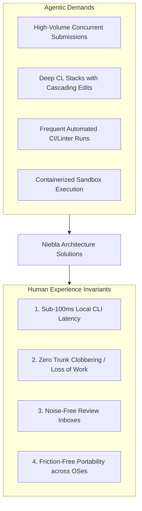
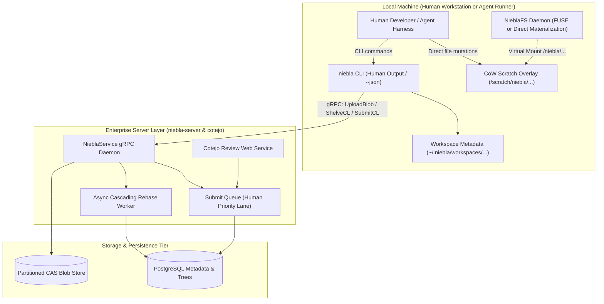

# Niebla: Agentic Development Architecture & Scalability Plan
## Preserving Human Developer Experience Under High-Volume Agent Workloads

## Executive Summary

**Niebla** is designed as a server-authoritative, cloud-native monorepo version control system inspired by Google's **Piper** (centralized server-authoritative monorepo VCS), **Critique** (code review tool), and **CitC/Fuse Daemon** (virtual workspace mounts with Copy-on-Write scratch overlays).

While human developers are the primary target audience, supporting **agentic-style development**—particularly high volumes of automated changelists (CLs), rapid iterations, and autonomous multi-agent swarms—presents architectural challenges. 

A core requirement is that **optimizing for agentic workflows must never degrade the human developer experience**. Instead, the architectural principle is: **"Agent-grade efficiency should feel like human luxury."**

This document outlines the architectural audit, critical failure modes under high volume, and the concrete safeguards designed into each solution to preserve and enhance the human experience.

---

## Human-First Architectural Principles



1. **Deterministic Trunk Safety:** Human work must never be silently clobbered, bypassed, or left in an un-merged state by high-volume agent submits.
2. **Instant CLI Responsiveness:** Heavy operations (cascading rebases, remote tree scans) must be offloaded from the interactive hot path so `shelve`, `status`, and `submit` remain snappy for humans.
3. **Dual-Mode Ergonomics:** Humans receive rich ANSI colors, tables, and emojis; scripts and agents receive structured JSON via `--json`.
4. **Future Submit Hook Architecture:** Complex agent auto-approval logic and review agent policies are deferred to a dedicated submit hook framework in future updates. In the interim, human review control and inbox sanity are preserved.

---

## System Architecture Diagram



---

## 1. Local-Level Analysis: Ergonomics & Virtual Workspaces

### 1.1 FUSE Daemon Completion & FUSE-less Direct Materialization
* **Current State:** In [`cmd/nieblafs/main.go`](file:///home/matatan/Developer/niebla/niebla/cmd/nieblafs/main.go#L18-L32), the FUSE daemon is a stub that parses flags and awaits signals without mounting or invoking `bazil.org/fuse/fs.Serve`.
* **Agentic Problem:** Agents typically execute within container sandboxes (Docker, Kubernetes pods, microVMs) where `/dev/fuse` and `CAP_SYS_ADMIN` are restricted or forbidden. Additionally, creating `/niebla/workspaces` requires `root` privileges.
* **Human Experience Impact & Safeguard:**
  - **FUSE-less Direct Materialization Mode:** Implement an alternative checkout mode (`niebla workspace create <name> --no-fuse` or auto-fallback) that materializes files directly into standard local directories (similar to sparse checkout in Git).
  - **Why Humans Benefit:** macOS developers frequently experience kernel extension friction, reduced SIP permissions, or licensing hurdles with `macFUSE`. Windows/WSL2 users also encounter FUSE permission issues. A direct materialization fallback gives human developers frictionless cross-platform access without compromising FUSE power users on Linux.

---

### 1.2 Inode Invalidation Control Socket
* **Current State:** When running `niebla sync`, [`internal/cli/sync.go`](file:///home/matatan/Developer/niebla/niebla/internal/cli/sync.go#L83-L91) updates the local JSON metadata (`ws.RootTreeHash`) in `~/.niebla/workspaces/<name>.json`.
* **The Problem:** The running `nieblafs` background daemon has no IPC channel to invalidate its cached directory inodes. The filesystem continues serving stale Merkle tree entries from the prior revision.
* **Human Experience Impact & Safeguard:**
  - **Pure Win / Bug Fix:** Humans encounter this exact same silent staleness bug after syncing.
  - **Solution:** Add a lightweight Unix domain control socket for `nieblafs` (e.g. `/run/user/<uid>/niebla/<name>.sock`). When `niebla sync` finishes, it sends a control message to purge inode caches and re-anchor the root tree hash seamlessly.

---

### 1.3 Scratch Scanning & `.nieblaignore` Parity
* **Current State:** [`ScanScratchChanges`](file:///home/matatan/Developer/niebla/niebla/internal/cli/status.go#L92-L176) walks the entire workspace scratch directory. For **every file found**, it calls [`tree.ResolvePath`](file:///home/matatan/Developer/niebla/niebla/internal/cli/status.go#L158), querying the gRPC server if not cached locally.
* **Agentic & Human Problem:**
  - Build tools, linters, and package managers (`npm install`, `cargo build`, `go build`, `python -m venv`) dump thousands of files into the scratch overlay (`node_modules/`, `target/`, `.pytest_cache/`).
  - Without an ignore filter, `niebla status` and `niebla diff` take seconds to resolve thousands of paths, and [`shelve.go`](file:///home/matatan/Developer/niebla/niebla/internal/cli/shelve.go#L87-L99) uploads build artifacts and binaries into CAS storage.
* **Human Experience Impact & Safeguard:**
  - **Pure Win:** Human developers expect standard `.gitignore` parity. Adding `.nieblaignore` parsing in [`ScanScratchChanges`](file:///home/matatan/Developer/niebla/niebla/internal/cli/status.go#L92) ensures build outputs are excluded from scans, CAS uploads, and status diffs, restoring sub-second CLI performance.

---

### 1.4 Dual-Mode CLI Contracts (Human-First Interactive + `--json`)
* **Current State:** CLI commands format output with ANSI colors, emojis (`✓`, `⚠️`), and tabwriter text tables ([`status.go`](file:///home/matatan/Developer/niebla/niebla/internal/cli/status.go#L83)).
* **Agentic Problem:** Autonomous LLM agents must parse stdout with regexes to extract CL IDs, patchset numbers, and conflict paths, leading to fragile automation.
* **Human Experience Impact & Safeguard:**
  - **Zero Friction:** Human developers continue receiving rich, readable terminal output by default.
  - **Solution:** Add a global `--json` flag to all commands (e.g. `niebla status --json`, `niebla shelve -m "..." --json`). When passed, it outputs a strict JSON schema with standard machine error codes (`ERR_REBASE_CONFLICT`, `ERR_UNRESOLVED_COMMENTS`). Scripts, IDE plugins, and agents use `--json`, while humans enjoy interactive formatting.

---

## 2. Enterprise-Level Analysis: High Volume Without Human Friction

### 2.1 Trunk Head Submission & Merge Queue with Human Priority Lane
* **Current State:**
  - In [`0001_init.sql`](file:///home/matatan/Developer/niebla/niebla/internal/db/migrations/0001_init.sql#L20-L28), `cl_id` is an auto-incrementing `BIGSERIAL` allocated at shelve time.
  - In [`queries.go`](file:///home/matatan/Developer/niebla/niebla/internal/db/queries.go#L196-L225), `GetHeadCL` queries `SELECT ... WHERE status = 'submitted' ORDER BY cl_id DESC LIMIT 1`.
  - In [`server.go`](file:///home/matatan/Developer/niebla/niebla/internal/grpc/server.go#L296-L356), `SubmitCL` merely sets `status = 'submitted'` without performing a 3-way merge onto the current trunk head.
* **The Failure Mode:**
  If Agent A (CL 100) and Agent B (CL 101) branch from CL 10:
  1. Agent B submits CL 101. Trunk head becomes CL 101.
  2. Agent A submits CL 100. Because `SubmitCL` does not rebase onto trunk head, it marks CL 100 submitted.
  3. But `GetHeadCL` sorts by `ORDER BY cl_id DESC`. Because $101 > 100$, trunk head still points to CL 101. CL 100's changes are lost from the linear head view, and the two CLs are never merged together.
* **Human Experience Safeguards:**
  1. **Decouple CL IDs from Trunk Revision Numbers:** Maintain an explicit, linear `trunk_revisions` sequence ($r1, r2, r3, \dots$).
  2. **Optimistic / Parallel Speculative Merging:** If a human CL touches `frontend/` and an agent CL touches `backend/`, the server merges both concurrently with zero queue wait.
  3. **Human Priority Lane:** Submissions by authenticated human developers (`auth.mode = "local"` or human identity tokens) jump ahead of automated background agent batch queues.
  4. **Responsive CLI Feedback:** Instead of freezing the terminal during queue processing, `niebla submit` prints live progress:
     ```
     Submitting CL 105 to trunk...
     Queue position: 1 (Human Priority Lane)
     ✓ Speculatively merged cleanly onto trunk head r42.
     Committed as trunk revision r43 (total time: 320ms).
     ```

---

### 2.2 Asynchronous Cascading Rebases with "Sync-Through" Fast-Path
* **Current State:** When an active CL is re-shelved, [`server.go`](file:///home/matatan/Developer/niebla/niebla/internal/grpc/server.go#L288-L290) synchronously calls [`CascadeStackRebase`](file:///home/matatan/Developer/niebla/niebla/internal/grpc/cascade.go#L17-L134), traversing all descendants and performing 3-way Merkle tree merges inside the gRPC request.
* **The Problem:** In deep stacks ($CL_1 \to CL_2 \to \dots \to CL_{30}$), re-shelving $CL_1$ causes multi-second blocking RPC latency and database lock contention under high volume.
* **The Potential Human Friction:** If rebases are offloaded completely to the background, a human might shelve CL 10, immediately `cd` into child CL 11, and run `niebla sync` before the background worker finishes processing CL 11.
* **Human Experience Safeguards:**
  - **On-Demand Flush ("Sync-Through"):** If a user calls `niebla sync` on a child CL whose rebase task is still queued in the background, `SyncWorkspace` intercepts the request and executes that specific child's rebase synchronously on-demand.
  - **Latency Benefit for Humans:** For the human, `niebla shelve` drops from a 2–5 second pause down to a **sub-100ms instant response**, while child sync remains 100% deterministic.

---

### 2.3 PostgreSQL Metadata Amplification (Binary Tree Manifests in CAS)
* **Current State:** In [`0001_init.sql`](file:///home/matatan/Developer/niebla/niebla/internal/db/migrations/0001_init.sql#L8-L19), directory trees are stored as individual database rows in `tree_nodes`.
* **The Problem:** Modifying one file recomputes hashes for every parent directory up to root. When agent swarms generate hundreds of small CLs, `tree_nodes` inflates with millions of rows, degrading query performance and bloating backups.
* **Human Experience Impact & Safeguard:**
  - **Pure Win / Invisible Backend Optimization:** Store directory manifests as serialized Protobuf blobs in CAS storage, indexed by a single `tree_hash BYTEA PRIMARY KEY` row in PostgreSQL. This cuts table row counts by $95\%$, speeds up human status and diff queries, and keeps backup archives compact.

---

### 2.4 Code Review Workflow & Future Submit Hooks
* **Current Context:** Future updates will introduce an extensible framework for **submit hooks**, automated review agents, and programmatic verification. The problem of agents auto-approving CLs will be formally addressed as part of that submit hook framework.
* **Interim Focus: Protecting the Human Review Inbox:**
  - When agents generate a high volume of CLs, human reviewers risk being flooded with review requests and email/UI notifications.
  - **Review Inbox Segregation in Cotejo:**
    In the Cotejo web review interface, partition changelists into dedicated views:
    - **`My Review Queue`**: Only CLs explicitly requesting human review or owned by human groups.
    - **`Agent / Automated CLs`**: Background agent tasks, linter suggestions, and automated branch updates.
    - **`Out for Review`**: Author view of pending changelists.
  - This guarantees human developers are never overwhelmed by high-volume agent activity while keeping all agent CLs fully inspectable in the monorepo history.

---

## 3. Human Experience Safeguards Matrix

| Proposed Solution | Primary Purpose | Risk to Human Experience | Human Safeguard Implemented |
| :--- | :--- | :--- | :--- |
| **Submit Queue (Merge Queue)** | Ensure linear trunk integrity under concurrent agent submits. | Loss of "instant submit" feeling; queue delay. | Speculative parallel merges for disjoint trees; Human Priority Lane; live CLI progress feedback. |
| **Async Cascading Rebase** | Prevent synchronous $O(N)$ write storms during stacked shelve. | Race condition if human jumps into child CL immediately. | On-Demand "Sync-Through" flushes target child rebase instantly; drops `shelve` latency to <100ms. |
| **`.nieblaignore` Support** | Stop build outputs from flooding CAS storage. | None (Pure win). | Standard `.gitignore` syntax compatibility prevents accidental clutter and speeds up scans. |
| **FUSE-less Materialization** | Enable agent execution in unprivileged container sandboxes. | None (Pure win). | Gives macOS and Windows/WSL2 humans native checkout without requiring kernel FUSE extensions. |
| **Daemon Inode Socket** | Keep virtual filesystem in sync with `niebla sync`. | None (Pure win). | Fixes silent data-staleness bug for both humans and agents. |
| **CLI `--json` Flag** | Provide structured machine contracts for agent LLMs. | None (Pure win). | Interactive terminal defaults remain rich with colors, tables, and emojis; `--json` is opt-in. |
| **CAS Binary Tree Manifests** | Eliminate PostgreSQL `tree_nodes` table bloat. | None (Pure win). | Faster database queries and smaller backup bundles across all operations. |
| **Cotejo Inbox Segregation** | Prevent review fatigue from agent-generated CLs. | Humans flooded by agent review notifications. | Dedicated inbox tabs separating human reviews from automated agent activity. |

---

## 4. Prioritized Implementation Roadmap

> **Active Execution Plan:** Detailed implementation steps, composable package boundaries, and `testcontainers-go` verification suites for the foundational components below are tracked in [`docs/foundation_implementation_plan.md`](file:///home/matatan/Developer/niebla/niebla/docs/foundation_implementation_plan.md).

### Phase 1: Local Ergonomics & Core Robustness (Immediate Priority)
- [x] **P0: `.nieblaignore` Support** *(✅ Completed: [Commits 2.1–2.2](file:///home/matatan/Developer/niebla/niebla/docs/foundation_implementation_plan.md#L98-L105))* — Add composable `pkg/ignore` matcher and filter in [`ScanScratchChanges`](file:///home/matatan/Developer/niebla/niebla/internal/cli/status.go#L92) to prevent build artifact pollution.
- [x] **P0: FUSE Daemon Inode Control Socket** *(✅ Completed: [Commits 4.1–4.2](file:///home/matatan/Developer/niebla/niebla/docs/foundation_implementation_plan.md#L173-L184))* — Add Unix control socket (`pkg/nieblafs/control`) to `nieblafs` to invalidate inode/metadata caches upon `niebla sync`.
- [x] **P1: Machine-Readable `--json` Contracts** *(✅ Completed: [Commit 2.5](file:///home/matatan/Developer/niebla/niebla/docs/foundation_implementation_plan.md#L115-L118))* — Add `--json` flag to `niebla status`, `diff`, `shelve`, `sync`, `export`, and `submit`.
- [x] **P1: FUSE-less Direct Materialization Mode** *(✅ Completed: [Commits 2.3–2.4](file:///home/matatan/Developer/niebla/niebla/docs/foundation_implementation_plan.md#L106-L114))* — Add `pkg/materialize`, `niebla export`, and `--no-fuse` checkout fallback for containerized agents, CI runners, and macOS human environments.
- [x] **P1: Complete FUSE Daemon Loop** *(✅ Completed: [Commit 4.3](file:///home/matatan/Developer/niebla/niebla/docs/foundation_implementation_plan.md#L185-L189))* — Finish read/lookup loops in [`cmd/nieblafs`](file:///home/matatan/Developer/niebla/niebla/cmd/nieblafs) with CoW scratch overlay and CAS fallback for environments where FUSE is available.

### Phase 2: Enterprise Concurrency & Trunk Integrity
- [x] **P0: Trunk Submit Queue & Linear Revision Numbers** *(✅ Completed: [Commits 1.4–1.5](file:///home/matatan/Developer/niebla/niebla/docs/foundation_implementation_plan.md#L74-L85))* — Implement atomic 3-way merge on submit with sequential trunk revisions ($r1, r2, \dots$) and advisory locking.
- [x] **P1: Asynchronous Cascading Rebases** *(✅ Completed: [Commits 6.1–6.3](file:///home/matatan/Developer/niebla/niebla/docs/foundation_implementation_plan.md#L225-L242))* — Transition stack re-parenting to background worker queue (`RebaseQueue` with branch `KeyedMutex`) with sub-100ms `ShelveCL` return and deterministic on-demand `SyncThrough` for child CLs.
- [x] **P2: CAS Binary Tree Manifests** *(✅ Completed: [Commits 1.2–1.3](file:///home/matatan/Developer/niebla/niebla/docs/foundation_implementation_plan.md#L65-L72))* — Migrate directory storage from row-per-entry `tree_nodes` to serialized binary/Protobuf manifests.
- [x] **P2: Cotejo Inbox Segregation** *(✅ Completed: [Commits 5.1–5.3](file:///home/matatan/Developer/niebla/niebla/docs/foundation_implementation_plan.md#L198-L215))* — Add segregated inbox queue tabs (`My Reviews`, `Out for Review`, `Agent / Automated`, `Submitted / Trunk`) to Cotejo, protecting human attention from automated agent review fatigue.

### Phase 3: Future Updates (Submit Hooks & Review Agent Framework)
- [x] **P1: Submit Hook Architecture (`.niebla/hooks.toml` & `niebla cas put`)** *(✅ Completed: [Commits 9.1–9.4](file:///home/matatan/Developer/niebla/niebla/docs/foundation_implementation_plan.md#L293-L311))* — Extensible client and server presubmit hooks, `niebla cas put/get` direct CAS blob ingestion, declarative `.niebla/hooks.toml` TOML syntax, metadata rules, path/pattern tree scans, `--no-verify` client bypass, and `--force` emergency bypass.
- [x] **P1: Review Agent Personas Framework (`.niebla/agents.toml`)** *(✅ Completed: [Commits 10.1–10.4](file:///home/matatan/Developer/niebla/niebla/docs/foundation_implementation_plan.md#L318-L336))* — Declarative review personas (`in_tree` scripts or prebuilt `cas_binary` tools), path-based auto-assignment on `ShelveCL`, CAS log streaming (`/cl/{id}/runs/{agent}/logs`), compiler/linter `file:line: message` inline comment diagnostics in Cotejo, and auto-approval voting (`lgtm` / `changes_requested`).
- [x] **P1: Policy & Auto-Approval Engine (`OWNERS.toml`)** *(✅ Completed: [Commits 8.1–8.3](file:///home/matatan/Developer/niebla/niebla/docs/foundation_implementation_plan.md#L271-L287))* — Scoped approval rules, hierarchical `OWNERS.toml` TOML syntax, `@group` expansion, `set_noparent` isolation, `[per_file]` pattern matching, and transaction-scoped submit gating with `--force` emergency bypass.
