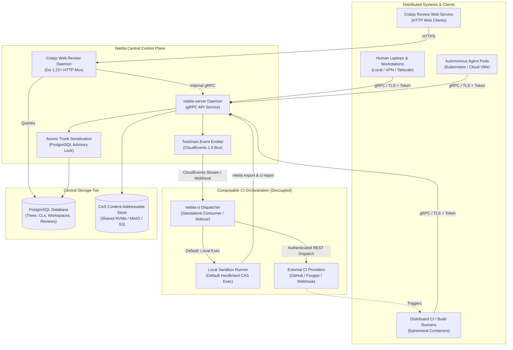
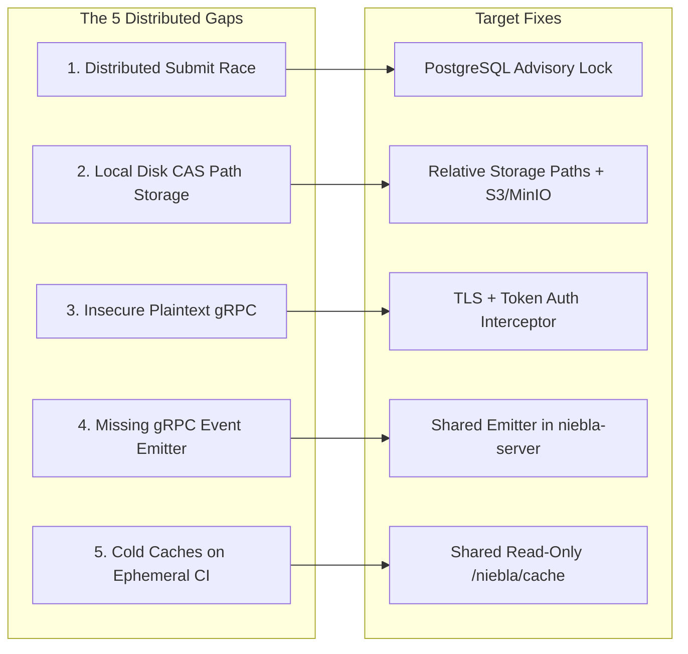

# Niebla: Distributed Systems Architecture & Scaling Analysis
## Supporting Multi-System Deployments for Small-to-Medium Teams

## Executive Summary

This document evaluates the **Niebla** version control system under multi-system distributed operations. The target deployment model is a **small-to-medium enterprise setup** (e.g., 5–50 human developers and 10–100 automated agent workers, CI runners, and build containers) operating across remote workstations, cloud sandboxes, and web interfaces.

Rather than adopting Google-scale multi-datacenter complexity (Paxos clusters, Chubby distributed locks, Bigtable), Niebla’s **server-authoritative Go gRPC daemon backed by PostgreSQL and Content-Addressable Storage (CAS)** provides an approachable, highly performant foundation.

However, operating with multiple distributed systems exposes **five critical architectural gaps** that must be resolved to guarantee data integrity, security, and consistent event delivery.

---

## 1. Distributed Topology Overview



---

## 2. The 5 Glaring Holes in Distributed Operations



---

### Gap 1: Distributed Submit Race Condition (Missing Central Trunk Lock)

* **Code Reference:** [`internal/db/queries.go:278`](file:///home/matatan/Developer/niebla/niebla/internal/db/queries.go#L278)
* **Current Implementation:**
  ```sql
  SELECT cl_id, author, status FROM changelists WHERE cl_id = $1 FOR UPDATE;
  ```
  `SubmitCL` acquires a row-level lock only on the specific changelist being submitted.
* **The Failure Mode:**
  If an automated agent on a cloud VM and a human developer on a laptop click "Submit" at the exact same millisecond:
  1. Client A locks CL 100.
  2. Client B locks CL 101.
  3. Both transactions read `GetHeadCL` concurrently (both seeing revision $r42$).
  4. Both update `status = 'submitted'` and commit to PostgreSQL simultaneously.
  5. **Result:** Neither CL was rebased on top of the other. The monorepo trunk silently forks into conflicting states.
* **The Small/Medium Solution:**
  Use PostgreSQL’s built-in transaction-scoped advisory locks before computing the merge:
  ```go
  // Acquire exclusive trunk commit lock for the duration of the submit transaction
  const TrunkCommitAdvisoryLockID = 0x4e494542 // 'NIEB'
  if _, err := tx.Exec(ctx, "SELECT pg_advisory_xact_lock($1)", TrunkCommitAdvisoryLockID); err != nil {
      return nil, fmt.Errorf("failed to acquire trunk serialization lock: %w", err)
  }
  ```
  This guarantees strict, deterministic sequential commits ($r43, r44, \dots$) without requiring complex distributed consensus protocols.

---

### Gap 2: Host-Local Filesystem Path Storage in CAS Metadata

* **Code Reference:** [`internal/db/migrations/0001_init.sql:1-6`](file:///home/matatan/Developer/niebla/niebla/internal/db/migrations/0001_init.sql#L1-L6)
* **Current Implementation:**
  ```sql
  CREATE TABLE blobs (
      sha256 BYTEA PRIMARY KEY,
      byte_size BIGINT NOT NULL,
      storage_path TEXT NOT NULL,
      created_at TIMESTAMPTZ DEFAULT now()
  );
  ```
  `storage_path` records an absolute local disk path (e.g. `/var/lib/niebla/blobs/ab/cd/...`).
* **The Failure Mode:**
  - If server migration occurs, or if secondary read-only worker instances are deployed, absolute host-local paths fail immediately with `ENOENT`.
  - Remote CI runners or cloud agents cannot read blobs directly from object storage without funneling all network traffic through the single `niebla-server` gRPC stream.
* **The Small/Medium Solution:**
  1. Store relative sharded keys in PostgreSQL (e.g. `blobs/ab/cd/<sha256>`).
  2. Allow `niebla-server` to back onto either local disk/NFS or an **S3-compatible object store** (MinIO, Cloudflare R2, AWS S3), which is already pre-configured in [`internal/config/config.go:157-168`](file:///home/matatan/Developer/niebla/niebla/internal/config/config.go#L157-L168).

---

### Gap 3: Hardcoded Insecure gRPC Transport

* **Code Reference:** [`internal/cli/client.go:49`](file:///home/matatan/Developer/niebla/niebla/internal/cli/client.go#L49)
* **Current Implementation:**
  ```go
  grpc.WithTransportCredentials(insecure.NewCredentials())
  ```
* **The Failure Mode:**
  When distributed systems (laptops on remote networks, cloud CI runners) communicate with `niebla-server`:
  - Source code blobs and metadata travel in unencrypted plaintext across the public network.
  - The server accepts all incoming RPCs without authenticating whether the caller is an authorized human or agent worker.
* **The Small/Medium Solution:**
  1. Add standard TLS configuration (`--tls`, `--tls-ca-cert`) or leverage private mesh networks (Tailscale / WireGuard) for zero-config encrypted transport.
  2. Implement a gRPC interceptor validating bearer tokens (`X-Niebla-Token`) against configured API tokens in [`~/.config/niebla/config.toml`](file:///home/matatan/Developer/niebla/niebla/internal/config/config.go).

---

### Gap 4: Missing Event Emission in the gRPC Server Daemon

* **Code Reference:** [`cmd/cotejo/main.go:128`](file:///home/matatan/Developer/niebla/niebla/cmd/cotejo/main.go#L128) vs. [`cmd/niebla-server/main.go`](file:///home/matatan/Developer/niebla/niebla/cmd/niebla-server/main.go)
* **Current Implementation:**
  Event emission ([`internal/events`](file:///home/matatan/Developer/niebla/niebla/internal/events/factory.go)) is wired exclusively into the Cotejo web service. `niebla-server` has no event emitter instance.
* **The Failure Mode:**
  External distributed services (CI orchestrators, GitHub sync mirrors, automated test triggers) depend on webhook events.
  - When distributed agents or developers submit CLs via the `niebla` CLI over gRPC, **no webhook event is ever fired**.
  - Events only fire if a human submits manually inside the Cotejo web browser UI.
* **The Small/Medium Solution:**
  Initialize and inject the shared `pkgevents.Emitter` into `nieblav1.NieblaServiceServer` so that gRPC calls (`ShelveCL`, `SubmitCL`) emit webhooks uniformly to distributed consumers.

---

### Gap 5: Cold CAS Caches on Ephemeral Distributed Runners

* **Code Reference:** [`internal/cli/diff.go:75`](file:///home/matatan/Developer/niebla/niebla/internal/cli/diff.go#L75)
* **Current Implementation:**
  Clients store blob chunks in `~/.cache/niebla/blobs`.
* **The Failure Mode:**
  - Ephemeral CI runners (GitHub Actions containers, Kubernetes test pods) spin up with an empty disk.
  - If 15 test runners start concurrently on a 5GB monorepo, all 15 download identical base blobs over gRPC simultaneously, saturating server egress bandwidth and stalling build queues.
* **The Small/Medium Solution:**
  - Because Content-Addressable Storage (CAS) blobs are immutable and uniquely identified by their SHA-256 hash, **cached blobs never become stale**.
  - Ephemeral runners can mount a shared read-only cache volume (e.g., an NFS mount or Kubernetes `PersistentVolume` at `/niebla/cache`).
  - Runners verify local cache first; if present, zero network bandwidth is consumed.

---

## 3. Composable CI Runner Orchestration (`niebla-ci`)
### Composition Over Coupling: Decoupling VCS State from Build Execution

To support user-declarable CI runners—executing on the **local system by default**, or dispatching to **GitHub Actions, Forgejo Actions, or custom webhook infrastructure** with full authentication—CI orchestration must be designed as an **independent, composable component (`niebla-ci`)** rather than hardcoding provider logic into `niebla-server` or `cotejo`.

```mermaid
flowchart LR
    subgraph VCS["Core VCS & Review (Provider-Agnostic)"]
        Server["niebla-server (gRPC)"]
        Cotejo["cotejo (Review UI)"]
        EventBus["pkg/events (CloudEvents 1.0)"]
    end

    subgraph Orchestrator["Independent Component: niebla-ci Dispatcher"]
        Router["Event Consumer & Rule Router"]
        AuthVault["Auth & Credential Resolver<br>(Bearer / PAT / Basic / HMAC)"]
        Adapters["Pluggable Provider Drivers<br>(pkg/ci/providers)"]
    end

    subgraph Execution["Declarative Runner Targets"]
        Local["Local Sandbox Runner (Default)<br>Hardlinked CAS Checkout + Exec"]
        Forgejo["Forgejo / Gitea Actions<br>Workflow Dispatch REST API"]
        GitHub["GitHub Actions<br>Repository/Workflow Dispatch API"]
        Custom["Custom HTTP / K8s Runner<br>Signed CloudEvents Webhook"]
    end

    Server -->|1. Emit cl.created / cl.rebased| EventBus
    EventBus -->|2. Subscribe (In-Process or HTTP)| Router
    Router --> AuthVault
    AuthVault --> Adapters

    Adapters -->|provider = 'local'| Local
    Adapters -->|provider = 'forgejo'| Forgejo
    Adapters -->|provider = 'github'| GitHub
    Adapters -->|provider = 'webhook'| Custom

    Local -->|3a. niebla export & ci report| Server
    Forgejo -->|3b. niebla export & ci report| Server
    GitHub -->|3c. niebla export & ci report| Server
    Custom -->|3d. niebla export & ci report| Server
    Server -.->|4. Update Check Run Status| Cotejo
```

### 3.1 Architectural Boundaries & Zero-Coupling Contract

By enforcing strict boundaries, `niebla-server` and `cotejo` remain completely ignorant of GitHub, Forgejo, or local shell execution semantics:

1. **Outbound Contract (Standard CloudEvents 1.0):**
   `niebla-server` only emits standardized events ([`pkg/events/event.go`](file:///home/matatan/Developer/niebla/niebla/pkg/events/event.go)) such as `niebla.cl.created`, `niebla.cl.rebased`, and `niebla.cl.submitted`.
2. **Independent Dispatcher (`cmd/niebla-ci` & `pkg/ci`):**
   `niebla-ci` is a standalone consumer that subscribes to Niebla events (either via the existing [`exec` / `webhook` sinks](file:///home/matatan/Developer/niebla/niebla/internal/events/factory.go) or embedded as an optional worker). It translates generic VCS events into provider-specific API calls.
3. **Stateless Materialization Contract (`niebla export`):**
   Because Niebla is a Piper/CitC-style VCS rather than Git, remote CI runners cannot use `git clone`. Instead, any runner (local, GitHub, or Forgejo) uses a single stateless CLI command—`niebla export --cl <id> --patchset <ps> --dest ./workspace`—authenticated via a scoped bearer token to materialize the exact Merkle tree snapshot without requiring FUSE.
4. **Inbound Status Contract (`ReportCheckRun` API):**
   `niebla-server` and `cotejo` expose a provider-agnostic **Check Runs API** (`queued`, `running`, `passed`, `failed`, `external_url`, `log_blob_sha256`). Whether a check was run by a local `go test` process or a remote GitHub Actions macOS VM, the status report contract is identical.

---

### 3.2 Declarative Runner & Authentication Schema

Users declare where CI runners execute in [`~/.config/niebla/config.toml`](file:///home/matatan/Developer/niebla/niebla/internal/config/config.go) (or per-repository in `.niebla/ci.toml`). If no external runner is configured, `niebla-ci` defaults to the zero-configuration **`local`** provider.

```toml
[ci]
enabled = true
default_runner = "local"          # Runs on the local system by default
require_green_to_submit = true    # Gates SubmitCL on passing check runs

# 1. Default Local Runner (Zero external infrastructure required)
[ci.runners.local]
provider = "local"
work_dir = "/tmp/niebla-ci"       # Ephemeral CoW / hardlinked CAS sandbox
command = ["go", "test", "./..."]
timeout_seconds = 300
concurrency = 2

# 2. Forgejo / Gitea Actions Runner
[ci.runners.forgejo-linux]
provider = "forgejo"
endpoint = "https://git.example.com/api/v1/repos/org/monorepo-ci/actions/workflows/ci.yml/dispatches"
ref = "main"
[ci.runners.forgejo-linux.auth]
mode = "bearer"                   # "bearer", "token", "basic", "header", "hmac"
token_env = "FORGEJO_CI_TOKEN"    # Reads secret from environment or key_file

# 3. GitHub Actions Runner
[ci.runners.github-build]
provider = "github"
endpoint = "https://api.github.com/repos/org/monorepo-ci/dispatches"
event_type = "niebla_presubmit"
[ci.runners.github-build.auth]
mode = "bearer"
token_env = "GITHUB_PAT_TOKEN"

# 4. Custom Generic Webhook / Kubernetes Tekton Trigger
[ci.runners.custom-k8s]
provider = "webhook"
endpoint = "https://ci.internal.corp/hooks/niebla"
[ci.runners.custom-k8s.auth]
mode = "hmac"
secret_env = "CUSTOM_WEBHOOK_SECRET"
```

---

### 3.3 Required Implementation Work Across the 5 Sub-Components

#### 1. Pluggable `ci.Provider` Interface & Auth Injector (`pkg/ci`)
Currently, [`WebhookSink`](file:///home/matatan/Developer/niebla/niebla/pkg/events/sinks/webhook.go#L69-L129) only sends CloudEvents payloads with an `X-Critique-Signature-256` HMAC header. External Git forges require REST API client authentication and provider-specific JSON schemas:
* **`Provider` Interface:**
  ```go
  type DispatchRequest struct {
      CLID        int64
      Patchset    int
      TreeHash    string
      Author      string
      ServerURL   string
      RunnerToken string // Ephemeral or scoped token for callback & export
  }

  type Provider interface {
      Name() string
      Trigger(ctx context.Context, req DispatchRequest) (externalRunURL string, err error)
  }
  ```
* **Authentication Middleware:** A composable `http.RoundTripper` in `pkg/ci/auth` that resolves secrets via `token_env` or `key_file` (reusing the pattern in [`EncryptionConfig`](file:///home/matatan/Developer/niebla/niebla/internal/config/config.go#L120-L127)) and injects:
  * `Authorization: Bearer <token>` (GitHub PAT / Forgejo OAuth2)
  * `Authorization: token <token>` (Forgejo / Gitea personal access tokens)
  * `Authorization: Basic <base64>` (Jenkins / Basic Auth endpoints)
  * `X-Critique-Signature-256: sha256=<hmac>` (Custom webhooks)

#### 2. Default Local System Runner (`pkg/ci/providers/local`)
When `provider = "local"`, `niebla-ci` executes builds directly on the host machine without polluting the developer's active workspace:
1. Materializes the CL's `root_tree_hash` into `/tmp/niebla-ci/cl-<id>-ps-<n>/` by hardlinking immutable files directly from `~/.cache/niebla/blobs` (taking <20ms and zero extra disk space).
2. Executes the configured build/test command with `NIEBLA_CL_ID`, `NIEBLA_PATCHSET`, and `NIEBLA_TREE_HASH` environment variables.
3. Streams combined `stdout`/`stderr` into the CAS blob store and reports the resulting `log_blob_sha256` and exit status (`passed` / `failed`) back via the Check Runs API.

#### 3. GitHub & Forgejo Dispatch Adapters (`pkg/ci/providers/{github,forgejo}`)
* **Forgejo Adapter:** Formats a `POST /api/v1/repos/{owner}/{repo}/actions/workflows/{workflow_id}/dispatches` request with `{"ref": cfg.Ref, "inputs": {"cl_id": ..., "patchset": ..., "tree_hash": ...}}`.
* **GitHub Adapter:** Formats a `POST /repos/{owner}/{repo}/dispatches` (or workflow dispatch) request with header `Accept: application/vnd.github+json` and `client_payload` metadata.

#### 4. Stateless CLI Materialization & Status Reporting (`niebla export` & `niebla ci report`)
So external GitHub or Forgejo workflows can interact with Niebla cleanly in 2 lines of YAML:
```yaml
# Example Forgejo / GitHub Actions step
- name: Checkout Niebla CL & Run Tests
  env:
    NIEBLA_TOKEN: ${{ secrets.NIEBLA_RUNNER_TOKEN }}
  run: |
    niebla export --cl ${{ inputs.cl_id }} --patchset ${{ inputs.patchset }} --dest ./src
    niebla ci exec --cl ${{ inputs.cl_id }} --patchset ${{ inputs.patchset }} --runner forgejo-linux -- go test ./src/...
```
Here, `niebla ci exec` wraps any command, automatically reporting `running` at start and `passed`/`failed` (plus log output) upon completion.

#### 5. Provider-Agnostic `cl_check_runs` Schema & Cotejo UI Badges
Extend [`0002_critique.sql`](file:///home/matatan/Developer/niebla/niebla/internal/db/migrations/0002_critique.sql) with a decoupled `cl_check_runs` table:
```sql
CREATE TABLE IF NOT EXISTS cl_check_runs (
    id BIGSERIAL PRIMARY KEY,
    cl_id BIGINT NOT NULL REFERENCES changelists(cl_id) ON DELETE CASCADE,
    patchset_number INT NOT NULL,
    runner_name TEXT NOT NULL,
    provider TEXT NOT NULL,
    status TEXT NOT NULL CHECK (status IN ('queued', 'running', 'passed', 'failed', 'canceled')),
    external_url TEXT,
    log_blob_sha256 BYTEA REFERENCES blobs(sha256),
    started_at TIMESTAMPTZ DEFAULT now(),
    completed_at TIMESTAMPTZ,
    UNIQUE(cl_id, patchset_number, runner_name)
);
```
In [`internal/web/handlers/cl.go`](file:///home/matatan/Developer/niebla/niebla/internal/web/handlers/cl.go#L404-L521), `HandleSubmitCL` simply queries `cl_check_runs` for the active patchset—remaining completely decoupled from how or where those checks were executed.

---

## 4. Performance Profile: Small-to-Medium Enterprise Scale

| Operational Metric | Expected Performance | Architectural Rationale |
| :--- | :--- | :--- |
| **Concurrent Users** | 50 human developers + 100 autonomous agents | Central PostgreSQL connection pool (default 50 connections) easily sustains 5,000+ queries/second on modern multi-core NVMe hardware. |
| **Submit Throughput** | 5–10 atomic CL commits per second | Three-way tree merges operate on in-memory Merkle tree hashes. Disjoint subtrees resolve via diff3 in under 50ms without full-tree disk I/O. |
| **Network Egress** | Differential / Highly Optimized | Merkle tree navigation allows distributed systems to download only modified leaf nodes. Untouched subtrees are represented by 32-byte hashes. |
| **Hardware Footprint** | 1 Small/Medium Server Instance | Requires only 1 Go binary (`niebla-server`), 1 web binary (`cotejo`), and 1 standard PostgreSQL instance (4–8 vCPUs, 16GB RAM). |
| **Disaster Recovery** | Continuous / Decoupled | Native ZFS block snapshot replication or envelope-encrypted standalone bundles (`.nieblabak`) run without locking the VCS database. |

---

## 5. Multi-System Implementation Checklist

> **Active Execution Plan:** Detailed implementation steps, composable package interfaces, and `testcontainers-go` verification suites for the planned items below are tracked in [`docs/foundation_implementation_plan.md`](file:///home/matatan/Developer/niebla/niebla/docs/foundation_implementation_plan.md).

- [x] **Trunk Lock** *(✅ Completed: [Commits 1.4–1.5](file:///home/matatan/Developer/niebla/niebla/docs/foundation_implementation_plan.md#L74-L85))* — Add `pg_advisory_xact_lock`, sequential `trunk_revision`, and 3-way merge in [`SubmitCL`](file:///home/matatan/Developer/niebla/niebla/internal/db/queries.go) to serialize distributed submits.
- [x] **CAS Storage Abstraction** *(✅ Completed: [Commit 1.1](file:///home/matatan/Developer/niebla/niebla/docs/foundation_implementation_plan.md#L60-L63))* — Replace absolute filesystem paths in the `blobs` table with sharded relative paths, enabling S3/MinIO backends and portable storage.
- [ ] **gRPC Security:** Add TLS transport options and bearer token authorization interceptors to [`niebla-server`](file:///home/matatan/Developer/niebla/niebla/internal/grpc/server.go) and [`client.go`](file:///home/matatan/Developer/niebla/niebla/internal/cli/client.go).
- [x] **Server Event Wiring** *(✅ Completed: [Commit 3.1](file:///home/matatan/Developer/niebla/niebla/docs/foundation_implementation_plan.md#L129-L133))* — Wire `internal/events` into `niebla-server` to fire webhooks and CloudEvents for CLI-driven submissions and shelves.
- [x] **CI Cache Sharing** *(✅ Completed: [Commits 2.3 & 3.4](file:///home/matatan/Developer/niebla/niebla/docs/foundation_implementation_plan.md#L106-L148))* — Support shared read-only CAS cache hardlinking (`HardlinkCAS`) for ephemeral container and local runners.
- [x] **Composable `niebla-ci` Dispatcher (`pkg/ci`)** *(✅ Completed: [Commits 3.3–3.5](file:///home/matatan/Developer/niebla/niebla/docs/foundation_implementation_plan.md#L140-L154))* — Implement the decoupled CI runner orchestrator supporting `local` (default hardlinked CAS sandbox), `forgejo`, `github`, and `webhook` providers with `Bearer`, `PAT`, `Basic`, and `HMAC` authentication.
- [x] **Stateless CI CLI & Check Runs API** *(✅ Completed: [Commits 2.4, 3.2, & 3.6](file:///home/matatan/Developer/niebla/niebla/docs/foundation_implementation_plan.md#L110-L160))* — Add `niebla export`, `niebla ci exec`, and the `cl_check_runs` table in [`0002_critique.sql`](file:///home/matatan/Developer/niebla/niebla/internal/db/migrations/0002_critique.sql) so any local or remote runner can materialize trees and report build verdicts back to Cotejo.

