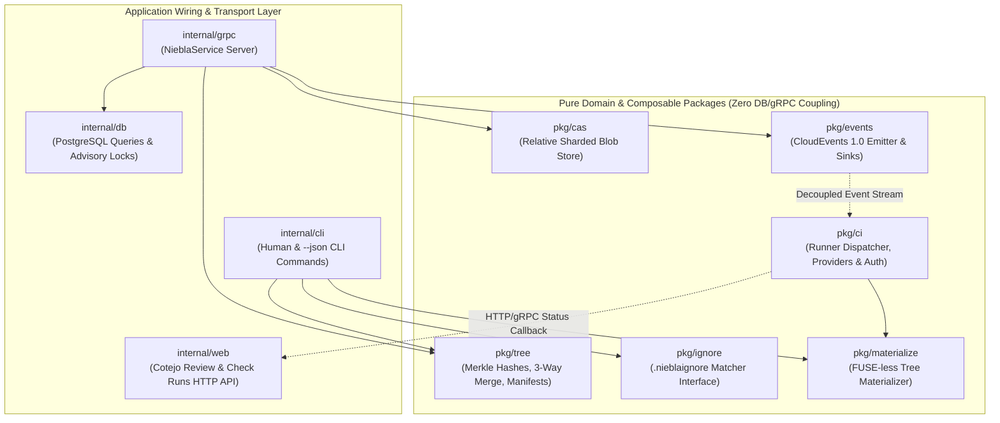

# Niebla: Foundation & Composable CI Implementation Plan
## Execution Checklist for Components 1, 2, and 3

> **Context:** This plan governs the implementation of the first three foundational components identified in the [Agentic Development Analysis](file:///home/matatan/Developer/niebla/niebla/docs/agentic_development_analysis.md) and [Distributed Architecture Analysis](file:///home/matatan/Developer/niebla/niebla/docs/distributed_architecture_analysis.md).
>
> **Core Engineering Principles:**
> 1. **Zero Backward-Compatibility Debt:** Because Niebla has no production users yet, schema improvements are applied directly to the base migrations (`0001_init.sql`, `0002_critique.sql`) rather than carrying legacy table structures.
> 2. **Composition Over Coupling:** All new subsystems (`pkg/ignore`, `pkg/materialize`, `pkg/ci`) are designed as standalone, interface-driven packages with zero circular or concrete dependencies on `internal/db` or `internal/grpc`.
> 3. **Thorough Verification & Testcontainers:** Every component includes unit tests for pure logic and `testcontainers-go` (`postgres:16-alpine`) + ephemeral HTTP/gRPC test servers for end-to-end integration and concurrency verification.
> 4. **Small, Atomic Commits (No "Super Commits"):**
>    - **One Logical Unit per Commit:** Each sub-step below maps to its own self-contained, atomic commit. Never bundle multiple subsystems, unrelated refactors, or cross-component changes into a single commit.
>    - **Tests Travel With Code:** Every commit that introduces or modifies logic MUST include its corresponding unit or integration tests in that same commit, and `go test` must pass before committing.
>    - **Target Size:** Keep commits focused (~50–250 lines of production code + tests) with conventional commit messages (`feat(cas): ...`, `feat(tree): ...`, `docs(skills): ...`).

---

## Architecture & Composition Overview

---

## Component 1: Core Storage & Trunk Integrity Overhaul
**References:**
- [Agentic Analysis §2.1: Trunk Head Submission & Linear Revisions](file:///home/matatan/Developer/niebla/niebla/docs/agentic_development_analysis.md#L128-L149)
- [Agentic Analysis §2.3: CAS Binary Tree Manifests](file:///home/matatan/Developer/niebla/niebla/docs/agentic_development_analysis.md#L161-L167)
- [Distributed Analysis Gap 1: Distributed Submit Race Condition](file:///home/matatan/Developer/niebla/niebla/docs/distributed_architecture_analysis.md#L92-L116)
- [Distributed Analysis Gap 2: Host-Local Filesystem Path Storage in CAS](file:///home/matatan/Developer/niebla/niebla/docs/distributed_architecture_analysis.md#L120-L138)

### Commit 1.1: `feat(cas): store portable relative sharded keys instead of host-absolute paths`
- [x] Update [`pkg/cas/cas.go`](file:///home/matatan/Developer/niebla/niebla/pkg/cas/cas.go) (`BlobWriter.Commit` and `Storage.RelativeBlobPath`) so `Commit()` returns the portable relative sharded key (`ab/cd/<sha256>`) for `storagePath`.
- [x] Ensure `Storage.OpenBlob` and `Storage.BlobPath` resolve relative keys against `s.baseDir` cleanly.
- [x] Add unit tests in `pkg/cas/cas_test.go` verifying `Commit()` returns relative paths and blobs remain readable after relocating `baseDir`.

### Commit 1.2: `feat(tree): add deterministic binary manifest serialization`
- [x] Add `MarshalManifest(entries []Entry) ([]byte, error)` and `UnmarshalManifest(data []byte) ([]Entry, error)` in [`pkg/tree/tree.go`](file:///home/matatan/Developer/niebla/niebla/pkg/tree/tree.go).
- [x] Add unit tests in `pkg/tree/tree_test.go` verifying deterministic round-trip serialization on empty, single-entry, and 1,000-entry directory trees.

### Commit 1.3: `feat(db): replace row-per-entry tree_nodes with compact trees manifest table`
- [x] Replace `tree_nodes` in [`internal/db/migrations/0001_init.sql`](file:///home/matatan/Developer/niebla/niebla/internal/db/migrations/0001_init.sql) with `trees (tree_hash BYTEA PRIMARY KEY, manifest BYTEA NOT NULL, entry_count INT NOT NULL, created_at TIMESTAMPTZ DEFAULT now())`.
- [x] Update `InsertTreeNodes`, `GetTreeEntries`, and `GetNodeEntry` in [`internal/db/queries.go`](file:///home/matatan/Developer/niebla/niebla/internal/db/queries.go) to read/write serialized manifests with zero signature changes.
- [x] Verify existing and updated tree queries pass in `internal/db/db_test.go` via `testcontainers-go` (`postgres:16-alpine`).

### Commit 1.4: `feat(db): add sequential trunk_revision and pg_advisory_xact_lock to SubmitCL`
- [x] Update `changelists` in [`internal/db/migrations/0001_init.sql`](file:///home/matatan/Developer/niebla/niebla/internal/db/migrations/0001_init.sql) with `trunk_revision BIGINT UNIQUE`, `trunk_revision_seq`, and seed CL 1 with `trunk_revision = 1`.
- [x] Update `GetHeadCL` in [`internal/db/queries.go`](file:///home/matatan/Developer/niebla/niebla/internal/db/queries.go#L196-L225) to order by `ORDER BY trunk_revision DESC LIMIT 1`.
- [x] Guard `SubmitCL` in [`internal/db/queries.go`](file:///home/matatan/Developer/niebla/niebla/internal/db/queries.go#L278) with `SELECT pg_advisory_xact_lock(0x4e494542)` and accept an optional `TrunkMergeFunc` callback to compute the merged root tree hash before assigning `nextval('trunk_revision_seq')`.
- [x] Add `testcontainers-go` tests in `internal/db/db_test.go` verifying out-of-order CL ID submission (`CL 3` submitted before `CL 2`) assigns `trunk_revision` 2 and 3 in strict commit order.

### Commit 1.5: `feat(grpc): perform 3-way Merkle tree merge onto trunk head during SubmitCL`
- [x] Wire `tree.ThreeWayTreeMerge` into `Server.SubmitCL` in [`internal/grpc/server.go`](file:///home/matatan/Developer/niebla/niebla/internal/grpc/server.go#L296-L356) so submitting a CL whose `parent_cl` lags behind `HeadCL` automatically merges disjoint subtrees onto trunk head, or aborts with `codes.FailedPrecondition` (`needs_rebase = true`) on file conflict.
- [x] Add `internal/grpc/submit_concurrency_test.go` (using `testcontainers-go`):
  - **10-Goroutine Concurrent Submit Race Test:** 10 concurrent goroutines submitting disjoint CLs branched from CL 1 -> all 10 succeed as `r2..r11` with all 10 files present in the final head tree.
  - **Conflicting Concurrent Submit Test:** 2 goroutines editing the same file -> 1 succeeds, 1 fails with `FailedPrecondition` and marks `needs_rebase = true`.

### Commit 1.6: `docs(skills): update niebla skill with trunk_revision and atomic 3-way submit semantics`
- [x] Update [`~/.gemini/config/skills/niebla/SKILL.md`](file:///home/matatan/.gemini/config/skills/niebla/SKILL.md) to document linear `trunk_revision` ($r1, r2, \dots$) vs. `cl_id` and automatic 3-way trunk merges during `niebla submit`.

---

## Component 2: FUSE-less Materialization (`pkg/materialize`), `.nieblaignore` (`pkg/ignore`), & `--json` CLI
**References:**
- [Agentic Analysis §1.1: FUSE-less Direct Materialization](file:///home/matatan/Developer/niebla/niebla/docs/agentic_development_analysis.md#L89-L95)
- [Agentic Analysis §1.3: Scratch Scanning & `.nieblaignore` Parity](file:///home/matatan/Developer/niebla/niebla/docs/agentic_development_analysis.md#L107-L114)
- [Agentic Analysis §1.4: Dual-Mode CLI Contracts (`--json`)](file:///home/matatan/Developer/niebla/niebla/docs/agentic_development_analysis.md#L117-L123)
- [Distributed Analysis §3.1: Stateless Materialization Contract (`niebla export`)](file:///home/matatan/Developer/niebla/niebla/docs/distributed_architecture_analysis.md#L239-L240)

### Commit 2.1: `feat(ignore): add standalone composable .nieblaignore matcher package`
- [x] Create `pkg/ignore` (`Matcher` interface) with zero internal dependencies, supporting comments (`#`), directory rules (`build/`), globs (`*.o`, `node_modules`), anchored paths (`/dist`), negation (`!important.log`), and built-in exclusion of `.niebla/`.
- [x] Add comprehensive table-driven unit tests in `pkg/ignore/ignore_test.go`.

### Commit 2.2: `feat(cli): integrate .nieblaignore filtering into ScanScratchChanges`
- [x] Wire `ignore.Matcher` into [`ScanScratchChanges`](file:///home/matatan/Developer/niebla/niebla/internal/cli/status.go#L92) so ignored directories return `filepath.SkipDir` immediately without making gRPC `ResolvePath` calls or uploading build artifacts during `shelve`.
- [x] Add unit/integration tests in `internal/cli/status_test.go` verifying ignored directories and files are excluded from status and shelve scans.

### Commit 2.3: `feat(materialize): add standalone concurrent tree materializer with CAS hardlink fast-path`
- [x] Create standalone package `pkg/materialize` (`MaterializeTree` accepting `tree.FetchTreeFunc`, `BlobFetcher`, and `Options{Concurrency, HardlinkCAS, Filter}`).
- [x] Add unit tests in `pkg/materialize/materialize_test.go` testing both hardlink mode (inode sharing from local CAS cache) and standard writable file copy mode with POSIX permissions (`0644` / `0755`).

### Commit 2.4: `feat(cli): add 'niebla export' and 'workspace create --no-fuse'`
- [x] Add `niebla export --cl <id> [--patchset <n>] --dest <dir>` in `internal/cli/export.go` backed by `pkg/materialize`.
- [x] Add `--no-fuse` flag to `niebla workspace create` in `internal/cli/workspace.go` for FUSE-less container/macOS checkouts.
- [x] Add `testcontainers-go` integration test in `internal/cli/export_integration_test.go` verifying end-to-end workspace creation, `.nieblaignore` filtering on shelve, and `niebla export` byte-for-byte verification.

### Commit 2.5: `feat(cli): add global --json flag and machine-readable output contracts`
- [x] Add global `--json` flag to `RootFlags` in `internal/cli/root.go` and structured JSON output envelopes for `status`, `shelve`, `submit`, `sync`, and `export`.
- [x] Add CLI JSON schema output tests in `internal/cli/json_output_test.go`.

### Commit 2.6: `docs(skills): update niebla skill with --no-fuse, export, .nieblaignore, and --json`
- [x] Update [`~/.gemini/config/skills/niebla/SKILL.md`](file:///home/matatan/.gemini/config/skills/niebla/SKILL.md) to document `workspace create --no-fuse`, `niebla export`, `.nieblaignore`, and `--json` usage for AI agents.

---

## Component 3: Unified Server Event Bus & Composable `niebla-ci` Orchestrator
**References:**
- [Distributed Analysis Gap 4: Missing Event Emission in gRPC Server](file:///home/matatan/Developer/niebla/niebla/docs/distributed_architecture_analysis.md#L159-L170)
- [Distributed Analysis §3: Composable CI Runner Orchestration (`niebla-ci`)](file:///home/matatan/Developer/niebla/niebla/docs/distributed_architecture_analysis.md#L188-L337)

### Commit 3.1: `feat(grpc): wire CloudEvents emitter into niebla-server`
- [x] Inject `pkgevents.Emitter` into [`internal/grpc/server.go`](file:///home/matatan/Developer/niebla/niebla/internal/grpc/server.go) (`Server.SetEmitter`) and [`cmd/niebla-server/main.go`](file:///home/matatan/Developer/niebla/niebla/cmd/niebla-server/main.go).
- [x] Emit standardized CloudEvents on `ShelveCL` (`niebla.cl.created`), `SubmitCL` (`niebla.cl.submitted`), and `CascadeStackRebase` (`niebla.cl.rebased` / `niebla.cl.rebase_conflict`).
- [x] Add unit/integration tests in `internal/grpc/events_test.go` asserting events are emitted on gRPC calls.

### Commit 3.2: `feat(db,web): add cl_check_runs table, Check Runs API, and submit gate`
- [x] Add `cl_check_runs` table to [`internal/db/migrations/0002_critique.sql`](file:///home/matatan/Developer/niebla/niebla/internal/db/migrations/0002_critique.sql) and DB queries (`UpsertCheckRun`, `ListCheckRunsForPatchset`, `AreCheckRunsGreen`).
- [x] Expose provider-agnostic check status endpoints (`ReportCheckRun` gRPC RPC and `POST /api/v1/ci/status` in Cotejo) and optional `require_green_to_submit` guard in `SubmitCL`.
- [x] Add `testcontainers-go` DB and handler tests for check run state transitions (`queued` -> `running` -> `passed`/`failed`) and submit gating.

### Commit 3.3: `feat(ci): add [ci] config schema, Provider interfaces, and Auth RoundTripper`
- [x] Extend [`internal/config/config.go`](file:///home/matatan/Developer/niebla/niebla/internal/config/config.go) and validation rules with `CIConfig`, `CIRunnerConfig`, and `CIAuthConfig`.
- [x] Create `pkg/ci` core interfaces (`Provider`, `StatusReporter`, `Dispatcher`) and `pkg/ci/auth` composable `http.RoundTripper` (`bearer`, `token`, `basic`, `header`, `hmac`).
- [x] Add unit tests in `pkg/ci/auth/auth_test.go` and `internal/config/config_test.go`.

### Commit 3.4: `feat(ci): implement default local sandbox runner provider`
- [x] Implement `pkg/ci/providers/local` using `pkg/materialize` (`HardlinkCAS`) to materialize patchsets into `/tmp/niebla-ci/cl-<id>-ps-<n>/`, execute the configured command with timeout, capture logs to CAS, and report status via `StatusReporter`.
- [x] Add unit tests in `pkg/ci/providers/local/local_test.go`.

### Commit 3.5: `feat(ci): implement forgejo, github, and webhook remote runner providers`
- [x] Implement `pkg/ci/providers/forgejo` (workflow dispatch API), `pkg/ci/providers/github` (`repository_dispatch` / `workflow_dispatch` API), and `pkg/ci/providers/webhook` (CloudEvents + auth).
- [x] Add `httptest.NewServer` test suites in `pkg/ci/providers/` verifying headers, auth tokens, HMAC signatures, request bodies, and retry behavior.

### Commit 3.6: `feat(cli): add 'niebla ci exec' and 'niebla ci report' commands`
- [x] Add `niebla ci exec` and `niebla ci report` in `internal/cli/ci.go` so remote runners can wrap any build command and automatically report `running` -> `passed`/`failed` + log blobs back to the server.
- [x] Add end-to-end integration test (`pkg/ci/ci_integration_test.go` with `testcontainers-go`) testing the full lifecycle from `niebla shelve` -> event dispatch -> runner execution -> check run status -> `niebla submit`.

### Commit 3.7: `docs(skills): create niebla-ci and niebla-config skills and update niebla skill`
- [x] Create [`~/.gemini/config/skills/niebla-ci/SKILL.md`](file:///home/matatan/.gemini/config/skills/niebla-ci/SKILL.md) covering `[ci.runners.<name>]`, auth configuration, GitHub/Forgejo workflow authoring with `niebla export` + `niebla ci exec`, and check run troubleshooting.
- [x] Create [`~/.gemini/config/skills/niebla-config/SKILL.md`](file:///home/matatan/.gemini/config/skills/niebla-config/SKILL.md) documenting `~/.config/niebla/config.toml` (`[events]`, `[ci]`, `[resilience]`) and `niebla config validate`.
- [x] Update [`~/.gemini/config/skills/niebla/SKILL.md`](file:///home/matatan/.gemini/config/skills/niebla/SKILL.md) to cross-reference `niebla ci` commands and the `require_green_to_submit` guard.

---

## Component 4: FUSE Inode Control Socket & Virtual Filesystem Re-Anchoring
**References:**
- [Agentic Development Gap 2: FUSE Kernel Cache Staleness on Out-of-Band Sync](file:///home/matatan/Developer/niebla/niebla/docs/agentic_development_analysis.md#L98-L105)
- [Agentic Roadmap Phase 1: P0 Inode Control Socket & P1 FUSE Read/Lookup](file:///home/matatan/Developer/niebla/niebla/docs/agentic_development_analysis.md#L204-L208)

### Commit 4.1: `feat(nieblafs): add control socket server and IPC protocol for inode invalidation`
- [x] Create standalone `pkg/nieblafs/control` with JSON-over-Unix-socket IPC protocol (`ping`, `reanchor`, `invalidate`, `status`).
- [x] Extend `cmd/nieblafs/internal/metadata/cache.go` with cache purging, re-anchoring, and per-path invalidation.
- [x] Add comprehensive unit tests in `pkg/nieblafs/control/control_test.go` and `cmd/nieblafs/internal/metadata/cache_test.go`.

### Commit 4.2: `feat(cli): wire socket-based cache invalidation into niebla sync and workspace lifecycle`
- [x] Add `SocketPath` to `WorkspaceConfig` and pass `--socket` in `spawnNieblafs`.
- [x] Use socket `ping` in `pollMountActive` for sub-millisecond daemon readiness detection.
- [x] In `niebla sync`, send `reanchor` to the running `nieblafs` daemon to purge kernel/metadata caches upon tree rebase, and update materialized files directly in `--no-fuse` mode.
- [x] Add unit and CLI integration tests in `internal/cli/sync_test.go`.

### Commit 4.3: `feat(nieblafs): complete FUSE mount, lookup, and read loops with CoW scratch overlay`
- [x] Wire `bazil.org/fuse/fs.Serve` and mount lifecycle in `cmd/nieblafs/main.go` with signal-safe unmount.
- [x] Complete `Root.Lookup` and `File.Read` resolving local CoW scratch files first with fallback to CAS blobs.
- [x] Add integration tests in `cmd/nieblafs/test/` verifying file lookup, read, and control socket re-anchoring.

### Commit 4.4: `docs(skills): update niebla skill and roadmap checklists with FUSE control socket`
- [x] Update `docs/agentic_development_analysis.md` checklist items for Phase 1 P0 and P1.
- [x] Update `~/.gemini/config/skills/niebla/SKILL.md` and embedded skill documentation.

---

## Component 5: Cotejo Review Inbox Segregation & Agent Activity Streaming (Phase 2 P2)
**References:**
- [Agentic Analysis §2.4: Code Review Workflow & Protecting the Human Review Inbox](file:///home/matatan/Developer/niebla/niebla/docs/agentic_development_analysis.md#L170-L180)
- [Agentic Roadmap Phase 2: P2 Cotejo Inbox Segregation](file:///home/matatan/Developer/niebla/niebla/docs/agentic_development_analysis.md#L213)

### Commit 5.1: `feat(config,db): add agent author classification and reviewer CL query`
- [x] Add `AgentAuthorPatterns []string` to `CritiqueConfig` in `internal/config/config.go` with defaults (`agent/*`, `bot/*`, `*[bot]`, `*@agent*`, `ci/*`, `system`) and helper `IsAgentAuthor(author string) bool`.
- [x] Add `GetAssignedCLIDsForUser(ctx context.Context, username string, groupNames []string) (map[int64]bool, error)` in `internal/db/review_queries.go`.
- [x] Add unit tests for author pattern classification and review queries in `internal/config/` and `internal/db/`.

### Commit 5.2: `feat(web): partition Cotejo changelist inbox into segregated tabs`
- [x] Update `CLHandler.HandleIndex` to classify and filter changelists into `My Reviews`, `Out for Review`, `Agent / Automated`, and `Submitted / Trunk`.
- [x] Update `internal/web/views/cl_list.templ` with tab navigation bar, badge counts, agent indicators, and empty states.
- [x] Run `templ generate` and add HTTP handler tests in `internal/web/handlers/` verifying tab filtering and HTMX swaps.

### Commit 5.3: `test(web): add testcontainers integration suite for Cotejo inbox segregation`
- [x] Add PostgreSQL testcontainer integration test in `internal/web/handlers/` validating end-to-end inbox segregation across human, reviewer group, and agent CLs.

### Commit 5.4: `docs(skills): update niebla skill and roadmap checklists with Cotejo inbox segregation`
- [x] Update `docs/agentic_development_analysis.md` marking Phase 2 P2 Cotejo Inbox Segregation as complete.
- [x] Update `~/.gemini/config/skills/niebla/SKILL.md` and embedded `assets/niebla/SKILL.md` documenting Cotejo inbox tabs.

---

## Component 6: Asynchronous Cascading Stack Rebases with On-Demand Sync-Through (Phase 2 P1)
**References:**
- [Agentic Analysis §2.2: Asynchronous Cascading Rebases with "Sync-Through" Fast-Path](file:///home/matatan/Developer/niebla/niebla/docs/agentic_development_analysis.md#L152-L160)
- [Agentic Roadmap Phase 2: P1 Asynchronous Cascading Rebases](file:///home/matatan/Developer/niebla/niebla/docs/agentic_development_analysis.md#L211)

### Commit 6.1: `feat(grpc): create asynchronous cascade rebase worker queue with per-CL locking`
- [x] Create `internal/grpc/rebase_queue.go` with background worker pool, FIFO task channels, and per-CL branch locking (`KeyedMutex`).
- [x] Implement `Enqueue(parentCLID int64, oldTree, newTree []byte)`, `Drain()`, and `Stop()`.
- [x] Add unit tests in `internal/grpc/rebase_queue_test.go` verifying asynchronous task execution, branch mutex isolation, and graceful worker shutdown.

### Commit 6.2: `feat(grpc): wire async rebase queue into ShelveCL and implement on-demand Sync-Through`
- [x] Wire `RebaseQueue` into `Server`: offload downstream stack re-parenting in `ShelveCL` to background queue for sub-100ms response.
- [x] Implement on-demand `SyncThrough` in `SyncWorkspace`: if a child CL's parent tree was updated while a background rebase is queued, immediately flush the child's rebase synchronously.
- [x] Add unit tests in `internal/grpc/sync_through_test.go` verifying instant shelve return and deterministic sync-through reconciliation.

### Commit 6.3: `test(grpc): add testcontainers integration suite for deep stack async cascading rebases`
- [x] Add PostgreSQL testcontainer integration test in `internal/grpc/cascade_integration_test.go` verifying multi-tier stack re-parenting ($CL_1 \to CL_2 \to CL_3$), concurrent shelving, and conflict handling.

### Commit 6.4: `docs(skills): update niebla skill and roadmap checklists with async cascading rebases`
- [x] Update `docs/agentic_development_analysis.md` marking Phase 2 P1 Asynchronous Cascading Rebases as complete.
- [x] Update `~/.gemini/config/skills/niebla/SKILL.md` and embedded `assets/niebla/SKILL.md` documenting background stack rebase and sync-through.

---

## Component 7: gRPC Transport Security (TLS) & Bearer Token Authentication
**References:**
- [Distributed Analysis Gap 3: Unauthenticated & Unencrypted gRPC Transport](file:///home/matatan/Developer/niebla/niebla/docs/distributed_architecture_analysis.md#L140-L156)
- [Distributed Architecture Roadmap: gRPC Security](file:///home/matatan/Developer/niebla/niebla/docs/distributed_architecture_analysis.md#L381)

### Commit 7.1: `feat(config,grpc): add TLS and auth token configuration schema and server auth interceptors`
- [x] Add `ServerTLSConfig`, `ClientTLSConfig`, and `AuthTokens` schema to `internal/config/config.go` with TOML parsing and validation.
- [x] Implement `AuthUnaryInterceptor` and `AuthStreamInterceptor` in `internal/grpc/auth.go` checking `Authorization: Bearer <token>` and `X-Niebla-Token`.
- [x] Add unit tests in `internal/grpc/auth_test.go` and `internal/config/config_test.go`.

### Commit 7.2: `feat(cli): add TLS credentials builder and Bearer auth credentials to DialGRPC`
- [x] Implement `BuildClientCredentials` and `TokenAuth` (`credentials.PerRPCCredentials`) in `internal/cli/client.go`.
- [x] Update `DialGRPC` and `ResolveServerAddr` to support optional TLS and token auth via config, flags, and `NIEBLA_TOKEN` environment variable while preserving insecure localhost defaults.
- [x] Add unit tests in `internal/cli/client_test.go`.

### Commit 7.3: `test(grpc): add integration suite for TLS transport and Bearer token authorization`
- [x] Add integration test in `internal/grpc/security_integration_test.go` using dynamically generated x509 certificates and testcontainers-go PostgreSQL.
- [x] Verify plaintext rejection by TLS server, unauthenticated rejection, invalid token rejection, valid token authorization across unary and streaming RPCs, and insecure backward compatibility.

### Commit 7.4: `docs(skills): update niebla skill and roadmap checklists with gRPC TLS & Bearer auth`
- [x] Update `docs/distributed_architecture_analysis.md` marking gRPC Security complete.
- [x] Update `~/.gemini/config/skills/niebla/SKILL.md` and embedded `assets/niebla/SKILL.md` documenting `--token`, `NIEBLA_TOKEN`, TLS flags, and `config.toml` security sections.

---

## Component 8: Policy & Auto-Approval Engine (`OWNERS.toml`) (Phase 3 P1)
**References:**
- [Agentic Roadmap Phase 3: Policy & Auto-Approval Engine](file:///home/matatan/Developer/niebla/niebla/docs/agentic_development_analysis.md#L218)

### Commit 8.1: `feat(owners): implement composable OWNERS.toml parser and hierarchical inheritance evaluator`
- [x] Create `pkg/owners/` with `OwnersConfig`, `ParseTOML`, directory hierarchy inheritance, `set_noparent` isolation, `per_file` glob matching, and `@group` expansion.
- [x] Implement `Evaluate(touchedPaths []string, approvedBy []string, groupResolver GroupResolver) EvaluationResult`.
- [x] Add comprehensive unit tests in `pkg/owners/owners_test.go`.

### Commit 8.2: `feat(grpc): wire OWNERS approval enforcement into SubmitCL transaction gate`
- [x] Wire `pkg/owners` into `SubmitCL` in `internal/grpc/server.go`: extract touched files, locate `OWNERS.toml` files, and evaluate required approvals.
- [x] Block unapproved submissions with `codes.FailedPrecondition` when `req.Force == false`.
- [x] Add unit tests in `internal/grpc/submit_owners_test.go`.

### Commit 8.3: `test(grpc,web): add testcontainers integration suite for OWNERS submit gates and Cotejo review status`
- [x] Add PostgreSQL testcontainer integration tests in `internal/grpc/owners_integration_test.go` verifying multi-directory submit gating, `set_noparent` isolation, and `--force` bypass.

### Commit 8.4: `docs(skills): update niebla skill and roadmap checklists with OWNERS.toml policy engine`
- [x] Update `docs/agentic_development_analysis.md` marking Policy & Auto-Approval Engine complete.
- [x] Update `~/.gemini/config/skills/niebla/SKILL.md` and embedded `assets/niebla/SKILL.md` documenting `OWNERS.toml` syntax, approval enforcement, and bypass flags.

## Component 9: Submit Hook Architecture (`.niebla/hooks.toml` & `niebla cas put`) (Phase 3 P1)
**References:**
- [Agentic Roadmap Phase 3: Submit Hook Architecture](file:///home/matatan/Developer/niebla/niebla/docs/agentic_development_analysis.md#L216)

### Commit 9.1: `feat(cas,cli): add 'niebla cas put' command for direct CAS blob ingestion`
- [x] Add `niebla cas put <file>` CLI command using gRPC streaming `UploadBlob` with `--json` output.
- [x] Add unit tests in `internal/cli/cas_test.go`.

### Commit 9.2: `feat(hooks): implement composable hooks TOML parser and presubmit evaluator`
- [x] Create `pkg/hooks/` with `Config`, `ParseTOML`, metadata rules, and CAS tree scanning rules.
- [x] Implement `EvaluateMetadata` and `EvaluateTreeScan` with detailed diagnostics.
- [x] Add comprehensive unit tests in `pkg/hooks/hooks_test.go`.

### Commit 9.3: `feat(grpc,cli): wire presubmit hook validation into SubmitCL and client submit command`
- [ ] Add client-side presubmit execution in `internal/cli/submit.go` with `--no-verify`.
- [ ] Wire server-side presubmit hooks into `SubmitCL` in `internal/grpc/server.go`: parse `.niebla/hooks.toml` from CL root tree, run metadata and tree_scan validations, and block on failures unless `Force` is set.
- [ ] Add unit tests in `internal/grpc/submit_hooks_test.go`.

### Commit 9.4: `test(grpc,cli): add testcontainers integration suite for CAS put and submit hook gates`
- [ ] Add PostgreSQL testcontainer integration tests in `internal/grpc/hooks_integration_test.go` verifying `niebla cas put`, metadata presubmit rules, tree scan presubmit rules, and `--force` bypass.

### Commit 9.5: `docs(skills): update niebla skill and roadmap checklists with submit hook architecture`
- [ ] Update `docs/agentic_development_analysis.md` marking Submit Hook Architecture complete.
- [ ] Update `~/.gemini/config/skills/niebla/SKILL.md` and embedded `assets/niebla/SKILL.md` documenting `niebla cas put`, `.niebla/hooks.toml` syntax, and submit hook behavior.

