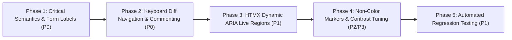

# Cotejo Web Code Review Accessibility (a11y) Plan

| Attribute | Value |
| :--- | :--- |
| **Document Target** | Cotejo Web Code Review Platform (`niebla/internal/web/`, `niebla/assets/`) |
| **Standard** | **WCAG 2.1 Level AA** |
| **Status** | Approved for Implementation |
| **Parent Tracking** | [ROADMAP.md](../ROADMAP.md#3-code-review--cotejo-web-platform) (Section 3) |

---

## 1. Executive Summary & Design Principles

**Cotejo** is the native web code review interface for the Niebla version control system, implemented in pure Go using `templ`, Tailwind CSS, and HTMX. It provides high-throughput Myers diff visualizations, attention set tracking, single-click AI hint applications, and stacked Changelist (CL) reviews.

While Cotejo's lightweight server-side rendering (SSR) architecture provides a solid semantic base (native HTML5 `<dialog>`, standard semantic landmarks, no client-side hydration lag), its current implementation lacks keyboard parity for code reviews, omits essential ARIA attributes, and contains micro-copy contrast deficits.

### Core Implementation Principles
1. **Zero Aesthetic Compromise:** Complying with WCAG 2.1 AA must **not** disrupt Cotejo's sleek, deep-space dark aesthetic (`#090d16` canvas, `#0c1322` panel headers, and vivid blue/indigo accents).
2. **Sub-15ms Rendering Performance:** Keep DOM nodes lean; prefer lightweight CSS and semantic HTML over heavy client-side JavaScript polyfills.
3. **Full Keyboard Parity:** Every code review action feasible with a mouse (diff line inspection, multi-line comment selection, thread resolution, draft replies, and submitting) must be fully executable via keyboard alone.
4. **Transparent Assistive Context:** Dynamic HTMX partial swaps must announce asynchronous outcomes (AI hints, new comments, approval updates) to screen readers via polite ARIA live regions.

---

## 2. Comprehensive WCAG 2.1 AA Audit & Gap Analysis

```
┌─────────────────────────────────────────────────────────────────────────────┐
│                          Cotejo Accessibility Matrix                        │
├───────────────────┬──────────────┬──────────────┬───────────────────────────┤
│ WCAG Criterion    │ Level        │ Current State│ Target Resolution         │
├───────────────────┼──────────────┼──────────────┼───────────────────────────┤
│ 1.1.1 Non-text    │ Level A      │ ⚠️ Non-comp  │ aria-hidden on decorative │
│ 1.3.1 Info & Rel  │ Level A      │ ❌ Failing   │ Linked labels & tab roles │
│ 1.4.1 Use of Color│ Level A      │ ⚠️ Partial   │ Gutter signs & .sr-only   │
│ 1.4.3 Contrast    │ Level AA     │ ⚠️ Partial   │ Bump slate-500 to 400     │
│ 2.1.1 Keyboard    │ Level A      │ ❌ Failing   │ Keyboard line comment key │
│ 2.4.1 Bypass Blks │ Level A      │ ❌ Failing   │ Skip-to-content link      │
│ 2.4.3 Focus Order │ Level A      │ ⚠️ Partial   │ Return focus on dialog cls│
│ 2.4.7 Focus Vis   │ Level AA     │ ⚠️ Partial   │ Ring contrast enhancement │
│ 4.1.2 Name/Role   │ Level A      │ ❌ Failing   │ aria-label on icon btns   │
│ 4.1.3 Status Msg  │ Level AA     │ ❌ Failing   │ aria-live on HTMX targets │
└───────────────────┴──────────────┴──────────────┴───────────────────────────┘
```

### Gap 1: Mouse-Locked Diff Commenting (WCAG 2.1.1 — Level A)
* **Location:** `niebla/internal/web/views/diff_view.templ`
* **Deficit:** Range selection and comment box activation rely exclusively on DOM mouse events (`mousedown`, `mouseenter`, `mouseup`, `shiftKey` click) attached to `.diff-line-num`. Keyboard-only users have no mechanism to focus a line or trigger inline comments.
* **Remediation:**
  * Render diff line number cells as keyboard-focusable interactive targets (`tabindex="0"`, `role="button"`, `aria-label="Line {n}, press Enter to comment"`).
  * Support keyboard shortcuts: pressing `Enter` or `c` on a focused line opens the comment box for that line.
  * Pressing `Shift+Enter` or `Shift+Down` extends the line selection range.

### Gap 2: Missing Form Controls & Accessible Names (WCAG 1.3.1 & 4.1.2 — Level A)
* **Location:** `niebla/internal/web/views/layout.templ`, `comment_box.templ`, `reply_modal.templ`
* **Deficits:**
  1. Jump input (`#cl-jump-input`) uses only `placeholder="jump to id..."` without a `<label>` or `aria-label`.
  2. Comment draft `<textarea>` in `comment_box.templ` lacks an explicit `<label for="...">` or `aria-label`.
  3. Close buttons in dialogs (`reply_modal.templ`, `unresolved-comments-modal`) render a bare character (`✕`) without `aria-label="Close dialog"`.
* **Remediation:** Add explicit `aria-label` attributes to all standalone inputs, textareas, and icon buttons.

### Gap 3: Silent Dynamic Updates & HTMX Swaps (WCAG 4.1.3 — Level AA)
* **Location:** `niebla/internal/web/views/cl_list.templ`, `diff_view.templ`, `comment_box.templ`
* **Deficits:** Dynamic HTMX targets (`#inbox-container`, `#comment-row-...`, `#ai-hint-preview-...`, `#cl-status-badge`) lack `aria-live` regions. When HTMX injects a generated AI hint or posts a comment, screen reader users receive no audio notification.
* **Remediation:**
  * Add `aria-live="polite"` and `role="region"` with `aria-label` to dynamic containers.
  * Inject a shared invisible global live notification region (`#a11y-announcer`) for transient operational feedback (e.g., "AI suggestion applied to patchset").

### Gap 4: Diff Additions & Deletions Solely Using Color (WCAG 1.4.1 — Level A)
* **Location:** `niebla/internal/web/views/diff_view.templ`
* **Deficits:** While deletions feature `line-through`, additions and modifications are distinguished purely through background/text colors (`bg-emerald-950/40 text-emerald-200`).
* **Remediation:**
  * Retain the existing emerald and rose palette intact.
  * Add standard gutter prefix indicators (`+` for additions, `-` for deletions, ` ` for unchanged).
  * Insert `<span class="sr-only">Added: </span>` / `<span class="sr-only">Deleted: </span>` within code lines for screen readers.

### Gap 5: Non-Semantic Inbox Navigation Tabs (WCAG 1.3.1 & 4.1.2 — Level A)
* **Location:** `niebla/internal/web/views/cl_list.templ`
* **Deficits:** Navigation tabs (`My Reviews`, `Outgoing`, `Agents`, `Submitted`, `All`) are bare `<a>` links inside a `<div>`, omitting standard tablist semantics.
* **Remediation:** Add `role="tablist"` to the parent container, `role="tab"` to each tab anchor, and `aria-selected="true/false"`.

### Gap 6: Sub-4.5:1 Contrast Ratios in Muted Micro-Copy (WCAG 1.4.3 — Level AA)
* **Location:** `niebla/internal/web/views/layout.templ`, `cl_list.templ`, `cl_detail.templ`
* **Deficits:** Muted metadata tokens (`text-slate-500` #64748b and `text-slate-600` #475569) against `#090d16` background yield contrast ratios of 3.8:1 and 2.4:1, failing the 4.5:1 AA standard for regular text.
* **Remediation:**
  * Keep the dark background `#090d16` and accent colors unchanged.
  * Step secondary and tertiary text tokens up within the same Tailwind Slate family: replace `text-slate-500` / `text-slate-600` with `text-slate-400` (`#94a3b8`, yielding **5.8:1** contrast).

---

## 3. Phased Implementation Roadmap



### Phase 1: Critical Semantics, Form Labels & Skip Link (P0)
1. **Skip Navigation Link:**
   * Insert at the very top of `Layout` in `layout.templ`:
     ```html
     <a href="#main-content" class="sr-only focus:not-sr-only focus:absolute focus:top-2 focus:left-2 focus:z-50 focus:px-4 focus:py-2 focus:bg-sky-600 focus:text-white focus:rounded-md focus:shadow-xl focus:outline-none focus:ring-2 focus:ring-white">
         Skip to main content
     </a>
     ```
   * Add `id="main-content"` to `<main>` in `layout.templ`.
2. **Accessible Form Names:**
   * In `layout.templ`, add `aria-label="Jump to Changelist ID"` to `#cl-jump-input`.
   * In `comment_box.templ`, add `aria-label="Write an inline comment draft"` to `#comment-body-...`.
   * In `reply_modal.templ`, add `aria-label="Close reply dialog"` to the `✕` close button.
   * In `unresolved-comments-modal` and `override-approvals-modal`, add `aria-label="Close dialog"` to dismiss buttons.
3. **Decorative Element Hiding:**
   * Add `aria-hidden="true"` to emojis in `cl_list.templ` empty states (`🎉`, `📝`, `🤖`, `📭`).
   * Add `aria-hidden="true"` to unicode stack arrows (`──►`) in `cl_detail.templ`.

### Phase 2: Keyboard-Driven Diff Navigation & Commenting (P0)
1. **Focusable Line Numbers:**
   * Update `.diff-line-num` in `diff_view.templ`:
     ```html
     <td
         class="diff-line-num select-none cursor-pointer focus:outline-none focus:ring-1 focus:ring-sky-400 focus:bg-sky-950/40"
         tabindex="0"
         role="button"
         aria-label={ fmt.Sprintf("Line %d, press Enter to comment", lineNum) }
         data-line={ strconv.Itoa(lineNum) }
         data-file={ filePath }
         data-cl={ strconv.FormatInt(clID, 10) }
         data-patchset={ strconv.Itoa(patchsetNum) }
     >
     ```
2. **Keyboard Event Listeners:**
   * Add `keydown` event listeners to `.diff-line-num`:
     * `Enter` or `Space` or `c`: Opens inline comment box for the focused line.
     * `Shift + Enter`: Extends range selection from previous anchor line to current line and opens range comment box.
     * `Escape`: Clears active selection.

### Phase 3: Dynamic HTMX Live Announcements & Tablist Semantics (P1)
1. **HTMX Target ARIA Live Attributes:**
   * Add `aria-live="polite"` and `role="region"` to `#inbox-container` in `cl_list.templ`.
   * Add `aria-live="polite"` to `#ai-hint-preview-...` in `comment_box.templ`.
   * Add `aria-live="polite"` to `#cl-status-badge` in `cl_detail.templ`.
2. **Global Announcer Component:**
   * Embed in `layout.templ`:
     ```html
     <div id="a11y-announcer" class="sr-only" role="status" aria-live="polite" aria-atomic="true"></div>
     ```
   * Configure HTMX `htmx:afterSwap` event to populate `#a11y-announcer` with contextual notifications (e.g., "Comment saved", "AI hint generated").
3. **Inbox Tablist Semantics:**
   * In `cl_list.templ`, wrap tab navigation in `role="tablist"` with `aria-label="Changelist inbox categories"`.
   * Mark active tab with `role="tab"` and `aria-selected="true"`.
   * Mark inactive tabs with `role="tab"` and `aria-selected="false"`.

### Phase 4: Non-Color Markers & Slate Contrast Tuning (P2 & P3)
1. **Diff Non-Color Gutter Markers:**
   * Modify `diff_view.templ` to prepend visual prefix indicators inside the diff code margin:
     * Added line: `<span class="diff-sign text-emerald-400 select-none mr-1.5 font-bold">+</span>`
     * Deleted line: `<span class="diff-sign text-rose-400 select-none mr-1.5 font-bold">-</span>`
     * Equal line: `<span class="diff-sign text-slate-600 select-none mr-1.5 opacity-0"> </span>`
   * Add `<span class="sr-only">Added: </span>` and `<span class="sr-only">Deleted: </span>` for screen readers.
2. **Tailwind Contrast Tuning:**
   * Replace `text-slate-500` and `text-slate-600` on regular text elements across `layout.templ`, `cl_list.templ`, and `cl_detail.templ` with `text-slate-400` (`#94a3b8`), lifting contrast from 3.8:1 to **5.8:1**.
   * Enhance interactive element focus ring contrast from `focus:ring-sky-500` to `focus:ring-sky-400` with 2px offset.

### Phase 5: Automated Verification & Regression Testing
1. **Automated Axe-Core Test Integration:**
   * Integrate an automated accessibility scanner into the release candidate test suite (`test/rc/cotejo_lifecycle_test.go`).
   * Add an automated check run verifying 0 critical/serious WCAG 2.1 AA violations on all rendered routes (`/`, `/cl/{id}`, `/cl/{id}/file`, `/cl/{id}/comment-box`).
2. **Keyboard Navigation End-to-End Suite:**
   * Add Playwright or headless Chromium tests asserting:
     * Tabbing to `#cl-jump-input` and jumping to a CL.
     * Navigating diff table rows with keyboard, triggering `Enter`, and focusing comment `<textarea>`.
     * Opening and dismissing `<dialog>` modals with `Escape` and verifying focus restoration.

---

## 4. Verification & Acceptance Criteria

| Checkpoint | Verification Method | Pass Criteria |
| :--- | :--- | :--- |
| **Keyboard Commenting** | Manual & End-to-End Test | User can select any line range and submit an inline comment without touching a mouse. |
| **Screen Reader Announcement** | NVDA / Orca / VoiceOver | Screen reader clearly announces "Added line", "Deleted line", and speaks AI hint results when generated. |
| **Form Controls** | Axe-core / Lighthouse a11y | 100% of `<input>`, `<textarea>`, and `<button>` elements have valid programmatic accessible names. |
| **Color Contrast** | Color Contrast Analyzer (CCA) | 100% of body text against dark backgrounds achieves $\ge 4.5:1$ contrast ratio. |
| **Zero Visual Regression** | Visual Diffing Snapshot | Background colors, accent highlights, and visual hierarchy remain identical to v0.2.0. |
