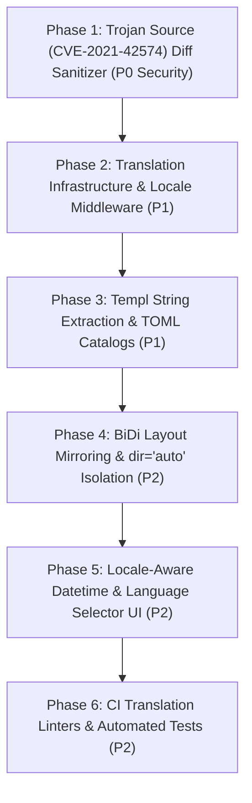

# Cotejo Internationalization (i18n), Localization (l10n) & BiDi Security Plan

| Attribute | Value |
| :--- | :--- |
| **Document Target** | Cotejo Web Code Review Platform (`niebla/internal/web/`, `niebla/assets/`, `niebla/cmd/cotejo/`) |
| **Standard** | **Unicode Standard Annex #9**, **CVE-2021-42574 (Trojan Source Defense)**, **BCP 47**, **CLDR Plural Rules** |
| **Status** | Approved for Implementation |
| **Parent Tracking** | [ROADMAP.md](../ROADMAP.md#3-code-review--cotejo-web-platform) (Section 3) |

---

## 1. Executive Summary & Core Objectives

As **Niebla** expands to distributed engineering organizations, multi-national development teams, and global open-source contributors, **Cotejo** must deliver a first-class internationalized code review experience without compromising its high-throughput Go `templ` server-side rendering (SSR) architecture or sub-15ms latency guarantees.

Furthermore, internationalization in a code review platform introduces a critical security dimension: **adversarial bidirectional (BiDi) source code manipulation**. Known as **Trojan Source (CVE-2021-42574)**, hidden BiDi Unicode override characters can trick reviewers into seeing code that executes completely differently at runtime.

### Strategic Objectives
1. **Embedded Zero-Overhead Translation Catalogs:** Bundle compiled translation catalogs directly into binary distribution via Go `//go:embed`, maintaining Cotejo's single-binary deployment footprint.
2. **Transparent Locale Negotiation:** Automatically infer user language preferences from HTTP `Accept-Language` headers, session cookies, and workstation configuration (`~/.config/niebla/config.toml`), with an interactive header language picker.
3. **CLDR-Compliant Pluralization & Locale Formatting:** Replace hardcoded US-English format strings with CLDR-aware pluralization rules and localized timestamp formatting.
4. **Bidirectional (BiDi / RTL) Layout Mirroring:** Provide native right-to-left UI mirroring for Arabic, Hebrew, and Persian users via CSS logical properties and isolated `dir="auto"` containers for user-generated text.
5. **Trojan Source (CVE-2021-42574) Visual Defense:** Intercept, sanitize, and visually flag all bidirectional control characters within the Myers diff engine before code reaches the reviewer's browser.

---

## 2. Architecture Overview

```
                      ┌──────────────────────────────────────┐
                      │          HTTP Review Request         │
                      │   Accept-Language / Cookie / Config  │
                      └──────────────────┬───────────────────┘
                                         │
                                         ▼
                      ┌──────────────────────────────────────┐
                      │        LocaleResolver Middleware     │
                      │  Resolves BCP-47 Tag (e.g., 'es-ES') │
                      │  Injects Localizer into Context      │
                      └──────────────────┬───────────────────┘
                                         │
                 ┌───────────────────────┴───────────────────────┐
                 ▼                                               ▼
      ┌─────────────────────┐                         ┌─────────────────────┐
      │  Go Templ Views     │                         │  Myers Diff Engine  │
      │  T(ctx, "key")      │                         │  Trojan Source Scan │
      │  Pluralization      │                         │  BiDi Highlighting  │
      │  dir="auto" Blocks  │                         │  Raw Safe Render    │
      └──────────┬──────────┘                         └──────────┬──────────┘
                 │                                               │
                 └───────────────────────┬───────────────────────┘
                                         ▼
                      ┌──────────────────────────────────────┐
                      │    Rendered Localized HTML Stream    │
                      │   <html lang="es" dir="ltr">         │
                      └──────────────────────────────────────┘
```

---

## 3. Comprehensive Gap Analysis & Detailed Specifications

### Gap 1: Hardcoded English String Literals
* **Location:** `niebla/internal/web/views/*.templ`
* **Current State:** Over 200 user-facing strings are hardcoded English literals (e.g., *"Cotejo Review Inbox"*, *"Your review queue is clear!"*, *"Reply to CL"*, *"Rebase Required"*).
* **Specification:**
  * Adopt `github.com/nicksnyder/go-i18n/v2` with TOML translation catalogs stored in `niebla/assets/locales/`:
    * `en.toml` (Base / Source of Truth)
    * `es.toml` (Spanish)
    * `ja.toml` (Japanese)
    * `de.toml` (German)
    * `zh-Hans.toml` (Simplified Chinese)
    * `ar.toml` (Arabic — RTL testbed)
  * Embed catalogs directly into `niebla/assets/assets.go`:
    ```go
    //go:embed static/* locales/*.toml
    var EmbeddedFS embed.FS
    ```
  * Provide a type-safe context translation helper:
    ```go
    func T(ctx context.Context, messageID string, args ...any) string
    ```
  * Example in `cl_list.templ`:
    ```html
    <h1 class="text-2xl font-bold text-white tracking-tight">
        { views.T(ctx, "inbox.title") }
    </h1>
    ```

### Gap 2: Pluralization Deficits (CLDR Compliance)
* **Location:** `comment_box.templ`, `cl_detail.templ`
* **Current State:** English-only plural concatenations like `fmt.Sprintf("%d pending", draftCount)` fail in languages with complex plural categories (e.g., Arabic has zero, one, two, few, many, other).
* **Specification:**
  * Define structured TOML message bundles supporting CLDR plural rules:
    ```toml
    # niebla/assets/locales/en.toml
    [comments.pending_drafts]
    one = "1 pending draft"
    other = "{{.Count}} pending drafts"

    # niebla/assets/locales/ar.toml
    [comments.pending_drafts]
    zero = "لا مسودات معلقة"
    one = "مسودة واحدة معلقة"
    two = "مسودتان معلقتان"
    few = "{{.Count}} مسودات معلقة"
    many = "{{.Count}} مسودة معلقة"
    other = "{{.Count}} مسودة معلقة"
    ```

### Gap 3: Bidirectional (BiDi / RTL) Layout & User Content
* **Location:** `niebla/internal/web/views/layout.templ`, `cl_detail.templ`
* **Current State:**
  * Static `<html lang="en">` with no `dir` attribute.
  * Hardcoded physical CSS classes (`left-2.5`, `pl-9`, `pr-3`, `border-l-2`, `mr-1.5`) breaking horizontal layouts when flipped to RTL.
  * Freeform user comments and commit descriptions in Arabic/Hebrew get left-aligned, causing reversed punctuation and broken inline code blocks.
* **Specification:**
  1. **Dynamic HTML Shell:**
     ```html
     <html lang={ GetLocale(ctx) } dir={ GetDirection(ctx) } class="dark h-full ...">
     ```
  2. **Logical Tailwind Properties Migration:**
     * `pl-9` $\rightarrow$ `ps-9` (padding-inline-start)
     * `pr-3` $\rightarrow$ `pe-3` (padding-inline-end)
     * `left-2.5` $\rightarrow$ `start-2.5`
     * `border-l-2` $\rightarrow$ `border-s-2`
     * `mr-1.5` $\rightarrow$ `me-1.5`
  3. **Content Isolation with `dir="auto"`:**
     Wrap user-generated changelist descriptions, commit titles, and inline comment bodies in `<div dir="auto">`:
     ```html
     <div dir="auto" class="text-sm text-slate-300 font-sans max-w-3xl whitespace-pre-wrap leading-relaxed">
         { data.CL.Description }
     </div>
     ```

### Gap 4: Trojan Source (CVE-2021-42574) Security Vulnerability
* **Location:** `niebla/internal/web/diff/engine.go`
* **Current Threat:**
  Attackers can insert invisible Unicode bidirectional formatting characters into source code:
  * `U+202A` (Left-to-Right Embedding — LRE)
  * `U+202B` (Right-to-Left Embedding — RLE)
  * `U+202D` (Left-to-Right Override — LRO)
  * `U+202E` (Right-to-Left Override — RLO)
  * `U+202C` (Pop Directional Formatting — PDF)
  * `U+2066`–`U+2069` (Directional Isolates — LRI, RLI, FSI, PDI)
  These characters allow malicious code logic to appear as harmless comments or strings to a human reviewer in Cotejo while executing as malicious syntax in compilers.
* **Specification:**
  1. **Diff Sanitization Engine:**
     In `internal/web/diff/engine.go`, inspect all tokens before generating HTML rows.
  2. **Visual Warning Callout:**
     When a BiDi control character is detected:
     * Escape the character so it cannot execute visual direction changes in the browser DOM.
     * Render a prominent visual security badge:
       ```html
       <span class="inline-flex items-center px-1.5 py-0.5 rounded text-[10px] font-mono bg-rose-950 text-rose-300 border border-rose-600 font-bold" title="Dangerous BiDi Control Character: U+202E (RLO)">
           ⚠️ [BIDI: U+202E]
       </span>
       ```
     * Display a security banner on the file diff page: *"Warning: Trojan Source (CVE-2021-42574) bidirectional characters detected in this file."*

### Gap 5: Locale-Aware Timestamps & Number Formats
* **Location:** `niebla/internal/web/views/layout.templ`, `cl_list.templ`
* **Current State:** Timestamps use hardcoded format strings (`cl.CommittedAt.Format("Jan 02, 15:04")`).
* **Specification:**
  * Deliver standard ISO 8601 timestamps in machine-readable attributes:
    ```html
    <time datetime={ cl.CommittedAt.Format(time.RFC3339) } class="localized-time">
        { FormatLocalizedTime(ctx, cl.CommittedAt) }
    </time>
    ```
  * Client-side enhancement (zero dependencies): Add a 15-line vanilla JS helper in `Layout` using `Intl.DateTimeFormat`:
    ```javascript
    document.querySelectorAll('.localized-time').forEach(el => {
        const d = new Date(el.getAttribute('datetime'));
        if (!isNaN(d)) {
            el.textContent = new Intl.DateTimeFormat(navigator.language, {
                month: 'short', day: '2-digit', hour: '2-digit', minute: '2-digit'
            }).format(d);
        }
    });
    ```

---

## 4. Phased Implementation Roadmap



### Phase 1: Trojan Source (CVE-2021-42574) Diff Sanitizer (P0 Security)
1. Add `bidi.go` to `niebla/internal/web/diff/` implementing character detection for `U+202A`–`U+202E` and `U+2066`–`U+2069`.
2. Intercept diff line tokenization to escape raw BiDi overrides into visual badge tokens.
3. Write unit tests in `niebla/internal/web/diff/bidi_test.go` asserting malicious payloads trigger visual security badges.

### Phase 2: Translation Infrastructure & Locale Middleware (P1)
1. Add `niebla/internal/web/i18n/` package wrapping `go-i18n/v2`.
2. Implement `LocaleResolver` HTTP middleware in `niebla/internal/web/handlers/`:
   * Step 1: Check `?lang=` query parameter (allows live switching).
   * Step 2: Check `cotejo_locale` cookie.
   * Step 3: Parse `Accept-Language` header via `golang.org/x/text/language`.
   * Step 4: Fallback to `en-US`.
3. Bind embedded TOML locale files from `niebla/assets/locales/`.

### Phase 3: Templ String Extraction & TOML Catalogs (P1)
1. Author base catalog `niebla/assets/locales/en.toml` organizing keys by domain:
   * `[nav]`, `[inbox]`, `[cl_detail]`, `[comments]`, `[verdicts]`, `[ci]`.
2. Replace hardcoded strings in all `.templ` templates with `views.T(ctx, "key")`.
3. Provide initial verified translations for Spanish (`es.toml`) and Japanese (`ja.toml`).

### Phase 4: BiDi Layout Mirroring & `dir="auto"` Isolation (P2)
1. Add `GetDirection(ctx)` helper returning `"rtl"` for Arabic, Hebrew, and Persian locales, `"ltr"` otherwise.
2. Update `Layout` to output `<html lang={ GetLocale(ctx) } dir={ GetDirection(ctx) }>`.
3. Migrate layout CSS from physical properties (`pl-`, `pr-`, `left-`) to Tailwind logical properties (`ps-`, `pe-`, `start-`).
4. Wrap all dynamic markdown and comment rendering slots in `<div dir="auto">`.

### Phase 5: Locale-Aware Datetime & Language Selector UI (P2)
1. Add a subtle language selector dropdown in the Cotejo top navbar (`layout.templ`) with one-click cookie switching.
2. Render ISO 8601 `<time datetime="...">` tags with progressive enhancement via client-side `Intl.DateTimeFormat`.

### Phase 6: CI Translation Linters & Automated Tests (P2)
1. Add a catalog completeness check in `internal/web/i18n/i18n_test.go`:
   * Asserts every key in `en.toml` exists in all secondary catalogs (`es.toml`, `ja.toml`, etc.).
   * Asserts no untranslated fallback keys remain in production builds.
2. Add end-to-end multi-locale verification in `test/rc/cotejo_lifecycle_test.go` verifying localized routes return 200 with proper `Content-Language` headers.

---

## 5. Verification & Acceptance Criteria

| Checkpoint | Verification Method | Pass Criteria |
| :--- | :--- | :--- |
| **Trojan Source Defense** | Automated Diff Unit Test | Source files with `U+202E` characters display visible `[BIDI: U+202E]` badges and security alerts; zero arbitrary DOM visual reordering. |
| **Locale Resolution** | HTTP Integration Test | Requests with `Accept-Language: es` render Spanish UI strings and `<html lang="es" dir="ltr">`. |
| **RTL Rendering** | Visual Regression / Headless Test | Arabic locale (`ar`) flips navbar, diff actions, and margins properly with zero visual clipping. |
| **Missing Key Guard** | CI Linter (`go test ./...`) | 100% key parity between `en.toml` and localized catalogs; missing keys fail the build immediately. |
| **Performance Overhead** | Benchmark Test | Middleware lookup and string translation add $< 0.1\text{ms}$ per request; zero memory allocation per cached lookup. |
